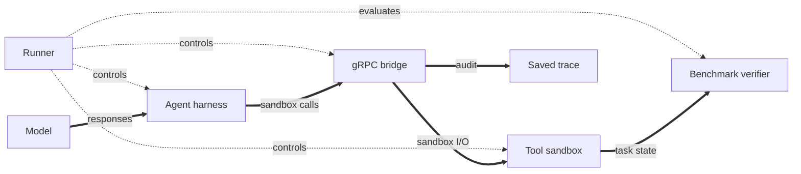
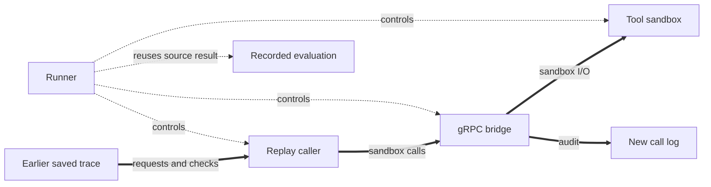

# Sandbox-call replay design

## 1. Overview

Sandbox-call replay repeats recorded sandbox calls from one occurrence or a complete run without starting an agent harness or calling an agent model. A live run with `--record-for-replay` produces a [replay trace](#2-scope-and-language) through the existing gRPC tool bridge. The [capture contract](#4-capture-contract) records response checks and session timing in the [current audit](#3-current-evidence-and-gaps). A [trace sanity check](#5-replayer-components) validates the complete source before sandbox creation. The [scheduler and caller](#5-replayer-components) then send its requests through a new bridge session. The [Runner lifecycle](#6-lifecycle-and-results) still prepares the sandbox and confirms caller stop and bridge revocation. [Checks and limits](#7-checks-and-limits) define what a result means. The [first replay version reuses the source evaluation](#8-reused-evaluation-in-the-first-version); [profile integration](#9-profile-integration) selects one source occurrence or every recorded occurrence in a run. [Open questions and deferred features](#10-open-questions-and-deferred-features) remain separate from the implemented first version.

**Recording run: harness and model active.**



**Replay run: the saved trace replaces the harness and model.**



Both runs use the same sandbox and isolation order. The replay caller replaces the harness and its model input. `Runner` implements a replay path without an agent harness (`pkg/runner/runner.go:97-120,369-514`). The [replay caller](#5-replayer-components) includes the parser, scheduler, and gRPC caller. The [first-version evaluation rule](#8-reused-evaluation-in-the-first-version) carries the source result without a verifier rerun.

The first version uses the gRPC transport. The trace parser and timing logic do not depend on a Hermes tool or a model response. The caller maps requests to gRPC. SSH replay is [deferred](#10-open-questions-and-deferred-features).

## 2. Scope and language

A **sandbox call** is one bridge operation. One model-level **tool call** can cause several sandbox calls. This design replays sandbox calls. It does not replay model decisions or task arrivals ([bridge terms](bridge.md#terms), `docs/design/bridge.md:23-32`; `pkg/config/arrivals.go:19-34`).

| Term | Meaning | Avoid |
| --- | --- | --- |
| **Logical task** | A benchmark case selected by its catalog ID, before a run assigns an execution ID. | Task occurrence |
| **Task occurrence** | One execution of a logical task, with its own run-local ID, sandbox, and call log. | Logical task |
| **Sandbox-call replay** | A task execution that repeats recorded sandbox calls without an agent harness or agent model. | Task-arrival replay |
| **Replay trace** | The recorded requests, expected responses, and timing of sandbox calls from one task occurrence. | Arrival trace |
| **Replay-ready trace** | A replay trace with complete request inputs, response checks, and timing. | Complete log |
| **Replay mismatch** | A strict difference in a sandbox-call response, such as response length, gRPC status, `Exec` exit code, or successful `WriteFile` byte count. | Response hash drift |
| **Response hash drift** | A changed response SHA-256 with no strict difference. It is diagnostic and nonfatal by default. | Response match |
| **Reused evaluation** | The source occurrence's recorded evaluation result, carried into replay without a verifier rerun. | New sandbox grade |

A logical task differs from its per-run task occurrence (`internal/app/execution.go:32-43,84-112`).

One replay trace belongs to one task occurrence. Replay selects the same benchmark and logical task, compares the recorded image reference and pinned benchmark revisions with the new run, and runs the benchmark's normal sandbox preparation. It does not prove that the prepared sandboxes have identical state. The image reference is a tag, which can name different bytes later (`internal/app/execution.go:32-43,84-112`; `internal/app/run.go:426-490`; `pkg/runner/runner.go:430-458`; `pkg/containerimage/image.go:20-38`). Replay may change the sandbox runtime from Docker to Kubernetes. Replay uses the earliest recorded `started_at` across the selected workload as its source timing origin. It preserves call-start offsets on that common timeline, not the delay before the earliest call. For multiple occurrences, the first call-bearing caller that completes readiness starts one UTC replay clock. Later callers reuse that clock. A single selected occurrence keeps its caller-local start after readiness. Each occurrence starts calls only after its sandbox, bridge, and caller are ready. Late readiness can delay calls but cannot reset the common timeline. Preserve the final post-call wait when the trace has calls. The gaps include opaque harness and model work; replay does not reproduce that work or inspect model responses. Network delay can move the bridge's actual start time. The first replay version reuses the source evaluation instead of running the benchmark verifier on the new sandbox (`pkg/runner/interfaces.go:17-37`; `pkg/runner/runner.go:430-441,480-514`; `pkg/bridge/grpc/files.go:358-365`).

Toolathlon is [deferred](#10-open-questions-and-deferred-features). Its setup requires an MCP-capable harness and prepares task-specific gateway services; the gRPC sandbox-call trace does not cover those MCP interactions (`internal/app/wiring/benchmark/toolathlon.go:21-36`; `pkg/benchmark/toolathlon/sandbox.go:66-175`).

A strict gRPC result difference is a **replay mismatch**. Stop new calls on the first strict mismatch. Report a caller execution failure. A changed response SHA-256 alone is diagnostic and does not stop scheduling. Keep canonical response byte count and gRPC status strict for all calls, and check `Exec` exit code and successful `WriteFile` byte count explicitly. Do not change the expected response to make the trace pass. Calls already in flight must finish or be stopped before bridge revocation. Confirm caller stop and bridge revocation before treating replay as complete (`pkg/bridge/grpc/caller.go:70-112`; `pkg/runner/runner.go:480-514`). The [reused evaluation](#8-reused-evaluation-in-the-first-version) cannot turn a strict replay mismatch into success. Audit IDs and clocks are not response data. Report changed script output or file responses as response hash drift only if no strict check fails.

**Sources:** `docs/design/bridge.md`, `pkg/config/arrivals.go`, `pkg/runner/interfaces.go`, `pkg/runner/runner.go`, `internal/app/execution.go`, `internal/app/run.go`, `pkg/containerimage/image.go`, `internal/app/wiring/benchmark/toolathlon.go`, `pkg/benchmark/toolathlon/sandbox.go`.

## 3. Current evidence and gaps

The bridge writes one JSONL line per sandbox call after that call finishes. The line has `started_at`, rounded `duration_ms`, completion-time `timestamp`, and a sequence assigned when the writer enqueues it. Thus file order is not start order. `started_at` is an `RFC3339Nano` bridge-clock timestamp. With recording enabled, a separate confirmed-harness-completion marker is stored in `bridge/runtime.json` after Runner confirms harness stop (`pkg/bridge/internal/bridgekit/audit.go:27-59,130-165`; `pkg/runner/runner.go:316-334`; `pkg/bridge/session.go:109-130`).

```go
	sequence := writer.sequence + 1
	timestamp := FormatTime(writer.now())
	structured.Stamp(sequence, timestamp)
```

This code runs when the record is enqueued, not when the sandbox call starts (`pkg/bridge/internal/bridgekit/audit.go:130-143`). Sort by `started_at` for the replay schedule. Do not add an ordering or per-call offset field until a real trace needs one. Accept equal `started_at` values without an order guarantee. Calls with equal starts can launch in any order and overlap. Never use `sequence`, file order, or completion order to choose their start times. `FormatTime` discards Go's monotonic clock value, so wall-clock changes can distort offsets even when the start order is clear (`pkg/bridge/internal/bridgekit/audit.go:57-60`). The first version assumes a stable bridge wall clock. It cannot detect every clock jump between calls; strict timing across such jumps needs recorded monotonic offsets.

| gRPC call | Request input in recording audit | Response checks in recording audit |
| --- | --- | --- |
| `Exec` | Script, shell arguments, workdir, and printable UTF-8 stdin up to 16 MiB. | Canonical response digest and length, gRPC code, exit code, and bounded returned stdout/stderr when recording. Produced-byte counts can differ from returned bytes. (`pkg/bridge/grpc/bridge.go:397-447`; `pkg/bridge/grpc/audit.go:21-39,85-109`) |
| `Stat` | Path. | Canonical response digest and length include existence, type, size, and mode; gRPC code is explicit. (`pkg/bridge/grpc/files.go:205-224`; `pkg/bridge/grpc/audit.go:73-83`) |
| `ReadFile` | Path and optional `max_bytes`; zero or omission reads the whole file. | Canonical response digest and length include header and streamed content or failure status. (`pkg/bridge/grpc/files.go:227-269,420-449`; `pkg/bridge/grpc/audit.go:41-83`) |
| `ReadLines` | Path, positive first line and line count, and optional byte clamp. | Canonical response digest and length include summary and streamed content or failure status. (`pkg/bridge/grpc/files.go:272-332,420-449`; `pkg/bridge/grpc/audit.go:41-83`) |
| `WriteFile` | Path, consumed byte count, digest, and body when printable UTF-8 at most 16 MiB. A successful call consumed the declared size; a failed call can omit it. | Canonical response digest and length include `created` and written byte count or failure status; gRPC code is explicit. (`pkg/bridge/grpc/files.go:358-381,420-449`; `pkg/bridge/grpc/audit.go:73-83`) |

Successful `ReadLines` calls have positive window fields, so these fields distinguish them from `ReadFile`. Early refusals can lack distinguishing fields or original request data. The parser rejects the whole trace if any call has `status: "rejected"`; it does not need an RPC-method field for the first version (`pkg/bridge/grpc/files.go:59-82,227-235,272-281`; `pkg/bridge/grpc/replay.go:234-246`). An admitted call that fails after sandbox dispatch is not an early refusal.

```go
	if int64(len(content)) < count {
		return sizeOmitted(count), "size-omitted"
	}
	if bridgekit.SafeStructuredText(content) {
		return string(content), "utf-8"
	}
```

The input rule above omits binary or control-bearing stdin and file-write bodies from JSONL. The optional raw log can retain those bytes through 16 MiB, but it is off by default. A write larger than 16 MiB can succeed without retaining its body in either log. `Exec` refuses stdin above 16 MiB before execution (`pkg/bridge/grpc/audit.go:164-184`; `pkg/bridge/grpc/files.go:151-168,437-443`; `pkg/bridge/grpc/bridge.go:386-390`; `pkg/config/config.go:445-456`). The combined audit files also have a 256 MiB limit; an audit failure latches and stops later calls (`pkg/bridge/internal/bridgekit/audit.go:22-25,130-165,249-258`). Historical recordings from before the capture extension lack response fingerprints and the completion marker; they are not strict replay sources. Live runs with `--record-for-replay` capture these fields and can be replay-ready (`pkg/bridge/grpc/audit.go:21-39`; `pkg/bridge/session.go:283-320`).

**Sources:** `pkg/bridge/internal/bridgekit/audit.go`, `pkg/bridge/grpc/audit.go`, `pkg/bridge/grpc/bridge.go`, `pkg/bridge/grpc/files.go`, `pkg/bridge/grpc/replay.go`, `pkg/bridge/grpc/v1/sandbox.proto`, `pkg/bridge/session.go`, `pkg/runner/runner.go`, `pkg/config/config.go`.

## 4. Capture contract

Live gRPC runs with `--record-for-replay` extend the tool-call record while keeping its request fields and one-line-per-sandbox-call form (`pkg/bridge/grpc/audit.go:21-39`; `docs/design/bridge.md:185-200`). The response fields are:

| Field | Meaning |
| --- | --- |
| `response_sha256` | Digest of the complete **logical gRPC outcome**. It includes the method, deterministic response messages, final gRPC code, and error message. The private audit also retains bounded `Exec` output. |
| `response_bytes` | Byte length of the canonical outcome used for `response_sha256`, not the sandbox's total produced output. |
| `grpc_code` | Exact gRPC status code; an `Exec` nonzero exit with an OK RPC remains an OK RPC. |
| `replay_error` | A stable reason that required request data or bounded output is missing. Examples include omitted stdin, an omitted write body, or `response-debug-too-large`. |

The recorder and caller use one versioned, deterministic outcome encoding. It length-prefixes the method and each deterministic protobuf response message. Stream bodies use fixed chunks, not the target's read sizes. The final fields hold the RPC status and message. The digest covers the response assembled and sent by the bridge, not output cut by a cap. It cannot prove that the client received each byte (`pkg/bridge/grpc/audit.go:41-83`; `pkg/bridge/grpc/caller.go:122-220`; `pkg/bridge/grpc/files.go:375-381`).

Live audits retain printable request text in `tool-calls.jsonl`. The recorder marks omitted stdin and write content with `replay_error` (`pkg/bridge/grpc/bridge.go:423-447`; `pkg/bridge/grpc/files.go:420-449`). Before replay starts its task sandbox or sends any call, `LoadReplaySource` reads every record and validates the complete source. It rejects a rejected or canceled call, a missing input or outcome, and each failed `WriteFile`. An admitted non-write call that fails after sandbox dispatch can remain replayable when its inputs and outcome are complete. If call 11 omits a `WriteFile` body, replay reports the trace as not replayable. It does not send calls 1–10 (`pkg/bridge/grpc/replay.go:44-193,234-320`). The private audit retains bounded `Exec` output text or lossless base64 when recording, without a separate debug flag. A single `Exec` record beyond the 128 MiB line bound keeps a bounded `replay_error` marker. After confirmed harness stop and bridge revocation, Runner fails that recording task and skips evaluation (`pkg/bridge/grpc/audit.go:85-109`; `pkg/runner/runner.go:316-353`; `pkg/replay/responses.go:19-70`). If the combined 256 MiB audit limit latches a failure, bridge revocation and collection are unconfirmed; Runner blocks evaluation and reports the actual cleanup result (`pkg/bridge/internal/bridgekit/audit.go:130-165,249-258`; `pkg/bridge/session.go:220-320`; `pkg/runner/runner.go:329-345`). Captured output and `aries.log` can contain task-supplied text. Keep both private, and never deliberately log known credentials. A private payload format for omitted inputs is [deferred](#10-open-questions-and-deferred-features).

When recording, the control plane records a confirmed harness-completion marker with the same bridge host clock as call `timestamp`. Runner sends `CompleteHarness` after positive harness stop and before bridge release; the control server stamps its receipt (`pkg/runner/runner.go:316-334`; `pkg/bridge/session.go:109-130`; `pkg/bridge/control/server.go:160-174`). Release alone would include unrelated cleanup delay. The signal can arrive after the actual stop, so it is not an exact harness-stop time. A missing marker prevents replay readiness but does not skip release. For recording runs, per-task `bridge/runtime.json` stores schema version, `run_id`, `harness_completed_at`, benchmark type, logical task ID, image reference, pinned revisions, and runtime IDs (`pkg/bridge/session.go:30-43,80-107,283-320`). It does not contain a prepared sandbox snapshot, image digest, or credentials.

With capture enabled, after bridge release and collection, `Session.Stop` stores `tool_calls_bytes` and `tool_calls_sha256` in `runtime.json`. `LoadReplaySource` checks both before parsing the source, so a complete-line truncation cannot look like a valid shorter call sequence (`pkg/bridge/session.go:254-320`; `pkg/bridge/grpc/replay.go:78-111`). A failed finalization or collection does not mark a source replay-ready. Audit output remains private (`pkg/bridge/session.go:283-320`; `pkg/bridge/grpc/replay.go:195-222`).

The loader requires recording metadata `run_id` to match the parent result, including when the call log is empty. Earlier nonempty sources without this field remain valid only if every call proves the parent run binding. Earlier empty sources without this binding are rejected before sandbox creation.

**Sources:** `pkg/bridge/internal/bridgekit/audit.go`, `pkg/bridge/grpc/audit.go`, `pkg/bridge/grpc/bridge.go`, `pkg/bridge/grpc/files.go`, `pkg/bridge/grpc/replay.go`, `pkg/bridge/grpc/caller.go`, `pkg/bridge/grpc/v1/sandbox.proto`, `pkg/runner/runner.go`, `pkg/replay/responses.go`, `pkg/bridge/session.go`, `pkg/bridge/control/server.go`, `docs/design/bridge.md`.

## 5. Replayer components

**Trace sanity check (parser).** Before task sandbox creation, `LoadReplaySource` reads the complete versioned gRPC trace and per-task `bridge/runtime.json` for one task. It checks the saved log length and SHA-256 digest before parsing calls. It rejects early refusals, canceled calls, missing inputs, `replay_error`, missing response checks, missing completion marker, and incomplete audit. It computes call-start offsets from the earliest `started_at` and the final wait from the latest completion-time `timestamp` to the completion marker. It rejects a negative final wait before sandbox start. An empty trace has no call offsets or final wait. File `sequence` reflects completion order, not start order; it serves as source record identity. The loader matches the source benchmark type, logical task ID, image reference, pinned revisions, and one source evaluation in the parent `run-result.json`. Only after the full check succeeds does Runner create and prepare the sandbox. These checks do not prove identical prepared state. Historical pre-extension runs are not silently upgraded. A new live run must first capture a [replay-ready trace](#4-capture-contract) (`pkg/bridge/grpc/replay.go:44-193,234-320`; `pkg/runner/runner.go:430-458`). The parser produces a transport-neutral sandbox-call plan with request, expected outcome, and start offset.

Before task sandbox creation, whole-run preflight reports equal starts across occurrences through the owning run's Logrus logger in `aries.log`. Runner also reports equal starts within an occurrence. Each warning names the source run, source occurrence, source sequences, and common timestamp and offset. It contains no command, response output, or credentials.

Before any task sandbox starts, whole-run preflight checks each JSON plan against the caller's 512 MiB bound. The size includes JSON escapes, base64-encoded request bodies, global offsets, and the longest serialized UTC replay origin. Recorded `Exec` workdirs must match an explicitly selected workdir. Runner also compares them with the resolved bridge endpoint workdir before starting the caller. Command arguments do not change.

**Scheduler.** A plan can supply `ReplayAt`, a shared replay wall-clock instant encoded as a JSON timestamp with a time zone. Separate processes and Kubernetes nodes cannot share a monotonic clock origin. Each caller maps this wall-clock instant to its own monotonic clock once, when it accepts the plan for execution. Every call targets `ReplayAt + StartOffset`. Equal offsets in separate callers have the same target; unequal offsets keep their spacing. Readiness, private plan transfer, and late acceptance do not move the shared origin. Without `ReplayAt`, a legacy single-occurrence caller starts its local clock after preparation and readiness. Its first call is due immediately. `Plan.StartedAt` remains the recorded source origin, is not serialized, and never sets the replay clock. An explicit zero-valued `ReplayAt` differs from an absent origin (`pkg/replay/plan.go:37-48`; `pkg/bridge/grpc/caller.go:52-93`). For a multi-occurrence selection, the app supplies one UTC `ReplayAt` through a per-plan copy when the first call-bearing caller reaches execution after readiness. Later callers reuse it. Empty plans neither arm nor wait for the clock. Single-occurrence selections leave `ReplayAt` absent. Private plan staging and network delay after readiness can still delay actual calls; those delays remain diagnostic.

The shared reference requires synchronized caller host wall clocks. Offset calculation across source bridges also requires synchronized source clocks. Clock error and changes before each caller maps the reference can cause different actual launch times. Later wall-clock changes do not correct the local monotonic schedule. Host scheduling, network delivery, and header receipt can delay bridge admission. Replay does not guarantee exact network arrival or physical execution times. Recorded `started_at` offsets remain the scheduling authority; measured timing drift is diagnostic, not a response-equality condition (`pkg/bridge/grpc/files.go:358-365`; `pkg/bridge/grpc/bridge.go:348-386`). Current timing diagnostics remain relative to each occurrence's first bridge start, not a cross-occurrence timing check.

Calls can overlap. Launch an overdue call as soon as possible, without moving later targets. Each launched RPC receives its full call timeout, including overdue calls. Managed callers bound readiness and private plan staging separately from execution. Execution budgets include the remaining wait to the last target, the RPC allowance, the recorded final wait, and bounded processing time. Overdue targets add no scheduling wait. Reject negative durations and duration overflow before staging or executing an unsafe plan (`pkg/replay/managed/caller.go:146-173`; `pkg/replay/managed/child.go:81-114`). After all launched calls finish, wait the complete source post-call interval. For a trace with no calls, stop after readiness without an artificial wait, even with a shared origin. A late reply can extend total session duration. The interval measures bridge-recorded idle time, not exact harness idle time (`pkg/bridge/internal/bridgekit/audit.go:130-165`). On a strict mismatch, stop new calls and join or cancel started calls through bounded cleanup. Keep one private endpoint and caller per occurrence, with positive caller stop before bridge revocation. Replay does not use the task-arrival file format.

**Replay-only timing correlation.** The caller sends the source audit's existing `sequence` through `aries-replay-source-sequence` metadata on each gRPC call. This metadata is separate from `tool_call_id`; it does not add a live source identifier. The bridge rejects malformed values before sandbox dispatch and writes `replay_source_sequence` into the replay audit for all five RPCs (`pkg/bridge/grpc/caller.go:115-121`; `pkg/bridge/grpc/bridge.go:465-495`; `pkg/bridge/grpc/files.go:60-89`). Source and replay audit `sequence` values both follow completion order and cannot pair overlapping calls. After confirmed caller stop and bridge revocation with finalized audit collection, Runner reads only bounded shared audit fields. It pairs records by `replay_source_sequence`, then subtracts each source start offset from the corresponding replay bridge start offset relative to that trace's earliest start. `task.replay.timing.calls` stores the source sequence and signed `drift_ns`. Missing or duplicate correlation makes timing `unavailable` with a reason; it does not turn a matching response into a mismatch or change the reused grade. No response body is read or reported for timing.

**Replay-only response correlation.** After positive caller stop and bridge revocation, Runner reads finalized private replay audit evidence. It compares each `response_sha256` with the source call by `replay_source_sequence`. `task.replay.responses.calls` records source sequence, expected and actual hashes, and `matched` or `drifted` status (`pkg/runner/runner.go:480-505`; `pkg/replay/responses.go:72-171`). This summary is separate from timing, replay execution status, and the reused grade. A missing or ambiguous audit makes the summary `unavailable` without changing replay status. Log hashes on every recorded drift, even when another strict check failed on that call. For `Exec`, log labeled source and replay stdout/stderr through the normal logger and stderr. Encode non-UTF-8 output as labeled base64; if the source audit has no captured output, log `source output unavailable`. File-call logs show hashes only. Never copy response text into `run-result.json` or a caller error.

**Tool caller.** A separate task-attached caller container or pod runs the replay mode of the pinned `aries-bridge` image. The caller requires private access to the native gRPC endpoint, which has no client authentication (`pkg/replay/managed/caller.go:38-100`; `cmd/aries/wiring.go:157-179`; `pkg/bridge/grpc/bridge.go:1-3,220-237`). The caller stages the validated plan through private deployment file transfer and runs without host mounts or credentials (`pkg/replay/managed/caller.go:93-118,146-169`). It uses the generated gRPC client for `Exec`, `Stat`, `ReadFile`, `ReadLines`, and `WriteFile` (`pkg/bridge/grpc/caller.go:115-211`). For writes, send one header and the retained body in chunks. Half-close the stream and check the recorded byte count. Preserve a recorded `tool_call_id` when present; the new run uses its own task and sandbox identities (`pkg/bridge/grpc/caller.go:115-121,194-210`; `pkg/replay/managed/caller.go:77-100`). The caller checks canonical response byte count and gRPC status for every call, plus `Exec` exit code and successful `WriteFile` byte count. A changed SHA-256 alone does not fail the call. After positive caller and bridge stop, Runner compares saved response hashes and logs each drift; for `Exec`, it logs available source and replay output (`pkg/bridge/grpc/caller.go:115-220`; `pkg/runner/runner.go:480-505`; `pkg/replay/responses.go:128-171`). Give each call a bounded context; the server has no fixed call deadline (`pkg/replay/managed/caller.go:38-69`; `docs/implementation/grpc-bridge.md:351-354`).

Only the parser and caller know the transport. The scheduler consumes call offsets and comparison outcomes. Do not add a registry, generic transport framework, SSH caller, harness emulation, or model stub for the first version. The [lifecycle](#6-lifecycle-and-results) still determines where this component runs.

**Sources:** `pkg/bridge/grpc/v1/sandbox.proto`, `pkg/bridge/grpc/bridge.go`, `pkg/bridge/grpc/files.go`, `pkg/bridge/grpc/replay.go`, `pkg/bridge/grpc/caller.go`, `pkg/bridge/service.go`, `pkg/replay/managed/caller.go`, `pkg/replay/responses.go`, `pkg/replay/timing.go`, `cmd/aries-bridge/main.go`, `Dockerfile.bridge`, `docs/design/bridge.md`, `docs/implementation/grpc-bridge.md`, `internal/app/execution.go`, `pkg/config/arrivals.go`, `pkg/runner/runner.go`.

## 6. Lifecycle and results

For live runs, `runner.New` requires an `AgentHarness`. Runner calls its `Start`, `Run`, and `Stop` after bridge start. It evaluates only after positive harness stop and bridge revocation. Recording runs also check the bounded gRPC response audit (`pkg/runner/runner.go:59-95,270-365`). Its benchmark interface takes the task and sandbox, not harness output (`pkg/runner/interfaces.go:17-37`). Replay uses a narrow caller path in the same bridge-access slot. It does not run an agent or add a fifth Runner role. The [profile branch](#9-profile-integration) selects replay, and `runner.NewReplay` constructs its path without an agent harness (`pkg/runner/runner.go:97-120`). The [reused evaluation rule](#8-reused-evaluation-in-the-first-version) replaces the verifier call for replay.

```go
	if err := r.harness.Stop(isolationCtx); err != nil {
		isolationErrors = append(isolationErrors, fmt.Errorf("confirm harness stopped: %w", err))
	} else {
		harnessActive = false
		result.Isolation.HarnessStopped = true
		if completion, ok := r.bridge.(interface{ CompleteHarness(context.Context) error }); ok && r.recordForReplay {
			if err := completion.CompleteHarness(isolationCtx); err != nil {
				allErrors = append(allErrors, fmt.Errorf("record harness completion: %w", err))
			}
		}
	}
	if err := r.bridge.Stop(isolationCtx); err != nil {
		isolationErrors = append(isolationErrors, fmt.Errorf("confirm bridge revoked: %w", err))
	} else {
		bridgeActive = false
		result.Isolation.BridgeRevoked = true
	}
```

When recording, Runner calls `CompleteHarness` only after a confirmed stop and still revokes the bridge if completion recording fails (`pkg/runner/runner.go:316-335`). Runner construction requires bridge `RecordSource`, `RecordTask`, and `CompleteHarness` methods only for recording. The app checks this contract before it records source metadata or starts task resources. Ordinary runs do not require these methods.

Replay caller stop and bridge revocation each get an independent bounded cleanup context. Caller-stop failure or cancellation does not prevent bridge revocation.

Run the complete [trace sanity check](#5-replayer-components) and reject any source that is not replayable before creating the task sandbox. Prepare the sandbox, start its bridge session, confirm caller readiness, run the validated plan, and confirm caller stop. Revoke bridge access before finalizing replay. Do not upload private verifier material or call `Benchmark.Evaluate` in the first version. Then remove sandboxes. If caller stop or bridge revocation cannot be confirmed, report an isolation failure and continue bounded cleanup (`pkg/runner/runner.go:430-514`; `docs/design.md:131-164`). A mismatch is a replay execution failure, not an evaluation result. The live Runner evaluates task state after confirmed isolation, even after a harness run failure (`pkg/runner/runner.go:293-365`). Replay instead carries the source task's recorded evaluation with an explicit reused label and source run and task IDs. This result is historical evidence, not a new grade of the replay sandbox. Keep replay mismatch and isolation failures separate; the reused source grade cannot make a failed replay succeed (`pkg/core/types.go:201-226,245-283`; `pkg/runner/runner.go:430-441,468-514`).

**Sources:** `pkg/runner/runner.go`, `pkg/runner/interfaces.go`, `pkg/core/types.go`, `docs/design.md`.

## 7. Checks and limits

Replay schedules RPCs from recorded `started_at` offsets and permits overlapping calls (`pkg/bridge/grpc/replay.go:181-197`; `pkg/bridge/grpc/caller.go:52-92`). It does not reproduce sandbox startup, preparation, idle lifetime, or removal timing. Thus the original number of simultaneously live sandboxes and the original resource contention are not guaranteed. Fresh sandbox preparation and sanitization remain required. The [lifecycle](#6-lifecycle-and-results) still requires positive caller isolation for replay or positive harness isolation for live runs. Positive bridge revocation and confirmed sandbox removal remain required (`pkg/runner/runner.go:413-432,471-488,514-549`; `docs/design.md:131-164`).

A replay-ready trace requires finalized evidence, complete request inputs, response fingerprints, a common clock origin, and a task match. Check these before the first replay call. Test response capture for `Exec`, `Stat`, `ReadFile`, `ReadLines`, and `WriteFile`, including a returned `created` value and an expected RPC error. Test omitted binary input, writes above 16 MiB, early refusals, canceled calls, and negative final waits. Confirm that each rejects the complete source before sandbox creation or any replay call. Test caller readiness before the first call. Test recorded call-start spacing, final delay, an empty trace, overlapping starts, and a mismatch with another call in flight. Confirm that replay never invokes `Benchmark.Evaluate`, and that a missing source result fails preflight. Confirm that an inherited source grade never hides a replay mismatch or isolation failure. These cases exercise the [capture contract](#4-capture-contract), [components](#5-replayer-components), and [lifecycle](#6-lifecycle-and-results) (`pkg/bridge/grpc/v1/sandbox.proto:15-36,66-202`; `pkg/bridge/grpc/audit.go:73-109`; `pkg/runner/runner.go:430-514`).

Matching requests and response fingerprints shows equivalent **bridge-visible** behavior, not identical sandbox state. A script can launch background work after its RPC ends, and the bridge does not log later filesystem changes (`docs/design/bridge.md:167-175`; `pkg/bridge/grpc/bridge.go:348-427`). The live Runner evaluates task state separately; first-version replay deliberately does not (`pkg/runner/interfaces.go:17-24`; `docs/design.md:160-171`). Docker and Kubernetes can give different results for the same task image. Docker typed reads use the daemon; Kubernetes reads run inside the container (`docs/design/bridge.md:144-156`; `pkg/deployment/docker/files.go:3-12`; `pkg/deployment/kubernetes/files.go:3-10`). Do not normalize these response differences. Report SHA-only differences as nonfatal drift. Stop new calls on the first strict mismatch. Keep both separate from the reused source evaluation.

A response can be lost after a successful write is recorded; the bridge cannot prove that the harness received it (`pkg/bridge/grpc/files.go:375-381`). Audit input may include task data and remains private. Credential values must not enter profiles, structured logs, runtime metadata, or results (`docs/design.md:201-205`; `docs/design/bridge.md:196-200`). The first version does not restore missing binary input or recover an incomplete audit. It does not infer model decisions or observe later background work.

**Sources:** `pkg/bridge/grpc/v1/sandbox.proto`, `pkg/bridge/grpc/audit.go`, `pkg/bridge/grpc/bridge.go`, `pkg/bridge/grpc/files.go`, `pkg/bridge/grpc/replay.go`, `pkg/bridge/grpc/caller.go`, `pkg/bridge/internal/bridgekit/audit.go`, `pkg/runner/runner.go`, `pkg/runner/interfaces.go`, `pkg/deployment/docker/files.go`, `pkg/deployment/kubernetes/files.go`, `docs/design.md`, `docs/design/bridge.md`.

## 8. Reused evaluation in the first version

**Decision.** The first replay version loads the matching source task's evaluation from the parent `run-result.json` during the trace sanity check. A missing or mismatched result rejects the source before sandbox creation. Replay does not call `Benchmark.Evaluate`, upload private verifier material, or run a model judge. Carry the source evaluation status, score, and reward as recorded; label them reused with source run and task IDs. Keep the source `evaluation/` artifacts in the source run; replay does not create new verifier artifacts. Do not present the inherited result as a new grade of the replay sandbox. A replay mismatch or isolation failure still makes replay fail, regardless of the source grade (`pkg/core/types.go:218-226,245-284`; `pkg/bridge/grpc/replay.go:113-143`; `pkg/runner/runner.go:430-514`; `docs/run-results.md:41-74`).

**Case for reusing the recorded result.** In a live run, model decisions lead to sandbox scripts and file operations. Replay sends the recorded sandbox calls instead of running the model again. If these actions produce the same final task result, the benchmark should give that result the same grade. A new call to a model judge can give a different grade for the same report or answer. Reusing the recorded verdict avoids that variation. The source run already stores its evaluation result (`pkg/runner/runner.go:353-364`; `pkg/benchmark/deepresearchbench/evaluate.go:185-200`; `pkg/benchmark/sweatlas/evaluate.go:161-178`; `docs/run-results.md`). Replay does not reproduce the model's private decisions; it reproduces their bridge-visible sandbox calls (`docs/design/bridge.md:23-32`).

**Limit of reusing the source result.** Equal bridge-visible responses do not prove equal final sandbox state. For example, `Exec("date +%s > answer.txt")` can return the same empty output and exit code on both runs, but leave different file content. Background work can also change files after the last recorded call (`pkg/bridge/grpc/bridge.go:348-427`; `docs/design/bridge.md:167-175`). Copying the source evaluation would grade the old sandbox, not check the new one. A changed Docker or Kubernetes environment can also affect the task state even when recorded calls match (`pkg/deployment/docker/files.go:3-12`; `pkg/deployment/kubernetes/files.go:3-10`). A fresh model judge can vary even when its input has not changed; that variation does not show a replay error.

A fresh evaluation, cached model-judge verdict after input comparison, and automatic grade comparison remain [deferred features](#10-open-questions-and-deferred-features). The first version has no evaluation-mode switch. Caller stop and bridge revocation remain positive isolation gates without a verifier rerun (`pkg/runner/runner.go:480-514`).

**Sources:** `pkg/runner/runner.go`, `pkg/core/types.go`, `pkg/benchmark/deepresearchbench/evaluate.go`, `pkg/benchmark/sweatlas/evaluate.go`, `pkg/bridge/grpc/bridge.go`, `pkg/deployment/docker/files.go`, `pkg/deployment/kubernetes/files.go`, `docs/design/bridge.md`, `docs/run-results.md`.

## 9. Profile integration

### 9.1 Profile branches

Live source recording is a CLI intent, not a profile field. Both
`aries PROFILE --record-for-replay` and `aries --record-for-replay PROFILE`
enable it. Reject the flag on setup and replay profiles, duplicate or unknown
flags, and extra positional arguments. Preserve a single profile named `setup`.
Require Hermes gRPC and source provenance for every resolved selected task before
sandbox or model-runtime execution. Recording supports multiple logical tasks,
repeated task IDs, and finite timed loops. A selector can expand; retain every
resolved task instead of selecting only the first. Direct logical task IDs keep
their requested order and repeats. Each occurrence uses fresh benchmark and runtime
owners and writes a separate source with its logical identity, image, revisions,
and parent run binding. A loop closes admission at its deadline and finishes
admitted work. Arrival schedules remain unsupported for recording. Do not use a
separate benchmark-name list. Keep detailed call and timing checks in the replay
loader; successful recording does not promise a replayable trace. Replay selects one
source occurrence or all recorded occurrences in a complete run.

Ordinary live runs keep baseline audits, raw-log opt-in, limits, and all isolation
and cleanup checks. They omit replay response enrichment, completion recording,
source finalization, and replay-only task failures. Their per-task runtime JSON
contains only the original five runtime-binding fields. Run directory layout and
`output_dir` do not change. Replay execution automatically captures timing and
response evidence, without the live recording flag.

A strict profile selects exactly one execution mode. A live profile has top-level `model`, `harness`, and model `runtime` fields. A replay profile has top-level `replay` instead and forbids all three live-only fields. The common `benchmark`, `sandbox`, and `bridge` configuration still selects the task and its execution environment. A replay profile selects one source occurrence or a complete recorded run. `benchmark.tasks` selects the catalog needed to validate every source logical task; it does not filter source occurrences or multiply the workload. Forbid `execution.loop_duration`, `execution.arrivals_file`, and `execution.arrival_rate_per_min` in replay profiles. The source determines the finite occurrence set, including occurrences created by source loops. Keep `bridge.type: "hermes-grpc"` for the first replay version; do not infer a new bridge type from the absent harness (`pkg/config/config.go:659-846`; `cmd/aries/wiring.go:38-73,246-269`).

| Profile branch | Required caller fields | Forbidden caller fields |
| --- | --- | --- |
| Live | `model`, `harness`, model `runtime` | `replay` |
| Replay | `replay.source`, `replay.deployment` | `model`, `harness`, model `runtime` |

`replay.deployment` places a separate caller runtime that uses the pinned bridge image. Bridge, sandbox, and replay caller deployment settings stay separate. Deployment checks now include replay: Docker deployments use the same local daemon; Kubernetes deployments use one backend and namespace. Wiring requires replay caller, bridge, and sandbox to use the same backend, with the caller on a private task attachment (`pkg/config/deployment.go:49-143`; `cmd/aries/wiring.go:287-320`; `pkg/replay/managed/caller.go:77-100`). The unauthenticated gRPC endpoint must remain on a trusted network (`pkg/bridge/grpc/bridge.go:1-3,220-237`).

### 9.2 Source occurrence and recorded artifacts

`replay.source` names one task-occurrence directory or a complete run directory. A task directory selects only that occurrence. A run directory selects every occurrence indexed by its `run-result.json`, without skipping incomplete sources. A relative path resolves from the replay profile file's directory, not the process working directory (`pkg/config/config.go:598-607`). Each occurrence directory contains `bridge/tool-calls.jsonl` for sandbox calls and `bridge/runtime.json` for the finalized log binding, completion marker, and task identity. The parent run directory holds `run-result.json` with each source evaluation. Whole-run preflight validates all selected sources before task sandbox creation. Admission reloads one bounded payload plan and rejects changes to its runtime metadata, call log, or parent result (`pkg/bridge/grpc/replay_sources.go`; `pkg/bridge/grpc/replay.go`). The source evaluation is not a call or timing input.

Historical sources recorded before the capture extension lack response checks, finalized log binding, and the bridge completion marker. The loader rejects them rather than silently upgrading them. A current live Hermes gRPC run with `--record-for-replay` can produce replay-ready evidence when its bounded capture and completion checks succeed. Source runtime IDs identify the earlier run and do not become new sandbox or bridge IDs (`pkg/bridge/grpc/replay.go:78-111,234-320`; `pkg/bridge/session.go:283-320`; [capture contract](#4-capture-contract)).

### 9.3 Starting-state checks and application flow

During the [trace sanity check](#5-replayer-components), before task sandbox creation, compare the recorded benchmark type, logical task ID, selected image reference, and pinned benchmark revisions with the new run. Run the benchmark's normal sandbox preparation. A source task-occurrence ID identifies the call log; it is not the logical benchmark task ID (`internal/app/execution.go:32-43,84-112`; `pkg/bridge/grpc/replay.go:31-42,113-143`; `pkg/runner/runner.go:430-441`). These are guards against a wrong task or image, not proof of identical prepared state. Task image references use tags; a tag can resolve to different bytes on another run. Do not add a full state snapshot or require an image digest in the first version (`pkg/containerimage/image.go:20-38`). Allow Docker-to-Kubernetes replay and report each changed bridge-visible response hash as nonfatal drift. Strict differences still fail replay.

The application now selects a replay branch before model preparation and preflight. It keeps benchmark preparation, sandbox start, bridge start, caller execution, positive caller stop, bridge revocation, and sandbox cleanup in order (`internal/app/run.go:95-114,278-344,426-490`; `pkg/runner/runner.go:430-514`). The replay branch reports execution separately from harness status and reused evaluation. It does not upload private verifier material or call `Benchmark.Evaluate` (`pkg/runner/runner.go:430-514`). Toolathlon remains a [deferred feature](#10-open-questions-and-deferred-features) because its MCP interactions are not in this gRPC trace (`cmd/aries/wiring.go:52-68`).

The app executes each selected occurrence once, with `execution.concurrency` as the allocation limit. It creates one fresh Runner, benchmark occurrence, sandbox, bridge session, and caller per admitted source. It releases these runtime owners before admitting replacement work. It does not prepare every loop-produced sandbox at once or create new loop iterations. Logical task IDs, source occurrence identities, and fresh execution identities remain separate. Local execution-ID strings can match across runs; their run IDs distinguish the executions. Zero-call occurrences remain in results with their reused source evaluations. Source artifacts stay unchanged; replay writes a separate run directory.

The first version [reuses the source evaluation](#8-reused-evaluation-in-the-first-version) from `run-result.json`. It needs no replay judge model or evaluation-mode field. Show the inherited result with its source identity, separate from replay execution and isolation status. Rerunning a verifier or comparing new and old grades is future work.

**Sources:** `pkg/config/config.go`, `pkg/config/deployment.go`, `cmd/aries/wiring.go`, `internal/app/run.go`, `internal/app/execution.go`, `internal/app/wiring/benchmark/toolathlon.go`, `pkg/runner/runner.go`, `pkg/bridge/session.go`, `pkg/bridge/internal/bridgekit/audit.go`, `pkg/bridge/grpc/replay.go`, `pkg/core/types.go`, `pkg/containerimage/image.go`, `docs/run-results.md`, `docs/design/bridge.md`.

## 10. Open questions and deferred features

**Open policy question.** This question remains unresolved:

1. What long-term rule applies to an older source `Exec` audit without captured stdout or stderr? Today Runner logs `source output unavailable` on SHA-only drift and continues (`pkg/bridge/grpc/replay.go:277-285`; `pkg/replay/responses.go:140-160`). Recording and replay gRPC runs retain bounded output; that capture rule is settled (`pkg/bridge/grpc/bridge.go:438-447`; `pkg/bridge/grpc/audit.go:85-109`).
**Recording-intent decision.** Use the CLI-only `--record-for-replay` flag for live source recording. Do not add a profile field. Ordinary runs keep baseline evidence; replay execution captures comparison evidence automatically.

**Deferred features, not first-version policy questions.** SSH replay, Toolathlon MCP replay, prepared sandbox snapshots, monotonic recorded offsets, fresh grading, and a private format for omitted request payloads are outside this version. The gRPC caller and parser, source evaluation reuse, and bounded opt-in live `Exec` capture are implemented (`pkg/bridge/grpc/replay.go:44-193`; `pkg/bridge/grpc/caller.go:17-220`; `pkg/runner/runner.go:430-514`; `pkg/bridge/grpc/bridge.go:438-447`).

**Sources:** `pkg/bridge/grpc/replay.go`, `pkg/bridge/grpc/caller.go`, `pkg/bridge/grpc/bridge.go`, `pkg/bridge/grpc/audit.go`, `pkg/replay/responses.go`, `pkg/runner/runner.go`, `pkg/config/config.go`, `pkg/bridge/session.go`.
