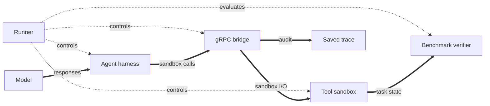
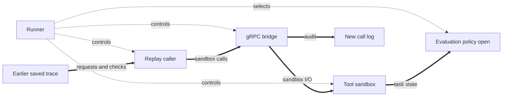

# Sandbox-call replay design

## 1. Overview

Sandbox-call replay repeats one recorded task's sandbox calls without starting an agent harness or calling an agent model. A live run produces a [replay trace](#2-scope-and-language) through the existing gRPC tool bridge. The [capture contract](#4-capture-contract) adds response checks and session timing to the [current audit](#3-current-evidence-and-gaps). A [trace sanity check](#5-replayer-components) validates the complete source before sandbox creation. The [scheduler and caller](#5-replayer-components) then send its requests through a new bridge session. The [Runner lifecycle](#6-lifecycle-and-results) still prepares the sandbox and confirms caller stop and bridge revocation. [Checks and limits](#7-checks-and-limits) define what a result means. The [evaluation policy](#8-open-question-replay-evaluation) remains open; [profile integration](#9-profile-integration) has settled fields and open checks.

**Recording run: harness and model active.**



**Replay run: the saved trace replaces the harness and model.**



Both runs use the same sandbox and isolation order. The replay caller replaces the harness and its model input. Replay support in `Runner` is proposed, not implemented (`pkg/runner/runner.go:56-69,233-318`). The [replay caller](#5-replayer-components) includes the parser, scheduler, and gRPC caller. The [evaluation policy](#8-open-question-replay-evaluation) is not settled.

The first version uses the gRPC transport. The trace parser and timing logic do not depend on a Hermes tool or a model response. The caller maps requests to gRPC. A later SSH caller can use the same replay steps without changing the scheduler.

## 2. Scope and language

A **sandbox call** is one bridge operation. One model-level **tool call** can cause several sandbox calls. This design replays sandbox calls. It does not replay model decisions or task arrivals ([bridge terms](bridge.md#terms), `docs/design/bridge.md:23-32`; `pkg/config/arrivals.go:19-34`).

| Term | Meaning | Avoid |
| --- | --- | --- |
| **Logical task** | A benchmark case selected by its catalog ID, before a run assigns an execution ID. | Task occurrence |
| **Task occurrence** | One execution of a logical task, with its own run-local ID, sandbox, and call log. | Logical task |
| **Sandbox-call replay** | A task execution that repeats recorded sandbox calls without an agent harness or agent model. | Task-arrival replay |
| **Replay trace** | The recorded requests, expected responses, and timing of sandbox calls from one task occurrence. | Arrival trace |
| **Replay-ready trace** | A replay trace with complete request inputs, response checks, and timing. | Complete log |
| **Replay mismatch** | A difference between an expected sandbox-call response and the response to its replayed request. | Benchmark failure |

A logical task differs from its per-run task occurrence (`internal/app/execution.go:32-43,84-112`).

One replay trace belongs to one task occurrence. Replay selects the same benchmark and logical task, compares the recorded image reference and pinned benchmark revisions with the new run, and runs the benchmark's normal sandbox preparation. It does not prove that the prepared sandboxes have identical state. The image reference is a tag, which can name different bytes later (`internal/app/execution.go:32-43,84-112`; `internal/app/run.go:264-294`; `pkg/runner/runner.go:213-240`; `pkg/containerimage/image.go:20-38`). Replay may change the sandbox runtime from Docker to Kubernetes. Replay uses the first recorded `started_at` as its timing origin and preserves later call-start spacing. It does not preserve the delay before the first call. Start replay calls only after sandbox preparation, bridge access, and the caller are ready. Preserve the final post-call wait when the trace has calls. The gaps include opaque harness and model work; replay does not reproduce that work or inspect model responses. Network delay can move the bridge's actual start time. The benchmark verifier remains independent of the caller (`pkg/runner/interfaces.go:17-37`; `pkg/runner/runner.go:305-316`; `pkg/bridge/grpc/files.go:358-365`).

Toolathlon is outside the first replay version. Its setup requires an MCP-capable harness and prepares task-specific gateway services; the gRPC sandbox-call trace does not cover those MCP interactions. Toolathlon replay is a future feature (`internal/app/wiring/benchmark/toolathlon.go:21-36`; `pkg/benchmark/toolathlon/sandbox.go:66-175`).

A different gRPC result is a **replay mismatch**. Stop new calls on the first mismatch. Report a caller execution failure. Do not change the expected response to make the trace pass. Calls already in flight must finish or be stopped before bridge revocation. Any evaluation of the resulting sandbox must follow confirmation of both isolation gates (`pkg/runner/runner.go:279-316`). The [replay evaluation policy](#8-open-question-replay-evaluation) remains open. Audit IDs and clocks are not response data. A changed script output or file response is a mismatch, even across runtimes.

**Sources:** `docs/design/bridge.md`, `pkg/config/arrivals.go`, `pkg/runner/interfaces.go`, `pkg/runner/runner.go`, `internal/app/execution.go`, `internal/app/run.go`, `pkg/containerimage/image.go`, `internal/app/wiring/benchmark/toolathlon.go`, `pkg/benchmark/toolathlon/sandbox.go`.

## 3. Current evidence and gaps

The bridge writes one JSONL line per sandbox call after that call finishes. The line has `started_at`, rounded `duration_ms`, completion-time `timestamp`, and a sequence assigned when the writer enqueues it. Thus file order is not start order. `started_at` is an RFC3339Nano bridge-clock timestamp; the log has no confirmed-harness-completion marker (`pkg/bridge/internal/bridgekit/audit.go:27-59,57-65,130-165`; `pkg/bridge/grpc/bridge.go:384-423`; `pkg/bridge/grpc/files.go:56-64,86-100`).

```go
	sequence := writer.sequence + 1
	timestamp := FormatTime(writer.now())
	structured.Stamp(sequence, timestamp)
```

This code runs when the record is enqueued, not when the sandbox call starts (`pkg/bridge/internal/bridgekit/audit.go:130-143`). Sort by `started_at` for the replay schedule. Do not add an ordering or per-call offset field until a real trace needs one. Reject an equal-time ambiguity instead of inventing an order. `FormatTime` discards Go's monotonic clock value, so wall-clock changes can distort offsets even when the start order is clear (`pkg/bridge/internal/bridgekit/audit.go:57-60`). The first version assumes a stable bridge wall clock. It cannot detect every clock jump between calls; strict timing across such jumps needs recorded monotonic offsets.

| gRPC call | Inputs already recorded | Response evidence missing for a strict check |
| --- | --- | --- |
| `Exec` | Script, shell arguments, workdir, and printable UTF-8 stdin up to 16 MiB. | Exact returned stdout and stderr digests, response reason, and exact RPC failure code. `stdout_bytes` and `stderr_bytes` count produced bytes, which can differ from returned bytes when output is cut. (`pkg/bridge/grpc/bridge.go:348-427`; `pkg/bridge/grpc/audit.go:75-95`) |
| `Stat` | Path. | Returned existence, type, size, and mode. (`pkg/bridge/grpc/files.go:205-224`; `pkg/bridge/grpc/v1/sandbox.proto:82-98`) |
| `ReadFile` | Path and optional `max_bytes`; zero or omission reads the whole file. | Header size and exact returned response; the existing digest covers file content on success, not the header or failure response. (`pkg/bridge/grpc/files.go:227-269,420-449`; `pkg/bridge/grpc/v1/sandbox.proto:108-135`) |
| `ReadLines` | Path, positive first line and line count, and optional byte clamp. | Full summary and exact returned response; the existing digest covers window content on success, not the summary or failure response. (`pkg/bridge/grpc/files.go:272-309,420-449`) |
| `WriteFile` | Path, consumed byte count, digest, and body when printable UTF-8 at most 16 MiB. A successful call consumed the declared size; a failed call can omit it. | `created`, exact RPC failure code, and full response. (`pkg/bridge/grpc/files.go:358-381,420-449`; `pkg/bridge/grpc/v1/sandbox.proto:175-202`) |

Successful `ReadLines` calls have positive window fields, so their existing fields distinguish them from `ReadFile`. Early refusals can lack distinguishing fields or original request data. The parser rejects the whole trace if any call has `status: "rejected"`; it does not add an RPC-method field for the first version (`pkg/bridge/grpc/files.go:59-82,227-235,272-281`; `pkg/bridge/grpc/audit.go:22-33`). An admitted call that fails after sandbox dispatch is not an early refusal.

```go
	if int64(len(content)) < count {
		return sizeOmitted(count), "size-omitted"
	}
	if bridgekit.SafeStructuredText(content) {
		return string(content), "utf-8"
	}
```

The input rule above omits binary or control-bearing stdin and file-write bodies from JSONL. The optional raw log can retain those bytes through 16 MiB, but it is off by default. A write larger than 16 MiB can succeed without retaining its body in either log. `Exec` refuses stdin above 16 MiB before execution (`pkg/bridge/grpc/audit.go:75-95`; `pkg/bridge/grpc/files.go:151-168,437-443`; `pkg/bridge/grpc/bridge.go:375-379`; `pkg/config/config.go:445-456`). The combined audit files also have a 256 MiB limit; an audit failure latches and stops later calls (`pkg/bridge/internal/bridgekit/audit.go:22-25,130-165,249-258`). Old recordings lack full response fingerprints and timing anchors. They are not strict replay traces.

**Sources:** `pkg/bridge/internal/bridgekit/audit.go`, `pkg/bridge/grpc/audit.go`, `pkg/bridge/grpc/bridge.go`, `pkg/bridge/grpc/files.go`, `pkg/bridge/grpc/v1/sandbox.proto`, `pkg/config/config.go`.

## 4. Capture contract

Extend the gRPC tool-call record on every new live run. Preserve its existing request fields and one-line-per-sandbox-call form (`pkg/bridge/internal/bridgekit/audit.go:27-55`; `docs/design/bridge.md:185-200`). Add only these call fields:

| Field | Meaning |
| --- | --- |
| `response_sha256` | Digest of the complete **logical gRPC outcome**. Include method-specific returned fields, streamed content, final gRPC code, and error message. Do not retain response bodies. |
| `response_bytes` | Byte length of the canonical outcome used for `response_sha256`, not the sandbox's total produced output. |
| `grpc_code` | Exact gRPC status code; an `Exec` nonzero exit with an OK RPC remains an OK RPC. |
| `replay_error` | A stable reason that required request data is missing. Examples include omitted stdin, an omitted write body, or a failed write without its declared size. |

Define one versioned, deterministic outcome encoding for the gRPC caller and recorder. Length-prefix each field or message to avoid ambiguous concatenation. Encode unary response fields and streamed read headers, body bytes, and summaries in procedure order. Include the RPC status and message on failure. The digest covers the response assembled and sent by the bridge, not output cut by a cap. It cannot prove that the client received each byte (`pkg/bridge/grpc/bridge.go:386-427`; `pkg/bridge/grpc/files.go:375-381`; `pkg/bridge/grpc/v1/sandbox.proto:66-80,120-173,195-202`). This encoding is a proposed recording rule, not a claim about the current JSONL schema.

Keep request text already retained in `tool-calls.jsonl`. Do not add payload files now. Mark omitted stdin or write content with `replay_error`. Also mark failed or partial writes without a recorded declared size. A successful write consumed exactly its declared size; a failed write's `stdin_bytes` can differ from its header size (`pkg/bridge/grpc/bridge.go:358-379`; `pkg/bridge/grpc/files.go:358-381,424-449`; `pkg/bridge/grpc/v1/sandbox.proto:175-193`). The live benchmark continues. Before replay starts its task sandbox or sends any call, its trace sanity check reads every record and validates the complete source. Any early refusal with `status: "rejected"` or canceled call with `status: "canceled"` makes the whole trace unreplayable; report an error and do not start replay. Do not omit such a call and replay the rest. Calls that fail after sandbox dispatch can remain replayable when their inputs and outcomes are complete and they were not canceled. If call 11 omits a `WriteFile` body, replay reports the trace as not replayable. It does not send calls 1–10. No extra `ReadFile` body or `Exec` output text is stored. A failed or unsealed audit remains an audit failure under the existing fail-closed rules, not a recoverable `replay_error` (`pkg/bridge/grpc/audit.go:75-95`; `pkg/bridge/internal/bridgekit/audit.go:130-165,335-350`). If a real workload needs omitted inputs, review a private payload format then.

Record one session marker from the **same bridge clock** as call `timestamp`: confirmed harness completion. It bounds the wait after the last recorded call; no bridge-ready marker or initial setup wait is needed. Extend the existing per-task `bridge/runtime.json` with a version, this marker, and the source benchmark type, logical task ID, image reference, and pinned benchmark revisions. Do not write fake sandbox calls or add a separate timing file. Add a control-plane completion signal for the existing sandbox session. Runner sends it after a confirmed harness stop and before bridge release; the bridge stamps its receipt. Release alone is too late because it includes unrelated cleanup delay (`pkg/runner/runner.go:279-292`; `pkg/bridge/session.go:139-202`; `docs/design/bridge.md:80-92`). The signal can arrive after the actual stop, so do not claim an exact harness-stop time. A missing signal makes the trace not replay-ready but must not skip release. The current `runtime.json` contains only runtime IDs (`pkg/bridge/session.go:43-49`). Finalize and validate the extended file with the same private evidence checks as the call log (`pkg/bridge/session.go:173-200`; `pkg/bridge/internal/bridgekit/audit.go:335-350`). Do not store a prepared sandbox snapshot, an image digest, or credentials for this check.

Bind the finalized `tool-calls.jsonl` to the source `bridge/runtime.json`. After bridge release and log collection, store the log's byte length and SHA-256 digest in `runtime.json`. Replay checks both before it accepts the source. A complete-line truncation otherwise looks like a valid shorter call sequence. The current bridge verifies collected files against an in-memory manifest, but it does not persist that manifest for a later replay (`pkg/bridge/session.go:167-200`). Do not mark a source replay-ready if log finalization, collection, or this binding fails.

**Sources:** `pkg/bridge/internal/bridgekit/audit.go`, `pkg/bridge/grpc/audit.go`, `pkg/bridge/grpc/bridge.go`, `pkg/bridge/grpc/files.go`, `pkg/bridge/grpc/v1/sandbox.proto`, `pkg/runner/runner.go`, `pkg/bridge/session.go`, `docs/design/bridge.md`.

## 5. Replayer components

**Trace sanity check (parser).** Before task sandbox creation, read the complete, versioned, finalized gRPC trace and extended per-task `bridge/runtime.json` for one task. Check the saved log length and SHA-256 digest before parsing its calls. Reject any early refusal, canceled call, negative call-start offset, missing input, `replay_error`, missing response check, missing completion marker, or incomplete audit. Validate record format and compute call-start offsets from the earliest `started_at`. Compute the source's final wait from its latest completion-time `timestamp` to the confirmed completion marker. Reject a negative final wait before the task sandbox starts. An empty trace has no call offsets or final wait. Do not treat completion-time `sequence` as start order; retain it only as the source record identity. Compare the source benchmark type, logical task ID, image reference, and pinned benchmark revisions with the new run before starting its sandbox. Only after the full trace sanity check succeeds, create the sandbox and run normal benchmark preparation. These checks do not prove identical prepared state. A trace from an old run is not silently upgraded; the [capture contract](#4-capture-contract) first needs a new live run (`pkg/bridge/internal/bridgekit/audit.go:130-165`; `pkg/bridge/grpc/audit.go:22-33`; `pkg/runner/runner.go:213-240`). The parser produces a transport-neutral sandbox-call plan: request, expected outcome, and start offset. The gRPC parser owns interpretation of gRPC-specific fields.

**Scheduler.** Start a monotonic caller clock only after sandbox preparation, bridge access, and caller readiness. The first recorded call is due immediately. Target each later launch at `epoch + (recorded started_at - first recorded started_at)`; do not sleep separately between records. This permits recorded overlap without adding a start-order field. For an overdue call, launch it as soon as possible. Compare bridge-side start offsets relative to the first call in both audits and report their drift. Do not claim to reproduce the initial setup wait. Network delivery and header receipt can move bridge-side admission after caller launch (`pkg/bridge/grpc/files.go:358-365`; `pkg/bridge/grpc/bridge.go:348-386`). After all launched calls finish, wait the source post-call interval already validated by the trace sanity check. For a trace with no calls, stop the caller after readiness without an artificial wait. This preserves the recorded final idle delay even if replay calls finish late; total session duration can grow. The audit writer stamps `timestamp` when it enqueues a completed call. Thus this interval measures bridge-recorded idle time, not exact harness idle time (`pkg/bridge/internal/bridgekit/audit.go:130-165`). On mismatch, send no further calls; join or cancel already-started calls on a bounded cleanup path. Call timing is a load schedule, **not** a response-equality condition. The current application already uses absolute due times for task arrivals. This plan reuses that scheduling idea, not its arrival-file format (`internal/app/execution.go:80-134`; `pkg/config/arrivals.go:19-34`).

**Tool caller.** Run from a trusted private placement that can reach the task's native gRPC endpoint. The endpoint has no client authentication; do not publish it to an untrusted network (`docs/design/bridge.md:95-100`; `pkg/bridge/grpc/bridge.go:1-3,217-232`). Use the generated gRPC client and issue `Exec`, `Stat`, `ReadFile`, `ReadLines`, or `WriteFile` for each planned sandbox call. For writes, send one header and the retained body in chunks. Half-close the stream and check the recorded byte count (`pkg/bridge/grpc/v1/sandbox.proto:15-36,175-202`; `pkg/bridge/grpc/files.go:384-417`). Compare the full logical outcome with the recorded digest, length, and status. Preserve a recorded `tool_call_id` when present, but use the new run's own sandbox and task identities (`pkg/bridge/grpc/bridge.go:430-456`). Give each call a bounded context; the server has no fixed call deadline (`docs/implementation/grpc-bridge.md:351-354`).

Only the parser and caller know the transport. The scheduler consumes call offsets and comparison outcomes. Do not add a registry, generic transport framework, SSH caller, harness emulation, or model stub for the first version. The [lifecycle](#6-lifecycle-and-results) still determines where this component runs.

**Sources:** `pkg/bridge/grpc/v1/sandbox.proto`, `pkg/bridge/grpc/bridge.go`, `pkg/bridge/grpc/files.go`, `docs/design/bridge.md`, `docs/implementation/grpc-bridge.md`, `internal/app/execution.go`, `pkg/config/arrivals.go`, `pkg/runner/runner.go`.

## 6. Lifecycle and results

The current Runner requires an `AgentHarness` and calls its `Start`, `Run`, and `Stop` after it starts the bridge. It evaluates only after positive harness stop and bridge revocation (`pkg/runner/runner.go:41-69,233-318`). Its benchmark interface takes the task and sandbox, not harness output (`pkg/runner/interfaces.go:17-37`). A replayer needs a narrow caller path in the same bridge-access slot. It must not pretend to run an agent or add a fifth Runner role. The [profile branch](#9-profile-integration) is selected, but Runner construction remains proposed. The [replay evaluation policy](#8-open-question-replay-evaluation) remains open.

```go
	if err := r.harness.Stop(isolationCtx); err != nil {
		isolationErrors = append(isolationErrors, fmt.Errorf("confirm harness stopped: %w", err))
	} else {
		harnessActive = false
		result.Isolation.HarnessStopped = true
	}
	if err := r.bridge.Stop(isolationCtx); err != nil {
		isolationErrors = append(isolationErrors, fmt.Errorf("confirm bridge revoked: %w", err))
	} else {
		bridgeActive = false
		result.Isolation.BridgeRevoked = true
	}
```

Run the complete [trace sanity check](#5-replayer-components) and reject any unreplayable source before creating the task sandbox. Prepare the sandbox, start its bridge session, confirm caller readiness, run the validated plan, and confirm caller stop. Revoke bridge access before any evaluation that uses the live sandbox or private verifier material. Then remove sandboxes. If caller stop or bridge revocation cannot be confirmed, do not upload private verifier material (`pkg/runner/runner.go:213-240,279-318`; `docs/design.md:131-164`). A mismatch is a replay execution failure, not an evaluation result. The current Runner evaluates task state after confirmed isolation, even after a harness run failure (`pkg/runner/runner.go:261-318`). Whether replay reruns evaluation or reuses a recorded result is [open](#8-open-question-replay-evaluation). Track replay and evaluation outcomes separately; do not report a replay as a successful harness run (`pkg/core/types.go:201-226,245-283`; `pkg/runner/runner.go:405-428`).

**Sources:** `pkg/runner/runner.go`, `pkg/runner/interfaces.go`, `pkg/core/types.go`, `docs/design.md`.

## 7. Checks and limits

A replay-ready trace requires finalized evidence, complete request inputs, response fingerprints, a common clock origin, and a task match. Check these before the first replay call. Test response capture for `Exec`, `Stat`, `ReadFile`, `ReadLines`, and `WriteFile`, including a returned `created` value and an expected RPC error. Test omitted binary input, writes above 16 MiB, early refusals, canceled calls, and negative final waits. Confirm that each rejects the complete source before sandbox creation or any replay call. Test caller readiness before the first call. Test recorded call-start spacing, final delay, an empty trace, overlapping starts, and a mismatch with another call in flight. Confirm that any replay evaluation using the sandbox runs only after isolation succeeds. These cases exercise the [capture contract](#4-capture-contract), [components](#5-replayer-components), and [lifecycle](#6-lifecycle-and-results) (`pkg/bridge/grpc/v1/sandbox.proto:15-36,66-202`; `pkg/bridge/grpc/audit.go:75-95`; `pkg/runner/runner.go:279-318`).

Matching requests and response fingerprints shows equivalent **bridge-visible** behavior, not identical sandbox state. A script can launch background work after its RPC ends, and the bridge does not log later filesystem changes (`docs/design/bridge.md:167-175`; `pkg/bridge/grpc/bridge.go:348-427`). Evaluation of task state is a separate check under the current Runner (`pkg/runner/interfaces.go:17-24`; `docs/design.md:160-171`). Docker and Kubernetes can give different results for the same task image. Docker typed reads use the daemon; Kubernetes reads run inside the container (`docs/design/bridge.md:144-156`; `pkg/deployment/docker/files.go:3-12`; `pkg/deployment/kubernetes/files.go:3-10`). Do not normalize these response differences in strict mode. Report the first mismatch and keep any replay evaluation outcome separate.

A response can be lost after a successful write is recorded; the bridge cannot prove that the harness received it (`pkg/bridge/grpc/files.go:375-381`). Audit input may include task data and remains private. Credential values must not enter profiles, structured logs, runtime metadata, or results (`docs/design.md:201-205`; `docs/design/bridge.md:196-200`). The first version does not restore missing binary input or recover an incomplete audit. It does not infer model decisions or observe later background work.

**Sources:** `pkg/bridge/grpc/v1/sandbox.proto`, `pkg/bridge/grpc/audit.go`, `pkg/bridge/grpc/bridge.go`, `pkg/bridge/grpc/files.go`, `pkg/bridge/internal/bridgekit/audit.go`, `pkg/runner/runner.go`, `pkg/runner/interfaces.go`, `pkg/deployment/docker/files.go`, `pkg/deployment/kubernetes/files.go`, `docs/design.md`, `docs/design/bridge.md`.

## 8. Open question: replay evaluation

**Case for reusing the recorded result.** In a live run, model decisions lead to sandbox scripts and file operations. Replay sends the recorded sandbox calls instead of running the model again. If these actions produce the same final task result, the benchmark should give that result the same grade. A new call to a model judge can give a different grade for the same report or answer. Reusing the recorded verdict avoids that variation. The source run already stores its evaluation result (`pkg/runner/runner.go:305-318`; `pkg/benchmark/deepresearchbench/evaluate.go:185-200`; `pkg/benchmark/sweatlas/evaluate.go:161-178`; `docs/run-results.md`). Replay does not reproduce the model's private decisions; it reproduces their bridge-visible sandbox calls (`docs/design/bridge.md:23-32`).

**Case against unconditional reuse.** Equal bridge-visible responses do not prove equal final sandbox state. For example, `Exec("date +%s > answer.txt")` can return the same empty output and exit code on both runs, but leave different file content. Background work can also change files after the last recorded call (`pkg/bridge/grpc/bridge.go:348-427`; `docs/design/bridge.md:167-175`). Copying the source evaluation would grade the old sandbox, not check the new one. A changed Docker or Kubernetes environment can also affect the task state even when recorded calls match (`pkg/deployment/docker/files.go:3-12`; `pkg/deployment/kubernetes/files.go:3-10`). A fresh model judge can vary even when its input has not changed; that variation does not show a replay error.

**Unresolved decision.** Decide whether replay reruns benchmark evaluation, reuses the entire recorded result, or reuses only a recorded model-judge verdict after checking its exact input. Also decide how to label a reused result and how to report changed evaluator input. No choice is adopted here. Caller stop and bridge revocation must still be confirmed before any private verifier material reaches the sandbox (`pkg/runner/runner.go:279-316`).

**Sources:** `pkg/runner/runner.go`, `pkg/benchmark/deepresearchbench/evaluate.go`, `pkg/benchmark/sweatlas/evaluate.go`, `pkg/bridge/grpc/bridge.go`, `pkg/deployment/docker/files.go`, `pkg/deployment/kubernetes/files.go`, `docs/design/bridge.md`, `docs/run-results.md`.

## 9. Profile integration

### 9.1 Profile branches

A strict profile selects exactly one execution mode. A live profile has top-level `model`, `harness`, and model `runtime` fields. A replay profile has top-level `replay` instead and forbids all three live-only fields. The common `benchmark`, `sandbox`, and `bridge` configuration still selects the task and its execution environment. A replay profile selects one recorded task occurrence, not a list of source occurrences. Require exactly one `benchmark.tasks` ID that matches the source logical task. Forbid `execution.loop_duration`, `execution.arrivals_file`, and `execution.arrival_rate_per_min` in replay profiles. These fields can schedule repeated occurrences, even when the profile selects only one logical task (`pkg/config/config.go:724-740,822-829`; `internal/app/execution.go:115-150`). Keep `bridge.type: "hermes-grpc"` for the first replay version; do not infer a new bridge type from the absent harness (`pkg/config/config.go:659-846`; `cmd/aries/wiring.go:38-73,246-269`).

| Profile branch | Required caller fields | Forbidden caller fields |
| --- | --- | --- |
| Live | `model`, `harness`, model `runtime` | `replay` |
| Replay | `replay.source`, `replay.deployment` | `model`, `harness`, model `runtime` |

`replay.deployment` places the private caller. Keep bridge and sandbox deployment settings separate; do not inherit their resources or placement into the caller. Current deployment checks cover the live harness, bridge, and sandbox. Replay must validate caller access to the private gRPC endpoint. It must not expose that unauthenticated endpoint to an untrusted network (`pkg/config/deployment.go:49-195`; `cmd/aries/wiring.go:246-269`; `docs/design/bridge.md:95-100`).

### 9.2 Source occurrence and recorded artifacts

`replay.source` names one task-occurrence directory. Resolve a relative path from the replay profile file's directory, not the process working directory. The source directory contains `bridge/tool-calls.jsonl` for sandbox calls and `bridge/runtime.json` for the source binding. After the [capture extension](#4-capture-contract), `bridge/runtime.json` also supplies timing and baseline identifiers. The parent run directory holds `run-result.json`, which retains the earlier evaluation outcome. Keep all three source artifacts available, but do not treat the old evaluation result as a call or timing input (`docs/run-results.md:9-19,41-58,178-187`; `pkg/bridge/session.go:43-49`; `pkg/bridge/internal/bridgekit/audit.go:27-55`; `pkg/core/types.go:245-284`). Whether replay consumes the old result depends on the [open evaluation policy](#8-open-question-replay-evaluation).

The current call log lacks full response checks, and the current `bridge/runtime.json` holds runtime binding IDs only. The current `run-result.json` has task outcomes but no bridge-side timing anchors. Thus existing runs are not silently accepted as strict replay sources; the live capture changes must produce a replay-ready trace first (`pkg/bridge/internal/bridgekit/audit.go:27-55`; `pkg/bridge/session.go:43-49`; `pkg/core/types.go:245-284`; [current gaps](#3-current-evidence-and-gaps)). Source runtime IDs identify the earlier run and must not become new sandbox or bridge IDs.

### 9.3 Starting-state checks and application flow

During the [trace sanity check](#5-replayer-components), before task sandbox creation, compare the recorded benchmark type, logical task ID, selected image reference, and pinned benchmark revisions with the new run. Run the benchmark's normal sandbox preparation. A source task-occurrence ID identifies the call log; it is not the logical benchmark task ID (`internal/app/execution.go:32-43,84-112`; `pkg/runner/runner.go:213-240`). These are guards against a wrong task or image, not proof of identical prepared state. Task image references use tags; a tag can resolve to different bytes on another run. Do not add a full state snapshot or require an image digest in the first version (`pkg/containerimage/image.go:20-38`). Allow Docker-to-Kubernetes replay, but report any changed bridge-visible response as a mismatch. Do not suppress a mismatch to make cross-runtime replay pass.

The current application prepares a live harness and model, can launch a model runtime, and preflights the model. A replay profile must skip those live-only paths while keeping benchmark preparation, sandbox start, bridge start, caller execution, positive caller stop, bridge revocation, and sandbox cleanup in order (`internal/app/run.go:84-108,149-220,264-294,324-362`; `pkg/runner/runner.go:213-318`). Report replay execution separately from harness success and any evaluation result. Do not upload private verifier material before caller stop and bridge revocation are confirmed. Toolathlon remains a [future feature](#2-scope-and-language) because its MCP interactions are not in this gRPC trace (`internal/app/wiring/benchmark/toolathlon.go:21-36`).

The [evaluation policy](#8-open-question-replay-evaluation) remains open. If replay reruns a model judge, it needs judge-only model settings without top-level `model`. If replay reuses a verdict, it needs a rule for changed judge input and a clear label for the inherited result. Whether to compare a new grade with the old grade automatically is also open. No such choice is implied by keeping `run-result.json`.

**Sources:** `pkg/config/config.go`, `pkg/config/deployment.go`, `cmd/aries/wiring.go`, `internal/app/run.go`, `internal/app/execution.go`, `internal/app/wiring/benchmark/toolathlon.go`, `pkg/runner/runner.go`, `pkg/bridge/session.go`, `pkg/bridge/internal/bridgekit/audit.go`, `pkg/core/types.go`, `pkg/containerimage/image.go`, `docs/run-results.md`, `docs/design/bridge.md`.
