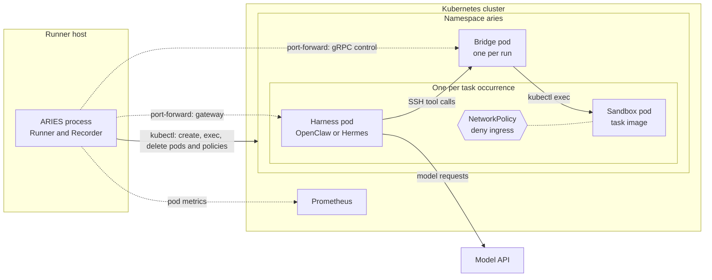

# Kubernetes implementation

[`pkg/deployment/kubernetes`](../../pkg/deployment/kubernetes/kubernetes.go)
implements the [deployment contract](../design/deployment.md) on pods, so the
existing harness, sandbox and bridge components run on a cluster unchanged. It is
selected per component with `deployment.backend: "kubernetes"`; see
[deployment configuration](../configuration.md#kubernetes-deployment). Cluster
bootstrap, the Helm chart and the runner host are covered in
[`k8s/`](../../k8s/README.md).

## Placement

The Runner is a host process, not a pod. It reaches the cluster only through the
`kubectl` binary and the context that resolves, from Invitro's loader node or
from any machine with a route to the API server. Every runtime is one pod in a
single namespace:



Solid arrows are the paths a task uses; dotted arrows are the Runner's own
control and measurement connections. The figure leaves out the API server,
which every `kubectl` arrow actually passes through. In particular, the bridge
and the Runner reach a sandbox pod through the API server's exec endpoint, never
by connecting to it directly, which is why its NetworkPolicy can deny all
ingress.

| Runtime | Lifetime | Reached by |
| --- | --- | --- |
| Sandbox pod | One per task occurrence, plus fresh evaluation sandboxes | Runner and bridge, through `kubectl exec` |
| Harness pod | One per task occurrence | Runner, through a port-forward to its gateway |
| Bridge pod | One per run | Runner (gRPC control, port-forward); harness pods (SSH, pod address) |

Harness, sandbox and bridge must all select the Kubernetes backend and the same
namespace. The bridge pod execs into sandbox pods and harness pods dial the
bridge pod, so a component left on Docker could not be reached. Profile
normalization rejects mixed compositions before any effect.

The provider shells out to `kubectl` rather than linking client-go. That keeps
the dependency set unchanged and makes the kubeconfig the whole cluster
contract, at the cost of one process per operation.

## Create, stage, start

`Create`, `UploadArchive` and `Start` are operations of the
[`Runtime` interface](../../pkg/deployment/deployment.go) in the deployment
contract, not Kubernetes states. Components call them in that order to stage
private files before their process runs: the shared harness runtime in
[`Runtime.Start`](../../pkg/harness/harness.go) and the bridge service in
[`Service.Start`](../../pkg/bridge/service.go). Docker maps them directly onto
create container, copy files, start container.

Kubernetes has no created-but-not-started pod, so the provider adds a gate. The
gate is a shell wrapper that the provider sets as the container's command, in
front of the command the component requested. It is the `gateShell` constant in
[`kubernetes.go`](../../pkg/deployment/kubernetes/kubernetes.go), applied by
`gatedCommand` in [`manifest.go`](../../pkg/deployment/kubernetes/manifest.go):

```sh
while [ ! -e /run/aries-gate/start ]; do sleep 0.2; done; exec "$@"
```

| Contract operation | What the provider does | Pod state |
| --- | --- | --- |
| `Create` | Applies the pod and waits until it is `Running` | Container runs the gate loop |
| `UploadArchive` | Extracts the archive with `kubectl exec` | Unchanged |
| `Start` | Writes the marker file `/run/aries-gate/start` | Gate execs the requested command |

The pod is `Running` from `Create` onwards. "Started" is therefore a logical
state of the runtime: it means the marker file exists and the gate has replaced
itself with the requested command, which becomes PID 1 with its exact argv.
`/run/aries-gate` is an `emptyDir` volume that ARIES mounts into every pod,
outside the image's filesystem.

Three consequences are explicit provider constraints:

- **Images need `/bin/sh`.** Sandbox images also need `tar` and `stat` for file
  transfer. Per-command user switching requires `setpriv` from `util-linux`.
- **An unset entrypoint is not preserved.** The cluster API does not report an
  image's entrypoint, so a request without one runs its arguments directly.
  OpenClaw relies on this and its launcher does not need the image entrypoint.
- **`Init` is not provided.** The requested command is PID 1 and no init process
  reaps orphans.

### Staging as a non-root image

Docker's copy API writes as root whatever user the image declares. `kubectl
exec` runs as the image's user, which cannot create directories under root-owned
paths. Wiring therefore names staging roots for images that need them: OpenClaw
runs as UID 1000 and stages under `/run/aries` and `/opt/aries`. The provider
mounts an `emptyDir` at each root and a root init container hands them to that
user before the main container starts. Hermes and the bridge start as root and
need none.

## Execution and transfer

`Exec` and `ExecStream` forward the command through `kubectl exec`, using a small
positional-argument shell command to change directory when needed before
`exec "$@"`. Output and the exit code come from kubectl. A nonzero exit can
therefore also indicate a kubectl transport failure. Cancellation stops the local
kubectl process and may leave the command running in the pod. There is no PID
bookkeeping or remote process-group cleanup; runtime removal remains responsible
for removing remaining processes.

`kubectl exec` cannot select a user; a command always starts as the container's
own user. SWE-bench Pro runs the agent's commands as UID 65532 and ARIES's own
as root, so a command that requests another user starts as root and uses
`setpriv --reuid UID --regid GID --clear-groups` before running it. `HOME` is
set to `/` for such a command, as Docker does for a UID with no account.

This needs two things from the task image: it must start as root, and it must
provide `setpriv` from `util-linux`. **Running SWE-bench Pro needs no action from
you.** ARIES runs the upstream images (`docker.io/jefzda/sweap-images`)
unchanged, with no conversion step, and those images provide both: they set no
`USER`, and their Debian bases include `util-linux`. Sampled images across Go,
Python and TypeScript tasks all start as UID 0 with `/usr/bin/setpriv`. The
requirement matters only if the pinned dataset moves to images built
differently, such as on Alpine, which does not install `util-linux` by default.

Archives move as tar streams over exec. Pod logs are a single interleaved
stream, so they arrive on stdout only.

## Addresses

`Address` resolves what the Runner dials. Outside the cluster it is a
`kubectl port-forward` on a reserved loopback port, restarted on that same port
if kubectl loses its connection. When the Runner itself runs in a pod it is the
target's pod address. `TaskAddress` is always the pod address, which is how
harness pods reach the bridge's per-sandbox SSH listeners.

## Network isolation

A cluster has one flat pod network, so isolation is expressed with
NetworkPolicy. The task environment creates each sandbox's policy before its pod
and removes it after the pod is gone. What the policy permits depends on the
task's `allow_network`, which the [benchmark](benchmarks.md) sets per task and a
profile cannot change: Terminal-Bench 2 and SWE-Atlas QA take it from
`allow_internet` in the task's `task.toml`, while SWE-bench Pro, Deep Research
Bench and Toolathlon always set it to `true`.

| `allow_network` | Ingress | Egress |
| --- | --- | --- |
| `false` | Denied | Denied |
| `true` | Denied | DNS, and the internet outside `pod_cidr` and `service_cidr` |

Denied ingress is the load-bearing half: a sandbox that accepts no connections
cannot be reached by another task. The bridge needs none, because exec goes
through the API server. Leaving the CIDRs unset only widens what a
network-allowed task may dial out to.

The run environment owns one more policy, on the bridge pod. Its SSH listeners
accept clients without authentication, so the policy admits only pods in the
namespace that are not sandboxes. The reported run policy is
`per-sandbox-policy`.

NetworkPolicy is enforced by the CNI plugin. Under one that does not implement
it, such as flannel, the objects are accepted and silently ignored.

A task may declare a service that the harness must reach, as Deep Research Bench
does for the search engine it starts inside the sandbox. The task environment
then also creates a Service named after the sandbox, so the harness has a stable
address before the pod exists (`http://<sandbox name>:<port>`, the same form
Docker resolves on its run network), and the sandbox's policy gains one ingress
rule admitting harness pods to that port only. Pods carry their role as a label
but not their task, so the rule admits every harness in the namespace, as
Docker's shared network does. The Service is removed with the policy.

## Pod names, labels and annotations

Each component names its own runtime as `aries-<role>-<task>-<random>`, and the
provider uses that name as the pod name. The names are the same ones Docker
containers get:

| Pod | Name | Example |
| --- | --- | --- |
| Sandbox | `aries-sandbox-<task>-<16 hex>` | `aries-sandbox-fix-git-001-03cfd3ce39bab2f8` |
| OpenClaw harness | `aries-openclaw-<task>-<16 hex>` | `aries-openclaw-fix-git-001-3964909f9e34fd0d` |
| Hermes harness | `aries-hermes-<task>-<16 hex>` | `aries-hermes-fix-git-001-5b1e7c2a90d4f316` |
| Bridge | `aries-bridge-<24 hex>` | `aries-bridge-8019af64fc4a734d411b564d` |

The prefix gives the role. The task part is a readable hint only: a pod name is
limited to 63 lowercase letters, digits and hyphens, so the task ID is
lowercased, every other character becomes a hyphen, and the result is cut at 24
characters. Two tasks can therefore share it. The random suffix is what makes
the name unique, so every task occurrence gets a fresh identity, including
repeated task IDs running at the same time. The bridge serves the whole run and
carries no task. The exact task and run IDs are recorded on the pod instead.

The provider sets three labels, which selectors and `kubectl` filters use:

| Label | Value |
| --- | --- |
| `app.kubernetes.io/managed-by` | `aries` |
| `app.kubernetes.io/component` | `sandbox`, `evaluation-sandbox`, `harness` or `bridge` |
| `aries.dev/runtime` | The pod's own name, so a NetworkPolicy can select exactly one pod |

The component's ownership metadata is stored as annotations: `aries.managed`,
`aries.kind`, `aries.component`, `aries.run`, `aries.task`, and for harnesses
`aries.attempt`. These are annotations rather than labels because a label value
is limited to 63 characters, while a run ID may be 128 characters and a task ID
149. To see which task a pod belongs to:

```sh
kubectl -n aries get pods -l app.kubernetes.io/managed-by=aries \
  -o custom-columns='NAME:.metadata.name,TASK:.metadata.annotations.aries\.task'
```

## Ownership and cleanup

`Validate` checks the pod against its request: identity, annotations, image,
gated command, working directory, privilege escalation, host namespaces, host
paths and the absence of a service account token. It also searches the whole pod
object for supplied secret values. `Stop` deletes the pod and returns only after
a lookup confirms absence.

Only the bridge pod mounts a service account. Its Role allows `get pods` and
`pods/exec` in the namespace, and before executing it confirms the target is a
live sandbox pod of its own run and task.

There is no controller. A Runner that is killed leaves its pods and policies
behind; remove them by label as shown in [`k8s/`](../../k8s/README.md).

## Images

The cluster pulls images; ARIES cannot build into it. Image preparation is
therefore a no-op on this backend. Both harnesses are supported; they differ
only in which images must be published beforehand:

| Image | Source | Needed for | Publish first? |
| --- | --- | --- | --- |
| Task sandbox | Public, pinned by the benchmark | Both harnesses | No |
| OpenClaw harness | Public upstream image, used unchanged | OpenClaw | No |
| Hermes harness | Upstream image plus `hermes-otel`, built by ARIES | Hermes | Yes |
| Bridge | Built by ARIES; needs `kubectl` on this backend | Both harnesses | Yes |

An OpenClaw run therefore needs only the bridge image published, and a Hermes
run needs the bridge and the derived Hermes image. Each deployment block's
`images` map translates a locally built name to the reference the cluster pulls.

## Resource measurements

The Recorder runs inside the `aries` process on the runner host, not in the
cluster. It is deployment-neutral: each provider hands it a resource source, and
it writes the same `resources.jsonl` whatever the backend. The Kubernetes source
is in [`resources.go`](../../pkg/deployment/kubernetes/resources.go).

### Where the readings come from

Readings are cAdvisor data, read from Prometheus. They come from a standalone
cAdvisor that the ARIES chart runs on every node as a DaemonSet, not from the
cAdvisor built into the kubelet. The kubelet's samples an idle container less
and less often, up to about 15 seconds, and the kubelet offers no setting to
stop that, so its readings arrive unevenly. The standalone one runs with
`--allow_dynamic_housekeeping=false` and samples every container on a fixed
housekeeping interval, 250 milliseconds by default. It watches both containerd and
Docker, so Kubernetes pods and Docker runs on the same node are measured by the
same code at the same rate, which is what lets the two backends be compared.
A PodMonitor has Prometheus scrape it every second and keep the time cAdvisor
took each sample.

On each sample the source runs three instant queries against the server named
by `prometheus_url`, summed per pod over the namespace:

| Reading | Query |
| --- | --- |
| Cumulative CPU | `container_cpu_usage_seconds_total` |
| Memory | `container_memory_working_set_bytes` |
| Observation time | `timestamp()` of the CPU series, the moment cAdvisor sampled it |

The standalone cAdvisor's series are told apart from the kubelet's by the labels
it copies from containerd, `container_label_io_kubernetes_pod_name` and
`container_label_io_kubernetes_pod_namespace`, which the kubelet's lack. Only
those identity labels and ARIES's own `aries.*` labels are kept, so a series
carries no task content.

Prometheus identifies a pod by name only, while the run and task it belongs to
are in its annotations. The source therefore lists pods through `kubectl`, but
only when Prometheus reports a pod name it has not classified yet. Annotations
never change, so in the steady state a sample is HTTP alone.

Node exporter is not a substitute: it reports whole-node figures, not per-pod
ones.

### What it depends on

- **The monitoring stack and the chart's cAdvisor.** Without a `prometheus_url`
  the measurements are recorded as unsupported and the run continues; nothing
  is fabricated. With one, but no standalone cAdvisor series for the namespace,
  the first sample fails: the chart's own cAdvisor pods live there, so an empty
  answer means nothing is collecting, not that the pods are idle.
- **A reachable address.** `k8s/apply-aries.sh` prints the Prometheus Service's
  cluster address. A cluster node reaches it directly, which is why the runner
  on Invitro's loader node needs no port-forward. A runner outside the cluster
  would need its own route to Prometheus.

### Freshness

Two intervals bound how fine the data is: cAdvisor's housekeeping, when it
samples the cgroup counters, and Prometheus's scrape, which keeps the newest
sample it finds (`cadvisor.housekeepingInterval` and `cadvisor.scrapeInterval`
in the chart). cAdvisor waits a random one to two housekeeping intervals between
samples, a jitter no flag removes, so the housekeeping interval is set well
below the scrape's:

| Housekeeping, with a 1-second scrape | Gap between stored samples | Gaps over 1.5 s | cAdvisor CPU per node |
| --- | --- | --- | --- |
| 1 second | 1.0–2.0 s, median 1.5 s | about half | |
| 500 milliseconds | mean 1.0 s, 5th–95th percentile 0.56–1.61 s | 11% | about 0.14 cores |
| 250 milliseconds, the default | mean 1.0 s, 5th–95th percentile 0.72–1.28 s, at most 1.44 s | none | about 0.2 cores |

Measured on a three-node Invitro cluster over 90 seconds and about 1,300 gaps
per setting. A stored sample keeps the time cAdvisor took it, so the spread is
real spacing between observations, not timestamp error. cAdvisor's own CPU use
is the same on every node and under both backends. Each line of
`resources.jsonl` is one real observation at its own timestamp; nothing is
repeated to fill a gap, and because the CPU counter is cumulative, the rate
between two observations stays exact however far apart they are.

The source records a reading only when the scrape time has advanced, so a
repeated value is never counted twice, and asks the Recorder to keep a pod's CPU
baseline across samples that carry nothing new. `second` in `resources.jsonl` is
elapsed time, so samples stay comparable across intervals. A pod without a
memory limit reports `memory_limit_bytes` 0. A few consecutive pod-listing
failures are absorbed as missing samples rather than ending the run's telemetry.

## Supported composition

Terminal-Bench 2, SWE-bench Pro and Deep Research Bench with OpenClaw or Hermes
in text mode, with all three components on one cluster and namespace. Realtime and voice modes, managed
model runtimes, GPU tasks and the other benchmarks have not been exercised on
this backend.
