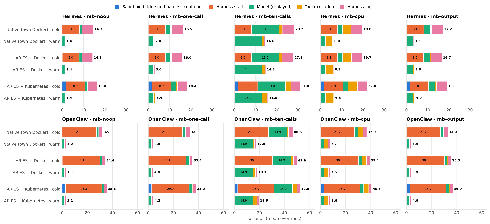
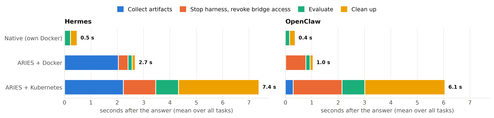

# coldwarm: campaign 20261102-e5-2640v4

*Generated by `scripts/experiment/report.py` from this campaign's runs; edit `notes.md`, not this file.*

## Setup

Cold and warm end-to-end latency of the microbenchmark tasks for each harness, with tools run natively, in an ARIES Docker sandbox and in an ARIES Kubernetes pod, the model held constant by record and replay.

| Setup | How tools run |
|---|---|
| **Native** | The harness's own Docker sandbox, with no ARIES involved: the baseline. |
| **ARIES Docker** | ARIES creates the sandbox as a Docker container; the harness reaches it through ARIES's tool bridge. |
| **ARIES K8s** | The same, with the harness, sandbox and bridge as Kubernetes pods. |

**Controls**
- **Hardware:** Intel(R) Xeon(R) CPU E5-2640 v4 @ 2.40GHz, unknown CPUs, SMT off, turbo off. Each harness runs on a worker of its own, and every setup of a harness on that worker.
- **Resources:** harness: 2 CPUs, 4096 MiB; sandbox: 2 CPUs, 4096 MiB.
- **Model:** each harness's replies were recorded once and replayed with their original timing, so model time is the same in every setup.
- **Resource measurement:** CPU and memory come from cAdvisor through Prometheus, sampled every second, the same way in every setup.
- **Runs:** 5 repetitions of every setup, each task run cold and then warm on the same harness and sandbox.

| Task | The agent | Isolates |
|---|---|---|
| `mb-noop` | replies without using a tool | harness, model and lifecycle cost |
| `mb-one-call` | runs `touch /tmp/mb-one` | one tool round trip |
| `mb-ten-calls` | runs ten `echo` commands, one tool call each, the first overwriting the file | the cost per call |
| `mb-cpu` | runs a fixed 3,000,000-step SHA-256 chain | a CPU-bound call, about 2.5 s on a 2.4 GHz core |
| `mb-output` | prints 66,399 bytes of `base64` | output carried back through the bridge |

## Stages of a task

- **Cold** is the first request on a fresh harness and sandbox, from the first start-up step to the answer:
  - **Start-up:** the sandbox and its bridge endpoint are reserved, the harness's container or pod is created and the harness started, while the sandbox starts and the bridge binds it.
  - **Harness start:** launching the harness and waiting until it reports ready, usually most of start-up.
  - **Model:** how long the agent waited on the (replayed) model.
  - **Tool execution:** the tool calls as the harness timed them, the trip to the sandbox included.
  - **Harness logic:** the rest, the harness's own work. With the harness start, it is the harness's overhead.
- **Warm** is the same task again on the running harness and sandbox: model, tool execution and harness logic.
- **After the answer**, which the user does not wait for: collecting the harness's artifacts, stopping it, evaluating and cleaning up.

## Figures

PDFs and every plotted number (`figures.csv`) are beside the PNGs in `figures/`.

### End-to-end time, cold and warm

### After the answer

## Results

Means over valid runs, in seconds. Each task's full breakdown is in its own report (below).

### OpenClaw

| Task | Native cold | ARIES Docker cold | ARIES K8s cold | Native warm | ARIES Docker warm | ARIES K8s warm |
|---|---|---|---|---|---|---|
| [`mb-noop`](tasks/mb-noop.md) | 32.20 | 34.36 | 35.61 | 3.25 | 2.99 | 3.15 |
| [`mb-one-call`](tasks/mb-one-call.md) | 33.15 | 35.41 | 37.99 | 4.02 | 3.98 | 4.17 |
| [`mb-ten-calls`](tasks/mb-ten-calls.md) | 46.60 | 49.92 | 52.48 | 17.48 | 18.32 | 19.60 |
| [`mb-cpu`](tasks/mb-cpu.md) | 36.97 | 39.36 | 40.84 | 7.74 | 7.62 | 7.96 |
| [`mb-output`](tasks/mb-output.md) | 32.98 | 35.49 | 36.89 | 3.88 | 3.82 | 3.98 |

### Hermes

| Task | Native cold | ARIES Docker cold | ARIES K8s cold | Native warm | ARIES Docker warm | ARIES K8s warm |
|---|---|---|---|---|---|---|
| [`mb-noop`](tasks/mb-noop.md) | 14.65 | 14.35 | 16.40 | 1.42 | 1.41 | 1.42 |
| [`mb-one-call`](tasks/mb-one-call.md) | 16.47 | 16.03 | 18.41 | 2.83 | 3.03 | 3.35 |
| [`mb-ten-calls`](tasks/mb-ten-calls.md) | 28.23 | 27.80 | 30.97 | 14.55 | 14.77 | 15.95 |
| [`mb-cpu`](tasks/mb-cpu.md) | 19.76 | 19.72 | 21.97 | 5.99 | 6.27 | 6.48 |
| [`mb-output`](tasks/mb-output.md) | 17.16 | 16.68 | 19.14 | 3.45 | 3.64 | 3.99 |

### Overhead against native

Each ARIES setup's mean minus native's, averaged over the tasks. Per tool call is the warm `mb-ten-calls` run's harness-timed tool execution divided by its calls.

| Harness | Setup | Start-up | Cold latency | Warm latency | Per tool call (ms) | Warm harness logic |
|---|---|---|---|---|---|---|
| OpenClaw | Native | 27.23 |  |  | 106 | 1.46 |
| OpenClaw | ARIES Docker | +2.97 | +2.53 | +0.07 | 183 | 1.29 |
| OpenClaw | ARIES K8s | +4.59 | +4.38 | +0.50 | 314 | 1.34 |
| Hermes | Native | 8.09 |  |  | 111 | 0.29 |
| Hermes | ARIES Docker | -0.03 | -0.34 | +0.18 | 140 | 0.26 |
| Hermes | ARIES K8s | +2.57 | +2.12 | +0.59 | 255 | 0.28 |

The native row's start-up column is native's own start-up; the other rows are differences from it. Per tool call and warm harness logic are absolute values in every row.

## Per-task reports

Every start-up phase, the cold and warm runs split into model, tool execution and harness logic, the harness's overhead, each tool call as the harness and the bridge timed it, what follows the answer, CPU and memory, and every repetition:

- [`mb-noop`](tasks/mb-noop.md)
- [`mb-one-call`](tasks/mb-one-call.md)
- [`mb-ten-calls`](tasks/mb-ten-calls.md)
- [`mb-cpu`](tasks/mb-cpu.md)
- [`mb-output`](tasks/mb-output.md)

## Runs

Runs per harness and setup, by status. Only valid runs are analysed.

| Harness | Setup | Valid | Failed | Superseded | Task runs solved |
|---|---|---|---|---|---|
| OpenClaw | Native | 5 | 0 | 0 | 25/25 |
| OpenClaw | ARIES Docker | 5 | 0 | 0 | 25/25 |
| OpenClaw | ARIES K8s | 5 | 0 | 0 | 25/25 |
| Hermes | Native | 5 | 0 | 0 | 25/25 |
| Hermes | ARIES Docker | 5 | 0 | 0 | 25/25 |
| Hermes | ARIES K8s | 5 | 0 | 0 | 25/25 |

Model requests not answered from the recording: 0.

## Provenance

| | |
|---|---|
| Experiment spec | `experiments/coldwarm/experiment.json` |
| ARIES commit | `259b587 (Docker and Kubernetes runs); 16f8779 (native Hermes); f8f26b4 (native OpenClaw)` |
| Bridge image | `aries-bridge:v1, loaded onto the node as aries-local/aries-bridge` |
| vHive setup tool | `v1.8.2, through Invitro 49c90dfd (the cluster predates scripts/experiment)` |
| Started, finished | 2026-11-01T03:03:07Z, 2026-11-05T15:30:00Z |
| Harnesses | openclaw, hermes |
| Setups | docker, k8s, native |
| Tasks | `mb-noop`, `mb-one-call`, `mb-ten-calls`, `mb-cpu`, `mb-output` |
| Repetitions | 5, each task run cold then warm |
| Recordings | recorded on 1 November 2026 (cold run only), replayed in every run |
| Recording `hermes` | sha256 `7f67b3565ad2c66d` |
| Recording `openclaw` | sha256 `83ee02da06493768` |
| Note | Migrated from .cache/coldwarm-v3 after the fact: the runs were made by hand-written chains before scripts/experiment existed. The ARIES runs were remeasured on 2 November with the early harness start; native OpenClaw ran on 1 November and native Hermes on 5 November, after its tool spans were kept. CPU clock pinned at 2.4 GHz. |

| Worker | Harnesses | ARIES commit | CPU | CPUs | Memory (GiB) | SMT | Turbo | Kernel | Kubelet | Docker |
|---|---|---|---|---|---|---|---|---|---|---|
| hp123 | openclaw | `259b587 (Doc` | Intel(R) Xeon(R) CPU E5-2640 v4 @ 2.40GHz | unknown | unknown | off | off | unknown | v1.34.3 | unknown |
| hp131 | hermes | `259b587 (Doc` | Intel(R) Xeon(R) CPU E5-2640 v4 @ 2.40GHz | unknown | unknown | off | off | unknown | v1.34.3 | unknown |

The full per-variant analysis is in `analysis/analysis.md`, one row per task run in `analysis/tasks.csv`.

## Notes

Written by hand when the campaign was first reported (the addendum of the cold and warm report); the tables and figures it refers to are the generated ones above.

### What was measured

A user waiting on an agent pays two different costs:
- **Cold:** the first request on a fresh harness and sandbox. ARIES starts the
  harness and the sandbox **in parallel** (the default), waits until both are
  ready, then sends the task. Cold latency runs from the first start-up step to
  the first answer.
- **Warm:** the same task sent again to the **same** harness and sandbox,
  which are already running. Warm latency is that second run alone.

Every task leaves the sandbox as it found it, so the warm run repeats exactly
the same work. For example, `mb-ten-calls` now overwrites its file rather than
appending to it.

**Changes since the first experiment**
- **Parallel start:** the harness's container or pod is created while the
  sandbox starts, instead of after it.
- **New `harness_collect` phase:** the task run now ends when the harness
  answers. Copying the harness's logs and trajectory out of its container
  afterwards is timed as this separate phase. Before this change, Hermes's
  session export (about 2 s) was counted inside the task run.
- **Model time:** now counted as the time the agent waited on a model request.
  Hermes also sends a background request (most likely its session title) that
  offers no tools and that the agent does not wait for; it runs while the agent
  works and is left out. Before, its duration was added to the replies', and
  counting it at all made Hermes's model time vary with how slow the tools
  were, although the replay itself was identical in every setup.
- **Harness started alongside the sandbox:** the sandbox and its bridge
  endpoint are reserved first, so the harness starts while the sandbox does
  instead of after it (see the end-to-end figure). The ARIES runs were remeasured
  with this on 2 November; the native runs are unchanged.

**Setup**
- **Nodes:** a new four-node CloudLab cluster, the same hardware type as
  before (Xeon E5-2640 v4), each node set up the same way.
- **One harness per node:** OpenClaw ran on one worker and Hermes on the other,
  in parallel. All three setups of a harness ran on the same node, so the
  comparison between setups is not affected by differences between nodes.
- **Replay:** each harness's model replies were recorded once and replayed in
  every run.
- **Runs:** 5 runs of each task in each of the 6 harness and setup
  combinations, 150 task runs in total. Every task passed, and every model
  request was answered from the recording.

### The end-to-end figure

Each panel is one harness and task, with two bars per setup: cold, from the
first start-up step to the first answer, and warm, the same task again on the
running harness and sandbox. Each bar is split into stages:
- **Sandbox, bridge and harness container:** the part of start-up not spent
  starting the harness, that is, whatever else is on the critical path before
  it. Cold only.
- **Harness start:** writing the harness's configuration, launching the
  harness and waiting until it reports ready. Cold only.

  **How the harness starts alongside the sandbox.** The harness never runs
  commands itself: for every tool call it connects over SSH to the bridge,
  which runs the command inside the sandbox container. The microbenchmark
  sandboxes use the public `python:3.12.12-slim-bookworm` image. The harness
  reads two things about the sandbox once, at launch: the bridge's SSH address
  (Hermes as `TERMINAL_SSH_HOST` and `TERMINAL_SSH_PORT`, OpenClaw in its
  configuration) and the sandbox's working directory. ARIES therefore starts a
  task in this order:
  1. **Reserve the sandbox** (`sandbox_reserve`): name it and start its task
     services, without creating its container.
  2. **Reserve its bridge endpoint** (`bridge_reserve`): the bridge opens an SSH
     listener for the sandbox and returns its port, before the sandbox exists.
  3. **In parallel:**
     - the harness's container or pod is created (`harness_prepare`) and the
       harness is started on the reserved endpoint (`harness_start`);
     - the sandbox's container starts (`sandbox_start`), the benchmark
       sanitises it (`sandbox_prepare`), and the bridge binds it to the
       reserved listener (`bridge_register`).
  4. **Wait** for both, then send the task.

  The bridge holds back any connection that arrives before the binding, so
  nothing reaches the sandbox before it has been sanitised. The working
  directory has to be known in advance. The microbenchmark tasks don't set
  one, so ARIES finds it once per run by starting and removing one sandbox from
  the image (0.3 s on Docker), outside any task's timing.

  So the blue segment is now steps 1 and 2 plus creating the harness's own
  container or pod, which the harness needs before it can launch. On Docker
  that is almost nothing (0.02–0.05 s). On Kubernetes it is mostly the harness
  pod's creation (1.5 s for Hermes, 2.5 s for OpenClaw). The sandbox's own
  start (1.9 s on Kubernetes) runs alongside the harness start and is hidden.
- **Model (replayed):** time the agent waited on a model request, that is,
  with a request offering it tools open. It is the same in every setup, by
  construction: each run sends the same requests and the replay answers each
  in its recorded time. Hermes's background title request is left out, as the
  agent does not wait for it.
- **Tool execution:** how long the harness's tool calls took as the harness
  itself saw them, the round trip to the sandbox included. It is timed the same
  way in every setup, native included: from Hermes's own trace of each tool
  call (its `tool.terminal` spans), and for OpenClaw from its session log, from
  the model's tool-calling reply to the tool's result. OpenClaw's own per-call
  duration is not used, because it leaves out the workspace sync OpenClaw runs
  in the sandbox before every command.
- **Harness logic:** the rest of the run, the harness's own work: preparing
  each request, handling each reply, and on the first request of a fresh
  harness, its first-use set-up.

Each bar is the mean of 5 runs, so its stages add up exactly to the mean
end-to-end time in the stage tables. A mean reacts to an outlier: OpenClaw's
`mb-one-call` on Kubernetes reads 38.0 s cold because one of its five runs
took 34.5 s to start the harness (the median is 36.9 s).

Start-up is most of a cold request, and it is mostly the harness starting
itself.
- **Cold:** the setups differ mostly by start-up. ARIES + Docker is within
  0.5 s of native for Hermes (slightly faster for all five tasks) and about
  2.2–3.3 s slower for OpenClaw. Kubernetes adds 1.3–2.6 s (OpenClaw) to
  2.1–3.2 s (Hermes) more.
- **Warm:** once the harness is running, the setups differ only by tool-call
  cost. `mb-noop` makes no tool calls and is the same everywhere.
  `mb-ten-calls` makes ten and shows the largest gap.
- **Tool execution against harness logic:** in a warm run, harness logic is
  the same in every setup, and the difference is all tool execution. For the
  ten calls of `mb-ten-calls`:

  | Warm `mb-ten-calls` | Tool execution: native / Docker / K8s | Harness logic: native / Docker / K8s |
  |---|---|---|
  | OpenClaw | 1.06 / 1.83 / 3.14 s | 1.52 / 1.59 / 1.56 s |
  | Hermes | 1.11 / 1.40 / 2.55 s | 0.48 / 0.42 / 0.44 s |

  So a tool call costs OpenClaw about 0.11 s natively, 0.18 s through ARIES +
  Docker and 0.31 s through ARIES + Kubernetes, and Hermes about 0.11, 0.14
  and 0.26 s.

#### Why Hermes's first request is slow, even for `mb-noop`

The first request on a fresh harness is slower than the same request
repeated, even after the harness has reported itself ready: by 4–5.7 s for
Hermes and 0.9–2 s for OpenClaw, in every setup.

`mb-noop` runs no commands, so its tool execution in the end-to-end figure is zero
and its harness logic is not tool time. That stage is everything in a run that is not the model, and
for Hermes almost all of it is set-up Hermes does on its first turn, once per
harness. Here is the cold `mb-noop` on ARIES + Docker, timed from the moment
Hermes receives the task:

| Time | What Hermes is doing | Duration |
|---|---|---|
| 0 – 1.6 s | Nothing in its log. Most likely creating the agent: loading its modules, configuration and skills, and building the system prompt | ~1.6 s |
| 1.6 – 3.7 s | Checking the requirements of every toolset it ships with (browser, computer use, Discord, Feishu, Spotify, image and video generation, X search, and others). All 26 report "unavailable this turn" | ~2.1 s |
| 3.6 – 4.0 s | Opening its terminal session to the sandbox over SSH through the bridge: an `echo`, `echo $HOME`, a shell-snapshot script and a file sync, which the bridge rejects by design. It does this even though no command will run | ~0.4 s |
| 4.0 – 6.2 s | The model call. Hermes measures 2.0 s for it, against about 1.2–1.4 s for the same request when warm, so about 0.8 s is first-call overhead in its HTTP client | ~2.2 s |
| 6.2 – 6.3 s | Returning the answer | ~0.1 s |

- **Warm:** the same task sends its model request 0.1 s after arriving, and
  everything apart from the model takes 0.12 s. The agent, the tool checks and
  the terminal session are all reused; the 26 tool-check lines appear in
  Hermes's log only during the cold run.
- **This comes from Hermes, not ARIES.** Native Hermes shows the same burst of
  tool checks at 1.6–3.8 s. That is why cold `mb-noop` takes 14.7 s both
  natively and on ARIES + Docker.
- **Why OpenClaw's first request costs less.** OpenClaw's non-model time on a
  cold `mb-noop` is about 2.4 s, against 1.2 s warm. It does most of its
  preparation during its 27–30 s start-up, before it reports ready. Hermes
  reports ready after about 8 s and defers this work to the first request.
- **Could it be reduced?** About 2 s could go by enabling only the toolsets
  the tasks use (terminal and file) in Hermes's configuration. That changes
  the harness's configuration, so it would have to apply to native Hermes too
  for a fair comparison, and the result would no longer measure Hermes's
  defaults. It was not tried.

### The after-answer figure

None of this adds to the user's wait, but it limits how quickly a node can
take the next task.
- **Collection:** Hermes's session export takes 2.0–2.2 s.
- **Stop harness, revoke bridge access:** stops and removes the harness's
  container or pod, and releases the sandbox from the bridge: the bridge
  closes the sandbox's SSH listener and finalises its tool-call log. The
  bridge itself keeps running, since it is one long-running server shared by
  the whole run, and is removed only when the run ends.
- **Kubernetes clean-up:** deleting the sandbox pod takes 3.1 s. The
  sandbox's only process, `sleep infinity`, ignores the stop signal, so
  Kubernetes waits out the pod's grace period before killing it, then confirms
  the pod is gone. The grace period is 1 s, the shortest that still waits for
  that confirmation. With the earlier 5-second grace period, clean-up took
  6.07 s. Docker removes the container with an immediate kill (0.12 s).
- **Native:** the baseline records no stop step. Its 0.2–0.3 s clean-up
  removes the containers outright, without confirming that the harness has
  stopped.

#### What the cold and warm results show
- **Cold latency is mostly harness start-up.** OpenClaw spends 27–30 s
  starting and Hermes about 8 s; the first request adds 4–20 s, depending on
  the task.
- **ARIES + Docker against native:**
  - Cold: OpenClaw is 2.2–3.3 s slower, almost all of it a slower harness
    start (30.2 s against 27.2 s). The likely cause, from the first
    experiment, is the readiness probe. Hermes is within 0.5 s of native.
  - Warm: within 0.3 s of native for tasks with at most one tool call, and
    up to 0.8 s (OpenClaw) for ten calls. The gap grows with the number of tool
    calls: it is the bridge's round trip, about 0.1 s per call.
- **ARIES + Kubernetes against ARIES + Docker:**
  - Cold: +1.3–2.6 s for OpenClaw and +2.1–3.2 s for Hermes. The sandbox's
    pod now starts alongside the harness, so what remains is mostly the
    harness's own pod creation (1.5–2.5 s), which the harness needs before it
    can launch, plus a slower harness start for Hermes (8.9 s against 8.0 s).
  - Warm: up to +1.3 s, because each tool call goes through the Kubernetes
    API and takes about twice as long. In `mb-ten-calls`, tools take 2.3 s
    against 1.0 s on Docker for OpenClaw, and 1.5 s against 0.7 s for Hermes.
- **Starting the harness alongside the sandbox** changed cold start-up as
  follows, against the runs where only the harness's container was created in
  parallel:

  | Start-up to the first request (medians) | Before | After | Change |
  |---|---|---|---|
  | Hermes, ARIES + Docker | 8.3 s | 8.0 s | −0.3 s |
  | Hermes, ARIES + Kubernetes | 11.7–11.9 s | 10.9 s | −0.8 s |
  | OpenClaw, ARIES + Docker | 30.3 s | 30.2 s | −0.1 s |
  | OpenClaw, ARIES + Kubernetes | 30.9–31.3 s | 31.6 s | +0.4 s |

  On Docker it hides the sandbox's 0.3 s, the most it can. On Kubernetes the
  gain is small: the earlier parallel start already overlapped the harness's
  pod creation with the sandbox's, and that pod creation is still on the
  critical path. For OpenClaw on Kubernetes there is no gain at all: before,
  the harness pod (2.73 s) and the sandbox path (2.68 s) ran in parallel;
  now the reservation (0.23 s) runs first and then the harness pod (2.50 s),
  again 2.73 s. On top of that, OpenClaw's harness start itself was 0.2–0.5 s
  slower on this day on both Docker and Kubernetes (Kubernetes 28.9 s against
  28.4–28.7 s; Docker 30.2 s against 29.9 s). Nothing runs alongside it, since
  the sandbox is bound before it begins, so this is most likely day-to-day
  variation on the node rather than the new start order. Creating the harness
  pod while the reservations run, which needs only the run's placement, would
  recover the 0.23 s; that has not been done.
- **A harness reporting itself ready is not yet ready for work.** In every
  setup the first request costs extra: about 5 s for Hermes and about 1.5 s for
  OpenClaw. For short tasks on Hermes, this is about a third of the cold
  latency. Warming the harness up with a throwaway request before the real one
  removes it, at the cost of that request's time.
- **Resources are unchanged from the first experiment.** Peak harness CPU is
  1.6–2.1 cores (the limit is 2), and peak memory is about 0.8 GiB for
  OpenClaw and about 0.25 GiB for Hermes in every setup.

#### Limits of these results
- **Earlier ARIES runs:** ARIES runs taken before the `harness_collect` phase
  existed, Kubernetes runs taken with the 5-second grace period, and runs
  taken before the harness started alongside the sandbox are kept but not used
  here. The native runs did not need rerunning.
- **Same limits as the first experiment:** short tasks, one task at a time on
  a node, and 5 runs per combination.
