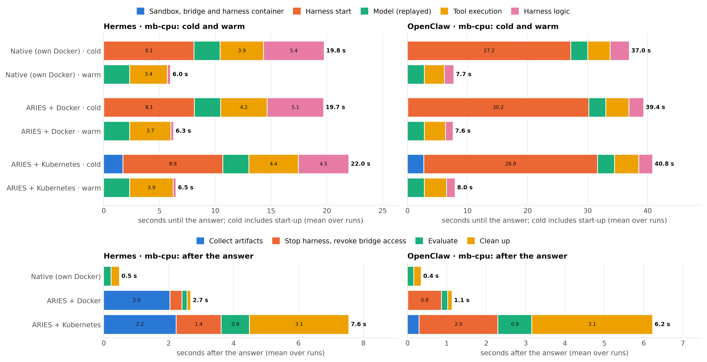
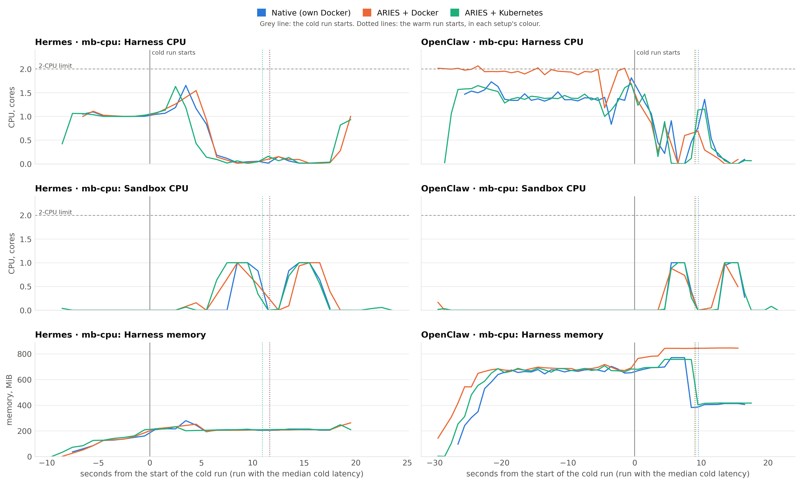

# `mb-cpu`: time breakdown

*Generated by `scripts/experiment/report.py`; back to the [campaign report](../report.md).*

The agent runs a fixed 3,000,000-step SHA-256 chain; the verifier checks the final hash. It isolates a CPU-bound call, about 2.5 s on a 2.4 GHz core.

Means ± standard deviation over the valid runs, in seconds unless marked; the last columns are each ARIES setup's mean minus native's.

- **Start-up:** the phases before the first request. The harness starts while the sandbox starts, so the *alongside* phases overlap the harness start, and start-up is less than their sum.
- **Run:** model time is how long a request offering tools was open. Tool execution is timed by the harness, the same way in every setup: Hermes's tool spans, or OpenClaw's session log from the tool-calling reply to the tool's result. Harness logic is the rest of the run: the harness's own work.
- **Harness overhead:** the harness's own time, beside the model and the tools. Cold, it is the harness start plus the cold run's harness logic; warm, the warm run's harness logic.
- **Tool calls:** what one agent tool call costs, from the agent's side. Natively the harness runs the command in its own container; through ARIES the request goes harness → bridge → sandbox and back.
  - *Per call, as the harness timed it:* the whole call, by the harness's own clock. It is timed the same way in every setup, so compare setups on this row.
  - *Commands the bridge ran:* every request the bridge served in the sandbox. One agent call is several: OpenClaw syncs its workspace before each command, and Hermes opens a terminal session (connection checks, environment, a shell snapshot) before its first command.
  - *Per call, the bridge running its commands:* the bridge's time running all of them, divided by the agent's calls.
  - *Per call, transport:* the whole call minus the bridge's share: requests travelling between harness, bridge and sandbox, and any gaps between the bridge's commands. It is a remainder, not a network measurement.
  - Native runs have no bridge, so only the whole call is shown.
  - **–** in a cold run: the bridge ran more commands cold than warm, because the harness also set itself up through the bridge before any agent call (Hermes opens a terminal session when the agent starts). Those commands belong to no call, so the bridge share and transport are left out.

## Figures

PDFs are beside the PNGs in `../figures/tasks/`.

### Time breakdown

### Resources over time

Each setup's run with the median cold latency, timed from the start of its cold run, so start-up is to the left of zero. CPU is the rate of the container's CPU counter over one-second bins.

## OpenClaw

Runs: Native 5, ARIES Docker 5, ARIES K8s 5.

| Measure | Native | ARIES Docker | ARIES K8s | ARIES Docker − native | ARIES K8s − native |
|---|---|---|---|---|---|
| ***Start-up, until the first request*** | | | | | |
| Sandbox reservation (`sandbox_reserve`) | – | 0.00 ± 0.00 | 0.15 ± 0.00 | – | – |
| Bridge endpoint reservation (`bridge_reserve`) | – | 0.02 ± 0.00 | 0.08 ± 0.00 | – | – |
| Harness container or pod creation (`harness_prepare`) | – | 0.03 ± 0.00 | 2.50 ± 0.01 | – | – |
| Harness start, until it reports ready (`harness_start`) | 27.21 ± 0.16 | 30.16 ± 0.09 | 28.95 ± 0.06 | +2.95 | +1.73 |
| *Alongside:* sandbox start (`sandbox_start`) | – | 0.17 ± 0.01 | 1.87 ± 0.01 | – | – |
| *Alongside:* sandbox sanitising (`sandbox_prepare`) | – | 0.10 ± 0.00 | 0.21 ± 0.00 | – | – |
| *Alongside:* bridge binding the sandbox (`bridge_register`) | – | 0.06 ± 0.00 | 0.18 ± 0.00 | – | – |
| **Start-up to the first request** | 27.21 ± 0.16 | 30.21 ± 0.09 | 31.68 ± 0.06 | +3.00 | +4.46 |
| ***Cold run, from the request to the answer*** | | | | | |
| Model (replayed) | 2.82 ± 0.00 | 2.82 ± 0.00 | 2.82 ± 0.00 | -0.00 | -0.00 |
| Tool execution, as the harness timed it | 3.74 ± 0.38 | 3.88 ± 0.29 | 4.04 ± 0.23 | +0.13 | +0.30 |
| Harness logic | 3.19 ± 0.09 | 2.46 ± 0.13 | 2.30 ± 0.10 | -0.73 | -0.89 |
| **Cold run** | 9.76 ± 0.29 | 9.15 ± 0.36 | 9.16 ± 0.19 | -0.60 | -0.59 |
| **Cold latency: start-up and run** | 36.97 ± 0.38 | 39.36 ± 0.40 | 40.84 ± 0.19 | +2.39 | +3.87 |
| Harness overhead: harness start and logic | 30.41 ± 0.13 | 32.62 ± 0.21 | 31.25 ± 0.12 | +2.21 | +0.85 |
| Model calls the agent waited on | 2.0 ± 0.0 | 2.0 ± 0.0 | 2.0 ± 0.0 | +0.0 | +0.0 |
| ***Warm run, the same task on the running harness and sandbox*** | | | | | |
| Model (replayed) | 2.82 ± 0.00 | 2.82 ± 0.00 | 2.82 ± 0.00 | +0.00 | +0.00 |
| Tool execution, as the harness timed it | 3.35 ± 0.03 | 3.52 ± 0.06 | 3.71 ± 0.06 | +0.18 | +0.37 |
| Harness logic, its overhead when warm | 1.57 ± 0.02 | 1.28 ± 0.07 | 1.43 ± 0.05 | -0.30 | -0.14 |
| **Warm latency** | 7.74 ± 0.04 | 7.62 ± 0.12 | 7.96 ± 0.09 | -0.12 | +0.22 |
| Model calls the agent waited on | 2.0 ± 0.0 | 2.0 ± 0.0 | 2.0 ± 0.0 | +0.0 | +0.0 |

### Tool calls

| Measure | Native | ARIES Docker | ARIES K8s | ARIES Docker − native | ARIES K8s − native |
|---|---|---|---|---|---|
| ***Tool calls, cold run*** | | | | | |
| Agent tool calls | 1.0 ± 0.0 | 1.0 ± 0.0 | 1.0 ± 0.0 | +0.0 | +0.0 |
| Commands the bridge ran for them | – | 5.0 ± 0.0 | 5.0 ± 0.0 | – | – |
| Per call, as the harness timed it | 3743 ± 376 | 3876 ± 293 | 4038 ± 225 | +133 | +296 |
| Per call, the bridge running its commands | – | 3579 ± 295 | 3687 ± 235 | – | – |
| Per call, transport between harness and sandbox | – | 296 ± 6 | 351 ± 62 | – | – |
| ***Tool calls, warm run*** | | | | | |
| Agent tool calls | 1.0 ± 0.0 | 1.0 ± 0.0 | 1.0 ± 0.0 | +0.0 | +0.0 |
| Commands the bridge ran for them | – | 5.0 ± 0.0 | 5.0 ± 0.0 | – | – |
| Per call, as the harness timed it | 3345 ± 30 | 3521 ± 63 | 3713 ± 61 | +175 | +368 |
| Per call, the bridge running its commands | – | 3387 ± 67 | 3579 ± 63 | – | – |
| Per call, transport between harness and sandbox | – | 134 ± 6 | 135 ± 2 | – | – |

### After the answer and resources

| Measure | Native | ARIES Docker | ARIES K8s | ARIES Docker − native | ARIES K8s − native |
|---|---|---|---|---|---|
| ***After the answer*** | | | | | |
| Collect the harness's artifacts (`harness_collect`) | – | 0.01 ± 0.00 | 0.30 ± 0.00 | – | – |
| Stop the harness, revoke bridge access (`isolation`) | – | 0.86 ± 0.02 | 2.00 ± 0.19 | – | – |
| Evaluate (`evaluation`) | 0.16 ± 0.00 | 0.16 ± 0.00 | 0.86 ± 0.01 | -0.00 | +0.70 |
| Clean up (`cleanup`) | 0.19 ± 0.01 | 0.11 ± 0.01 | 3.07 ± 0.01 | -0.08 | +2.88 |
| **After the answer** | 0.35 ± 0.01 | 1.13 ± 0.02 | 6.23 ± 0.19 | +0.78 | +5.88 |
| ***Resources, over the whole task*** | | | | | |
| Harness CPU, mean (% of one core) | 105 ± 1 | 136 ± 1 | 100 ± 1 | +31 | -5 |
| Harness CPU, peak (% of one core) | 175 ± 4 | 206 ± 2 | 173 ± 4 | +31 | -2 |
| Harness memory, peak (MiB) | 773 ± 18 | 902 ± 124 | 995 ± 248 | +129 | +222 |
| Sandbox CPU, mean (% of one core) | 45 ± 3 | 14 ± 1 | 13 ± 0 | -30 | -32 |
| Sandbox CPU, peak (% of one core) | 100 ± 0 | 100 ± 0 | 100 ± 0 | -0 | -0 |
| Sandbox memory, peak (MiB) | 8 ± 0 | 8 ± 0 | 8 ± 0 | -0 | -0 |

### Each repetition (latency, seconds)

| Repetition | Native cold | Native warm | ARIES Docker cold | ARIES Docker warm | ARIES K8s cold | ARIES K8s warm |
|---|---|---|---|---|---|---|
| 1 | 37.53 | 7.68 | 39.38 | 7.67 | 40.86 | 7.83 |
| 2 | 37.21 | 7.72 | 40.04 | 7.77 | 40.77 | 7.95 |
| 3 | 36.71 | 7.78 | 39.10 | 7.66 | 40.78 | 8.07 |
| 4 | 36.75 | 7.76 | 39.20 | 7.47 | 40.63 | 8.00 |
| 5 | 36.65 | 7.75 | 39.10 | 7.51 | 41.15 | 7.96 |

## Hermes

Runs: Native 5, ARIES Docker 5, ARIES K8s 5.

| Measure | Native | ARIES Docker | ARIES K8s | ARIES Docker − native | ARIES K8s − native |
|---|---|---|---|---|---|
| ***Start-up, until the first request*** | | | | | |
| Sandbox reservation (`sandbox_reserve`) | – | 0.00 ± 0.00 | 0.15 ± 0.00 | – | – |
| Bridge endpoint reservation (`bridge_reserve`) | – | 0.00 ± 0.00 | 0.07 ± 0.00 | – | – |
| Harness container or pod creation (`harness_prepare`) | – | 0.02 ± 0.00 | 1.52 ± 0.01 | – | – |
| Harness start, until it reports ready (`harness_start`) | 8.10 ± 0.10 | 8.12 ± 0.14 | 8.95 ± 0.50 | +0.02 | +0.85 |
| *Alongside:* sandbox start (`sandbox_start`) | – | 0.16 ± 0.01 | 1.90 ± 0.01 | – | – |
| *Alongside:* sandbox sanitising (`sandbox_prepare`) | – | 0.10 ± 0.00 | 0.22 ± 0.00 | – | – |
| *Alongside:* bridge binding the sandbox (`bridge_register`) | – | 0.00 ± 0.00 | 0.07 ± 0.00 | – | – |
| **Start-up to the first request** | 8.10 ± 0.10 | 8.14 ± 0.14 | 10.68 ± 0.50 | +0.04 | +2.57 |
| ***Cold run, from the request to the answer*** | | | | | |
| Model (replayed) | 2.34 ± 0.00 | 2.34 ± 0.00 | 2.34 ± 0.00 | +0.00 | -0.00 |
| Tool execution, as the harness timed it | 3.89 ± 0.27 | 4.18 ± 0.22 | 4.43 ± 0.18 | +0.29 | +0.54 |
| Harness logic | 5.43 ± 0.08 | 5.07 ± 0.15 | 4.52 ± 0.52 | -0.36 | -0.90 |
| **Cold run** | 11.66 ± 0.29 | 11.58 ± 0.22 | 11.29 ± 0.63 | -0.07 | -0.37 |
| **Cold latency: start-up and run** | 19.76 ± 0.28 | 19.72 ± 0.27 | 21.97 ± 0.17 | -0.04 | +2.21 |
| Harness overhead: harness start and logic | 13.53 ± 0.12 | 13.19 ± 0.07 | 13.47 ± 0.04 | -0.34 | -0.06 |
| Model calls the agent waited on | 3.0 ± 0.0 | 3.0 ± 0.0 | 3.0 ± 0.0 | +0.0 | +0.0 |
| ***Warm run, the same task on the running harness and sandbox*** | | | | | |
| Model (replayed) | 2.34 ± 0.00 | 2.34 ± 0.00 | 2.34 ± 0.00 | -0.00 | -0.00 |
| Tool execution, as the harness timed it | 3.38 ± 0.00 | 3.69 ± 0.09 | 3.90 ± 0.09 | +0.31 | +0.52 |
| Harness logic, its overhead when warm | 0.28 ± 0.00 | 0.24 ± 0.05 | 0.24 ± 0.02 | -0.03 | -0.04 |
| **Warm latency** | 5.99 ± 0.00 | 6.27 ± 0.07 | 6.48 ± 0.10 | +0.28 | +0.49 |
| Model calls the agent waited on | 3.0 ± 0.0 | 3.0 ± 0.0 | 3.0 ± 0.0 | +0.0 | +0.0 |

### Tool calls

| Measure | Native | ARIES Docker | ARIES K8s | ARIES Docker − native | ARIES K8s − native |
|---|---|---|---|---|---|
| ***Tool calls, cold run*** | | | | | |
| Agent tool calls | 1.0 ± 0.0 | 1.0 ± 0.0 | 1.0 ± 0.0 | +0.0 | +0.0 |
| Commands the bridge ran for them | – | 28.0 ± 0.0 | 28.0 ± 0.0 | – | – |
| Per call, as the harness timed it | 3889 ± 266 | 4178 ± 217 | 4425 ± 185 | +289 | +536 |
| ***Tool calls, warm run*** | | | | | |
| Agent tool calls | 1.0 ± 0.0 | 1.0 ± 0.0 | 1.0 ± 0.0 | +0.0 | +0.0 |
| Commands the bridge ran for them | – | 14.0 ± 0.0 | 14.0 ± 0.0 | – | – |
| Per call, as the harness timed it | 3376 ± 0 | 3687 ± 90 | 3899 ± 86 | +310 | +522 |
| Per call, the bridge running its commands | – | 3442 ± 96 | 3674 ± 64 | – | – |
| Per call, transport between harness and sandbox | – | 245 ± 23 | 225 ± 34 | – | – |

### After the answer and resources

| Measure | Native | ARIES Docker | ARIES K8s | ARIES Docker − native | ARIES K8s − native |
|---|---|---|---|---|---|
| ***After the answer*** | | | | | |
| Collect the harness's artifacts (`harness_collect`) | – | 2.04 ± 0.01 | 2.23 ± 0.00 | – | – |
| Stop the harness, revoke bridge access (`isolation`) | – | 0.37 ± 0.01 | 1.39 ± 0.21 | – | – |
| Evaluate (`evaluation`) | 0.23 ± 0.00 | 0.16 ± 0.00 | 0.87 ± 0.01 | -0.07 | +0.64 |
| Clean up (`cleanup`) | 0.26 ± 0.02 | 0.11 ± 0.01 | 3.06 ± 0.01 | -0.15 | +2.80 |
| **After the answer** | 0.49 ± 0.02 | 2.69 ± 0.01 | 7.55 ± 0.22 | +2.20 | +7.06 |
| ***Resources, over the whole task*** | | | | | |
| Harness CPU, mean (% of one core) | 59 ± 0 | 57 ± 1 | 55 ± 0 | -2 | -4 |
| Harness CPU, peak (% of one core) | 156 ± 9 | 158 ± 6 | 156 ± 8 | +3 | +1 |
| Harness memory, peak (MiB) | 257 ± 15 | 262 ± 14 | 257 ± 7 | +5 | +0 |
| Sandbox CPU, mean (% of one core) | 27 ± 1 | 27 ± 1 | 22 ± 1 | -1 | -6 |
| Sandbox CPU, peak (% of one core) | 100 ± 0 | 100 ± 0 | 100 ± 0 | +0 | -0 |
| Sandbox memory, peak (MiB) | 9 ± 0 | 9 ± 0 | 8 ± 0 | +0 | -0 |

### Each repetition (latency, seconds)

| Repetition | Native cold | Native warm | ARIES Docker cold | ARIES Docker warm | ARIES K8s cold | ARIES K8s warm |
|---|---|---|---|---|---|---|
| 1 | 19.60 | 5.99 | 19.89 | 6.27 | 22.11 | 6.42 |
| 2 | 19.72 | 5.99 | 19.90 | 6.16 | 21.98 | 6.42 |
| 3 | 19.48 | 5.99 | 19.96 | 6.37 | 22.08 | 6.65 |
| 4 | 19.79 | 5.99 | 19.50 | 6.27 | 21.67 | 6.46 |
| 5 | 20.21 | 5.99 | 19.37 | 6.26 | 21.99 | 6.44 |
