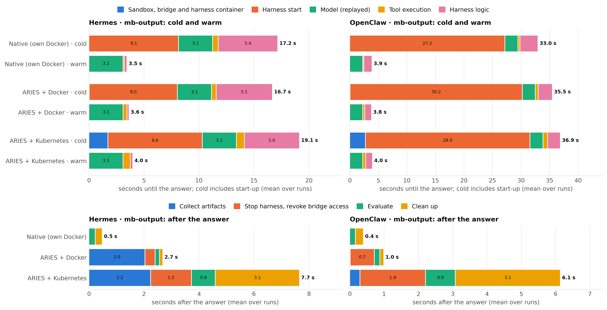
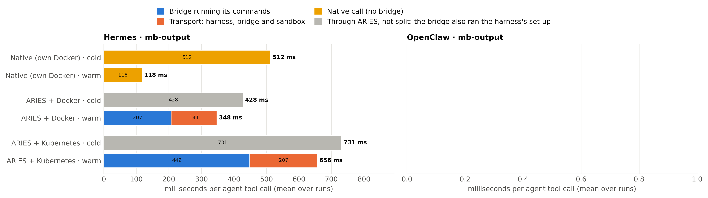

# `mb-output`: time breakdown

*Generated by `scripts/experiment/report.py`; back to the [campaign report](../report.md).*

The agent prints 66,399 bytes of `base64`; the verifier checks the saved copy's size. It isolates output carried back through the bridge.

Means ± standard deviation over the valid runs, in seconds unless marked; the last columns are each ARIES setup's mean minus native's.

- **Start-up:** the phases before the first request. The harness starts while the sandbox starts, so the *alongside* phases overlap the harness start, and start-up is less than their sum.
- **Run:** model time is how long a request offering tools was open. Tool execution is timed by the harness, the same way in every setup: Hermes's tool spans, or OpenClaw's session log from the tool-calling reply to the tool's result. Harness logic is the rest of the run: the harness's own work.
- **Harness overhead:** the harness's own time, beside the model and the tools. Cold, it is the harness start plus the cold run's harness logic; warm, the warm run's harness logic.
- **Tool calls:** the bridge runs more commands than the agent makes calls, because the harness also runs its own, such as OpenClaw's workspace sync, so its time is divided by the agent's calls. **Transport** is the harness-timed time per call minus the bridge's: the round trips between harness, bridge and sandbox. Native runs have no bridge. A cold run that ran more bridge commands than its warm run also ran the harness's own set-up through the bridge, outside any agent call, so its bridge share and transport are left out (–).

## Figures

PDFs are beside the PNGs in `../figures/tasks/`.

### Time breakdown

### Cost of a tool call

## OpenClaw

Runs: Native 5, ARIES Docker 5, ARIES K8s 5.

| Measure | Native | ARIES Docker | ARIES K8s | ARIES Docker − native | ARIES K8s − native |
|---|---|---|---|---|---|
| ***Start-up, until the first request*** | | | | | |
| Sandbox reservation (`sandbox_reserve`) | – | 0.00 ± 0.00 | 0.15 ± 0.00 | – | – |
| Bridge endpoint reservation (`bridge_reserve`) | – | 0.02 ± 0.00 | 0.08 ± 0.00 | – | – |
| Harness container or pod creation (`harness_prepare`) | – | 0.03 ± 0.00 | 2.50 ± 0.01 | – | – |
| Harness start, until it reports ready (`harness_start`) | 27.17 ± 0.16 | 30.17 ± 0.16 | 28.85 ± 0.11 | +3.00 | +1.68 |
| *Alongside:* sandbox start (`sandbox_start`) | – | 0.17 ± 0.01 | 1.87 ± 0.01 | – | – |
| *Alongside:* sandbox sanitising (`sandbox_prepare`) | – | 0.10 ± 0.00 | 0.21 ± 0.00 | – | – |
| *Alongside:* bridge binding the sandbox (`bridge_register`) | – | 0.06 ± 0.00 | 0.18 ± 0.00 | – | – |
| **Start-up to the first request** | 27.17 ± 0.16 | 30.22 ± 0.16 | 31.58 ± 0.10 | +3.05 | +4.41 |
| ***Cold run, from the request to the answer*** | | | | | |
| Model (replayed) | 2.28 ± 0.00 | 2.28 ± 0.00 | 2.28 ± 0.00 | +0.00 | +0.00 |
| Tool execution, as the harness timed it | 0.36 ± 0.01 | 0.54 ± 0.01 | 0.81 ± 0.10 | +0.18 | +0.45 |
| Harness logic | 3.17 ± 0.04 | 2.46 ± 0.02 | 2.22 ± 0.01 | -0.71 | -0.95 |
| **Cold run** | 5.80 ± 0.04 | 5.27 ± 0.02 | 5.31 ± 0.10 | -0.53 | -0.49 |
| **Cold latency: start-up and run** | 32.98 ± 0.14 | 35.49 ± 0.17 | 36.89 ± 0.07 | +2.51 | +3.91 |
| Harness overhead: harness start and logic | 30.34 ± 0.14 | 32.62 ± 0.17 | 31.07 ± 0.11 | +2.28 | +0.73 |
| Model calls the agent waited on | 2.0 ± 0.0 | 2.0 ± 0.0 | 2.0 ± 0.0 | +0.0 | +0.0 |
| ***Warm run, the same task on the running harness and sandbox*** | | | | | |
| Model (replayed) | 2.28 ± 0.00 | 2.28 ± 0.00 | 2.28 ± 0.00 | +0.00 | -0.00 |
| Tool execution, as the harness timed it | 0.20 ± 0.00 | 0.34 ± 0.01 | 0.52 ± 0.00 | +0.14 | +0.32 |
| Harness logic, its overhead when warm | 1.40 ± 0.06 | 1.20 ± 0.01 | 1.19 ± 0.01 | -0.21 | -0.22 |
| **Warm latency** | 3.88 ± 0.05 | 3.82 ± 0.01 | 3.98 ± 0.01 | -0.06 | +0.10 |
| Model calls the agent waited on | 2.0 ± 0.0 | 2.0 ± 0.0 | 2.0 ± 0.0 | +0.0 | +0.0 |

### Tool calls

| Measure | Native | ARIES Docker | ARIES K8s | ARIES Docker − native | ARIES K8s − native |
|---|---|---|---|---|---|
| ***Tool calls, cold run*** | | | | | |
| Agent tool calls | 0.0 ± 0.0 | 0.0 ± 0.0 | 0.0 ± 0.0 | +0.0 | +0.0 |
| Commands the bridge ran for them | – | 5.0 ± 0.0 | 5.0 ± 0.0 | – | – |
| ***Tool calls, warm run*** | | | | | |
| Agent tool calls | 0.0 ± 0.0 | 0.0 ± 0.0 | 0.0 ± 0.0 | +0.0 | +0.0 |
| Commands the bridge ran for them | – | 5.0 ± 0.0 | 5.0 ± 0.0 | – | – |

### After the answer and resources

| Measure | Native | ARIES Docker | ARIES K8s | ARIES Docker − native | ARIES K8s − native |
|---|---|---|---|---|---|
| ***After the answer*** | | | | | |
| Collect the harness's artifacts (`harness_collect`) | – | 0.01 ± 0.00 | 0.30 ± 0.00 | – | – |
| Stop the harness, revoke bridge access (`isolation`) | – | 0.70 ± 0.01 | 1.91 ± 0.07 | – | – |
| Evaluate (`evaluation`) | 0.16 ± 0.01 | 0.16 ± 0.00 | 0.86 ± 0.01 | -0.00 | +0.70 |
| Clean up (`cleanup`) | 0.24 ± 0.01 | 0.11 ± 0.01 | 3.06 ± 0.01 | -0.12 | +2.83 |
| **After the answer** | 0.40 ± 0.01 | 0.99 ± 0.01 | 6.14 ± 0.07 | +0.59 | +5.74 |
| ***Resources, over the whole task*** | | | | | |
| Harness CPU, mean (% of one core) | 125 ± 1 | 163 ± 2 | 116 ± 3 | +37 | -9 |
| Harness CPU, peak (% of one core) | 173 ± 5 | 206 ± 3 | 212 ± 57 | +33 | +39 |
| Harness memory, peak (MiB) | 884 ± 186 | 819 ± 30 | 797 ± 19 | -65 | -87 |
| Sandbox CPU, mean (% of one core) | 2 ± 0 | 1 ± 0 | 0 ± 0 | -1 | -1 |
| Sandbox CPU, peak (% of one core) | 5 ± 1 | 13 ± 3 | 6 ± 2 | +8 | +1 |
| Sandbox memory, peak (MiB) | 1 ± 0 | 2 ± 2 | 1 ± 0 | +2 | +0 |

### Each repetition (latency, seconds)

| Repetition | Native cold | Native warm | ARIES Docker cold | ARIES Docker warm | ARIES K8s cold | ARIES K8s warm |
|---|---|---|---|---|---|---|
| 1 | 32.91 | 3.94 | 35.26 | 3.80 | 36.92 | 3.98 |
| 2 | 33.06 | 3.86 | 35.52 | 3.82 | 36.86 | 3.99 |
| 3 | 32.86 | 3.93 | 35.46 | 3.82 | 36.91 | 3.97 |
| 4 | 32.88 | 3.83 | 35.73 | 3.81 | 36.79 | 3.97 |
| 5 | 33.19 | 3.83 | 35.49 | 3.82 | 36.96 | 3.99 |

## Hermes

Runs: Native 5, ARIES Docker 5, ARIES K8s 5.

| Measure | Native | ARIES Docker | ARIES K8s | ARIES Docker − native | ARIES K8s − native |
|---|---|---|---|---|---|
| ***Start-up, until the first request*** | | | | | |
| Sandbox reservation (`sandbox_reserve`) | – | 0.00 ± 0.00 | 0.15 ± 0.00 | – | – |
| Bridge endpoint reservation (`bridge_reserve`) | – | 0.00 ± 0.00 | 0.07 ± 0.00 | – | – |
| Harness container or pod creation (`harness_prepare`) | – | 0.02 ± 0.00 | 1.51 ± 0.01 | – | – |
| Harness start, until it reports ready (`harness_start`) | 8.14 ± 0.14 | 8.02 ± 0.03 | 8.57 ± 0.37 | -0.12 | +0.43 |
| *Alongside:* sandbox start (`sandbox_start`) | – | 0.17 ± 0.01 | 1.90 ± 0.01 | – | – |
| *Alongside:* sandbox sanitising (`sandbox_prepare`) | – | 0.10 ± 0.00 | 0.22 ± 0.00 | – | – |
| *Alongside:* bridge binding the sandbox (`bridge_register`) | – | 0.00 ± 0.00 | 0.07 ± 0.01 | – | – |
| **Start-up to the first request** | 8.14 ± 0.14 | 8.04 ± 0.03 | 10.30 ± 0.37 | -0.10 | +2.15 |
| ***Cold run, from the request to the answer*** | | | | | |
| Model (replayed) | 3.10 ± 0.00 | 3.10 ± 0.00 | 3.10 ± 0.00 | +0.00 | +0.00 |
| Tool execution, as the harness timed it | 0.51 ± 0.01 | 0.43 ± 0.00 | 0.73 ± 0.03 | -0.08 | +0.22 |
| Harness logic | 5.40 ± 0.10 | 5.11 ± 0.03 | 5.01 ± 0.43 | -0.30 | -0.40 |
| **Cold run** | 9.02 ± 0.10 | 8.63 ± 0.03 | 8.84 ± 0.46 | -0.38 | -0.18 |
| **Cold latency: start-up and run** | 17.16 ± 0.06 | 16.68 ± 0.02 | 19.14 ± 0.14 | -0.48 | +1.98 |
| Harness overhead: harness start and logic | 13.55 ± 0.06 | 13.13 ± 0.02 | 13.58 ± 0.13 | -0.42 | +0.03 |
| Model calls the agent waited on | 3.0 ± 0.0 | 3.0 ± 0.0 | 3.0 ± 0.0 | +0.0 | +0.0 |
| ***Warm run, the same task on the running harness and sandbox*** | | | | | |
| Model (replayed) | 3.10 ± 0.00 | 3.10 ± 0.00 | 3.10 ± 0.00 | +0.00 | -0.00 |
| Tool execution, as the harness timed it | 0.12 ± 0.00 | 0.35 ± 0.00 | 0.66 ± 0.01 | +0.23 | +0.54 |
| Harness logic, its overhead when warm | 0.23 ± 0.00 | 0.19 ± 0.00 | 0.23 ± 0.01 | -0.04 | -0.00 |
| **Warm latency** | 3.45 ± 0.00 | 3.64 ± 0.00 | 3.99 ± 0.01 | +0.19 | +0.53 |
| Model calls the agent waited on | 3.0 ± 0.0 | 3.0 ± 0.0 | 3.0 ± 0.0 | +0.0 | +0.0 |

### Tool calls

| Measure | Native | ARIES Docker | ARIES K8s | ARIES Docker − native | ARIES K8s − native |
|---|---|---|---|---|---|
| ***Tool calls, cold run*** | | | | | |
| Agent tool calls | 1.0 ± 0.0 | 1.0 ± 0.0 | 1.0 ± 0.0 | +0.0 | +0.0 |
| Commands the bridge ran for them | – | 28.0 ± 0.0 | 28.0 ± 0.0 | – | – |
| Per call, as the harness timed it | 512 ± 10 | 428 ± 2 | 731 ± 26 | -84 | +219 |
| ***Tool calls, warm run*** | | | | | |
| Agent tool calls | 1.0 ± 0.0 | 1.0 ± 0.0 | 1.0 ± 0.0 | +0.0 | +0.0 |
| Commands the bridge ran for them | – | 14.0 ± 0.0 | 14.0 ± 0.0 | – | – |
| Per call, as the harness timed it | 118 ± 0 | 348 ± 2 | 656 ± 6 | +230 | +538 |
| Per call, the bridge running its commands | – | 207 ± 3 | 449 ± 9 | – | – |
| Per call, transport between harness and sandbox | – | 141 ± 1 | 207 ± 4 | – | – |

### After the answer and resources

| Measure | Native | ARIES Docker | ARIES K8s | ARIES Docker − native | ARIES K8s − native |
|---|---|---|---|---|---|
| ***After the answer*** | | | | | |
| Collect the harness's artifacts (`harness_collect`) | – | 2.04 ± 0.01 | 2.24 ± 0.01 | – | – |
| Stop the harness, revoke bridge access (`isolation`) | – | 0.37 ± 0.01 | 1.49 ± 0.34 | – | – |
| Evaluate (`evaluation`) | 0.23 ± 0.00 | 0.16 ± 0.00 | 0.87 ± 0.01 | -0.07 | +0.64 |
| Clean up (`cleanup`) | 0.26 ± 0.02 | 0.12 ± 0.01 | 3.06 ± 0.01 | -0.14 | +2.81 |
| **After the answer** | 0.48 ± 0.02 | 2.69 ± 0.01 | 7.66 ± 0.35 | +2.20 | +7.17 |
| ***Resources, over the whole task*** | | | | | |
| Harness CPU, mean (% of one core) | 76 ± 2 | 73 ± 1 | 69 ± 1 | -3 | -7 |
| Harness CPU, peak (% of one core) | 162 ± 5 | 165 ± 9 | 155 ± 6 | +3 | -7 |
| Harness memory, peak (MiB) | 248 ± 12 | 259 ± 13 | 266 ± 7 | +11 | +19 |
| Sandbox CPU, mean (% of one core) | 0 ± 0 | 3 ± 0 | 1 ± 0 | +2 | +1 |
| Sandbox CPU, peak (% of one core) | 5 ± 1 | 22 ± 4 | 6 ± 1 | +17 | +2 |
| Sandbox memory, peak (MiB) | 3 ± 2 | 2 ± 2 | 1 ± 1 | -0 | -2 |

### Each repetition (latency, seconds)

| Repetition | Native cold | Native warm | ARIES Docker cold | ARIES Docker warm | ARIES K8s cold | ARIES K8s warm |
|---|---|---|---|---|---|---|
| 1 | 17.09 | 3.46 | 16.67 | 3.65 | 19.08 | 3.98 |
| 2 | 17.18 | 3.46 | 16.68 | 3.64 | 19.14 | 3.98 |
| 3 | 17.17 | 3.45 | 16.68 | 3.64 | 18.94 | 3.98 |
| 4 | 17.25 | 3.45 | 16.65 | 3.64 | 19.32 | 4.01 |
| 5 | 17.11 | 3.45 | 16.71 | 3.64 | 19.21 | 3.98 |
