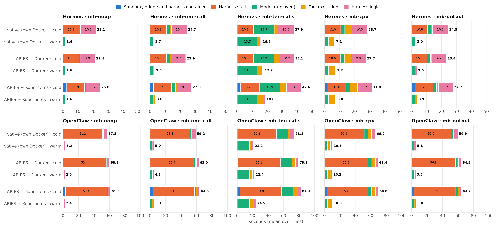
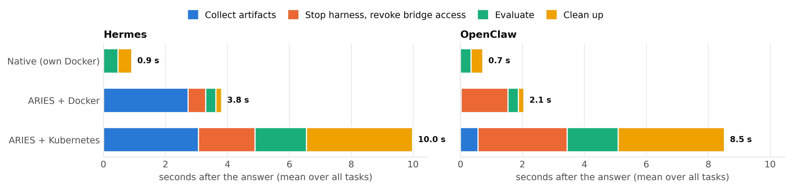

# coldwarm: campaign 20261115-e5-2630v3

*Generated by `scripts/experiment/report.py` from this campaign's runs; edit `notes.md`, not this file.*

## Setup

Cold and warm end-to-end latency of the microbenchmark tasks for each harness, with tools run natively, in an ARIES Docker sandbox and in an ARIES Kubernetes pod, the model held constant by record and replay.

| Setup | How tools run |
|---|---|
| **Native** | The harness's own Docker sandbox, with no ARIES involved: the baseline. |
| **ARIES Docker** | ARIES creates the sandbox as a Docker container; the harness reaches it through ARIES's tool bridge. |
| **ARIES K8s** | The same, with the harness, sandbox and bridge as Kubernetes pods. |

**Controls**
- **Hardware:** Intel(R) Xeon(R) CPU E5-2630 v3 @ 2.40GHz, 16 CPUs, SMT off, turbo off. Each harness runs on a worker of its own, and every setup of a harness on that worker.
- **Resources:** harness: 2 CPUs, 4096 MiB; sandbox: 2 CPUs, 4096 MiB.
- **Model:** each harness's replies were recorded once and replayed with their original timing, so model time is the same in every setup.
- **Resource measurement:** CPU and memory come from cAdvisor through Prometheus, sampled every second, the same way in every setup.
- **Runs:** 5 repetitions of every setup, each task run cold and then warm on the same harness and sandbox.

| Task | The agent | Isolates |
|---|---|---|
| `mb-noop` | replies without using a tool | harness, model and lifecycle cost |
| `mb-one-call` | runs `touch /tmp/mb-one` | one tool round trip |
| `mb-ten-calls` | runs ten `echo` commands, one tool call each, the first overwriting the file | the cost per call |
| `mb-cpu` | runs a fixed 3,000,000-step SHA-256 chain | a CPU-bound call, about 2.5 s on a 2.4 GHz core |
| `mb-output` | prints 66,399 bytes of `base64` | output carried back through the bridge |

## Stages of a task

- **Cold** is the first request on a fresh harness and sandbox, from the first start-up step to the answer:
  - **Start-up:** the sandbox and its bridge endpoint are reserved, the harness's container or pod is created and the harness started, while the sandbox starts and the bridge binds it.
  - **Harness start:** launching the harness and waiting until it reports ready, usually most of start-up.
  - **Model:** how long the agent waited on the (replayed) model.
  - **Tool execution:** the tool calls as the harness timed them, the trip to the sandbox included.
  - **Harness logic:** the rest, the harness's own work. With the harness start, it is the harness's overhead.
- **Warm** is the same task again on the running harness and sandbox: model, tool execution and harness logic.
- **After the answer**, which the user does not wait for: collecting the harness's artifacts, stopping it, evaluating and cleaning up.

## Figures

PDFs and every plotted number (`figures.csv`) are beside the PNGs in `figures/`.

### End-to-end time, cold and warm

### After the answer

## Results

Means over valid runs, in seconds. Each task's full breakdown is in its own report (below).

### OpenClaw

| Task | Native cold | ARIES Docker cold | ARIES K8s cold | Native warm | ARIES Docker warm | ARIES K8s warm |
|---|---|---|---|---|---|---|
| [`mb-noop`](tasks/mb-noop.md) | 57.48 | 60.24 | 61.50 | 3.16 | 2.49 | 2.40 |
| [`mb-one-call`](tasks/mb-one-call.md) | 59.20 | 63.02 | 63.96 | 4.99 | 4.77 | 5.33 |
| [`mb-ten-calls`](tasks/mb-ten-calls.md) | 73.83 | 79.35 | 82.43 | 21.16 | 22.37 | 24.46 |
| [`mb-cpu`](tasks/mb-cpu.md) | 66.19 | 69.38 | 69.79 | 10.61 | 10.22 | 10.59 |
| [`mb-output`](tasks/mb-output.md) | 59.91 | 64.50 | 64.67 | 5.75 | 5.55 | 5.99 |

### Hermes

| Task | Native cold | ARIES Docker cold | ARIES K8s cold | Native warm | ARIES Docker warm | ARIES K8s warm |
|---|---|---|---|---|---|---|
| [`mb-noop`](tasks/mb-noop.md) | 22.06 | 21.42 | 24.97 | 1.64 | 1.62 | 1.64 |
| [`mb-one-call`](tasks/mb-one-call.md) | 24.65 | 23.85 | 27.77 | 2.67 | 3.25 | 3.61 |
| [`mb-ten-calls`](tasks/mb-ten-calls.md) | 37.91 | 38.06 | 42.62 | 16.24 | 17.65 | 18.83 |
| [`mb-cpu`](tasks/mb-cpu.md) | 28.74 | 27.73 | 31.78 | 7.07 | 7.73 | 8.00 |
| [`mb-output`](tasks/mb-output.md) | 24.47 | 23.41 | 27.70 | 2.98 | 3.56 | 3.93 |

### Overhead against native

Each ARIES setup's mean minus native's, averaged over the tasks. Per tool call is the warm `mb-ten-calls` run's harness-timed tool execution divided by its calls.

| Harness | Setup | Start-up | Cold latency | Warm latency | Per tool call (ms) | Warm harness logic |
|---|---|---|---|---|---|---|
| OpenClaw | Native | 51.28 |  |  | 215 | 2.58 |
| OpenClaw | ARIES Docker | +5.04 | +3.98 | -0.06 | 390 | 1.97 |
| OpenClaw | ARIES K8s | +5.71 | +5.15 | +0.62 | 610 | 2.02 |
| Hermes | Native | 10.89 |  |  | 174 | 0.47 |
| Hermes | ARIES Docker | -0.24 | -0.67 | +0.64 | 314 | 0.47 |
| Hermes | ARIES K8s | +3.58 | +3.40 | +1.08 | 433 | 0.47 |

The native row's start-up column is native's own start-up; the other rows are differences from it. Per tool call and warm harness logic are absolute values in every row.

## Per-task reports

Every start-up phase, the cold and warm runs split into model, tool execution and harness logic, the harness's overhead, each tool call as the harness and the bridge timed it, what follows the answer, CPU and memory, and every repetition:

- [`mb-noop`](tasks/mb-noop.md)
- [`mb-one-call`](tasks/mb-one-call.md)
- [`mb-ten-calls`](tasks/mb-ten-calls.md)
- [`mb-cpu`](tasks/mb-cpu.md)
- [`mb-output`](tasks/mb-output.md)

## Runs

Runs per harness and setup, by status. Only valid runs are analysed.

| Harness | Setup | Valid | Failed | Superseded | Task runs solved |
|---|---|---|---|---|---|
| OpenClaw | Native | 5 | 0 | 0 | 25/25 |
| OpenClaw | ARIES Docker | 5 | 0 | 0 | 25/25 |
| OpenClaw | ARIES K8s | 5 | 0 | 1 | 25/25 |
| Hermes | Native | 5 | 0 | 0 | 25/25 |
| Hermes | ARIES Docker | 5 | 0 | 0 | 25/25 |
| Hermes | ARIES K8s | 5 | 0 | 1 | 25/25 |

Runs left out:

- `runs/openclaw/docker/record` (superseded): retried: aries exit 1
- `runs/hermes/k8s/1` (superseded): first Kubernetes pod on the node pulled the harness image (101 s); rerun with the image cached
- `runs/openclaw/k8s/1` (superseded): first Kubernetes pod on the node pulled the harness image (47 s); rerun with the image cached

Model requests not answered from the recording: 0.

## Provenance

| | |
|---|---|
| Experiment spec | `experiments/coldwarm/experiment.json` |
| ARIES commit | `88279641d3bce1d4065752e73e53fd480dd6fb21` |
| Bridge image | `aries-bridge:v1-ae286e55f01f` |
| vHive setup tool | `9826bb9c2af97d6478498df64879e8c30b21d31d` |
| Started, finished | 2026-11-15T03:10:02Z, 2026-11-15T05:30:24Z |
| Harnesses | openclaw, hermes |
| Setups | docker, k8s, native |
| Tasks | `mb-noop`, `mb-one-call`, `mb-ten-calls`, `mb-cpu`, `mb-output` |
| Repetitions | 5, each task run cold then warm |
| Recordings | recorded in this campaign |
| Recording `hermes` | sha256 `d21fee03969c1291` |
| Recording `openclaw` | sha256 `cd8832d5087cc488` |
| Note | OpenClaw's first recording on pc822 failed: the harness did not report ready within the 45 s start deadline. pc822 was rebuilt at the commit that raises it to 120 s and OpenClaw recorded again; Hermes on pc778 ran throughout at the campaign's starting commit, where its 8 s start was within the deadline. |

| Worker | Harnesses | ARIES commit | CPU | CPUs | Memory (GiB) | SMT | Turbo | Kernel | Kubelet | Docker |
|---|---|---|---|---|---|---|---|---|---|---|
| pc778 | hermes | `88279641d3bc` | Intel(R) Xeon(R) CPU E5-2630 v3 @ 2.40GHz | 16 | 62.8 | off | off | 6.8.0-149-generic | v1.35.3 | 29.8.2 |
| pc822 | openclaw | `20aab7060d59` | Intel(R) Xeon(R) CPU E5-2630 v3 @ 2.40GHz | 16 | 62.8 | off | off | 6.8.0-149-generic | v1.35.3 | 29.8.2 |

The full per-variant analysis is in `analysis/analysis.md`, one row per task run in `analysis/tasks.csv`.

## Notes

### About this campaign

This is the cold and warm experiment on a new cluster built with vHive's setup
tool. The workers are dual-socket Xeon E5-2630 v3 nodes with 16 cores and
62 GiB, SMT and turbo off, and the clock pinned at 2.4 GHz. Under load the
cores run at 2.4 GHz. The cluster runs Kubernetes 1.35.3, Docker 29.8.2 and
kernel 6.8.

Each harness's model replies were recorded afresh, with the cold and the warm
run recorded separately. Every replayed request was answered from its
recording. Model time therefore matches across setups within this campaign,
but not with the earlier campaign's recordings.

Three runs are kept but left out of the analysis:
- **OpenClaw's first recording** failed because the harness did not report
  ready within ARIES's 45 s start deadline. The deadline was raised to 120 s
  and OpenClaw recorded again on a rebuilt pc822 (see `meta.json`).
- **The first Kubernetes repetition of each harness** included pulling the
  harness image into the node's containerd: 47 s for OpenClaw and 101 s for
  Hermes, on `mb-noop`'s pod. Each was rerun with the image cached. Later
  campaigns avoid this with a warm-up run per setup.

### What the results show

- **Cold latency is mostly the harness starting itself.** OpenClaw takes
  51–56 s to report ready, and Hermes 11–12 s. This dwarfs everything ARIES
  adds.
- **ARIES + Docker against native, cold:**
  - **Hermes:** level with native; slightly faster on four of the five tasks.
  - **OpenClaw:** 2.8–5.5 s slower, almost all of it a longer harness start
    (56.2 against 51.3 s). Reserving the sandbox and bridge and creating the
    container cost 0.1 s.
- **Kubernetes adds start-up of its own.** Creating the harness pod takes 2.9 s
  (OpenClaw) and 1.9 s (Hermes). The sandbox pod's start and bridge binding
  run alongside the harness start, partly hidden. Against native, cold latency
  rises by 5.2 s for OpenClaw and 3.4 s for Hermes.
- **Warm, the setups differ only in what a tool call costs.**
  - **No tools:** `mb-noop` is the same everywhere within 0.1 s for Hermes.
    OpenClaw's native harness logic is 0.7 s slower than through ARIES.
  - **Ten calls:** `mb-ten-calls` shows the gap. Per warm call:

    | Harness | Native | ARIES Docker | ARIES Kubernetes |
    |---|---|---|---|
    | OpenClaw | 215 ms | 390 ms | 610 ms |
    | Hermes | 174 ms | 314 ms | 433 ms |
- **Where a call's time goes through ARIES.** The bridge runs several commands
  per agent call: 4.1 for OpenClaw, whose workspace sync runs before each
  command, and 5 for Hermes. Per OpenClaw call, the bridge spends 209 ms on
  Docker and 434 ms on Kubernetes running them. About 180 ms is transport
  between harness, bridge and sandbox, which is about what a whole native call
  costs. Kubernetes's extra cost is in running the commands (exec into a pod),
  not in the transport.
- **Hermes's first request is slow in every setup:** about 10 s of harness
  logic cold, against 0.5 s warm. This is Hermes's first-use set-up (tool
  checks, terminal session), not ARIES; native shows the same.
- **After the answer:**
  - **Docker:** ARIES takes 2 s (OpenClaw) to 4 s (Hermes).
  - **Kubernetes:** 8.5–10 s. Cleaning up the sandbox pod takes 3.4 s, and
    evaluating, which runs in the pod, 1.7 s.
  - **Hermes's artifact export** takes 2.7–3.1 s in both ARIES setups.

  None of this adds to the user's wait, but it limits how quickly a worker
  takes the next task.

### Compared with the E5-2640 v4 campaign

The same setups and tasks ran on Broadwell nodes under Kubernetes 1.34
(`../20261102-e5-2640v4`). On these nodes almost everything is slower:

| Measure | OpenClaw, before | OpenClaw, now | Hermes, before | Hermes, now |
|---|---|---|---|---|
| Native harness start (s) | 27.2 | 51.3 | 8.1 | 10.9 |
| Warm tool call, native / Docker / K8s (ms) | 106 / 183 / 314 | 215 / 390 / 610 | 111 / 140 / 255 | 174 / 314 / 433 |
| `mb-cpu` warm tool execution, native (s) | 3.35 | 3.98 | 3.38 | 3.98 |

The CPU-bound task is 19% slower, but start-up and tool calls take up to about
twice as long. Short, bursty work suffers most. Likely contributors are:
- the older CPU generation, with two sockets;
- deep idle states (C6 is enabled, so idle cores wake slowly);
- the newer Docker, Kubernetes and kernel.

This campaign does not tell them apart. Compare setups within a campaign: the
ranking of setups and the shape of each breakdown hold on both clusters, but
absolute times do not carry over.

### Limits

- Five repetitions per setup. Standard deviations are in the per-task reports
  and are mostly small, but a single slow harness start moves a mean.
- One worker per harness, so a harness's setups share hardware, but the two
  harnesses ran on different nodes of the same type.
- Model replies are replayed with their recorded timing, so model time is
  constant by construction and says nothing about a live model.
- Native baselines record no stop step, and their clean-up does not confirm
  that the harness stopped. Their after-answer times are not strictly
  comparable.
