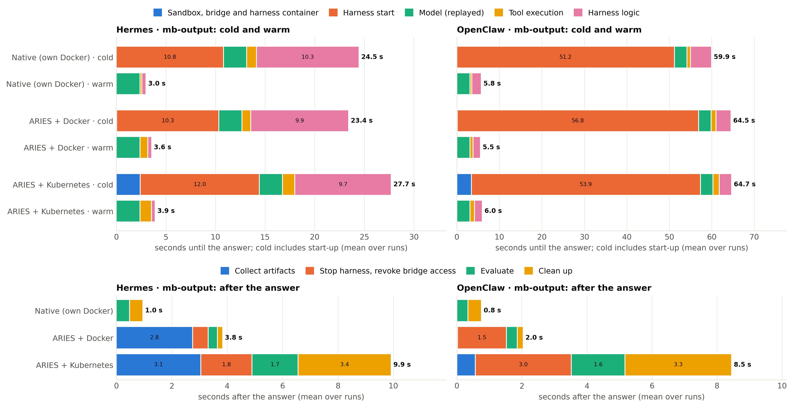
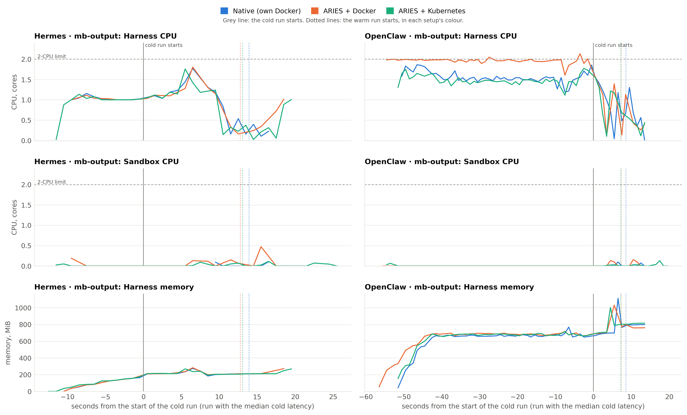

# `mb-output`: time breakdown

*Generated by `scripts/experiment/report.py`; back to the [campaign report](../report.md).*

The agent prints 66,399 bytes of `base64`; the verifier checks the saved copy's size. It isolates output carried back through the bridge.

Means ± standard deviation over the valid runs, in seconds unless marked; the last columns are each ARIES setup's mean minus native's.

- **Start-up:** the phases before the first request. The harness starts while the sandbox starts, so the *alongside* phases overlap the harness start, and start-up is less than their sum.
- **Run:** model time is how long a request offering tools was open. Tool execution is timed by the harness, the same way in every setup: Hermes's tool spans, or OpenClaw's session log from the tool-calling reply to the tool's result. Harness logic is the rest of the run: the harness's own work.
- **Harness overhead:** the harness's own time, beside the model and the tools. Cold, it is the harness start plus the cold run's harness logic; warm, the warm run's harness logic.
- **Tool calls:** what one agent tool call costs, from the agent's side. Natively the harness runs the command in its own container; through ARIES the request goes harness → bridge → sandbox and back.
  - *Per call, as the harness timed it:* the whole call, by the harness's own clock. It is timed the same way in every setup, so compare setups on this row.
  - *Commands the bridge ran:* every request the bridge served in the sandbox. One agent call is several: OpenClaw syncs its workspace before each command, and Hermes opens a terminal session (connection checks, environment, a shell snapshot) before its first command.
  - *Per call, the bridge running its commands:* the bridge's time running all of them, divided by the agent's calls.
  - *Per call, transport:* the whole call minus the bridge's share: requests travelling between harness, bridge and sandbox, and any gaps between the bridge's commands. It is a remainder, not a network measurement.
  - Native runs have no bridge, so only the whole call is shown.
  - **–** in a cold run: the bridge ran more commands cold than warm, because the harness also set itself up through the bridge before any agent call (Hermes opens a terminal session when the agent starts). Those commands belong to no call, so the bridge share and transport are left out.

## Figures

PDFs are beside the PNGs in `../figures/tasks/`.

### Time breakdown

### Resources over time

Each setup's run with the median cold latency, timed from the start of its cold run, so start-up is to the left of zero. CPU is the rate of the container's CPU counter over one-second bins.

## OpenClaw

Runs: Native 5, ARIES Docker 5, ARIES K8s 5.

| Measure | Native | ARIES Docker | ARIES K8s | ARIES Docker − native | ARIES K8s − native |
|---|---|---|---|---|---|
| ***Start-up, until the first request*** | | | | | |
| Sandbox reservation (`sandbox_reserve`) | – | 0.00 ± 0.00 | 0.29 ± 0.00 | – | – |
| Bridge endpoint reservation (`bridge_reserve`) | – | 0.05 ± 0.00 | 0.18 ± 0.00 | – | – |
| Harness container or pod creation (`harness_prepare`) | – | 0.04 ± 0.00 | 2.94 ± 0.13 | – | – |
| Harness start, until it reports ready (`harness_start`) | 51.21 ± 1.71 | 56.79 ± 1.63 | 53.90 ± 1.07 | +5.58 | +2.69 |
| *Alongside:* sandbox start (`sandbox_start`) | – | 0.31 ± 0.00 | 2.67 ± 0.14 | – | – |
| *Alongside:* sandbox sanitising (`sandbox_prepare`) | – | 0.21 ± 0.01 | 0.41 ± 0.01 | – | – |
| *Alongside:* bridge binding the sandbox (`bridge_register`) | – | 0.11 ± 0.00 | 0.35 ± 0.00 | – | – |
| **Start-up to the first request** | 51.21 ± 1.71 | 56.89 ± 1.63 | 57.31 ± 0.94 | +5.68 | +6.11 |
| ***Cold run, from the request to the answer*** | | | | | |
| Model (replayed) | 2.96 ± 0.00 | 2.97 ± 0.00 | 2.96 ± 0.00 | +0.00 | -0.00 |
| Tool execution, as the harness timed it | 0.79 ± 0.01 | 1.15 ± 0.03 | 1.47 ± 0.01 | +0.35 | +0.68 |
| Harness logic | 4.94 ± 0.11 | 3.50 ± 0.27 | 2.92 ± 0.18 | -1.44 | -2.02 |
| **Cold run** | 8.70 ± 0.11 | 7.61 ± 0.29 | 7.36 ± 0.18 | -1.09 | -1.34 |
| **Cold latency: start-up and run** | 59.91 ± 1.69 | 64.50 ± 1.85 | 64.67 ± 1.03 | +4.59 | +4.76 |
| Harness overhead: harness start and logic | 56.15 ± 1.70 | 60.29 ± 1.84 | 56.82 ± 1.15 | +4.14 | +0.67 |
| Model calls the agent waited on | 2.0 ± 0.0 | 2.0 ± 0.0 | 2.0 ± 0.0 | +0.0 | +0.0 |
| ***Warm run, the same task on the running harness and sandbox*** | | | | | |
| Model (replayed) | 3.08 ± 0.00 | 3.08 ± 0.00 | 3.08 ± 0.00 | +0.00 | +0.00 |
| Tool execution, as the harness timed it | 0.43 ± 0.01 | 0.74 ± 0.01 | 1.06 ± 0.01 | +0.30 | +0.63 |
| Harness logic, its overhead when warm | 2.24 ± 0.25 | 1.73 ± 0.14 | 1.85 ± 0.26 | -0.51 | -0.39 |
| **Warm latency** | 5.75 ± 0.25 | 5.55 ± 0.14 | 5.99 ± 0.26 | -0.21 | +0.24 |
| Model calls the agent waited on | 2.0 ± 0.0 | 2.0 ± 0.0 | 2.0 ± 0.0 | +0.0 | +0.0 |

### Tool calls

| Measure | Native | ARIES Docker | ARIES K8s | ARIES Docker − native | ARIES K8s − native |
|---|---|---|---|---|---|
| ***Tool calls, cold run*** | | | | | |
| Agent tool calls | 0.0 ± 0.0 | 0.0 ± 0.0 | 0.0 ± 0.0 | +0.0 | +0.0 |
| Commands the bridge ran for them | – | 5.0 ± 0.0 | 5.0 ± 0.0 | – | – |
| ***Tool calls, warm run*** | | | | | |
| Agent tool calls | 0.0 ± 0.0 | 0.0 ± 0.0 | 0.0 ± 0.0 | +0.0 | +0.0 |
| Commands the bridge ran for them | – | 5.0 ± 0.0 | 5.0 ± 0.0 | – | – |

### After the answer and resources

| Measure | Native | ARIES Docker | ARIES K8s | ARIES Docker − native | ARIES K8s − native |
|---|---|---|---|---|---|
| ***After the answer*** | | | | | |
| Collect the harness's artifacts (`harness_collect`) | – | 0.02 ± 0.00 | 0.57 ± 0.01 | – | – |
| Stop the harness, revoke bridge access (`isolation`) | – | 1.50 ± 0.22 | 2.95 ± 0.26 | – | – |
| Evaluate (`evaluation`) | 0.34 ± 0.00 | 0.34 ± 0.00 | 1.65 ± 0.01 | -0.00 | +1.31 |
| Clean up (`cleanup`) | 0.42 ± 0.02 | 0.18 ± 0.01 | 3.28 ± 0.13 | -0.23 | +2.86 |
| **After the answer** | 0.76 ± 0.02 | 2.04 ± 0.22 | 8.45 ± 0.19 | +1.28 | +7.69 |
| ***Resources, over the whole task*** | | | | | |
| Harness CPU, mean (% of one core) | 140 ± 1 | 171 ± 2 | 129 ± 2 | +31 | -11 |
| Harness CPU, peak (% of one core) | 194 ± 7 | 208 ± 3 | 253 ± 109 | +15 | +60 |
| Harness memory, peak (MiB) | 1055 ± 89 | 1077 ± 137 | 974 ± 55 | +23 | -81 |
| Sandbox CPU, mean (% of one core) | 2 ± 0 | 1 ± 0 | 1 ± 0 | -1 | -1 |
| Sandbox CPU, peak (% of one core) | 11 ± 2 | 27 ± 10 | 11 ± 1 | +16 | +0 |
| Sandbox memory, peak (MiB) | 1 ± 0 | 3 ± 2 | 1 ± 0 | +3 | +0 |

### Each repetition (latency, seconds)

| Repetition | Native cold | Native warm | ARIES Docker cold | ARIES Docker warm | ARIES K8s cold | ARIES K8s warm |
|---|---|---|---|---|---|---|
| 1 | 61.34 | 5.66 | 64.96 | 5.48 | 66.42 | 5.97 |
| 2 | 60.44 | 5.50 | 62.96 | 5.78 | 63.99 | 6.35 |
| 3 | 61.14 | 5.92 | 62.84 | 5.58 | 64.29 | 5.75 |
| 4 | 57.18 | 5.58 | 64.36 | 5.43 | 63.91 | 5.74 |
| 5 | 59.45 | 6.11 | 67.39 | 5.46 | 64.74 | 6.13 |

## Hermes

Runs: Native 5, ARIES Docker 5, ARIES K8s 5.

| Measure | Native | ARIES Docker | ARIES K8s | ARIES Docker − native | ARIES K8s − native |
|---|---|---|---|---|---|
| ***Start-up, until the first request*** | | | | | |
| Sandbox reservation (`sandbox_reserve`) | – | 0.00 ± 0.00 | 0.29 ± 0.00 | – | – |
| Bridge endpoint reservation (`bridge_reserve`) | – | 0.00 ± 0.00 | 0.14 ± 0.00 | – | – |
| Harness container or pod creation (`harness_prepare`) | – | 0.04 ± 0.01 | 1.98 ± 0.14 | – | – |
| Harness start, until it reports ready (`harness_start`) | 10.80 ± 0.29 | 10.29 ± 0.27 | 12.01 ± 0.19 | -0.51 | +1.21 |
| *Alongside:* sandbox start (`sandbox_start`) | – | 0.31 ± 0.01 | 2.72 ± 0.13 | – | – |
| *Alongside:* sandbox sanitising (`sandbox_prepare`) | – | 0.20 ± 0.00 | 0.42 ± 0.01 | – | – |
| *Alongside:* bridge binding the sandbox (`bridge_register`) | – | 0.00 ± 0.00 | 0.14 ± 0.00 | – | – |
| **Start-up to the first request** | 10.80 ± 0.29 | 10.34 ± 0.27 | 14.43 ± 0.22 | -0.47 | +3.62 |
| ***Cold run, from the request to the answer*** | | | | | |
| Model (replayed) | 2.33 ± 0.00 | 2.33 ± 0.00 | 2.33 ± 0.00 | +0.00 | -0.00 |
| Tool execution, as the harness timed it | 1.00 ± 0.01 | 0.88 ± 0.04 | 1.23 ± 0.01 | -0.12 | +0.23 |
| Harness logic | 10.34 ± 0.33 | 9.87 ± 0.20 | 9.72 ± 0.32 | -0.47 | -0.62 |
| **Cold run** | 13.66 ± 0.33 | 13.08 ± 0.22 | 13.28 ± 0.33 | -0.59 | -0.39 |
| **Cold latency: start-up and run** | 24.47 ± 0.52 | 23.41 ± 0.20 | 27.70 ± 0.37 | -1.06 | +3.23 |
| Harness overhead: harness start and logic | 21.14 ± 0.52 | 20.16 ± 0.18 | 21.73 ± 0.26 | -0.98 | +0.59 |
| Model calls the agent waited on | 3.0 ± 0.0 | 3.0 ± 0.0 | 3.0 ± 0.0 | +0.0 | +0.0 |
| ***Warm run, the same task on the running harness and sandbox*** | | | | | |
| Model (replayed) | 2.39 ± 0.00 | 2.39 ± 0.00 | 2.39 ± 0.00 | -0.00 | +0.00 |
| Tool execution, as the harness timed it | 0.19 ± 0.00 | 0.78 ± 0.01 | 1.15 ± 0.00 | +0.58 | +0.96 |
| Harness logic, its overhead when warm | 0.40 ± 0.00 | 0.39 ± 0.01 | 0.38 ± 0.01 | -0.00 | -0.02 |
| **Warm latency** | 2.98 ± 0.00 | 3.56 ± 0.00 | 3.93 ± 0.01 | +0.58 | +0.95 |
| Model calls the agent waited on | 3.0 ± 0.0 | 3.0 ± 0.0 | 3.0 ± 0.0 | +0.0 | +0.0 |

### Tool calls

| Measure | Native | ARIES Docker | ARIES K8s | ARIES Docker − native | ARIES K8s − native |
|---|---|---|---|---|---|
| ***Tool calls, cold run*** | | | | | |
| Agent tool calls | 1.0 ± 0.0 | 1.0 ± 0.0 | 1.0 ± 0.0 | +0.0 | +0.0 |
| Commands the bridge ran for them | – | 28.0 ± 0.0 | 28.0 ± 0.0 | – | – |
| Per call, as the harness timed it | 1003 ± 9 | 882 ± 39 | 1233 ± 15 | -120 | +230 |
| ***Tool calls, warm run*** | | | | | |
| Agent tool calls | 1.0 ± 0.0 | 1.0 ± 0.0 | 1.0 ± 0.0 | +0.0 | +0.0 |
| Commands the bridge ran for them | – | 14.0 ± 0.0 | 14.0 ± 0.0 | – | – |
| Per call, as the harness timed it | 192 ± 2 | 775 ± 6 | 1155 ± 3 | +584 | +963 |
| Per call, the bridge running its commands | – | 429 ± 4 | 848 ± 3 | – | – |
| Per call, transport between harness and sandbox | – | 346 ± 9 | 307 ± 5 | – | – |

### After the answer and resources

| Measure | Native | ARIES Docker | ARIES K8s | ARIES Docker − native | ARIES K8s − native |
|---|---|---|---|---|---|
| ***After the answer*** | | | | | |
| Collect the harness's artifacts (`harness_collect`) | – | 2.76 ± 0.05 | 3.05 ± 0.02 | – | – |
| Stop the harness, revoke bridge access (`isolation`) | – | 0.56 ± 0.02 | 1.85 ± 0.30 | – | – |
| Evaluate (`evaluation`) | 0.48 ± 0.00 | 0.33 ± 0.00 | 1.66 ± 0.01 | -0.15 | +1.18 |
| Clean up (`cleanup`) | 0.48 ± 0.07 | 0.19 ± 0.01 | 3.36 ± 0.31 | -0.29 | +2.88 |
| **After the answer** | 0.96 ± 0.07 | 3.84 ± 0.03 | 9.92 ± 0.38 | +2.88 | +8.96 |
| ***Resources, over the whole task*** | | | | | |
| Harness CPU, mean (% of one core) | 94 ± 1 | 89 ± 1 | 83 ± 1 | -5 | -11 |
| Harness CPU, peak (% of one core) | 177 ± 5 | 178 ± 7 | 188 ± 16 | +1 | +11 |
| Harness memory, peak (MiB) | 265 ± 14 | 266 ± 18 | 271 ± 5 | +2 | +6 |
| Sandbox CPU, mean (% of one core) | 3 ± 1 | 4 ± 1 | 2 ± 0 | +2 | -1 |
| Sandbox CPU, peak (% of one core) | 18 ± 5 | 40 ± 6 | 11 ± 1 | +22 | -7 |
| Sandbox memory, peak (MiB) | 2 ± 2 | 5 ± 2 | 2 ± 2 | +3 | +0 |

### Each repetition (latency, seconds)

| Repetition | Native cold | Native warm | ARIES Docker cold | ARIES Docker warm | ARIES K8s cold | ARIES K8s warm |
|---|---|---|---|---|---|---|
| 1 | 24.37 | 2.98 | 23.49 | 3.56 | 27.88 | 3.92 |
| 2 | 24.74 | 2.98 | 23.66 | 3.56 | 28.16 | 3.91 |
| 3 | 23.69 | 2.97 | 23.12 | 3.56 | 27.62 | 3.94 |
| 4 | 24.47 | 2.98 | 23.46 | 3.55 | 27.72 | 3.93 |
| 5 | 25.08 | 2.98 | 23.33 | 3.56 | 27.15 | 3.93 |
