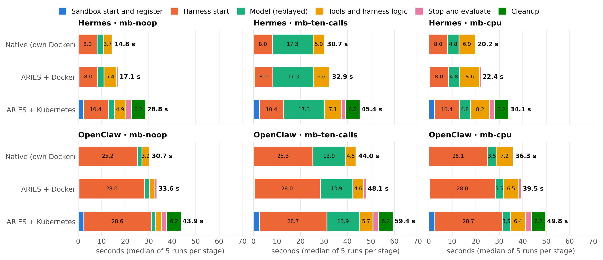
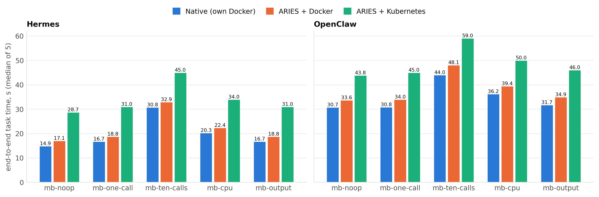
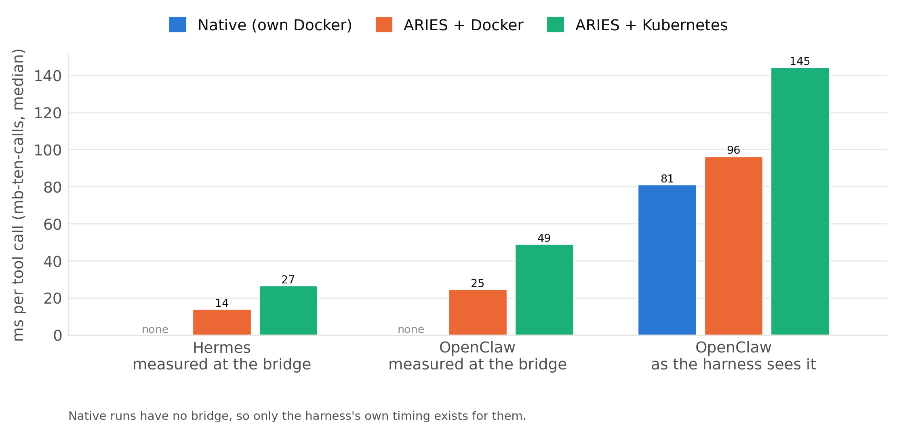
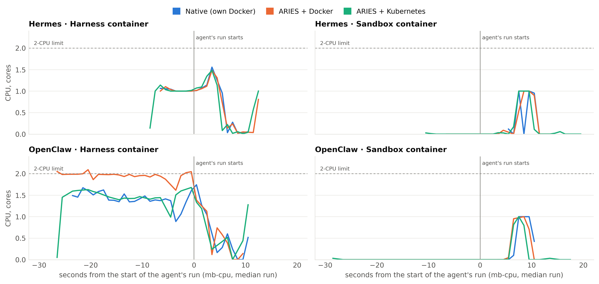
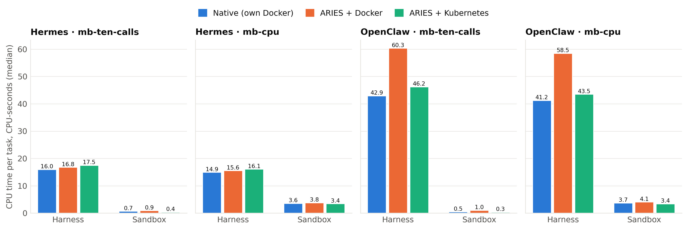
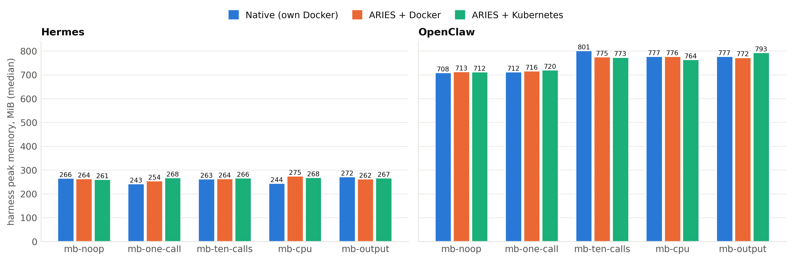
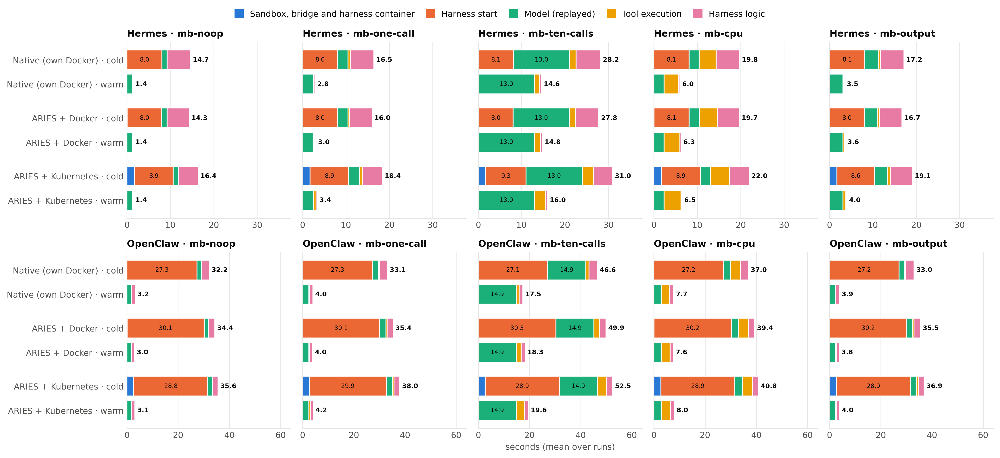
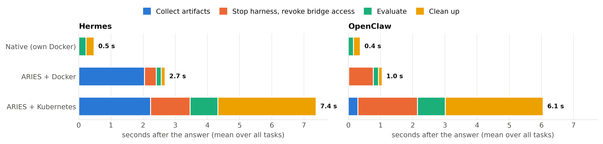

# Tool sandbox comparison: microbenchmark results

*The original summary, moved here from `.cache/microbench-report/summary.md`: the first comparison and its cold and warm addendum, written by hand. `report.md` beside it is the first part alone; the addendum's campaign, with its generated report, is [`experiments/coldwarm/results/20261102-e5-2640v4`](../../../coldwarm/results/20261102-e5-2640v4/report.md).*

## Setup

Three ways of giving an AI agent harness a sandbox for its tool calls were
compared, each with two harnesses (Hermes and OpenClaw):

| Setup | How tools run |
|---|---|
| **Native** | The harness's own Docker sandbox, with no ARIES involved (the baseline). |
| **ARIES + Docker** | ARIES creates the sandbox as a Docker container; the harness reaches it through ARIES's tool bridge, one long-running server per run. |
| **ARIES + Kubernetes** | The same, with the harness, sandbox and bridge as Kubernetes pods. |

**Controls**
- **Hardware:** one CloudLab worker node with SMT off, turbo boost off and the
  CPU clock pinned at 2.4 GHz.
- **Resources:** every harness and every sandbox limited to 2 CPUs and 4 GiB of
  memory.
- **Model:** the model's replies were recorded once per harness and then
  replayed with their original timing (aries-replay), so model time is
  identical in every setup. Every replayed request was answered from the
  recording.
- **Resource measurement:** CPU and memory were measured the same way in every
  setup, by a standalone cAdvisor sampled every second through Prometheus.

**Tasks**

| Task | What the agent does | What it isolates |
|---|---|---|
| `mb-noop` | Answers without running a command | Fixed start-up and tear-down cost |
| `mb-one-call` | Runs one command | Cost of one tool call |
| `mb-ten-calls` | Runs ten commands | How tool-call cost adds up |
| `mb-cpu` | Runs a CPU-heavy computation (3,000,000 SHA-256 steps) | Compute speed inside the sandbox |
| `mb-output` | Prints about 66 KB | Cost of returning large output |

Each task ran 5 times in each of the 6 combinations. All 150 task runs passed.
Figures show medians.

## Stages of a task

| Stage | Meaning |
|---|---|
| Sandbox start and register | Create the sandbox, copy the task in, register it with the bridge (ARIES only) |
| Harness start | Start the harness container and wait until it accepts work |
| Model (replayed) | Time spent waiting for model replies; identical by construction |
| Tools and harness logic | The rest of the agent's run: executing tools and the harness's own processing |
| Stop and evaluate | Stop the harness, revoke the bridge, run the task's checker |
| Cleanup | Delete the task's containers or pods |

Native creates its sandbox inside the agent's run, on the first tool call, and
has no separate stop step, so those stages are zero for it.

## How model calls are recorded and replayed

The model's replies are held constant by **aries-replay** (`cmd/aries-replay`,
logic in `pkg/model/replay/replay.go`). It is a small proxy that sits between
the harness and the model provider, DeepSeek. The harness is not aware of it:
the harness's model address points at aries-replay instead of at DeepSeek.

### Record mode (once per harness)

```
harness ──request──▶ aries-replay ──same request──▶ DeepSeek
harness ◀──reply──── aries-replay ◀──reply───────── DeepSeek
                          │
                          └─ saves the reply, with the time each piece arrived
```

1. **The request is forwarded unchanged.** The harness sends a normal
   OpenAI-style chat request, and aries-replay forwards it to
   `https://api.deepseek.com` with the harness's own API key.
2. **The reply is relayed as it streams in.** Each piece is passed straight to
   the harness. A copy is saved with its arrival time, in milliseconds after the
   request was received.
3. **The complete reply is saved under a key** that identifies its point in the
   conversation.
4. **Unfinished replies are not saved,** for example after a network error,
   because replaying one would give the agent half a turn. A reply the harness
   hung up on after receiving it whole is complete, so it is kept.

### The key: finding a reply again

| Part | What it is | Why |
|---|---|---|
| **Conversation** | A short hash of the first user message (the task instruction), with every run of digits replaced by `0` | Identifies the task. Folding the digits stops a timestamp the harness inserts from making each run look like a new task. |
| **Turn** | How many replies from the model are already in the conversation | Identifies the step: 0 is the first reply, 1 comes after the first tool result, and so on |
| **Tools** | How many tools the request offers | Separates the agent's main requests from side requests, such as Hermes asking for a session title with no tools offered |

The key deliberately leaves out the rest of the request. Tool output can differ
slightly between sandboxes, for example in a timestamp or a container name.
With a key covering the whole request, those runs would no longer find their
recorded replies. With this key, the same task at the same step always gets the
same reply.

### Replay mode (every comparison run)

1. **The key is computed** from each incoming request in the same way.
2. **The recorded reply is looked up.** DeepSeek is never contacted.
3. **The reply is sent with its original timing.** Each piece is held back
   until its recorded arrival time, so a reply that took 3.0 s to stream from
   DeepSeek takes 3.0 s again, with the same delay before the first piece.
4. **A request with no recording** is answered with HTTP 404 and logged as a
   miss. None of the 150 comparison runs had a miss.

Error replies are recorded too. One of Hermes's side requests is rejected by
DeepSeek (HTTP 400, "response_format type is unavailable"), and every replay
returns the same rejection, so Hermes takes the same path in every setup.

### Where the recordings are stored

On the worker node, under `~/aries/.cache/microbench-replay/`, one folder per
harness:

```
.cache/microbench-replay/
  openclaw/
    recordings.jsonl                        recorded replies (18)
    requests-docker-record-<time>.jsonl     every request made while recording
    requests-docker-replay-<time>.jsonl     every request in each replay run
    requests-k8s-replay-<time>.jsonl
    requests-native-replay-<time>.jsonl
  hermes/
    recordings.jsonl                        recorded replies (28)
    ...
```

- **`recordings.jsonl`:** one line per recorded reply. If a key was recorded
  twice, the first copy is used.
- **`requests-*.jsonl`:** one line per request, in either mode. Each line holds
  the time it arrived, the time to the first byte, the total duration, the key
  and, in replay, whether it was found. The analysis adds up these durations
  within each task's agent run to get that task's model time.

**How the harness is pointed at aries-replay:**
- **ARIES profiles** give the model address as `http://replay.local:8090/v1`.
  `scripts/microbench/run.sh` replaces `replay.local` with the node's IP and
  starts aries-replay in the requested mode.
- **The native baseline scripts** set the same address in each harness's own
  configuration.

### Example: one recorded model call

OpenClaw, task `mb-ten-calls`, the model's first reply, in which it decides to
run the first command. Its key is `d12ee4a99130e825/0/9`: this task, turn 0, 9
tools offered.

**1. The line in `openclaw/recordings.jsonl`.** The reply is stored as 131
pieces. Only the first two are shown here, and each piece's bytes are
base64-encoded:

```json
{
  "key": {"conversation": "d12ee4a99130e825", "turn": 0, "tools": 9},
  "recorded_at": "2026-10-25T05:46:45.68934816Z",
  "status": 200,
  "content_type": "text/event-stream; charset=utf-8",
  "chunks": [
    {"offset_ms": 401.117, "data": "ZGF0YTogeyJpZCI6ImIzZjIxZDYzLTcy…"},
    {"offset_ms": 956.279, "data": "ZGF0YTogeyJpZCI6ImIzZjIxZDYzLTcy…"},
    …
  ]
}
```

**2. Those pieces decoded.** They are DeepSeek's streamed reply, exactly as the
harness received it (long fields shortened):

```
401.117 ms   data: {"id":"b3f21d63-…","model":"deepseek-flash","choices":[{"delta":{"role":"assistant","content":null,"reasoning_content":""}}]}
956.279 ms   data: {"id":"b3f21d63-…","choices":[{"delta":{"reasoning_content":"The"}}]}
1005.763 ms  data: {"id":"b3f21d63-…","choices":[{"delta":{"reasoning_content":" user"}}]}
   …         (the model's reasoning, then the tool call's arguments, a few characters per piece)
3033.779 ms  data: {"id":"b3f21d63-…","choices":[{"delta":{"content":""},"finish_reason":"tool_calls"}],
                    "usage":{"prompt_tokens":10333,"completion_tokens":388,…}}
             data: [DONE]
```

Put together, the reply asks the harness to run one tool:

```
exec {"command": "echo 1 >> /tmp/mb-ten"}
```

**3. The same request in the logs**, while recording and then in a replay run
on ARIES + Docker:

```json
{"mode":"record","path":"/v1/chat/completions","key":{"conversation":"d12ee4a99130e825","turn":0,"tools":9},
 "received_at":"2026-10-25T05:46:45.68934816Z","first_byte_ms":401.117,"duration_ms":3033.836,
 "status":200,"request_bytes":39949,"reply_bytes":110183}

{"mode":"replay","path":"/v1/chat/completions","key":{"conversation":"d12ee4a99130e825","turn":0,"tools":9},
 "received_at":"2026-10-25T09:05:42.705341214Z","first_byte_ms":402.118,"duration_ms":3034.341,
 "status":200,"request_bytes":39949,"reply_bytes":110183,"hit":true}
```

The replay matches the recording to within a millisecond:

| | Time to first byte | Total time | Reply size |
|---|---|---|---|
| Recorded | 401.1 ms | 3033.8 ms | 110,183 bytes |
| Replayed | 402.1 ms | 3034.3 ms | 110,183 bytes |

The request was also identical in size (39,949 bytes), so the harness sent the
same conversation in both cases.

## Figures

Each figure is also saved as a PDF beside its PNG, for print. `figures.csv`
holds every plotted number, for a table beside the figures.

### Figure 1. Where a task's time goes



The fixed costs (harness start, Kubernetes pod creation and deletion) dominate
these short tasks. Model time is the same in every setup, by construction.
Each stage is the median of 5 runs, so the stacked totals can differ slightly
from the median end-to-end times in Figure 2.

### Figure 2. End-to-end task time



ARIES + Docker adds about 2–4 s per task over native. ARIES + Kubernetes adds
about 13–15 s.

### Figure 3. Time per tool call



- **At the bridge:** a command takes 14 ms (Hermes) and 25 ms (OpenClaw) on
  Docker, and roughly twice that on Kubernetes.
- **As OpenClaw sees it:** a call takes 81 ms natively, 96 ms through ARIES +
  Docker and 145 ms through ARIES + Kubernetes.

### Figure 4. CPU over time (`mb-cpu`)



Time is aligned at the start of the agent's run. The sandbox's burst (one core
for about 3.5 s) is the same in every setup, so compute inside the sandbox is
unaffected. The harnesses differ only during OpenClaw's start-up, where the
ARIES + Docker harness runs at its 2-CPU limit.

### Figure 5. CPU time per task



Measured from the containers' cumulative CPU counters. OpenClaw's harness uses
about 17 CPU-seconds more per task under ARIES + Docker than natively. The
other setups and the sandboxes are close to each other.

### Figure 6. Harness peak memory



Memory is the same across setups for both harnesses. Sandboxes peak at under
9 MiB in every setup, too small to share this scale; their values are in
`figures.csv`.

## Results

| | Native | ARIES + Docker | ARIES + Kubernetes |
|---|---|---|---|
| End-to-end time, Hermes | 14.9–30.8 s | +2.1–2.2 s | +13.7–14.3 s |
| End-to-end time, OpenClaw | 30.7–44.0 s | +2.9–4.1 s | +13.1–15.0 s |
| Time per tool call at the bridge (Hermes / OpenClaw) | none | 14 / 25 ms | 27 / 49 ms |
| Time per tool call as OpenClaw sees it | 81 ms | 96 ms | 145 ms |
| Harness CPU time per task, Hermes | 14.5–16.0 CPU-s | 15.1–16.8 | 16.1–17.5 |
| Harness CPU time per task, OpenClaw | 39.4–42.9 CPU-s | 56.6–60.3 | 41.7–46.2 |
| Harness peak memory, Hermes / OpenClaw | 243–272 / 708–801 MiB | 254–275 / 713–776 | 261–268 / 712–793 |
| Sandbox CPU and memory | equal across setups | equal | equal |

The Docker and Kubernetes columns give the difference from native for time,
and absolute values for the other rows.

### Where the overheads come from

**ARIES + Docker against native**
- **OpenClaw starts 2.8 s slower** under ARIES (28.0 s against 25.2 s). During
  start-up its harness container runs at its 2-CPU limit, where native runs at
  about 1.5 cores, and it uses about 17 CPU-seconds more per task. The likely
  cause, still to be confirmed, is ARIES's readiness check: it starts a new
  `node` process in the container every 100 ms, and those processes compete
  with the gateway for its CPUs.
- **Hermes starts in the same time** under ARIES as natively, but its agent run
  takes about 1.6 s longer whether it runs no commands or ten. That is a
  one-off cost per task, most likely setting up the SSH session and shell
  through the bridge.
- **Stopping and revoking the harness** adds 0.4–0.9 s. Native has no such step.
- **Each tool call** costs about 15 ms more for OpenClaw.

**ARIES + Kubernetes against ARIES + Docker**
- **Deleting pods takes 6.2 s per task**, against 0.1 s for Docker containers.
  This is the largest single cost.
- **Creating the sandbox pod** takes 2.6 s, against 0.3 s.
- **Harness start** is 2.4 s slower for Hermes and 0.6 s slower for OpenClaw.
- **Stopping** takes 1.1–2.0 s, against 0.4–0.9 s.
- **Each tool call** takes about twice as long, because a command goes through
  the Kubernetes API (`exec`) rather than the local Docker daemon.

**No difference between setups**
- the model's time, by design
- compute speed inside the sandbox
- the sandbox's CPU and memory
- the harness's memory

## Strengths and weaknesses

### Native (the harness's own Docker sandbox)

**Strengths**
- Lowest latency and fewest moving parts: no bridge, no separate stop step,
  and the sandbox is created only when the first tool runs.
- Lowest CPU cost for OpenClaw.

**Weaknesses**
- Each harness implements isolation its own way, which makes them hard to
  compare or control:
  - OpenClaw's sandbox has no network.
  - Hermes's has outbound network access and runs two sandbox containers
    per task.
  - The harness needs the host's Docker socket, which effectively gives it
    control of the host.
- No common record of tool calls. The per-call time exists only where the
  harness logs it (OpenClaw), so tool cost cannot be measured the same way
  across harnesses.
- Evaluation needs per-harness glue to find the harness's sandbox and run the
  checker in it.
- Single host only, with no scheduling or placement.

### ARIES + Docker

**Strengths**
- One sandbox model and one tool path for every harness: the same resource
  limits, the same network policy, and a per-call log measured at the bridge.
  The comparison between harnesses is fair by construction.
- The harness never holds the Docker socket. Its access to the sandbox is
  limited to the bridge and is revoked before the checker runs.
- Small overhead: about 2–4 s per task and about 15 ms per tool call over
  native. Most of it is start-up work that can be reduced (see the OpenClaw
  readiness check).

**Weaknesses**
- Still a single host.
- Adds a stop-and-revoke step (0.4–0.9 s) and a bridge hop on every tool call.
- The OpenClaw start-up path currently costs about 17 extra CPU-seconds per
  task. That matters when many tasks share a node.

### ARIES + Kubernetes

**Strengths**
- Everything ARIES + Docker provides, plus scheduling across a cluster,
  per-pod resource limits enforced by the kubelet, and standard tools for
  operating it.
- The way to run many tasks in parallel across nodes, which is what the
  throughput experiments will need.
- CPU and memory per task match native and Docker. Kubernetes adds no
  in-container overhead.

**Weaknesses**
- About 11–14 s more per task than ARIES + Docker. Pod deletion (6.2 s) and
  pod creation (2.6 s) dominate, so short tasks pay proportionally the most.
- Each tool call takes about twice as long (27–49 ms at the bridge, 145 ms as
  OpenClaw sees it), because every command goes through the Kubernetes API.
- More infrastructure to run: a cluster, a container registry and a metrics
  stack.

## Limits of these results
- **Short tasks:** these microbenchmarks last 15–60 s, so fixed costs dominate.
  On real benchmark tasks lasting minutes, the per-task overheads shrink
  relative to the total, while per-call costs grow with the number of tool
  calls.
- **One node, one task at a time:** contention between concurrent tasks is not
  measured yet; the throughput experiments will cover it.
- **Five runs per combination:** the spread across runs was small (for example,
  0.6 s for OpenClaw's harness start), but there are not enough runs for
  confidence intervals.
- **CPU measurement:** CPU over time is computed from cumulative counters in
  one-second bins. OpenClaw's ARIES + Docker harness reads 2.04–2.06 cores at
  its peak, which is its 2-CPU limit plus binning noise.
- **Native networking differs from ARIES's:** native OpenClaw has no network,
  native Hermes has outbound access, and ARIES puts the sandbox on its run
  network. No task here uses the network.

---

# Addendum: cold and warm start (1 November 2026)

This section adds a second experiment. It does not change the results above.

## What was measured

A user waiting on an agent pays two different costs:
- **Cold:** the first request on a fresh harness and sandbox. ARIES starts the
  harness and the sandbox **in parallel** (the default), waits until both are
  ready, then sends the task. Cold latency runs from the first start-up step to
  the first answer.
- **Warm:** the same task sent again to the **same** harness and sandbox,
  which are already running. Warm latency is that second run alone.

Every task leaves the sandbox as it found it, so the warm run repeats exactly
the same work. For example, `mb-ten-calls` now overwrites its file rather than
appending to it.

**Changes since the first experiment**
- **Parallel start:** the harness's container or pod is created while the
  sandbox starts, instead of after it.
- **New `harness_collect` phase:** the task run now ends when the harness
  answers. Copying the harness's logs and trajectory out of its container
  afterwards is timed as this separate phase. Before this change, Hermes's
  session export (about 2 s) was counted inside the task run.
- **Model time:** now counted as the time the agent waited on a model request.
  Hermes also sends a background request (most likely its session title) that
  offers no tools and that the agent does not wait for; it runs while the agent
  works and is left out. Before, its duration was added to the replies', and
  counting it at all made Hermes's model time vary with how slow the tools
  were, although the replay itself was identical in every setup.
- **Harness started alongside the sandbox:** the sandbox and its bridge
  endpoint are reserved first, so the harness starts while the sandbox does
  instead of after it (see Figure 7). The ARIES runs below were remeasured
  with this on 2 November; the native runs are unchanged.

**Setup**
- **Nodes:** a new four-node CloudLab cluster, the same hardware type as
  before (Xeon E5-2640 v4), each node set up the same way.
- **One harness per node:** OpenClaw ran on one worker and Hermes on the other,
  in parallel. All three setups of a harness ran on the same node, so the
  comparison between setups is not affected by differences between nodes.
- **Replay:** each harness's model replies were recorded once and replayed in
  every run.
- **Runs:** 5 runs of each task in each of the 6 harness and setup
  combinations, 150 task runs in total. Every task passed, and every model
  request was answered from the recording.

## Figures

The figure files are in the cold and warm campaign's
[`figures/`](../../../coldwarm/results/20261102-e5-2640v4/figures/), with a PDF beside each PNG and every plotted number in
`figures.csv`. They were drawn by
`scripts/microbench/plot_coldwarm.py`.

### Figure 7. End-to-end time, cold and warm



Each panel is one harness and task, with two bars per setup: cold, from the
first start-up step to the first answer, and warm, the same task again on the
running harness and sandbox. Each bar is split into stages:
- **Sandbox, bridge and harness container:** the part of start-up not spent
  starting the harness, that is, whatever else is on the critical path before
  it. Cold only.
- **Harness start:** writing the harness's configuration, launching the
  harness and waiting until it reports ready. Cold only.

  **How the harness starts alongside the sandbox.** The harness never runs
  commands itself: for every tool call it connects over SSH to the bridge,
  which runs the command inside the sandbox container. The microbenchmark
  sandboxes use the public `python:3.12.12-slim-bookworm` image. The harness
  reads two things about the sandbox once, at launch: the bridge's SSH address
  (Hermes as `TERMINAL_SSH_HOST` and `TERMINAL_SSH_PORT`, OpenClaw in its
  configuration) and the sandbox's working directory. ARIES therefore starts a
  task in this order:
  1. **Reserve the sandbox** (`sandbox_reserve`): name it and start its task
     services, without creating its container.
  2. **Reserve its bridge endpoint** (`bridge_reserve`): the bridge opens an SSH
     listener for the sandbox and returns its port, before the sandbox exists.
  3. **In parallel:**
     - the harness's container or pod is created (`harness_prepare`) and the
       harness is started on the reserved endpoint (`harness_start`);
     - the sandbox's container starts (`sandbox_start`), the benchmark
       sanitises it (`sandbox_prepare`), and the bridge binds it to the
       reserved listener (`bridge_register`).
  4. **Wait** for both, then send the task.

  The bridge holds back any connection that arrives before the binding, so
  nothing reaches the sandbox before it has been sanitised. The working
  directory has to be known in advance. The microbenchmark tasks don't set
  one, so ARIES finds it once per run by starting and removing one sandbox from
  the image (0.3 s on Docker), outside any task's timing.

  So the blue segment is now steps 1 and 2 plus creating the harness's own
  container or pod, which the harness needs before it can launch. On Docker
  that is almost nothing (0.02–0.05 s). On Kubernetes it is mostly the harness
  pod's creation (1.5 s for Hermes, 2.5 s for OpenClaw). The sandbox's own
  start (1.9 s on Kubernetes) runs alongside the harness start and is hidden.
- **Model (replayed):** time the agent waited on a model request, that is,
  with a request offering it tools open. It is the same in every setup, by
  construction: each run sends the same requests and the replay answers each
  in its recorded time. Hermes's background title request is left out, as the
  agent does not wait for it.
- **Tool execution:** how long the harness's tool calls took as the harness
  itself saw them, the round trip to the sandbox included. It is timed the same
  way in every setup, native included: from Hermes's own trace of each tool
  call (its `tool.terminal` spans), and for OpenClaw from its session log, from
  the model's tool-calling reply to the tool's result. OpenClaw's own per-call
  duration is not used, because it leaves out the workspace sync OpenClaw runs
  in the sandbox before every command.
- **Harness logic:** the rest of the run, the harness's own work: preparing
  each request, handling each reply, and on the first request of a fresh
  harness, its first-use set-up.

Each bar is the mean of 5 runs, so its stages add up exactly to the mean
end-to-end time in the tables below. A mean reacts to an outlier: OpenClaw's
`mb-one-call` on Kubernetes reads 38.0 s cold because one of its five runs
took 34.5 s to start the harness (the median is 36.9 s).

Start-up is most of a cold request, and it is mostly the harness starting
itself.
- **Cold:** the setups differ mostly by start-up. ARIES + Docker is within
  0.5 s of native for Hermes (slightly faster for all five tasks) and about
  2.2–3.3 s slower for OpenClaw. Kubernetes adds 1.3–2.6 s (OpenClaw) to
  2.1–3.2 s (Hermes) more.
- **Warm:** once the harness is running, the setups differ only by tool-call
  cost. `mb-noop` makes no tool calls and is the same everywhere.
  `mb-ten-calls` makes ten and shows the largest gap.
- **Tool execution against harness logic:** in a warm run, harness logic is
  the same in every setup, and the difference is all tool execution. For the
  ten calls of `mb-ten-calls`:

  | Warm `mb-ten-calls` | Tool execution: native / Docker / K8s | Harness logic: native / Docker / K8s |
  |---|---|---|
  | OpenClaw | 1.06 / 1.83 / 3.14 s | 1.52 / 1.59 / 1.56 s |
  | Hermes | 1.11 / 1.40 / 2.55 s | 0.48 / 0.42 / 0.44 s |

  So a tool call costs OpenClaw about 0.11 s natively, 0.18 s through ARIES +
  Docker and 0.31 s through ARIES + Kubernetes, and Hermes about 0.11, 0.14
  and 0.26 s.

### Why Hermes's first request is slow, even for `mb-noop`

The first request on a fresh harness is slower than the same request
repeated, even after the harness has reported itself ready: by 4–5.7 s for
Hermes and 0.9–2 s for OpenClaw, in every setup.

`mb-noop` runs no commands, so its "Tools and harness logic" in Figure 7 is
not tool time. That stage is everything in a run that is not the model, and
for Hermes almost all of it is set-up Hermes does on its first turn, once per
harness. Here is the cold `mb-noop` on ARIES + Docker, timed from the moment
Hermes receives the task:

| Time | What Hermes is doing | Duration |
|---|---|---|
| 0 – 1.6 s | Nothing in its log. Most likely creating the agent: loading its modules, configuration and skills, and building the system prompt | ~1.6 s |
| 1.6 – 3.7 s | Checking the requirements of every toolset it ships with (browser, computer use, Discord, Feishu, Spotify, image and video generation, X search, and others). All 26 report "unavailable this turn" | ~2.1 s |
| 3.6 – 4.0 s | Opening its terminal session to the sandbox over SSH through the bridge: an `echo`, `echo $HOME`, a shell-snapshot script and a file sync, which the bridge rejects by design. It does this even though no command will run | ~0.4 s |
| 4.0 – 6.2 s | The model call. Hermes measures 2.0 s for it, against about 1.2–1.4 s for the same request when warm, so about 0.8 s is first-call overhead in its HTTP client | ~2.2 s |
| 6.2 – 6.3 s | Returning the answer | ~0.1 s |

- **Warm:** the same task sends its model request 0.1 s after arriving, and
  everything apart from the model takes 0.12 s. The agent, the tool checks and
  the terminal session are all reused; the 26 tool-check lines appear in
  Hermes's log only during the cold run.
- **This comes from Hermes, not ARIES.** Native Hermes shows the same burst of
  tool checks at 1.6–3.8 s. That is why cold `mb-noop` takes 14.7 s both
  natively and on ARIES + Docker.
- **Why OpenClaw's first request costs less.** OpenClaw's non-model time on a
  cold `mb-noop` is about 2.4 s, against 1.2 s warm. It does most of its
  preparation during its 27–30 s start-up, before it reports ready. Hermes
  reports ready after about 8 s and defers this work to the first request.
- **Could it be reduced?** About 2 s could go by enabling only the toolsets
  the tasks use (terminal and file) in Hermes's configuration. That changes
  the harness's configuration, so it would have to apply to native Hermes too
  for a fair comparison, and the result would no longer measure Hermes's
  defaults. It was not tried.

### Figure 8. What happens after the answer



None of this adds to the user's wait, but it limits how quickly a node can
take the next task.
- **Collection:** Hermes's session export takes 2.0–2.2 s.
- **Stop harness, revoke bridge access:** stops and removes the harness's
  container or pod, and releases the sandbox from the bridge: the bridge
  closes the sandbox's SSH listener and finalises its tool-call log. The
  bridge itself keeps running, since it is one long-running server shared by
  the whole run, and is removed only when the run ends.
- **Kubernetes clean-up:** deleting the sandbox pod takes 3.1 s. The
  sandbox's only process, `sleep infinity`, ignores the stop signal, so
  Kubernetes waits out the pod's grace period before killing it, then confirms
  the pod is gone. The grace period is 1 s, the shortest that still waits for
  that confirmation. With the earlier 5-second grace period, clean-up took
  6.07 s. Docker removes the container with an immediate kill (0.12 s).
- **Native:** the baseline records no stop step. Its 0.2–0.3 s clean-up
  removes the containers outright, without confirming that the harness has
  stopped.

## Results

Means of 5 runs, in seconds. The cold columns run from the first start-up
step to the first answer, the warm columns are the same task again on the
running harness and sandbox; each row's stages add up to its total, apart from
rounding. The stages are those of Figure 7: "Sandbox, bridge, container" is the
start-up not spent starting the harness (none natively, where the harness
starts its own sandbox); tool execution and harness logic are timed by the
harness the same way in every setup.

### OpenClaw

| Task | Setup | Cold: sandbox, bridge, container | Cold: harness start | Cold: model | Cold: tool execution | Cold: harness logic | **Cold total** | Warm: model | Warm: tool execution | Warm: harness logic | **Warm total** |
|---|---|---|---|---|---|---|---|---|---|---|---|
| `mb-noop` | Native | 0.00 | 27.35 | 1.81 | 0.00 | 3.05 | **32.20** | 1.81 | 0.00 | 1.44 | **3.25** |
|  | ARIES Docker | 0.04 | 30.08 | 1.81 | 0.00 | 2.43 | **34.36** | 1.81 | 0.00 | 1.18 | **2.99** |
|  | ARIES K8s | 2.73 | 28.85 | 1.81 | 0.00 | 2.23 | **35.61** | 1.81 | 0.00 | 1.34 | **3.15** |
| `mb-one-call` | Native | 0.00 | 27.28 | 2.45 | 0.26 | 3.16 | **33.15** | 2.45 | 0.22 | 1.35 | **4.02** |
|  | ARIES Docker | 0.05 | 30.09 | 2.45 | 0.41 | 2.41 | **35.41** | 2.45 | 0.31 | 1.22 | **3.98** |
|  | ARIES K8s | 2.73 | 29.92 | 2.45 | 0.59 | 2.30 | **37.99** | 2.45 | 0.52 | 1.21 | **4.17** |
| `mb-ten-calls` | Native | 0.00 | 27.14 | 14.90 | 1.25 | 3.31 | **46.60** | 14.90 | 1.06 | 1.52 | **17.48** |
|  | ARIES Docker | 0.05 | 30.27 | 14.90 | 2.07 | 2.62 | **49.92** | 14.90 | 1.83 | 1.59 | **18.32** |
|  | ARIES K8s | 2.73 | 28.91 | 14.90 | 3.50 | 2.44 | **52.48** | 14.90 | 3.14 | 1.56 | **19.60** |
| `mb-cpu` | Native | 0.00 | 27.21 | 2.82 | 3.74 | 3.19 | **36.97** | 2.82 | 3.35 | 1.57 | **7.74** |
|  | ARIES Docker | 0.05 | 30.16 | 2.82 | 3.88 | 2.46 | **39.36** | 2.82 | 3.52 | 1.28 | **7.62** |
|  | ARIES K8s | 2.73 | 28.95 | 2.82 | 4.04 | 2.30 | **40.84** | 2.82 | 3.71 | 1.43 | **7.96** |
| `mb-output` | Native | 0.00 | 27.17 | 2.28 | 0.36 | 3.17 | **32.98** | 2.28 | 0.20 | 1.40 | **3.88** |
|  | ARIES Docker | 0.05 | 30.17 | 2.28 | 0.54 | 2.46 | **35.49** | 2.28 | 0.34 | 1.20 | **3.82** |
|  | ARIES K8s | 2.73 | 28.85 | 2.28 | 0.81 | 2.22 | **36.89** | 2.28 | 0.52 | 1.19 | **3.98** |

### Hermes

| Task | Setup | Cold: sandbox, bridge, container | Cold: harness start | Cold: model | Cold: tool execution | Cold: harness logic | **Cold total** | Warm: model | Warm: tool execution | Warm: harness logic | **Warm total** |
|---|---|---|---|---|---|---|---|---|---|---|---|
| `mb-noop` | Native | 0.00 | 8.05 | 1.21 | 0.00 | 5.39 | **14.65** | 1.21 | 0.00 | 0.21 | **1.42** |
|  | ARIES Docker | 0.02 | 8.01 | 1.21 | 0.00 | 5.10 | **14.35** | 1.22 | 0.00 | 0.20 | **1.41** |
|  | ARIES K8s | 1.73 | 8.94 | 1.21 | 0.00 | 4.52 | **16.40** | 1.21 | 0.00 | 0.21 | **1.42** |
| `mb-one-call` | Native | 0.00 | 8.04 | 2.45 | 0.51 | 5.47 | **16.47** | 2.45 | 0.11 | 0.27 | **2.83** |
|  | ARIES Docker | 0.02 | 8.01 | 2.45 | 0.42 | 5.13 | **16.03** | 2.45 | 0.34 | 0.24 | **3.03** |
|  | ARIES K8s | 1.73 | 8.88 | 2.45 | 0.70 | 4.65 | **18.41** | 2.45 | 0.65 | 0.25 | **3.35** |
| `mb-ten-calls` | Native | 0.00 | 8.10 | 12.96 | 1.51 | 5.67 | **28.23** | 12.96 | 1.11 | 0.48 | **14.55** |
|  | ARIES Docker | 0.02 | 8.02 | 12.96 | 1.46 | 5.35 | **27.80** | 12.96 | 1.40 | 0.42 | **14.77** |
|  | ARIES K8s | 1.72 | 9.31 | 12.96 | 2.57 | 4.41 | **30.97** | 12.96 | 2.55 | 0.44 | **15.95** |
| `mb-cpu` | Native | 0.00 | 8.10 | 2.34 | 3.89 | 5.43 | **19.76** | 2.34 | 3.38 | 0.28 | **5.99** |
|  | ARIES Docker | 0.02 | 8.12 | 2.34 | 4.18 | 5.07 | **19.72** | 2.34 | 3.69 | 0.24 | **6.27** |
|  | ARIES K8s | 1.73 | 8.95 | 2.34 | 4.43 | 4.52 | **21.97** | 2.34 | 3.90 | 0.24 | **6.48** |
| `mb-output` | Native | 0.00 | 8.14 | 3.10 | 0.51 | 5.40 | **17.16** | 3.10 | 0.12 | 0.23 | **3.45** |
|  | ARIES Docker | 0.02 | 8.02 | 3.10 | 0.43 | 5.11 | **16.68** | 3.10 | 0.35 | 0.19 | **3.64** |
|  | ARIES K8s | 1.73 | 8.57 | 3.10 | 0.73 | 5.01 | **19.14** | 3.10 | 0.66 | 0.23 | **3.99** |

### Start-up stages

| Stage | OpenClaw: ARIES Docker | OpenClaw: ARIES K8s | Hermes: ARIES Docker | Hermes: ARIES K8s |
|---|---|---|---|---|
| Sandbox reservation (`sandbox_reserve`) | 0.00 | 0.15 | 0.00 | 0.15 |
| Bridge reservation (`bridge_reserve`) | 0.02 | 0.08 | 0.00 | 0.07 |
| Harness container or pod creation (`harness_prepare`) | 0.03 | 2.50 | 0.02 | 1.52 |
| Harness start, until ready (`harness_start`) | 30.15 | 29.10 | 8.04 | 8.93 |
| *Alongside:* sandbox start, preparation and bridge binding | 0.33 | 2.26 | 0.26 | 2.19 |
| **Start-up to the first request** | 30.20 | 31.82 | 8.06 | 10.66 |

Natively, OpenClaw takes 27.2 s to start and Hermes 8.1 s.

### What the cold and warm results show
- **Cold latency is mostly harness start-up.** OpenClaw spends 27–30 s
  starting and Hermes about 8 s; the first request adds 4–20 s, depending on
  the task.
- **ARIES + Docker against native:**
  - Cold: OpenClaw is 2.2–3.3 s slower, almost all of it a slower harness
    start (30.2 s against 27.2 s). The likely cause, from the first
    experiment, is the readiness probe. Hermes is within 0.5 s of native.
  - Warm: within 0.3 s of native for tasks with at most one tool call, and
    up to 0.8 s (OpenClaw) for ten calls. The gap grows with the number of tool
    calls: it is the bridge's round trip, about 0.1 s per call.
- **ARIES + Kubernetes against ARIES + Docker:**
  - Cold: +1.3–2.6 s for OpenClaw and +2.1–3.2 s for Hermes. The sandbox's
    pod now starts alongside the harness, so what remains is mostly the
    harness's own pod creation (1.5–2.5 s), which the harness needs before it
    can launch, plus a slower harness start for Hermes (8.9 s against 8.0 s).
  - Warm: up to +1.3 s, because each tool call goes through the Kubernetes
    API and takes about twice as long. In `mb-ten-calls`, tools take 2.3 s
    against 1.0 s on Docker for OpenClaw, and 1.5 s against 0.7 s for Hermes.
- **Starting the harness alongside the sandbox** changed cold start-up as
  follows, against the runs where only the harness's container was created in
  parallel:

  | Start-up to the first request (medians) | Before | After | Change |
  |---|---|---|---|
  | Hermes, ARIES + Docker | 8.3 s | 8.0 s | −0.3 s |
  | Hermes, ARIES + Kubernetes | 11.7–11.9 s | 10.9 s | −0.8 s |
  | OpenClaw, ARIES + Docker | 30.3 s | 30.2 s | −0.1 s |
  | OpenClaw, ARIES + Kubernetes | 30.9–31.3 s | 31.6 s | +0.4 s |

  On Docker it hides the sandbox's 0.3 s, the most it can. On Kubernetes the
  gain is small: the earlier parallel start already overlapped the harness's
  pod creation with the sandbox's, and that pod creation is still on the
  critical path. For OpenClaw on Kubernetes there is no gain at all: before,
  the harness pod (2.73 s) and the sandbox path (2.68 s) ran in parallel;
  now the reservation (0.23 s) runs first and then the harness pod (2.50 s),
  again 2.73 s. On top of that, OpenClaw's harness start itself was 0.2–0.5 s
  slower on this day on both Docker and Kubernetes (Kubernetes 28.9 s against
  28.4–28.7 s; Docker 30.2 s against 29.9 s). Nothing runs alongside it, since
  the sandbox is bound before it begins, so this is most likely day-to-day
  variation on the node rather than the new start order. Creating the harness
  pod while the reservations run, which needs only the run's placement, would
  recover the 0.23 s; that has not been done.
- **A harness reporting itself ready is not yet ready for work.** In every
  setup the first request costs extra: about 5 s for Hermes and about 1.5 s for
  OpenClaw. For short tasks on Hermes, this is about a third of the cold
  latency. Warming the harness up with a throwaway request before the real one
  removes it, at the cost of that request's time.
- **Resources are unchanged from the first experiment.** Peak harness CPU is
  1.6–2.1 cores (the limit is 2), and peak memory is about 0.8 GiB for
  OpenClaw and about 0.25 GiB for Hermes in every setup.

### Limits of these results
- **Earlier ARIES runs:** ARIES runs taken before the `harness_collect` phase
  existed, Kubernetes runs taken with the 5-second grace period, and runs
  taken before the harness started alongside the sandbox are kept but not used
  here. The native runs did not need rerunning.
- **Same limits as the first experiment:** short tasks, one task at a time on
  a node, and 5 runs per combination.
