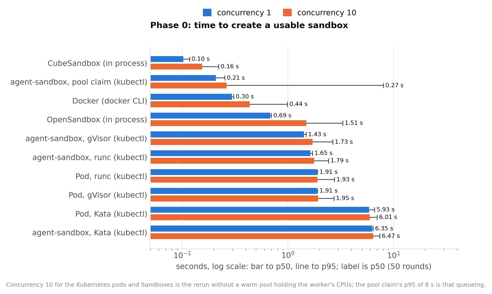
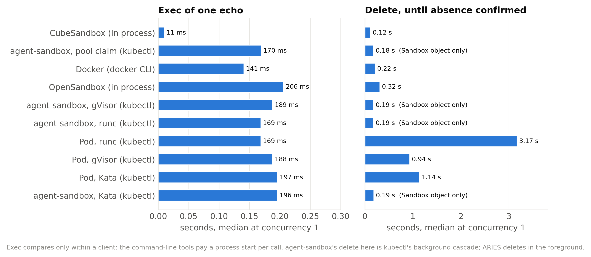
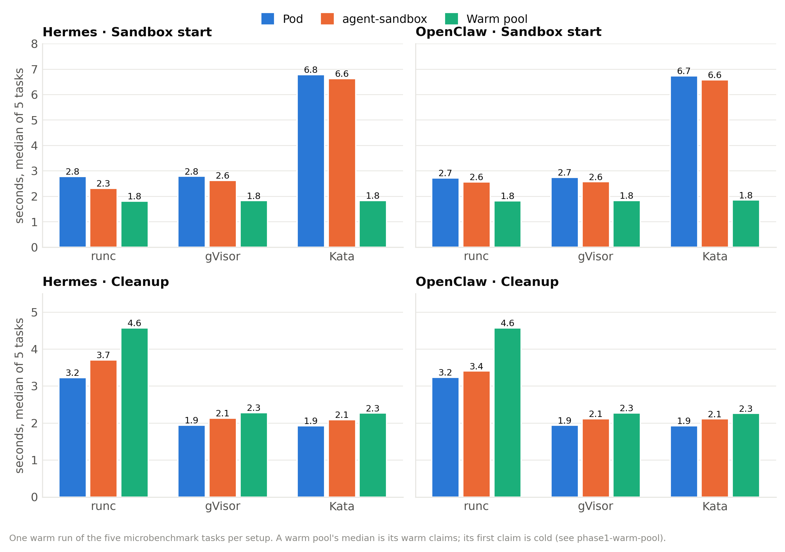
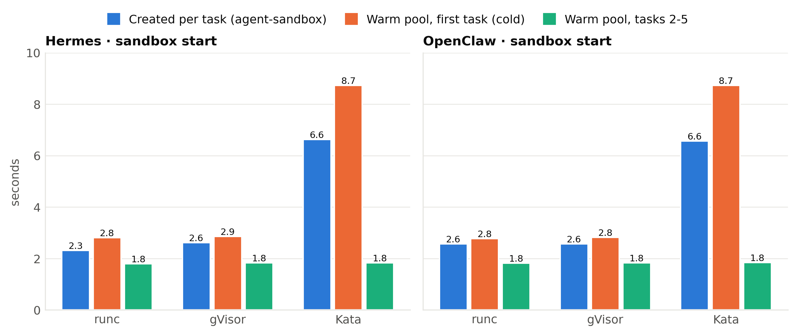
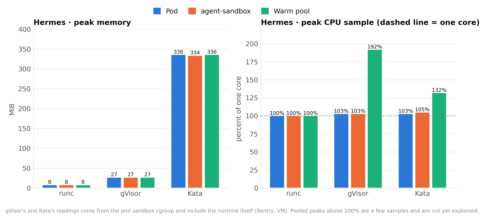

# Sandbox backends: report

2026-11-22. Phases 0 and 1 are done; Phase 2 (OpenSandbox) is on hold, and
Phases 3 (CubeSandbox) and 4 (the campaign) have not started.

## Summary

- **agent-sandbox, gVisor and Kata work in ARIES.** Both harnesses completed
  every task on all nine Kubernetes setups: 90 of 90 task runs succeeded,
  scored 1, and were confirmed isolated and cleaned up.
- **agent-sandbox adds nothing to start-up** over a plain pod. gVisor adds
  nothing at start; Kata adds about 4 s to boot its VM.
- **A warm pool brings a later start down to 1.8 s on every runtime,** hiding
  Kata's VM boot. Its first claim is cold, and pooled sandboxes are less
  isolated than per-task ones (see [Warm pools](#warm-pools)).
- **gVisor and Kata must be measured at pod level.** cAdvisor reports zero or
  nothing for their container, so a per-container reading shows a busy
  sandbox as idle.
- **CubeSandbox fits** through its in-sandbox agent's own API, and creates a
  KVM microVM sandbox in 0.10 s. Using it needs the harness and sandbox on
  different deployment backends, which is a contract change.
- **OpenSandbox fits neither harness.** Its command API has no stdin, and both
  harnesses send stdin; its output is text, so binary output is corrupted.

## Set-up

| | |
| --- | --- |
| Nodes | Five Emulab d430: Xeon E5-2630 v3, SMT and turbo off, clock pinned at 2.4 GHz |
| Cluster | Kubernetes 1.35.3, containerd 2.2.3, Calico; one control plane, one runner (monitoring), two workers |
| CubeSandbox | v0.8.0 on a fifth, standalone node, with XFS (reflink) at `/data/cubelet` |
| gVisor | `runsc` release-20261116.0, RuntimeClass `gvisor` |
| Kata | 4.4.0, the Rust shim with QEMU, RuntimeClass `kata` |
| agent-sandbox | v1.0.12 with extensions (`SandboxTemplate`, `SandboxWarmPool`, `SandboxClaim`) |
| OpenSandbox | Server 1.2.1 on Docker 29.8.2, execd `release-1.2.1`, with an API key |
| Image | `python:3.12.12-slim-bookworm` |
| Resources | Phase 0: 1 CPU, 1 GiB per sandbox. Phase 1: 2 CPUs, 4 GiB per harness and sandbox (`profiles/comparison/fixed-2cpu-4gib-overrides.json`) |

All Kubernetes measurements ran on one worker, `node-002`.

## Phase 0: each backend without ARIES

`phase0/probe.py` drives Docker, plain pods and agent-sandbox through the
`docker` and `kubectl` command-line tools; `phase0/probe_api.py` drives
CubeSandbox through the E2B SDK and envd's process API, and OpenSandbox
through its REST API and execd.

### Fit

The probe checks what ARIES's bridge needs from a sandbox
(`phase0/checks.jsonl`).

| Backend | Exact argv | Binary stdin | Binary stdout | stdout/stderr split | Exit code | Upload / download | Missing file distinct | Gone after delete |
| --- | --- | --- | --- | --- | --- | --- | --- | --- |
| Docker | ✓ | ✓ | ✓ | ✓ | ✓ | ✓ | ✓ | ✓ |
| Pod: runc, gVisor, Kata | ✓ | ✓ | ✓ | ✓ | ✓ | ✓ | ✓ | ✓ |
| agent-sandbox: runc, gVisor, Kata | ✓ | ✓ | ✓ | ✓ | ✓ | ✓ | ✓ | ✓, with a foreground delete |
| CubeSandbox | ✓ via envd `Process.Start` | ✓ | ✓ natively; the Python SDK decodes to text | ✓ | ✓ | ✓ | ✓ | ✓ |
| OpenSandbox | ✓ (execd ≥ 1.2) | **✗ none** | **✗** JSON text; `\xff` becomes U+FFFD | ✓ | ✓ | ✓ | ✓ | ✓ |

In every backend, cancelling closes the transport and leaves the command
running, which is what ARIES's contract states.

- **agent-sandbox's delete is not forced.** kubectl's default background
  cascade returns once the Sandbox object is gone, while the pod is still
  terminating. A foreground cascade returns after the pod is gone, and the
  containers had left the node 0.8–1.0 s earlier, as with a plain pod delete.
- **OpenSandbox reports a sandbox Running before execd listens,** so a client
  must wait for execd's `/ping`. Its upload needs the metadata as a file part.
- **A CubeSandbox template must keep a process running.** With the image's
  default `python3`, envd becomes unreachable. The v0.8.0 CLI also embeds no
  envd, so it is passed with `--envd-path`.
- **Inside the sandbox,** gVisor hides the cgroup limit files, and Kata gives
  the guest 2 vCPUs for a 1-CPU limit.

### Latency

Each round creates a sandbox, runs a first `echo`, runs ten more and deletes
it; 50 rounds per backend and concurrency, with no failures
(`phase0/latency.jsonl`).

At concurrency 10, the Kubernetes pods and Sandboxes are a rerun without a warm
pool present (`phase0/latency-k8s-c10-nopool.jsonl`). In the first run, a pool
of 12 sandboxes at 1 CPU each held 12 of the worker's 16 CPUs, new sandboxes
queued behind those requests, and the p95 reached 59–141 s. The pool claim's
own p95 of 8 s at concurrency 10 is the same queueing.

agent-sandbox's delete here is kubectl's background cascade, which returns when
only the Sandbox object is gone.

- **Create times compare across backends:** every client waits until the
  sandbox is usable. CubeSandbox restores a snapshotted microVM faster than
  `docker run` starts a container.
- **Exec times compare only within a client.** The command-line tools pay a
  process start per call (`docker` about 140 ms, `kubectl` about 165 ms);
  CubeSandbox and OpenSandbox are called in process. Phase 1 measures exec
  through ARIES itself.
- **A plain runc pod takes 3.2 s to delete,** against about 1 s under gVisor or
  Kata: `sleep` ignores SIGTERM, so the kubelet waits out the grace period.

## Phase 1: agent-sandbox, gVisor, Kata and warm pools in ARIES

### What changed

New fields under `sandbox.deployment.kubernetes`:

| Field | Effect |
| --- | --- |
| `runtime_class` | Sandbox pods run under that RuntimeClass, such as `gvisor` or `kata` |
| `agent_sandbox` | Each sandbox is an agent-sandbox `Sandbox`, whose controller makes the pod from exactly the pod ARIES would otherwise create |
| `warm_pool` | With `agent_sandbox`, each sandbox is claimed from a run-owned pool keeping that many ready pods per pod spec |

Exec, transfer, the start gate, the task's NetworkPolicy and the bridge's
target checks are otherwise unchanged.

### Results

Hermes and OpenClaw each replayed the five microbenchmark tasks once, with a
warm-up conversation, on every setup (`phase1/tasks.tsv`). All 90 task runs
succeeded, scored 1, and were confirmed isolated and cleaned up; no pods,
Sandboxes, claims, pools, templates, policies, Services, VMs or gVisor
processes were left afterwards.

With a warm pool, the first task of a run is a cold claim, and the rest are
warm:

The figures' numbers are in `phase1/tasks.tsv`;
`scripts/microbench/plot_sandbox.py` draws them from there and from
`phase0/`.

- **Sandbox start** is the ARIES phase from creating the sandbox's NetworkPolicy
  to a running, validated sandbox. Its 1.8 s floor is ARIES's own work around
  the claim: the policy, the claim, labelling, two validations and the start
  gate, each a `kubectl` call.
- **The sandbox's memory under gVisor and Kata** includes the runtime's own:
  gVisor's Sentry (about 27 MiB against runc's 8 MiB) and Kata's VM (about
  335 MiB). In a separate one-core busy-loop test, cAdvisor read gVisor's pod
  at 1.00 cores against runc's 0.98.
- **Cleanup** is longest for runc, whose `sleep` waits out the 1 s grace
  period; a warm-pool claim's foreground delete adds its claim and Sandbox.
- **mb-cpu's pooled gVisor and Kata peaks above 100%** come from a few
  samples; their busy median is 128% and 114%, against 100% for runc. They are
  not yet explained.

### Measuring gVisor and Kata

gVisor runs its Sentry, and Kata its VM, in the pod sandbox cgroup, and
cAdvisor reports zero or nothing for the container itself. Under a one-core
busy loop, the container series read zero (gVisor) or were absent (Kata),
while the pod sandbox series read 0.97 cores for both. ARIES therefore reads a pod under a RuntimeClass from its pod
sandbox cgroup, and keeps the container series for harness, bridge and runc
pods.

### Warm pools

A pool is created on the first claim of a pod spec in a run, as a
`SandboxTemplate` and a `SandboxWarmPool`. Each sandbox creates a
`SandboxClaim`, and ARIES patches the task's labels and annotations onto the
claimed pod. The claim is deleted in the foreground when the task ends, and
the run's pools and templates when the run ends. Tasks that share an image,
resources, working directory and environment share a pool; the container
ARIES starts once per run to resolve an image's working directory gets its
own.

A pooled sandbox is less isolated than one ARIES creates for its task:

- **It exists before its task.** It was started from a template and ran idle
  until claimed.
- **Its identity is added after it runs.** It keeps the pool's generated name,
  and the labels and annotations that the bridge, the task's NetworkPolicy and
  Service, and resource measurement rely on are patched on after the claim.
  The bridge therefore matches the pod by its own name and the sandbox by its
  label.
- **Its network is the template's until then.** The template's policy denies
  all ingress and egress from the moment the pod exists; once labelled, the
  task's policy adds its rules on top.
- **The pool costs capacity and interferes.** Waiting pods hold their CPU and
  memory requests, and each claim starts a replacement on the same node while
  the task runs, which no task's measurements include.

agent-sandbox's claim can only add labels from allow-listed domains, which is
why ARIES labels the pod itself.

### Validation

- `make lint`, `make test` and `make test-race` pass on Linux.
- `make integration` fails for reasons outside this work: the node's Docker
  lacks XFS with `pquota` for `--storage-opt`; the pinned Hermes image and the
  Terminal-Bench checkout were not on the node; and the OpenClaw integration
  test does not compile on `main`, because its fakes lack `ToolSandbox.Launch`.
- **Bridge image:** the bridge's target check changed. The non-pool runs used
  the published bridge `v1-ae286e55f01f`, whose behaviour for those setups is
  unchanged. The warm-pool runs used a bridge built from the working tree and
  loaded onto `node-002` only, as `aries-local/aries-bridge:v1-ae286e55f01f-dirty`.

## Phase 2: OpenSandbox (on hold)

OpenSandbox's execd `/command` takes no stdin, and both harnesses send stdin:

- **Hermes** sends it through its SSH session, for example in its bootstrap
  and file-sync steps.
- **OpenClaw** uploads its sandbox skills with `workspace_upload` calls, each
  piping a 143,360-byte tar archive into `tar -xf -`. In the Phase 1 runs, 234
  of OpenClaw's 1,008 tool calls carried stdin, all of them such uploads, in
  36 of its 45 tasks.

ARIES's contract forbids rewriting the agent's commands to read stdin from a
staged file. The remaining choices are buffering stdin into a file with the
argv unchanged, which changes stdin from a stream into a file and adds a
request per call; or adding stdin and byte-safe output to execd upstream.
Either also needs the sandbox on a different deployment backend from the
harness and bridge.

## Code changes

| Area | Files |
| --- | --- |
| Configuration | `pkg/config/deployment.go`: `runtime_class`, `agent_sandbox`, `warm_pool`, accepted only on `sandbox.deployment` |
| Pod and Sandbox manifests | `pkg/deployment/kubernetes/manifest.go`: `runtimeClassName`; a `Sandbox` around the same pod template, with no Service of its own and failed pods retained |
| Lifecycle | `pkg/deployment/kubernetes/kubernetes.go`: wait on the Sandbox's `Ready`; recover a lost create from the Sandbox; check runtime class and owner; foreground delete, then confirm the Sandbox and pod are gone |
| Warm pools | `pkg/deployment/kubernetes/warmpool.go`: run-owned template and pool per pod spec with a deny-all policy; claim, then label the pod; foreground claim delete; `environment.go` removes the run's pools |
| Bridge | `pkg/deployment/kubernetes/bridge.go`: the target check matches the pod by name and the sandbox by label |
| Measurement | `pkg/deployment/kubernetes/resources.go`: RuntimeClass pods read from the pod sandbox cgroup |
| Wiring | `internal/app/wiring/deployment/kubernetes.go` |
| Tests | `pkg/config/deployment_test.go`, `pkg/deployment/kubernetes/{kubernetes,environment,warmpool}_test.go` |
| Cluster | `scripts/testbed/install-sandbox-runtimes.sh`; `k8s/sandbox-runtimes.yaml`; `k8s/create-cluster.sh --sandbox-runtimes` and the `standalone` and `sandbox_runtimes` keys; `k8s/aries/templates/rbac.yaml`; `k8s/cluster.json.example` |
| Runs | `scripts/microbench/run.sh --runtime-class`, `--agent-sandbox`, `--warm-pool N` |
| Docs | `docs/configuration.md`, `docs/supported.md`, `docs/implementation/kubernetes.md`, `k8s/README.md` |

## Open items

- Commit these changes, and publish a bridge image for that commit
  (`make k8s-images`); pooled runs need it.
- Phase 3, CubeSandbox: needs agreement to run the harness and the sandbox on
  different deployment backends.
- Phase 4, a campaign over the setups that pass, with repetitions: it needs the
  campaign scripts to accept the new setup names, and should explain the
  pooled mb-cpu peaks above 100%.
- Clean up the OpenSandbox server on `node-002`, the CubeSandbox services on
  the standalone node, and the probe namespace `aries-probe`.
