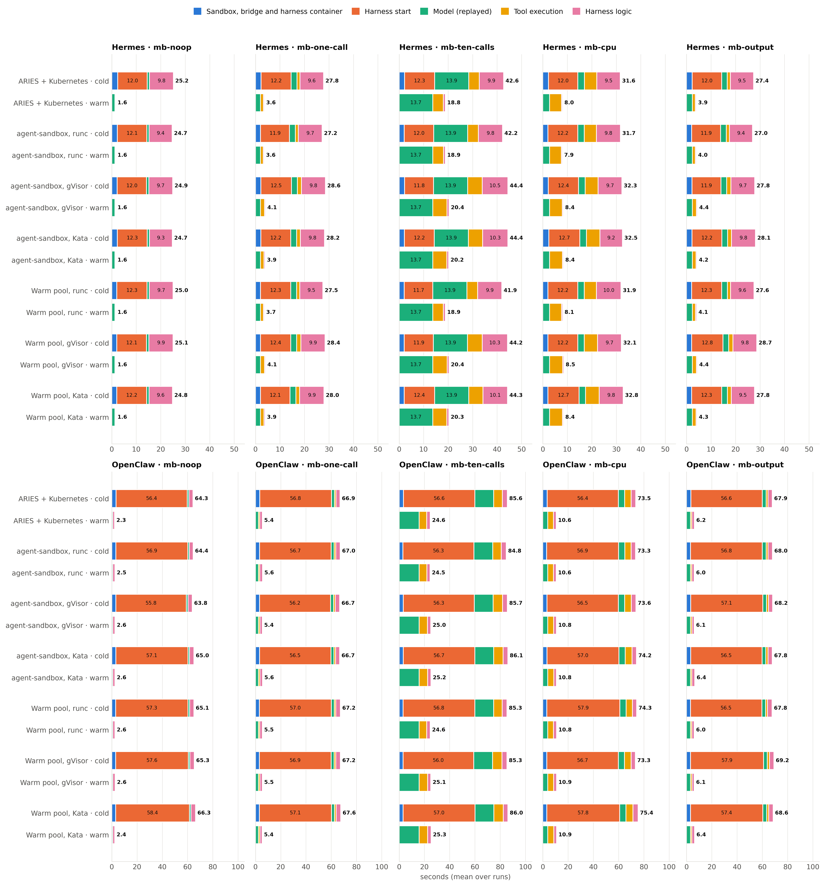
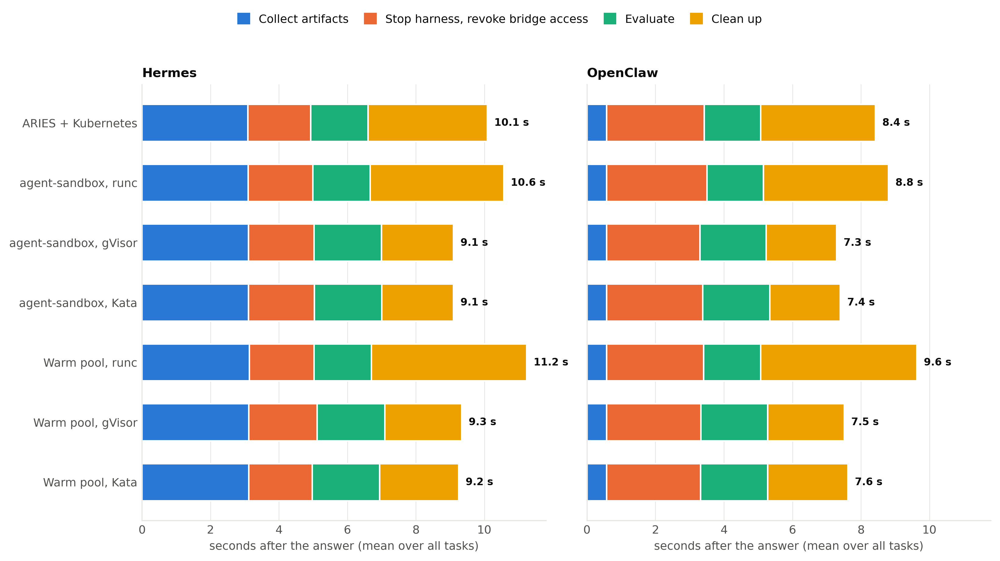

# sandbox: campaign 20261122-e5-2630v3

*Generated by `scripts/experiment/report.py` from this campaign's runs; edit `notes.md`, not this file.*

## Setup

Cold and warm end-to-end latency of the microbenchmark tasks for each harness, with the sandbox as a plain Kubernetes pod, as an agent-sandbox Sandbox, and claimed from an agent-sandbox warm pool, each under runc, gVisor and Kata where it applies; the model held constant by replaying the 20261115-e5-2630v3 recordings.

| Setup | How tools run |
|---|---|
| **ARIES K8s** | The same, with the harness, sandbox and bridge as Kubernetes pods. |
| **agent-sandbox** | Kubernetes pods, the sandbox created as an agent-sandbox Sandbox, whose controller makes the pod. |
| **agent-sandbox gVisor** | An agent-sandbox Sandbox under the gVisor RuntimeClass. |
| **agent-sandbox Kata** | An agent-sandbox Sandbox under the Kata RuntimeClass. |
| **Warm pool** | The sandbox claimed from a run-owned agent-sandbox warm pool of one ready pod; weaker isolation. |
| **Warm pool gVisor** | A warm-pool claim under the gVisor RuntimeClass. |
| **Warm pool Kata** | A warm-pool claim under the Kata RuntimeClass. |

**Controls**
- **Hardware:** Intel(R) Xeon(R) CPU E5-2630 v3 @ 2.40GHz, 16 CPUs, SMT off, turbo off. Each harness runs on a worker of its own, and every setup of a harness on that worker.
- **Resources:** harness: 2 CPUs, 4096 MiB; sandbox: 2 CPUs, 4096 MiB.
- **Model:** each harness's replies were recorded once and replayed with their original timing, so model time is the same in every setup.
- **Resource measurement:** CPU and memory come from cAdvisor through Prometheus, sampled every second, the same way in every setup.
- **Runs:** 5 repetitions of every setup, each task run cold and then warm on the same harness and sandbox.

| Task | The agent | Isolates |
|---|---|---|
| `mb-noop` | replies without using a tool | harness, model and lifecycle cost |
| `mb-one-call` | runs `touch /tmp/mb-one` | one tool round trip |
| `mb-ten-calls` | runs ten `echo` commands, one tool call each, the first overwriting the file | the cost per call |
| `mb-cpu` | runs a fixed 3,000,000-step SHA-256 chain | a CPU-bound call, about 2.5 s on a 2.4 GHz core |
| `mb-output` | prints 66,399 bytes of `base64` | output carried back through the bridge |

## Stages of a task

- **Cold** is the first request on a fresh harness and sandbox, from the first start-up step to the answer:
  - **Start-up:** the sandbox and its bridge endpoint are reserved, the harness's container or pod is created and the harness started, while the sandbox starts and the bridge binds it.
  - **Harness start:** launching the harness and waiting until it reports ready, usually most of start-up.
  - **Model:** how long the agent waited on the (replayed) model.
  - **Tool execution:** the tool calls as the harness timed them, the trip to the sandbox included.
  - **Harness logic:** the rest, the harness's own work. With the harness start, it is the harness's overhead.
- **Warm** is the same task again on the running harness and sandbox: model, tool execution and harness logic.
- **After the answer**, which the user does not wait for: collecting the harness's artifacts, stopping it, evaluating and cleaning up.

## Figures

PDFs and every plotted number (`figures.csv`) are beside the PNGs in `figures/`.

### End-to-end time, cold and warm

### After the answer

## Results

Means over valid runs, in seconds. Each task's full breakdown is in its own report (below).

### OpenClaw

Cold latency:

| Task | ARIES K8s | agent-sandbox | agent-sandbox gVisor | agent-sandbox Kata | Warm pool | Warm pool gVisor | Warm pool Kata |
|---|---|---|---|---|---|---|---|
| [`mb-noop`](tasks/mb-noop.md) | 64.30 | 64.40 | 63.76 | 65.01 | 65.06 | 65.32 | 66.35 |
| [`mb-one-call`](tasks/mb-one-call.md) | 66.91 | 67.05 | 66.66 | 66.69 | 67.25 | 67.17 | 67.58 |
| [`mb-ten-calls`](tasks/mb-ten-calls.md) | 85.59 | 84.77 | 85.68 | 86.09 | 85.29 | 85.32 | 86.04 |
| [`mb-cpu`](tasks/mb-cpu.md) | 73.53 | 73.32 | 73.62 | 74.16 | 74.33 | 73.30 | 75.37 |
| [`mb-output`](tasks/mb-output.md) | 67.90 | 67.97 | 68.17 | 67.85 | 67.75 | 69.21 | 68.61 |

Warm latency:

| Task | ARIES K8s | agent-sandbox | agent-sandbox gVisor | agent-sandbox Kata | Warm pool | Warm pool gVisor | Warm pool Kata |
|---|---|---|---|---|---|---|---|
| [`mb-noop`](tasks/mb-noop.md) | 2.32 | 2.50 | 2.60 | 2.60 | 2.56 | 2.63 | 2.40 |
| [`mb-one-call`](tasks/mb-one-call.md) | 5.41 | 5.58 | 5.42 | 5.65 | 5.48 | 5.45 | 5.37 |
| [`mb-ten-calls`](tasks/mb-ten-calls.md) | 24.58 | 24.47 | 25.01 | 25.17 | 24.63 | 25.09 | 25.29 |
| [`mb-cpu`](tasks/mb-cpu.md) | 10.55 | 10.56 | 10.77 | 10.79 | 10.82 | 10.90 | 10.88 |
| [`mb-output`](tasks/mb-output.md) | 6.20 | 6.03 | 6.13 | 6.44 | 6.04 | 6.14 | 6.37 |

### Hermes

Cold latency:

| Task | ARIES K8s | agent-sandbox | agent-sandbox gVisor | agent-sandbox Kata | Warm pool | Warm pool gVisor | Warm pool Kata |
|---|---|---|---|---|---|---|---|
| [`mb-noop`](tasks/mb-noop.md) | 25.22 | 24.67 | 24.87 | 24.72 | 25.05 | 25.05 | 24.80 |
| [`mb-one-call`](tasks/mb-one-call.md) | 27.81 | 27.21 | 28.61 | 28.21 | 27.54 | 28.43 | 27.99 |
| [`mb-ten-calls`](tasks/mb-ten-calls.md) | 42.65 | 42.19 | 44.42 | 44.38 | 41.93 | 44.25 | 44.28 |
| [`mb-cpu`](tasks/mb-cpu.md) | 31.57 | 31.68 | 32.28 | 32.49 | 31.91 | 32.06 | 32.80 |
| [`mb-output`](tasks/mb-output.md) | 27.38 | 26.97 | 27.85 | 28.12 | 27.56 | 28.68 | 27.78 |

Warm latency:

| Task | ARIES K8s | agent-sandbox | agent-sandbox gVisor | agent-sandbox Kata | Warm pool | Warm pool gVisor | Warm pool Kata |
|---|---|---|---|---|---|---|---|
| [`mb-noop`](tasks/mb-noop.md) | 1.64 | 1.64 | 1.64 | 1.64 | 1.64 | 1.65 | 1.64 |
| [`mb-one-call`](tasks/mb-one-call.md) | 3.63 | 3.61 | 4.12 | 3.92 | 3.67 | 4.13 | 3.92 |
| [`mb-ten-calls`](tasks/mb-ten-calls.md) | 18.84 | 18.88 | 20.40 | 20.24 | 18.86 | 20.41 | 20.30 |
| [`mb-cpu`](tasks/mb-cpu.md) | 8.02 | 7.93 | 8.35 | 8.40 | 8.08 | 8.52 | 8.41 |
| [`mb-output`](tasks/mb-output.md) | 3.93 | 3.95 | 4.40 | 4.23 | 4.08 | 4.40 | 4.25 |

### Overhead against ARIES K8s

Each ARIES setup's mean minus ARIES K8s's, averaged over the tasks. Per tool call is the warm `mb-ten-calls` run's harness-timed tool execution divided by its calls.

| Harness | Setup | Start-up | Cold latency | Warm latency | Per tool call (ms) | Warm harness logic |
|---|---|---|---|---|---|---|
| OpenClaw | ARIES K8s | 59.97 |  |  | 608 | 2.09 |
| OpenClaw | agent-sandbox | -0.11 | -0.14 | +0.02 | 614 | 2.10 |
| OpenClaw | agent-sandbox gVisor | -0.29 | -0.07 | +0.17 | 668 | 2.09 |
| OpenClaw | agent-sandbox Kata | +0.06 | +0.31 | +0.32 | 680 | 2.18 |
| OpenClaw | Warm pool | +0.26 | +0.29 | +0.10 | 611 | 2.18 |
| OpenClaw | Warm pool gVisor | +0.15 | +0.42 | +0.23 | 674 | 2.12 |
| OpenClaw | Warm pool Kata | +0.65 | +1.14 | +0.25 | 681 | 2.10 |
| Hermes | ARIES K8s | 14.43 |  |  | 432 | 0.46 |
| Hermes | agent-sandbox | -0.32 | -0.38 | -0.01 | 436 | 0.47 |
| Hermes | agent-sandbox gVisor | -0.09 | +0.68 | +0.57 | 585 | 0.48 |
| Hermes | agent-sandbox Kata | +0.15 | +0.66 | +0.47 | 575 | 0.46 |
| Hermes | Warm pool | -0.19 | -0.13 | +0.05 | 434 | 0.47 |
| Hermes | Warm pool gVisor | -0.07 | +0.77 | +0.61 | 588 | 0.47 |
| Hermes | Warm pool Kata | -0.02 | +0.61 | +0.49 | 575 | 0.47 |

The ARIES K8s row's start-up column is ARIES K8s's own start-up; the other rows are differences from it. Per tool call and warm harness logic are absolute values in every row.

## Per-task reports

Every start-up phase, the cold and warm runs split into model, tool execution and harness logic, the harness's overhead, each tool call as the harness and the bridge timed it, what follows the answer, CPU and memory, and every repetition:

- [`mb-noop`](tasks/mb-noop.md)
- [`mb-one-call`](tasks/mb-one-call.md)
- [`mb-ten-calls`](tasks/mb-ten-calls.md)
- [`mb-cpu`](tasks/mb-cpu.md)
- [`mb-output`](tasks/mb-output.md)

## Runs

Runs per harness and setup, by status. Only valid runs are analysed.

| Harness | Setup | Valid | Failed | Superseded | Task runs solved |
|---|---|---|---|---|---|
| OpenClaw | ARIES K8s | 5 | 0 | 1 | 25/25 |
| OpenClaw | agent-sandbox | 5 | 0 | 1 | 25/25 |
| OpenClaw | agent-sandbox gVisor | 5 | 0 | 1 | 25/25 |
| OpenClaw | agent-sandbox Kata | 5 | 0 | 1 | 25/25 |
| OpenClaw | Warm pool | 5 | 0 | 1 | 25/25 |
| OpenClaw | Warm pool gVisor | 5 | 0 | 1 | 25/25 |
| OpenClaw | Warm pool Kata | 5 | 0 | 1 | 25/25 |
| Hermes | ARIES K8s | 5 | 0 | 1 | 25/25 |
| Hermes | agent-sandbox | 5 | 0 | 1 | 25/25 |
| Hermes | agent-sandbox gVisor | 5 | 0 | 1 | 25/25 |
| Hermes | agent-sandbox Kata | 5 | 0 | 1 | 25/25 |
| Hermes | Warm pool | 5 | 0 | 1 | 25/25 |
| Hermes | Warm pool gVisor | 5 | 0 | 1 | 25/25 |
| Hermes | Warm pool Kata | 5 | 0 | 1 | 25/25 |

Runs left out:

- `runs/openclaw/k8s/warmup` (superseded): warm-up before measuring: pulls images, fills caches
- `runs/hermes/k8s/warmup` (superseded): warm-up before measuring: pulls images, fills caches
- `runs/openclaw/k8s-agent-sandbox/warmup` (superseded): warm-up before measuring: pulls images, fills caches
- `runs/hermes/k8s-agent-sandbox/warmup` (superseded): warm-up before measuring: pulls images, fills caches
- `runs/openclaw/k8s-agent-sandbox-gvisor/warmup` (superseded): warm-up before measuring: pulls images, fills caches
- `runs/hermes/k8s-agent-sandbox-gvisor/warmup` (superseded): warm-up before measuring: pulls images, fills caches
- `runs/hermes/k8s-agent-sandbox-kata/warmup` (superseded): warm-up before measuring: pulls images, fills caches
- `runs/openclaw/k8s-agent-sandbox-kata/warmup` (superseded): warm-up before measuring: pulls images, fills caches
- `runs/hermes/k8s-warm-pool/warmup` (superseded): warm-up before measuring: pulls images, fills caches
- `runs/openclaw/k8s-warm-pool/warmup` (superseded): warm-up before measuring: pulls images, fills caches
- `runs/hermes/k8s-warm-pool-gvisor/warmup` (superseded): warm-up before measuring: pulls images, fills caches
- `runs/hermes/k8s-warm-pool-kata/warmup` (superseded): warm-up before measuring: pulls images, fills caches
- `runs/openclaw/k8s-warm-pool-gvisor/warmup` (superseded): warm-up before measuring: pulls images, fills caches
- `runs/openclaw/k8s-warm-pool-kata/warmup` (superseded): warm-up before measuring: pulls images, fills caches

Model requests not answered from the recording: 0.

## Provenance

| | |
|---|---|
| Experiment spec | `experiments/sandbox/experiment.json` |
| ARIES commit | `9d36541cf23d539cad23cfb5911087bc20f39792` |
| Bridge image | `aries-bridge:v1-ff258b6f0569` |
| vHive setup tool | `9826bb9c2af97d6478498df64879e8c30b21d31d` |
| Started, finished | 2026-11-22T13:06:37Z, 2026-11-22T17:50:34Z |
| Harnesses | openclaw, hermes |
| Setups | k8s, k8s-agent-sandbox, k8s-agent-sandbox-gvisor, k8s-agent-sandbox-kata, k8s-warm-pool, k8s-warm-pool-gvisor, k8s-warm-pool-kata |
| Tasks | `mb-noop`, `mb-one-call`, `mb-ten-calls`, `mb-cpu`, `mb-output` |
| Repetitions | 5, each task run cold then warm |
| Recordings | experiments/coldwarm/results/20261115-e5-2630v3 |
| Recording `hermes` | sha256 `d21fee03969c1291` |
| Recording `openclaw` | sha256 `cd8832d5087cc488` |

| Worker | Harnesses | ARIES commit | CPU | CPUs | Memory (GiB) | SMT | Turbo | Kernel | Kubelet | Docker |
|---|---|---|---|---|---|---|---|---|---|---|
| pc762 | hermes | `9d36541cf23d` | Intel(R) Xeon(R) CPU E5-2630 v3 @ 2.40GHz | 16 | 62.8 | off | off | 6.8.0-149-generic | v1.35.3 | 29.8.2 |
| pc780 | openclaw | `9d36541cf23d` | Intel(R) Xeon(R) CPU E5-2630 v3 @ 2.40GHz | 16 | 62.8 | off | off | 6.8.0-149-generic | v1.35.3 | 29.8.2 |

The full per-variant analysis is in `analysis/analysis.md`, one row per task run in `analysis/tasks.csv`.

## Notes

### About this campaign

This campaign replays the [coldwarm 20261115-e5-2630v3](../../../coldwarm/results/20261115-e5-2630v3/report.md)
recordings on the same workers and hardware, and changes only how the tool
sandbox pod is made. Every request was answered from the recording, so model
time is identical across setups. The plain pod (ARIES K8s) is the baseline;
native and Docker are not run here, and the coldwarm campaign compares them
with ARIES K8s.

All 70 measured runs succeeded, 350 of 350 task runs solved. The 14 left out
are the planned warm-up runs, one per harness and setup.

Each run executes the five tasks in order, `mb-noop` first. A warm-pool run
creates its own pool of one when the run starts, so `mb-noop` claims a pod
that is still starting, and only the later four tasks claim a ready one.

### The sandbox is not on the critical path

The sandbox starts alongside the harness, and the harness start dominates
(about 12 s for Hermes and 56 s for OpenClaw). Every sandbox start, Kata's
6.5 s included, finishes well inside it, so cold latency differs from the
plain pod by at most about 1 s in any setup. Most of those differences are
within one standard deviation.

| Sandbox start (s) | Plain pod | agent-sandbox | Warm pool |
|---|---|---|---|
| runc | 2.7 | 2.3–2.6 | 1.8 |
| gVisor | | 2.6 | 1.8 |
| Kata | | 6.5 | 1.8 |

The warm pool's 1.8 s is for the four tasks that claim a ready pod. When the
pod is still starting (`mb-noop`), the claim takes 2.8 s under runc and gVisor
and 8.7 s under Kata, longer than creating the pod directly.

A pool therefore saves at most 0.9 s (runc) to 4.7 s (Kata) of sandbox start,
and with these harnesses none of it reaches the user. It would matter only for
a harness that starts faster than its sandbox.

The largest cold difference, +1.1 s for OpenClaw on the Kata warm pool, comes
from a longer harness start, not from the sandbox. The likely cause is the
pool booting a replacement Kata VM, which uses CPU on the same worker while the
harness starts. `mb-noop`'s harness start is 2.0 s longer there, and in that
task the claimed VM is also booting.

### Where gVisor and Kata cost time: tool calls

Under gVisor and Kata each tool call is slower, by about the same amount for
both runtimes, whether the pod is plain, from agent-sandbox or from a pool.

The cost per call in warm `mb-ten-calls`, as the harness timed it:

| Harness | runc | gVisor | Kata |
|---|---|---|---|
| OpenClaw | 608–614 ms | 668–674 ms (+60) | 680–681 ms (+70) |
| Hermes | 432–436 ms | 585–588 ms (+150) | 575 ms (+140) |

The per-task reports' bridge rows split this cost:
- **OpenClaw:** each call is about 4 sandbox commands. Under gVisor and Kata
  the bridge's share grows by about 65 ms per call, and the transport doesn't
  change.
- **Hermes:** each call is 5 sandbox commands. The bridge's share grows by
  80–95 ms, and the transport between harness and sandbox grows by about
  60 ms more.

Warm `mb-ten-calls` is 1.5 s slower for Hermes and 0.5 s slower for OpenClaw.
Single-call tasks change by up to 0.5 s.

### agent-sandbox under runc matches the plain pod

Under runc, agent-sandbox matches the plain pod within noise:
- its sandbox starts 0.1–0.4 s faster;
- its cold and warm latency are within ±0.4 s;
- its per-call time is within 6 ms.

The controller's extra step, from the Sandbox to the pod, costs nothing
measurable.

### After the answer

- **Evaluation:** about 0.3 s slower under gVisor and Kata. The verifier runs
  in the sandbox, so it pays the per-command cost.
- **Clean-up:** about 1.2 s faster under gVisor and Kata (2.0–2.3 s) than
  under runc. Under runc it takes 3.3 s for the plain pod, 3.6–4.0 s for
  agent-sandbox and 4.6 s for the warm pool. The same ordering appeared in
  the Phase 1 replays. All three delete in the foreground, so each waits until
  the containers have left the node. Under runc the sandbox's `sleep`
  ignores the stop signal and waits out the grace period, and a claim's
  delete also removes its claim and Sandbox.

### Resources

The sandbox's peak memory, from its pod cgroup:
- **runc:** about 1 MiB;
- **gVisor:** 17–18 MiB, gVisor's Sentry;
- **Kata:** 317–320 MiB, mostly the guest VM.

Sandbox CPU peaks rise with the runtime, but stay well under the 2-CPU limit.
The harness's CPU and memory don't change with the sandbox setup. Its peak CPU
varies by up to ±100% of a core between repetitions, so differences in that
row are noise.
