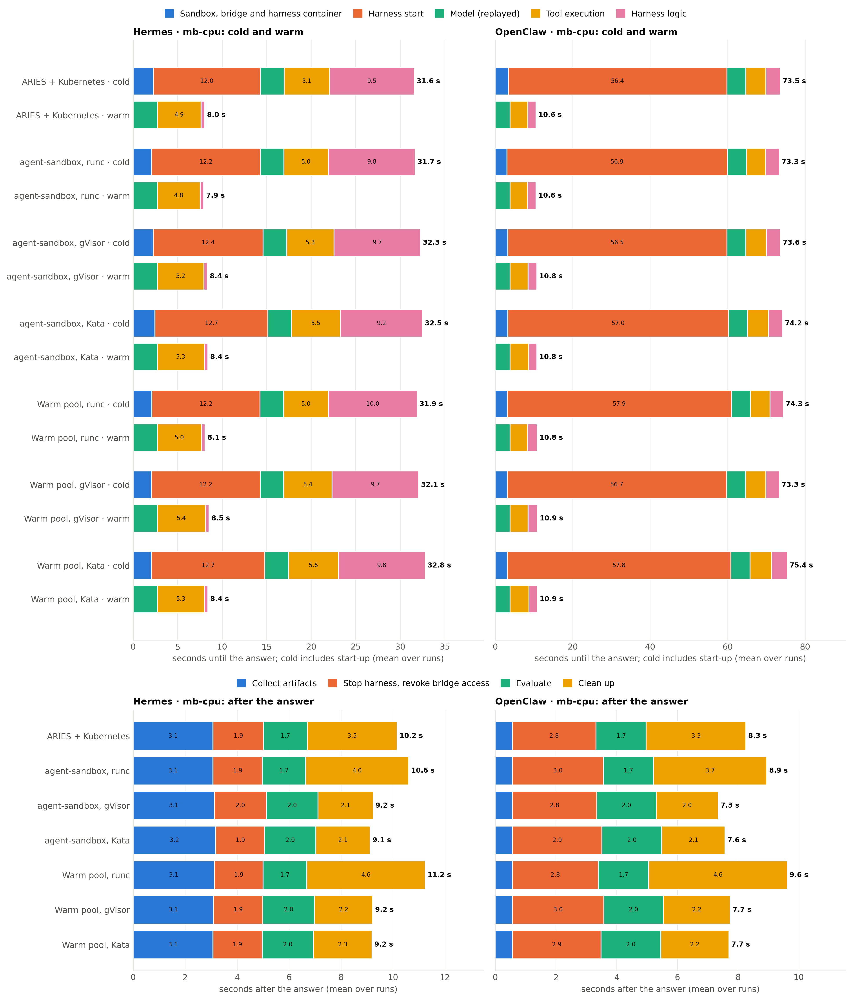
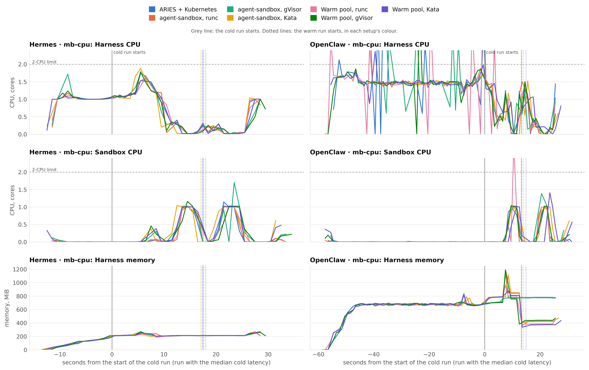

# `mb-cpu`: time breakdown

*Generated by `scripts/experiment/report.py`; back to the [campaign report](../report.md).*

The agent runs a fixed 3,000,000-step SHA-256 chain; the verifier checks the final hash. It isolates a CPU-bound call, about 2.5 s on a 2.4 GHz core.

Means ± standard deviation over the valid runs, in seconds unless marked; the last columns are each ARIES setup's mean minus ARIES K8s's.

- **Start-up:** the phases before the first request. The harness starts while the sandbox starts, so the *alongside* phases overlap the harness start, and start-up is less than their sum.
- **Run:** model time is how long a request offering tools was open. Tool execution is timed by the harness, the same way in every setup: Hermes's tool spans, or OpenClaw's session log from the tool-calling reply to the tool's result. Harness logic is the rest of the run: the harness's own work.
- **Harness overhead:** the harness's own time, beside the model and the tools. Cold, it is the harness start plus the cold run's harness logic; warm, the warm run's harness logic.
- **Tool calls:** what one agent tool call costs, from the agent's side. Natively the harness runs the command in its own container; through ARIES the request goes harness → bridge → sandbox and back.
  - *Per call, as the harness timed it:* the whole call, by the harness's own clock. It is timed the same way in every setup, so compare setups on this row.
  - *Commands the bridge ran:* every request the bridge served in the sandbox. One agent call is several: OpenClaw syncs its workspace before each command, and Hermes opens a terminal session (connection checks, environment, a shell snapshot) before its first command.
  - *Per call, the bridge running its commands:* the bridge's time running all of them, divided by the agent's calls.
  - *Per call, transport:* the whole call minus the bridge's share: requests travelling between harness, bridge and sandbox, and any gaps between the bridge's commands. It is a remainder, not a network measurement.
  - Native runs have no bridge, so only the whole call is shown.
  - **–** in a cold run: the bridge ran more commands cold than warm, because the harness also set itself up through the bridge before any agent call (Hermes opens a terminal session when the agent starts). Those commands belong to no call, so the bridge share and transport are left out.

## Figures

PDFs are beside the PNGs in `../figures/tasks/`.

### Time breakdown

### Resources over time

Each setup's run with the median cold latency, timed from the start of its cold run, so start-up is to the left of zero. CPU is the rate of the container's CPU counter over one-second bins.

## OpenClaw

Runs: ARIES K8s 5, agent-sandbox 5, agent-sandbox gVisor 5, agent-sandbox Kata 5, Warm pool 5, Warm pool gVisor 5, Warm pool Kata 5.

| Measure | ARIES K8s | agent-sandbox | agent-sandbox gVisor | agent-sandbox Kata | Warm pool | Warm pool gVisor | Warm pool Kata | agent-sandbox − ARIES K8s | agent-sandbox gVisor − ARIES K8s | agent-sandbox Kata − ARIES K8s | Warm pool − ARIES K8s | Warm pool gVisor − ARIES K8s | Warm pool Kata − ARIES K8s |
|---|---|---|---|---|---|---|---|---|---|---|---|---|---|
| ***Start-up, until the first request*** | | | | | | | | | | | | | |
| Sandbox reservation (`sandbox_reserve`) | 0.29 ± 0.00 | 0.29 ± 0.00 | 0.29 ± 0.00 | 0.29 ± 0.00 | 0.30 ± 0.00 | 0.29 ± 0.00 | 0.29 ± 0.00 | -0.00 | -0.00 | -0.00 | +0.00 | +0.00 | +0.00 |
| Bridge endpoint reservation (`bridge_reserve`) | 0.18 ± 0.00 | 0.18 ± 0.00 | 0.18 ± 0.00 | 0.18 ± 0.00 | 0.19 ± 0.00 | 0.18 ± 0.01 | 0.18 ± 0.00 | +0.00 | +0.00 | +0.00 | +0.01 | +0.00 | +0.00 |
| Harness container or pod creation (`harness_prepare`) | 2.93 ± 0.13 | 2.56 ± 0.14 | 2.80 ± 0.01 | 2.79 ± 0.01 | 2.62 ± 0.01 | 2.62 ± 0.01 | 2.62 ± 0.01 | -0.37 | -0.13 | -0.14 | -0.31 | -0.31 | -0.32 |
| Harness start, until it reports ready (`harness_start`) | 56.41 ± 0.78 | 56.92 ± 1.29 | 56.54 ± 0.94 | 56.99 ± 0.63 | 57.90 ± 1.44 | 56.67 ± 0.44 | 57.76 ± 0.35 | +0.51 | +0.13 | +0.57 | +1.49 | +0.26 | +1.35 |
| *Alongside:* sandbox start (`sandbox_start`) | 2.66 ± 0.13 | 2.31 ± 0.14 | 2.56 ± 0.01 | 6.35 ± 0.45 | 1.81 ± 0.01 | 1.84 ± 0.02 | 1.84 ± 0.01 | -0.35 | -0.10 | +3.68 | -0.85 | -0.82 | -0.82 |
| *Alongside:* sandbox sanitising (`sandbox_prepare`) | 0.42 ± 0.01 | 0.41 ± 0.01 | 0.46 ± 0.00 | 0.46 ± 0.01 | 0.41 ± 0.01 | 0.46 ± 0.00 | 0.47 ± 0.01 | -0.01 | +0.05 | +0.05 | -0.01 | +0.04 | +0.06 |
| *Alongside:* bridge binding the sandbox (`bridge_register`) | 0.35 ± 0.01 | 0.35 ± 0.00 | 0.43 ± 0.01 | 0.44 ± 0.02 | 0.34 ± 0.00 | 0.43 ± 0.00 | 0.44 ± 0.01 | +0.00 | +0.08 | +0.09 | -0.01 | +0.08 | +0.08 |
| **Start-up to the first request** | 59.82 ± 0.87 | 59.96 ± 1.35 | 59.81 ± 0.93 | 60.25 ± 0.63 | 61.01 ± 1.44 | 59.77 ± 0.43 | 60.85 ± 0.35 | +0.15 | -0.00 | +0.44 | +1.19 | -0.04 | +1.04 |
| ***Cold run, from the request to the answer*** | | | | | | | | | | | | | |
| Model (replayed) | 4.90 ± 0.00 | 4.90 ± 0.00 | 4.90 ± 0.00 | 4.90 ± 0.00 | 4.90 ± 0.00 | 4.90 ± 0.00 | 4.90 ± 0.00 | -0.00 | +0.00 | +0.00 | +0.00 | +0.00 | +0.00 |
| Tool execution, as the harness timed it | 5.17 ± 0.26 | 4.96 ± 0.18 | 5.26 ± 0.22 | 5.40 ± 0.09 | 5.04 ± 0.22 | 5.19 ± 0.09 | 5.58 ± 0.34 | -0.21 | +0.09 | +0.23 | -0.13 | +0.02 | +0.41 |
| Harness logic | 3.64 ± 0.59 | 3.50 ± 0.30 | 3.65 ± 0.46 | 3.60 ± 0.45 | 3.37 ± 0.36 | 3.43 ± 0.49 | 4.04 ± 0.21 | -0.14 | +0.00 | -0.04 | -0.27 | -0.21 | +0.39 |
| **Cold run** | 13.71 ± 0.49 | 13.36 ± 0.19 | 13.80 ± 0.34 | 13.91 ± 0.43 | 13.32 ± 0.45 | 13.52 ± 0.52 | 14.51 ± 0.49 | -0.35 | +0.09 | +0.19 | -0.40 | -0.19 | +0.80 |
| **Cold latency: start-up and run** | 73.53 ± 0.78 | 73.32 ± 1.32 | 73.62 ± 0.84 | 74.16 ± 0.45 | 74.33 ± 1.70 | 73.30 ± 0.88 | 75.37 ± 0.32 | -0.21 | +0.09 | +0.63 | +0.80 | -0.23 | +1.84 |
| Harness overhead: harness start and logic | 60.05 ± 0.46 | 60.42 ± 1.36 | 60.19 ± 0.85 | 60.59 ± 0.43 | 61.27 ± 1.50 | 60.10 ± 0.84 | 61.79 ± 0.17 | +0.37 | +0.13 | +0.54 | +1.22 | +0.05 | +1.74 |
| Model calls the agent waited on | 2.0 ± 0.0 | 2.0 ± 0.0 | 2.0 ± 0.0 | 2.0 ± 0.0 | 2.0 ± 0.0 | 2.0 ± 0.0 | 2.0 ± 0.0 | +0.0 | +0.0 | +0.0 | +0.0 | +0.0 | +0.0 |
| ***Warm run, the same task on the running harness and sandbox*** | | | | | | | | | | | | | |
| Model (replayed) | 3.86 ± 0.00 | 3.86 ± 0.00 | 3.86 ± 0.00 | 3.86 ± 0.00 | 3.86 ± 0.00 | 3.86 ± 0.00 | 3.86 ± 0.00 | +0.00 | +0.00 | -0.00 | +0.00 | +0.00 | +0.00 |
| Tool execution, as the harness timed it | 4.57 ± 0.12 | 4.54 ± 0.05 | 4.65 ± 0.08 | 4.81 ± 0.05 | 4.53 ± 0.10 | 4.68 ± 0.13 | 4.85 ± 0.10 | -0.03 | +0.08 | +0.23 | -0.04 | +0.10 | +0.28 |
| Harness logic, its overhead when warm | 2.12 ± 0.18 | 2.16 ± 0.29 | 2.26 ± 0.30 | 2.13 ± 0.37 | 2.43 ± 0.18 | 2.37 ± 0.19 | 2.17 ± 0.43 | +0.04 | +0.13 | +0.01 | +0.31 | +0.25 | +0.04 |
| **Warm latency** | 10.55 ± 0.18 | 10.56 ± 0.26 | 10.77 ± 0.32 | 10.79 ± 0.41 | 10.82 ± 0.14 | 10.90 ± 0.28 | 10.88 ± 0.48 | +0.00 | +0.21 | +0.24 | +0.27 | +0.35 | +0.32 |
| Model calls the agent waited on | 2.0 ± 0.0 | 2.0 ± 0.0 | 2.0 ± 0.0 | 2.0 ± 0.0 | 2.0 ± 0.0 | 2.0 ± 0.0 | 2.0 ± 0.0 | +0.0 | +0.0 | +0.0 | +0.0 | +0.0 | +0.0 |

### Tool calls

| Measure | ARIES K8s | agent-sandbox | agent-sandbox gVisor | agent-sandbox Kata | Warm pool | Warm pool gVisor | Warm pool Kata | agent-sandbox − ARIES K8s | agent-sandbox gVisor − ARIES K8s | agent-sandbox Kata − ARIES K8s | Warm pool − ARIES K8s | Warm pool gVisor − ARIES K8s | Warm pool Kata − ARIES K8s |
|---|---|---|---|---|---|---|---|---|---|---|---|---|---|
| ***Tool calls, cold run*** | | | | | | | | | | | | | |
| Agent tool calls | 1.0 ± 0.0 | 1.0 ± 0.0 | 1.0 ± 0.0 | 1.0 ± 0.0 | 1.0 ± 0.0 | 1.0 ± 0.0 | 1.0 ± 0.0 | +0.0 | +0.0 | +0.0 | +0.0 | +0.0 | +0.0 |
| Commands the bridge ran for them | 5.0 ± 0.0 | 5.0 ± 0.0 | 5.0 ± 0.0 | 5.0 ± 0.0 | 5.0 ± 0.0 | 5.0 ± 0.0 | 5.0 ± 0.0 | +0.0 | +0.0 | +0.0 | +0.0 | +0.0 | +0.0 |
| Per call, as the harness timed it | 5171 ± 259 | 4960 ± 184 | 5256 ± 215 | 5400 ± 95 | 5043 ± 221 | 5192 ± 92 | 5578 ± 337 | -211 | +85 | +230 | -128 | +21 | +407 |
| Per call, the bridge running its commands | 4405 ± 159 | 4205 ± 70 | 4469 ± 207 | 4687 ± 53 | 4376 ± 199 | 4500 ± 116 | 4778 ± 196 | -200 | +64 | +282 | -30 | +95 | +373 |
| Per call, transport between harness and sandbox | 765 ± 149 | 754 ± 152 | 786 ± 175 | 713 ± 45 | 667 ± 23 | 691 ± 46 | 800 ± 167 | -11 | +21 | -52 | -98 | -74 | +35 |
| ***Tool calls, warm run*** | | | | | | | | | | | | | |
| Agent tool calls | 1.0 ± 0.0 | 1.0 ± 0.0 | 1.0 ± 0.0 | 1.0 ± 0.0 | 1.0 ± 0.0 | 1.0 ± 0.0 | 1.0 ± 0.0 | +0.0 | +0.0 | +0.0 | +0.0 | +0.0 | +0.0 |
| Commands the bridge ran for them | 5.0 ± 0.0 | 5.0 ± 0.0 | 5.0 ± 0.0 | 5.0 ± 0.0 | 5.0 ± 0.0 | 5.0 ± 0.0 | 5.0 ± 0.0 | +0.0 | +0.0 | +0.0 | +0.0 | +0.0 | +0.0 |
| Per call, as the harness timed it | 4571 ± 115 | 4537 ± 53 | 4653 ± 81 | 4805 ± 50 | 4532 ± 98 | 4675 ± 135 | 4853 ± 95 | -34 | +81 | +234 | -39 | +104 | +282 |
| Per call, the bridge running its commands | 4278 ± 99 | 4231 ± 47 | 4348 ± 88 | 4512 ± 57 | 4247 ± 110 | 4378 ± 134 | 4551 ± 93 | -47 | +70 | +234 | -31 | +100 | +273 |
| Per call, transport between harness and sandbox | 293 ± 29 | 306 ± 15 | 304 ± 13 | 293 ± 12 | 285 ± 19 | 297 ± 26 | 303 ± 27 | +13 | +11 | +0 | -8 | +4 | +10 |

### After the answer and resources

| Measure | ARIES K8s | agent-sandbox | agent-sandbox gVisor | agent-sandbox Kata | Warm pool | Warm pool gVisor | Warm pool Kata | agent-sandbox − ARIES K8s | agent-sandbox gVisor − ARIES K8s | agent-sandbox Kata − ARIES K8s | Warm pool − ARIES K8s | Warm pool gVisor − ARIES K8s | Warm pool Kata − ARIES K8s |
|---|---|---|---|---|---|---|---|---|---|---|---|---|---|
| ***After the answer*** | | | | | | | | | | | | | |
| Collect the harness's artifacts (`harness_collect`) | 0.57 ± 0.00 | 0.57 ± 0.01 | 0.57 ± 0.01 | 0.57 ± 0.00 | 0.57 ± 0.01 | 0.57 ± 0.01 | 0.57 ± 0.01 | -0.00 | -0.00 | +0.00 | +0.00 | -0.00 | +0.00 |
| Stop the harness, revoke bridge access (`isolation`) | 2.75 ± 0.45 | 3.00 ± 0.40 | 2.78 ± 0.35 | 2.95 ± 0.25 | 2.83 ± 0.15 | 3.01 ± 0.35 | 2.92 ± 0.42 | +0.25 | +0.03 | +0.20 | +0.07 | +0.26 | +0.17 |
| Evaluate (`evaluation`) | 1.65 ± 0.01 | 1.65 ± 0.01 | 1.95 ± 0.01 | 1.97 ± 0.02 | 1.66 ± 0.01 | 1.95 ± 0.01 | 1.96 ± 0.03 | -0.00 | +0.30 | +0.31 | +0.01 | +0.30 | +0.31 |
| Clean up (`cleanup`) | 3.28 ± 0.13 | 3.73 ± 0.41 | 2.04 ± 0.14 | 2.08 ± 0.02 | 4.56 ± 0.01 | 2.21 ± 0.14 | 2.25 ± 0.03 | +0.44 | -1.24 | -1.20 | +1.28 | -1.07 | -1.03 |
| **After the answer** | 8.26 ± 0.43 | 8.94 ± 0.59 | 7.34 ± 0.44 | 7.57 ± 0.25 | 9.62 ± 0.17 | 7.74 ± 0.47 | 7.70 ± 0.41 | +0.69 | -0.91 | -0.69 | +1.36 | -0.51 | -0.56 |
| ***Resources, over the whole task*** | | | | | | | | | | | | | |
| Harness CPU, mean (% of one core) | 117 ± 7 | 119 ± 5 | 112 ± 3 | 112 ± 3 | 119 ± 1 | 118 ± 2 | 119 ± 2 | +2 | -5 | -5 | +2 | +1 | +2 |
| Harness CPU, peak (% of one core) | 290 ± 102 | 288 ± 86 | 311 ± 99 | 255 ± 120 | 253 ± 116 | 352 ± 112 | 294 ± 89 | -2 | +21 | -36 | -38 | +61 | +3 |
| Harness memory, peak (MiB) | 1028 ± 165 | 934 ± 213 | 928 ± 200 | 1087 ± 173 | 972 ± 146 | 1000 ± 147 | 1091 ± 187 | -95 | -101 | +59 | -56 | -28 | +62 |
| Sandbox CPU, mean (% of one core) | 9 ± 1 | 9 ± 1 | 11 ± 1 | 13 ± 1 | 9 ± 1 | 10 ± 1 | 12 ± 1 | -0 | +2 | +4 | +0 | +1 | +3 |
| Sandbox CPU, peak (% of one core) | 136 ± 49 | 100 ± 0 | 133 ± 68 | 130 ± 64 | 135 ± 79 | 135 ± 71 | 134 ± 53 | -35 | -2 | -6 | -0 | -1 | -1 |
| Sandbox memory, peak (MiB) | 8 ± 0 | 8 ± 0 | 25 ± 0 | 333 ± 2 | 8 ± 0 | 25 ± 0 | 337 ± 1 | -0 | +17 | +325 | -0 | +17 | +329 |

### Each repetition (latency, seconds)

| Repetition | ARIES K8s cold | ARIES K8s warm | agent-sandbox cold | agent-sandbox warm | agent-sandbox gVisor cold | agent-sandbox gVisor warm | agent-sandbox Kata cold | agent-sandbox Kata warm | Warm pool cold | Warm pool warm | Warm pool gVisor cold | Warm pool gVisor warm | Warm pool Kata cold | Warm pool Kata warm |
|---|---|---|---|---|---|---|---|---|---|---|---|---|---|---|
| 1 | 73.81 | 10.41 | 74.79 | 10.85 | 74.02 | 10.33 | 74.00 | 10.83 | 72.64 | 10.91 | 74.09 | 11.03 | 74.88 | 10.45 |
| 2 | 73.24 | 10.82 | 74.53 | 10.52 | 74.44 | 10.90 | 73.93 | 11.37 | 73.85 | 10.91 | 73.02 | 10.45 | 75.30 | 10.63 |
| 3 | 73.59 | 10.58 | 72.53 | 10.16 | 74.16 | 11.21 | 74.67 | 10.81 | 72.95 | 10.65 | 73.07 | 11.16 | 75.74 | 10.63 |
| 4 | 74.57 | 10.37 | 73.08 | 10.71 | 72.48 | 10.67 | 73.63 | 10.71 | 76.52 | 10.94 | 74.21 | 11.05 | 75.45 | 11.02 |
| 5 | 72.44 | 10.58 | 71.69 | 10.54 | 72.99 | 10.73 | 74.57 | 10.23 | 75.67 | 10.69 | 72.08 | 10.81 | 75.47 | 11.65 |

## Hermes

Runs: ARIES K8s 5, agent-sandbox 5, agent-sandbox gVisor 5, agent-sandbox Kata 5, Warm pool 5, Warm pool gVisor 5, Warm pool Kata 5.

| Measure | ARIES K8s | agent-sandbox | agent-sandbox gVisor | agent-sandbox Kata | Warm pool | Warm pool gVisor | Warm pool Kata | agent-sandbox − ARIES K8s | agent-sandbox gVisor − ARIES K8s | agent-sandbox Kata − ARIES K8s | Warm pool − ARIES K8s | Warm pool gVisor − ARIES K8s | Warm pool Kata − ARIES K8s |
|---|---|---|---|---|---|---|---|---|---|---|---|---|---|
| ***Start-up, until the first request*** | | | | | | | | | | | | | |
| Sandbox reservation (`sandbox_reserve`) | 0.30 ± 0.00 | 0.30 ± 0.00 | 0.29 ± 0.00 | 0.29 ± 0.00 | 0.30 ± 0.00 | 0.30 ± 0.00 | 0.30 ± 0.00 | +0.00 | -0.00 | -0.00 | -0.00 | +0.00 | -0.00 |
| Bridge endpoint reservation (`bridge_reserve`) | 0.14 ± 0.00 | 0.13 ± 0.00 | 0.14 ± 0.00 | 0.13 ± 0.00 | 0.14 ± 0.00 | 0.14 ± 0.00 | 0.14 ± 0.00 | -0.00 | +0.00 | -0.00 | +0.00 | +0.00 | +0.00 |
| Harness container or pod creation (`harness_prepare`) | 1.84 ± 0.17 | 1.65 ± 0.17 | 1.82 ± 0.01 | 2.01 ± 0.45 | 1.67 ± 0.01 | 1.63 ± 0.01 | 1.63 ± 0.01 | -0.19 | -0.02 | +0.17 | -0.17 | -0.21 | -0.20 |
| Harness start, until it reports ready (`harness_start`) | 12.03 ± 0.13 | 12.21 ± 0.55 | 12.35 ± 0.94 | 12.69 ± 0.65 | 12.16 ± 0.06 | 12.20 ± 0.92 | 12.73 ± 0.63 | +0.17 | +0.32 | +0.66 | +0.13 | +0.17 | +0.70 |
| *Alongside:* sandbox start (`sandbox_start`) | 2.57 ± 0.16 | 2.42 ± 0.17 | 2.60 ± 0.02 | 6.60 ± 0.02 | 1.82 ± 0.01 | 1.83 ± 0.01 | 1.86 ± 0.03 | -0.15 | +0.03 | +4.02 | -0.75 | -0.74 | -0.71 |
| *Alongside:* sandbox sanitising (`sandbox_prepare`) | 0.42 ± 0.00 | 0.42 ± 0.01 | 0.47 ± 0.01 | 0.48 ± 0.00 | 0.42 ± 0.00 | 0.48 ± 0.01 | 0.49 ± 0.01 | +0.01 | +0.06 | +0.06 | +0.00 | +0.06 | +0.08 |
| *Alongside:* bridge binding the sandbox (`bridge_register`) | 0.14 ± 0.01 | 0.14 ± 0.00 | 0.14 ± 0.00 | 0.14 ± 0.01 | 0.14 ± 0.00 | 0.13 ± 0.00 | 0.13 ± 0.00 | -0.00 | -0.00 | -0.00 | +0.00 | -0.00 | -0.01 |
| **Start-up to the first request** | 14.31 ± 0.21 | 14.29 ± 0.45 | 14.61 ± 0.94 | 15.13 ± 0.86 | 14.26 ± 0.07 | 14.27 ± 0.92 | 14.80 ± 0.63 | -0.02 | +0.30 | +0.83 | -0.04 | -0.04 | +0.50 |
| ***Cold run, from the request to the answer*** | | | | | | | | | | | | | |
| Model (replayed) | 2.66 ± 0.00 | 2.66 ± 0.00 | 2.66 ± 0.00 | 2.66 ± 0.00 | 2.66 ± 0.00 | 2.66 ± 0.00 | 2.66 ± 0.00 | +0.00 | -0.00 | +0.00 | +0.00 | +0.00 | +0.00 |
| Tool execution, as the harness timed it | 5.11 ± 0.12 | 4.97 ± 0.08 | 5.32 ± 0.14 | 5.50 ± 0.11 | 5.00 ± 0.20 | 5.43 ± 0.09 | 5.59 ± 0.18 | -0.13 | +0.21 | +0.40 | -0.11 | +0.33 | +0.48 |
| Harness logic | 9.50 ± 0.65 | 9.77 ± 0.49 | 9.70 ± 0.41 | 9.20 ± 0.50 | 9.99 ± 0.22 | 9.71 ± 0.38 | 9.75 ± 0.24 | +0.26 | +0.20 | -0.30 | +0.49 | +0.20 | +0.25 |
| **Cold run** | 17.27 ± 0.63 | 17.40 ± 0.44 | 17.67 ± 0.45 | 17.36 ± 0.52 | 17.65 ± 0.41 | 17.79 ± 0.38 | 18.00 ± 0.40 | +0.13 | +0.41 | +0.09 | +0.38 | +0.53 | +0.74 |
| **Cold latency: start-up and run** | 31.57 ± 0.76 | 31.68 ± 0.33 | 32.28 ± 0.88 | 32.49 ± 0.58 | 31.91 ± 0.42 | 32.06 ± 0.84 | 32.80 ± 0.53 | +0.11 | +0.71 | +0.92 | +0.34 | +0.49 | +1.23 |
| Harness overhead: harness start and logic | 21.54 ± 0.71 | 21.97 ± 0.34 | 22.06 ± 1.00 | 21.89 ± 0.43 | 22.16 ± 0.25 | 21.91 ± 0.79 | 22.49 ± 0.52 | +0.43 | +0.52 | +0.35 | +0.62 | +0.37 | +0.95 |
| Model calls the agent waited on | 3.0 ± 0.0 | 3.0 ± 0.0 | 3.0 ± 0.0 | 3.0 ± 0.0 | 3.0 ± 0.0 | 3.0 ± 0.0 | 3.0 ± 0.0 | +0.0 | +0.0 | +0.0 | +0.0 | +0.0 | +0.0 |
| ***Warm run, the same task on the running harness and sandbox*** | | | | | | | | | | | | | |
| Model (replayed) | 2.72 ± 0.00 | 2.72 ± 0.00 | 2.72 ± 0.00 | 2.72 ± 0.00 | 2.72 ± 0.00 | 2.72 ± 0.00 | 2.72 ± 0.00 | +0.00 | +0.00 | +0.00 | +0.00 | +0.00 | +0.00 |
| Tool execution, as the harness timed it | 4.92 ± 0.09 | 4.83 ± 0.09 | 5.25 ± 0.13 | 5.29 ± 0.09 | 4.96 ± 0.09 | 5.40 ± 0.08 | 5.30 ± 0.08 | -0.09 | +0.33 | +0.37 | +0.04 | +0.49 | +0.38 |
| Harness logic, its overhead when warm | 0.39 ± 0.05 | 0.38 ± 0.04 | 0.39 ± 0.01 | 0.39 ± 0.02 | 0.41 ± 0.04 | 0.40 ± 0.02 | 0.39 ± 0.02 | -0.00 | -0.00 | +0.00 | +0.02 | +0.01 | +0.00 |
| **Warm latency** | 8.02 ± 0.09 | 7.93 ± 0.11 | 8.35 ± 0.14 | 8.40 ± 0.09 | 8.08 ± 0.13 | 8.52 ± 0.09 | 8.41 ± 0.09 | -0.09 | +0.33 | +0.37 | +0.06 | +0.50 | +0.39 |
| Model calls the agent waited on | 3.0 ± 0.0 | 3.0 ± 0.0 | 3.0 ± 0.0 | 3.0 ± 0.0 | 3.0 ± 0.0 | 3.0 ± 0.0 | 3.0 ± 0.0 | +0.0 | +0.0 | +0.0 | +0.0 | +0.0 | +0.0 |

### Tool calls

| Measure | ARIES K8s | agent-sandbox | agent-sandbox gVisor | agent-sandbox Kata | Warm pool | Warm pool gVisor | Warm pool Kata | agent-sandbox − ARIES K8s | agent-sandbox gVisor − ARIES K8s | agent-sandbox Kata − ARIES K8s | Warm pool − ARIES K8s | Warm pool gVisor − ARIES K8s | Warm pool Kata − ARIES K8s |
|---|---|---|---|---|---|---|---|---|---|---|---|---|---|
| ***Tool calls, cold run*** | | | | | | | | | | | | | |
| Agent tool calls | 1.0 ± 0.0 | 1.0 ± 0.0 | 1.0 ± 0.0 | 1.0 ± 0.0 | 1.0 ± 0.0 | 1.0 ± 0.0 | 1.0 ± 0.0 | +0.0 | +0.0 | +0.0 | +0.0 | +0.0 | +0.0 |
| Commands the bridge ran for them | 28.0 ± 0.0 | 28.0 ± 0.0 | 28.0 ± 0.0 | 28.0 ± 0.0 | 28.0 ± 0.0 | 28.0 ± 0.0 | 28.0 ± 0.0 | +0.0 | +0.0 | +0.0 | +0.0 | +0.0 | +0.0 |
| Per call, as the harness timed it | 5106 ± 121 | 4973 ± 85 | 5315 ± 136 | 5502 ± 110 | 4998 ± 200 | 5433 ± 94 | 5591 ± 184 | -133 | +209 | +396 | -108 | +327 | +485 |
| ***Tool calls, warm run*** | | | | | | | | | | | | | |
| Agent tool calls | 1.0 ± 0.0 | 1.0 ± 0.0 | 1.0 ± 0.0 | 1.0 ± 0.0 | 1.0 ± 0.0 | 1.0 ± 0.0 | 1.0 ± 0.0 | +0.0 | +0.0 | +0.0 | +0.0 | +0.0 | +0.0 |
| Commands the bridge ran for them | 14.0 ± 0.0 | 14.0 ± 0.0 | 14.0 ± 0.0 | 14.0 ± 0.0 | 14.0 ± 0.0 | 14.0 ± 0.0 | 14.0 ± 0.0 | +0.0 | +0.0 | +0.0 | +0.0 | +0.0 | +0.0 |
| Per call, as the harness timed it | 4918 ± 89 | 4827 ± 92 | 5248 ± 135 | 5290 ± 88 | 4959 ± 90 | 5404 ± 84 | 5300 ± 85 | -91 | +330 | +372 | +41 | +486 | +382 |
| Per call, the bridge running its commands | 4536 ± 85 | 4482 ± 70 | 4808 ± 79 | 4910 ± 55 | 4560 ± 81 | 4851 ± 15 | 4925 ± 53 | -54 | +272 | +375 | +24 | +315 | +389 |
| Per call, transport between harness and sandbox | 382 ± 40 | 345 ± 30 | 440 ± 95 | 380 ± 60 | 399 ± 90 | 553 ± 79 | 375 ± 47 | -37 | +58 | -3 | +17 | +171 | -8 |

### After the answer and resources

| Measure | ARIES K8s | agent-sandbox | agent-sandbox gVisor | agent-sandbox Kata | Warm pool | Warm pool gVisor | Warm pool Kata | agent-sandbox − ARIES K8s | agent-sandbox gVisor − ARIES K8s | agent-sandbox Kata − ARIES K8s | Warm pool − ARIES K8s | Warm pool gVisor − ARIES K8s | Warm pool Kata − ARIES K8s |
|---|---|---|---|---|---|---|---|---|---|---|---|---|---|
| ***After the answer*** | | | | | | | | | | | | | |
| Collect the harness's artifacts (`harness_collect`) | 3.07 ± 0.05 | 3.08 ± 0.07 | 3.12 ± 0.06 | 3.18 ± 0.35 | 3.12 ± 0.06 | 3.10 ± 0.02 | 3.07 ± 0.04 | +0.00 | +0.05 | +0.11 | +0.05 | +0.03 | -0.00 |
| Stop the harness, revoke bridge access (`isolation`) | 1.95 ± 0.23 | 1.89 ± 0.19 | 2.01 ± 0.22 | 1.88 ± 0.22 | 1.88 ± 0.33 | 1.89 ± 0.28 | 1.90 ± 0.25 | -0.06 | +0.06 | -0.07 | -0.07 | -0.05 | -0.05 |
| Evaluate (`evaluation`) | 1.68 ± 0.01 | 1.68 ± 0.01 | 1.99 ± 0.01 | 1.97 ± 0.01 | 1.68 ± 0.01 | 1.99 ± 0.01 | 1.97 ± 0.01 | -0.01 | +0.31 | +0.29 | -0.00 | +0.31 | +0.29 |
| Clean up (`cleanup`) | 3.46 ± 0.29 | 3.96 ± 0.39 | 2.12 ± 0.12 | 2.09 ± 0.02 | 4.56 ± 0.02 | 2.24 ± 0.02 | 2.26 ± 0.02 | +0.51 | -1.34 | -1.37 | +1.10 | -1.22 | -1.20 |
| **After the answer** | 10.16 ± 0.23 | 10.61 ± 0.46 | 9.23 ± 0.27 | 9.12 ± 0.26 | 11.24 ± 0.36 | 9.22 ± 0.28 | 9.19 ± 0.23 | +0.45 | -0.92 | -1.04 | +1.08 | -0.94 | -0.97 |
| ***Resources, over the whole task*** | | | | | | | | | | | | | |
| Harness CPU, mean (% of one core) | 67 ± 2 | 67 ± 3 | 68 ± 3 | 62 ± 4 | 68 ± 1 | 66 ± 2 | 67 ± 1 | +0 | +1 | -5 | +1 | -1 | +1 |
| Harness CPU, peak (% of one core) | 168 ± 8 | 172 ± 8 | 261 ± 113 | 177 ± 8 | 162 ± 9 | 182 ± 24 | 184 ± 21 | +4 | +92 | +8 | -6 | +13 | +16 |
| Harness memory, peak (MiB) | 264 ± 3 | 264 ± 4 | 267 ± 10 | 273 ± 5 | 266 ± 11 | 265 ± 9 | 275 ± 8 | +0 | +3 | +8 | +1 | +1 | +11 |
| Sandbox CPU, mean (% of one core) | 17 ± 2 | 17 ± 1 | 23 ± 1 | 38 ± 4 | 19 ± 1 | 22 ± 1 | 26 ± 1 | +0 | +5 | +20 | +1 | +5 | +8 |
| Sandbox CPU, peak (% of one core) | 103 ± 6 | 100 ± 0 | 116 ± 30 | 106 ± 8 | 103 ± 4 | 106 ± 6 | 112 ± 23 | -3 | +13 | +3 | -0 | +3 | +9 |
| Sandbox memory, peak (MiB) | 8 ± 0 | 9 ± 0 | 27 ± 0 | 335 ± 1 | 8 ± 0 | 27 ± 0 | 339 ± 1 | +0 | +18 | +327 | -0 | +19 | +331 |

### Each repetition (latency, seconds)

| Repetition | ARIES K8s cold | ARIES K8s warm | agent-sandbox cold | agent-sandbox warm | agent-sandbox gVisor cold | agent-sandbox gVisor warm | agent-sandbox Kata cold | agent-sandbox Kata warm | Warm pool cold | Warm pool warm | Warm pool gVisor cold | Warm pool gVisor warm | Warm pool Kata cold | Warm pool Kata warm |
|---|---|---|---|---|---|---|---|---|---|---|---|---|---|---|
| 1 | 31.84 | 7.94 | 32.00 | 8.01 | 31.39 | 8.34 | 32.54 | 8.39 | 32.00 | 8.14 | 31.57 | 8.56 | 33.25 | 8.39 |
| 2 | 31.88 | 8.03 | 32.03 | 8.02 | 33.48 | 8.34 | 33.18 | 8.34 | 32.22 | 8.13 | 32.38 | 8.56 | 32.20 | 8.36 |
| 3 | 31.89 | 8.04 | 31.61 | 7.94 | 31.94 | 8.56 | 32.48 | 8.34 | 32.31 | 8.23 | 31.02 | 8.36 | 33.44 | 8.57 |
| 4 | 30.22 | 8.15 | 31.24 | 7.74 | 31.68 | 8.36 | 32.67 | 8.55 | 31.25 | 7.94 | 32.10 | 8.55 | 32.44 | 8.37 |
| 5 | 32.03 | 7.94 | 31.55 | 7.93 | 32.92 | 8.16 | 31.58 | 8.36 | 31.78 | 7.95 | 33.23 | 8.58 | 32.70 | 8.35 |
