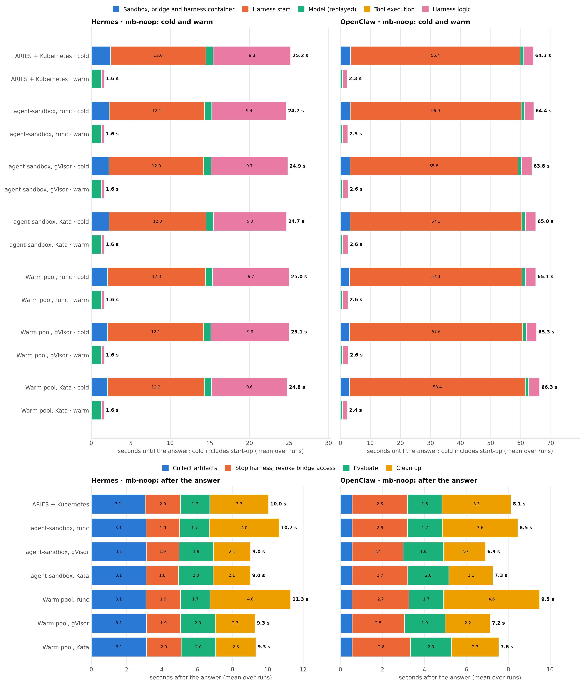
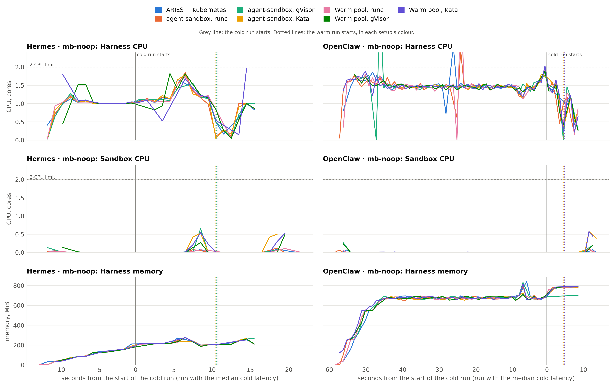

# `mb-noop`: time breakdown

*Generated by `scripts/experiment/report.py`; back to the [campaign report](../report.md).*

The agent replies without using a tool; the verifier checks nothing; always passes. It isolates harness, model and lifecycle cost.

Means ± standard deviation over the valid runs, in seconds unless marked; the last columns are each ARIES setup's mean minus ARIES K8s's.

- **Start-up:** the phases before the first request. The harness starts while the sandbox starts, so the *alongside* phases overlap the harness start, and start-up is less than their sum.
- **Run:** model time is how long a request offering tools was open. Tool execution is timed by the harness, the same way in every setup: Hermes's tool spans, or OpenClaw's session log from the tool-calling reply to the tool's result. Harness logic is the rest of the run: the harness's own work.
- **Harness overhead:** the harness's own time, beside the model and the tools. Cold, it is the harness start plus the cold run's harness logic; warm, the warm run's harness logic.
- **Tool calls:** what one agent tool call costs, from the agent's side. Natively the harness runs the command in its own container; through ARIES the request goes harness → bridge → sandbox and back.
  - *Per call, as the harness timed it:* the whole call, by the harness's own clock. It is timed the same way in every setup, so compare setups on this row.
  - *Commands the bridge ran:* every request the bridge served in the sandbox. One agent call is several: OpenClaw syncs its workspace before each command, and Hermes opens a terminal session (connection checks, environment, a shell snapshot) before its first command.
  - *Per call, the bridge running its commands:* the bridge's time running all of them, divided by the agent's calls.
  - *Per call, transport:* the whole call minus the bridge's share: requests travelling between harness, bridge and sandbox, and any gaps between the bridge's commands. It is a remainder, not a network measurement.
  - Native runs have no bridge, so only the whole call is shown.
  - **–** in a cold run: the bridge ran more commands cold than warm, because the harness also set itself up through the bridge before any agent call (Hermes opens a terminal session when the agent starts). Those commands belong to no call, so the bridge share and transport are left out.

## Figures

PDFs are beside the PNGs in `../figures/tasks/`.

### Time breakdown

### Resources over time

Each setup's run with the median cold latency, timed from the start of its cold run, so start-up is to the left of zero. CPU is the rate of the container's CPU counter over one-second bins.

## OpenClaw

Runs: ARIES K8s 5, agent-sandbox 5, agent-sandbox gVisor 5, agent-sandbox Kata 5, Warm pool 5, Warm pool gVisor 5, Warm pool Kata 5.

| Measure | ARIES K8s | agent-sandbox | agent-sandbox gVisor | agent-sandbox Kata | Warm pool | Warm pool gVisor | Warm pool Kata | agent-sandbox − ARIES K8s | agent-sandbox gVisor − ARIES K8s | agent-sandbox Kata − ARIES K8s | Warm pool − ARIES K8s | Warm pool gVisor − ARIES K8s | Warm pool Kata − ARIES K8s |
|---|---|---|---|---|---|---|---|---|---|---|---|---|---|
| ***Start-up, until the first request*** | | | | | | | | | | | | | |
| Sandbox reservation (`sandbox_reserve`) | 0.29 ± 0.00 | 0.29 ± 0.00 | 0.30 ± 0.00 | 0.29 ± 0.00 | 0.29 ± 0.00 | 0.29 ± 0.00 | 0.30 ± 0.00 | +0.00 | +0.00 | -0.00 | -0.00 | +0.00 | +0.00 |
| Bridge endpoint reservation (`bridge_reserve`) | 0.19 ± 0.00 | 0.18 ± 0.00 | 0.18 ± 0.00 | 0.18 ± 0.00 | 0.19 ± 0.00 | 0.19 ± 0.00 | 0.19 ± 0.00 | -0.00 | -0.00 | -0.00 | +0.00 | -0.00 | +0.00 |
| Harness container or pod creation (`harness_prepare`) | 2.98 ± 0.02 | 2.81 ± 0.01 | 2.80 ± 0.01 | 2.79 ± 0.02 | 2.64 ± 0.01 | 2.63 ± 0.01 | 2.62 ± 0.01 | -0.17 | -0.18 | -0.19 | -0.33 | -0.35 | -0.36 |
| Harness start, until it reports ready (`harness_start`) | 56.39 ± 0.54 | 56.87 ± 0.80 | 55.84 ± 0.28 | 57.11 ± 0.92 | 57.31 ± 0.88 | 57.60 ± 1.68 | 58.41 ± 0.37 | +0.48 | -0.55 | +0.72 | +0.93 | +1.21 | +2.03 |
| *Alongside:* sandbox start (`sandbox_start`) | 2.70 ± 0.02 | 2.55 ± 0.01 | 2.56 ± 0.01 | 6.55 ± 0.01 | 2.76 ± 0.05 | 2.85 ± 0.05 | 8.68 ± 0.72 | -0.15 | -0.14 | +3.85 | +0.07 | +0.15 | +5.98 |
| *Alongside:* sandbox sanitising (`sandbox_prepare`) | 0.41 ± 0.00 | 0.41 ± 0.01 | 0.47 ± 0.01 | 0.47 ± 0.02 | 0.42 ± 0.00 | 0.47 ± 0.00 | 0.47 ± 0.01 | +0.00 | +0.06 | +0.06 | +0.01 | +0.06 | +0.06 |
| *Alongside:* bridge binding the sandbox (`bridge_register`) | 0.37 ± 0.01 | 0.37 ± 0.01 | 0.45 ± 0.01 | 0.46 ± 0.01 | 0.37 ± 0.00 | 0.45 ± 0.01 | 0.46 ± 0.01 | -0.01 | +0.07 | +0.09 | -0.00 | +0.07 | +0.08 |
| **Start-up to the first request** | 59.84 ± 0.53 | 60.15 ± 0.79 | 59.11 ± 0.28 | 60.37 ± 0.93 | 60.44 ± 0.88 | 60.70 ± 1.68 | 61.51 ± 0.37 | +0.31 | -0.73 | +0.53 | +0.60 | +0.86 | +1.67 |
| ***Cold run, from the request to the answer*** | | | | | | | | | | | | | |
| Model (replayed) | 1.19 ± 0.00 | 1.19 ± 0.00 | 1.19 ± 0.00 | 1.19 ± 0.00 | 1.19 ± 0.00 | 1.19 ± 0.00 | 1.19 ± 0.00 | -0.00 | -0.00 | -0.00 | -0.00 | -0.00 | -0.00 |
| Tool execution, as the harness timed it | 0.00 ± 0.00 | 0.00 ± 0.00 | 0.00 ± 0.00 | 0.00 ± 0.00 | 0.00 ± 0.00 | 0.00 ± 0.00 | 0.00 ± 0.00 | +0.00 | +0.00 | +0.00 | +0.00 | +0.00 | +0.00 |
| Harness logic | 3.27 ± 0.34 | 3.06 ± 0.39 | 3.46 ± 0.18 | 3.46 ± 0.33 | 3.43 ± 0.30 | 3.43 ± 0.30 | 3.65 ± 0.23 | -0.21 | +0.19 | +0.18 | +0.16 | +0.16 | +0.37 |
| **Cold run** | 4.46 ± 0.34 | 4.25 ± 0.39 | 4.65 ± 0.18 | 4.64 ± 0.33 | 4.62 ± 0.30 | 4.62 ± 0.30 | 4.83 ± 0.23 | -0.21 | +0.19 | +0.18 | +0.16 | +0.16 | +0.37 |
| **Cold latency: start-up and run** | 64.30 ± 0.43 | 64.40 ± 0.99 | 63.76 ± 0.38 | 65.01 ± 1.16 | 65.06 ± 0.97 | 65.32 ± 1.86 | 66.35 ± 0.38 | +0.10 | -0.55 | +0.71 | +0.75 | +1.02 | +2.04 |
| Harness overhead: harness start and logic | 59.66 ± 0.44 | 59.93 ± 0.99 | 59.30 ± 0.39 | 60.56 ± 1.15 | 60.74 ± 0.96 | 61.03 ± 1.87 | 62.06 ± 0.39 | +0.27 | -0.36 | +0.90 | +1.08 | +1.37 | +2.40 |
| Model calls the agent waited on | 1.0 ± 0.0 | 1.0 ± 0.0 | 1.0 ± 0.0 | 1.0 ± 0.0 | 1.0 ± 0.0 | 1.0 ± 0.0 | 1.0 ± 0.0 | +0.0 | +0.0 | +0.0 | +0.0 | +0.0 | +0.0 |
| ***Warm run, the same task on the running harness and sandbox*** | | | | | | | | | | | | | |
| Model (replayed) | 0.74 ± 0.00 | 0.74 ± 0.00 | 0.74 ± 0.00 | 0.74 ± 0.00 | 0.74 ± 0.00 | 0.74 ± 0.00 | 0.74 ± 0.00 | -0.00 | +0.00 | -0.00 | -0.00 | +0.00 | +0.00 |
| Tool execution, as the harness timed it | 0.00 ± 0.00 | 0.00 ± 0.00 | 0.00 ± 0.00 | 0.00 ± 0.00 | 0.00 ± 0.00 | 0.00 ± 0.00 | 0.00 ± 0.00 | +0.00 | +0.00 | +0.00 | +0.00 | +0.00 | +0.00 |
| Harness logic, its overhead when warm | 1.58 ± 0.05 | 1.76 ± 0.21 | 1.86 ± 0.25 | 1.86 ± 0.27 | 1.83 ± 0.25 | 1.90 ± 0.25 | 1.67 ± 0.10 | +0.18 | +0.28 | +0.28 | +0.25 | +0.32 | +0.08 |
| **Warm latency** | 2.32 ± 0.05 | 2.50 ± 0.21 | 2.60 ± 0.25 | 2.60 ± 0.27 | 2.56 ± 0.25 | 2.63 ± 0.25 | 2.40 ± 0.10 | +0.18 | +0.28 | +0.28 | +0.25 | +0.32 | +0.08 |
| Model calls the agent waited on | 1.0 ± 0.0 | 1.0 ± 0.0 | 1.0 ± 0.0 | 1.0 ± 0.0 | 1.0 ± 0.0 | 1.0 ± 0.0 | 1.0 ± 0.0 | +0.0 | +0.0 | +0.0 | +0.0 | +0.0 | +0.0 |

### Tool calls

| Measure | ARIES K8s | agent-sandbox | agent-sandbox gVisor | agent-sandbox Kata | Warm pool | Warm pool gVisor | Warm pool Kata | agent-sandbox − ARIES K8s | agent-sandbox gVisor − ARIES K8s | agent-sandbox Kata − ARIES K8s | Warm pool − ARIES K8s | Warm pool gVisor − ARIES K8s | Warm pool Kata − ARIES K8s |
|---|---|---|---|---|---|---|---|---|---|---|---|---|---|
| ***Tool calls, cold run*** | | | | | | | | | | | | | |
| Agent tool calls | 0.0 ± 0.0 | 0.0 ± 0.0 | 0.0 ± 0.0 | 0.0 ± 0.0 | 0.0 ± 0.0 | 0.0 ± 0.0 | 0.0 ± 0.0 | +0.0 | +0.0 | +0.0 | +0.0 | +0.0 | +0.0 |
| Commands the bridge ran for them | 0.0 ± 0.0 | 0.0 ± 0.0 | 0.0 ± 0.0 | 0.0 ± 0.0 | 0.0 ± 0.0 | 0.0 ± 0.0 | 0.0 ± 0.0 | +0.0 | +0.0 | +0.0 | +0.0 | +0.0 | +0.0 |
| ***Tool calls, warm run*** | | | | | | | | | | | | | |
| Agent tool calls | 0.0 ± 0.0 | 0.0 ± 0.0 | 0.0 ± 0.0 | 0.0 ± 0.0 | 0.0 ± 0.0 | 0.0 ± 0.0 | 0.0 ± 0.0 | +0.0 | +0.0 | +0.0 | +0.0 | +0.0 | +0.0 |
| Commands the bridge ran for them | 0.0 ± 0.0 | 0.0 ± 0.0 | 0.0 ± 0.0 | 0.0 ± 0.0 | 0.0 ± 0.0 | 0.0 ± 0.0 | 0.0 ± 0.0 | +0.0 | +0.0 | +0.0 | +0.0 | +0.0 | +0.0 |

### After the answer and resources

| Measure | ARIES K8s | agent-sandbox | agent-sandbox gVisor | agent-sandbox Kata | Warm pool | Warm pool gVisor | Warm pool Kata | agent-sandbox − ARIES K8s | agent-sandbox gVisor − ARIES K8s | agent-sandbox Kata − ARIES K8s | Warm pool − ARIES K8s | Warm pool gVisor − ARIES K8s | Warm pool Kata − ARIES K8s |
|---|---|---|---|---|---|---|---|---|---|---|---|---|---|
| ***After the answer*** | | | | | | | | | | | | | |
| Collect the harness's artifacts (`harness_collect`) | 0.57 ± 0.00 | 0.57 ± 0.01 | 0.57 ± 0.00 | 0.56 ± 0.01 | 0.56 ± 0.00 | 0.56 ± 0.01 | 0.57 ± 0.01 | -0.00 | +0.00 | -0.00 | -0.01 | -0.00 | -0.00 |
| Stop the harness, revoke bridge access (`isolation`) | 2.63 ± 0.27 | 2.64 ± 0.34 | 2.42 ± 0.19 | 2.65 ± 0.11 | 2.71 ± 0.26 | 2.49 ± 0.02 | 2.77 ± 0.37 | +0.01 | -0.21 | +0.02 | +0.07 | -0.14 | +0.14 |
| Evaluate (`evaluation`) | 1.65 ± 0.01 | 1.65 ± 0.01 | 1.93 ± 0.00 | 1.96 ± 0.02 | 1.65 ± 0.01 | 1.94 ± 0.02 | 1.96 ± 0.02 | +0.01 | +0.29 | +0.31 | +0.01 | +0.29 | +0.31 |
| Clean up (`cleanup`) | 3.29 ± 0.13 | 3.60 ± 0.30 | 2.00 ± 0.16 | 2.10 ± 0.01 | 4.58 ± 0.02 | 2.16 ± 0.16 | 2.26 ± 0.02 | +0.31 | -1.29 | -1.19 | +1.29 | -1.13 | -1.03 |
| **After the answer** | 8.13 ± 0.22 | 8.46 ± 0.42 | 6.92 ± 0.21 | 7.27 ± 0.11 | 9.50 ± 0.25 | 7.15 ± 0.18 | 7.56 ± 0.37 | +0.33 | -1.21 | -0.86 | +1.36 | -0.98 | -0.58 |
| ***Resources, over the whole task*** | | | | | | | | | | | | | |
| Harness CPU, mean (% of one core) | 140 ± 3 | 140 ± 2 | 140 ± 3 | 138 ± 5 | 139 ± 1 | 140 ± 4 | 141 ± 3 | -1 | +0 | -2 | -2 | +0 | +1 |
| Harness CPU, peak (% of one core) | 250 ± 68 | 236 ± 42 | 329 ± 132 | 248 ± 81 | 230 ± 85 | 277 ± 124 | 222 ± 58 | -14 | +79 | -2 | -20 | +26 | -28 |
| Harness memory, peak (MiB) | 793 ± 33 | 791 ± 12 | 797 ± 44 | 800 ± 14 | 779 ± 17 | 802 ± 18 | 801 ± 20 | -3 | +4 | +6 | -14 | +8 | +8 |
| Sandbox CPU, mean (% of one core) | 0 ± 0 | 0 ± 0 | 1 ± 0 | 2 ± 0 | 0 ± 0 | 1 ± 0 | 2 ± 0 | -0 | +1 | +2 | -0 | +1 | +2 |
| Sandbox CPU, peak (% of one core) | 10 ± 2 | 9 ± 2 | 33 ± 5 | 58 ± 4 | 10 ± 2 | 28 ± 6 | 51 ± 11 | -1 | +23 | +48 | -0 | +18 | +41 |
| Sandbox memory, peak (MiB) | 1 ± 0 | 1 ± 1 | 17 ± 1 | 317 ± 2 | 1 ± 1 | 17 ± 0 | 317 ± 2 | +0 | +17 | +316 | +0 | +16 | +317 |

### Each repetition (latency, seconds)

| Repetition | ARIES K8s cold | ARIES K8s warm | agent-sandbox cold | agent-sandbox warm | agent-sandbox gVisor cold | agent-sandbox gVisor warm | agent-sandbox Kata cold | agent-sandbox Kata warm | Warm pool cold | Warm pool warm | Warm pool gVisor cold | Warm pool gVisor warm | Warm pool Kata cold | Warm pool Kata warm |
|---|---|---|---|---|---|---|---|---|---|---|---|---|---|---|
| 1 | 64.37 | 2.40 | 63.55 | 2.29 | 64.20 | 2.60 | 63.36 | 2.29 | 64.44 | 2.50 | 68.42 | 2.73 | 66.09 | 2.28 |
| 2 | 64.92 | 2.31 | 65.84 | 2.47 | 63.39 | 2.80 | 64.98 | 2.86 | 64.44 | 2.32 | 64.75 | 3.03 | 66.27 | 2.50 |
| 3 | 64.42 | 2.29 | 64.41 | 2.83 | 63.86 | 2.31 | 66.65 | 2.33 | 64.20 | 2.40 | 65.37 | 2.48 | 66.56 | 2.50 |
| 4 | 64.03 | 2.29 | 64.78 | 2.56 | 63.34 | 2.90 | 65.08 | 2.73 | 66.28 | 2.97 | 63.46 | 2.38 | 66.88 | 2.31 |
| 5 | 63.78 | 2.28 | 63.42 | 2.35 | 64.01 | 2.39 | 65.01 | 2.77 | 65.91 | 2.63 | 64.61 | 2.55 | 65.92 | 2.41 |

## Hermes

Runs: ARIES K8s 5, agent-sandbox 5, agent-sandbox gVisor 5, agent-sandbox Kata 5, Warm pool 5, Warm pool gVisor 5, Warm pool Kata 5.

| Measure | ARIES K8s | agent-sandbox | agent-sandbox gVisor | agent-sandbox Kata | Warm pool | Warm pool gVisor | Warm pool Kata | agent-sandbox − ARIES K8s | agent-sandbox gVisor − ARIES K8s | agent-sandbox Kata − ARIES K8s | Warm pool − ARIES K8s | Warm pool gVisor − ARIES K8s | Warm pool Kata − ARIES K8s |
|---|---|---|---|---|---|---|---|---|---|---|---|---|---|
| ***Start-up, until the first request*** | | | | | | | | | | | | | |
| Sandbox reservation (`sandbox_reserve`) | 0.30 ± 0.00 | 0.29 ± 0.00 | 0.30 ± 0.00 | 0.30 ± 0.00 | 0.31 ± 0.03 | 0.30 ± 0.00 | 0.29 ± 0.00 | -0.00 | -0.00 | -0.00 | +0.01 | -0.00 | -0.00 |
| Bridge endpoint reservation (`bridge_reserve`) | 0.14 ± 0.00 | 0.14 ± 0.00 | 0.14 ± 0.00 | 0.14 ± 0.00 | 0.14 ± 0.00 | 0.14 ± 0.00 | 0.14 ± 0.00 | +0.00 | +0.00 | +0.00 | +0.00 | +0.00 | +0.00 |
| Harness container or pod creation (`harness_prepare`) | 2.02 ± 0.01 | 1.84 ± 0.01 | 1.80 ± 0.06 | 1.82 ± 0.01 | 1.65 ± 0.05 | 1.66 ± 0.01 | 1.64 ± 0.01 | -0.18 | -0.22 | -0.20 | -0.38 | -0.37 | -0.38 |
| Harness start, until it reports ready (`harness_start`) | 12.03 ± 0.92 | 12.05 ± 0.03 | 11.99 ± 0.48 | 12.26 ± 0.51 | 12.33 ± 0.50 | 12.13 ± 0.19 | 12.22 ± 0.53 | +0.02 | -0.05 | +0.22 | +0.29 | +0.10 | +0.18 |
| *Alongside:* sandbox start (`sandbox_start`) | 2.75 ± 0.01 | 2.62 ± 0.01 | 2.59 ± 0.06 | 6.60 ± 0.02 | 2.81 ± 0.06 | 2.87 ± 0.01 | 8.73 ± 0.03 | -0.14 | -0.16 | +3.85 | +0.06 | +0.12 | +5.98 |
| *Alongside:* sandbox sanitising (`sandbox_prepare`) | 0.42 ± 0.00 | 0.42 ± 0.01 | 0.47 ± 0.01 | 0.47 ± 0.02 | 0.42 ± 0.01 | 0.46 ± 0.01 | 0.48 ± 0.02 | -0.00 | +0.05 | +0.05 | -0.01 | +0.04 | +0.05 |
| *Alongside:* bridge binding the sandbox (`bridge_register`) | 0.15 ± 0.00 | 0.15 ± 0.00 | 0.15 ± 0.01 | 0.15 ± 0.00 | 0.15 ± 0.01 | 0.15 ± 0.00 | 0.14 ± 0.01 | -0.00 | -0.00 | -0.00 | -0.01 | -0.00 | -0.01 |
| **Start-up to the first request** | 14.49 ± 0.92 | 14.33 ± 0.01 | 14.22 ± 0.46 | 14.51 ± 0.52 | 14.42 ± 0.47 | 14.22 ± 0.19 | 14.29 ± 0.53 | -0.17 | -0.27 | +0.02 | -0.07 | -0.28 | -0.20 |
| ***Cold run, from the request to the answer*** | | | | | | | | | | | | | |
| Model (replayed) | 0.92 ± 0.00 | 0.92 ± 0.00 | 0.92 ± 0.00 | 0.92 ± 0.00 | 0.92 ± 0.00 | 0.92 ± 0.00 | 0.92 ± 0.00 | +0.00 | +0.00 | +0.00 | +0.00 | -0.00 | -0.00 |
| Tool execution, as the harness timed it | 0.00 ± 0.00 | 0.00 ± 0.00 | 0.00 ± 0.00 | 0.00 ± 0.00 | 0.00 ± 0.00 | 0.00 ± 0.00 | 0.00 ± 0.00 | +0.00 | +0.00 | +0.00 | +0.00 | +0.00 | +0.00 |
| Harness logic | 9.80 ± 0.25 | 9.42 ± 0.37 | 9.72 ± 0.24 | 9.28 ± 0.41 | 9.71 ± 0.35 | 9.91 ± 0.20 | 9.59 ± 0.24 | -0.38 | -0.08 | -0.52 | -0.10 | +0.11 | -0.21 |
| **Cold run** | 10.73 ± 0.25 | 10.35 ± 0.37 | 10.64 ± 0.24 | 10.21 ± 0.41 | 10.63 ± 0.35 | 10.84 ± 0.20 | 10.51 ± 0.24 | -0.38 | -0.08 | -0.52 | -0.10 | +0.11 | -0.21 |
| **Cold latency: start-up and run** | 25.22 ± 0.74 | 24.67 ± 0.38 | 24.87 ± 0.55 | 24.72 ± 0.39 | 25.05 ± 0.21 | 25.05 ± 0.21 | 24.80 ± 0.45 | -0.54 | -0.35 | -0.50 | -0.17 | -0.17 | -0.42 |
| Harness overhead: harness start and logic | 21.84 ± 0.74 | 21.47 ± 0.37 | 21.71 ± 0.57 | 21.54 ± 0.39 | 22.04 ± 0.23 | 22.04 ± 0.22 | 21.80 ± 0.44 | -0.36 | -0.13 | -0.30 | +0.20 | +0.21 | -0.03 |
| Model calls the agent waited on | 2.0 ± 0.0 | 2.0 ± 0.0 | 2.0 ± 0.0 | 2.0 ± 0.0 | 2.0 ± 0.0 | 2.0 ± 0.0 | 2.0 ± 0.0 | +0.0 | +0.0 | +0.0 | +0.0 | +0.0 | +0.0 |
| ***Warm run, the same task on the running harness and sandbox*** | | | | | | | | | | | | | |
| Model (replayed) | 1.28 ± 0.00 | 1.28 ± 0.00 | 1.28 ± 0.00 | 1.28 ± 0.00 | 1.28 ± 0.00 | 1.28 ± 0.00 | 1.28 ± 0.00 | -0.00 | +0.00 | -0.00 | +0.00 | -0.00 | -0.00 |
| Tool execution, as the harness timed it | 0.00 ± 0.00 | 0.00 ± 0.00 | 0.00 ± 0.00 | 0.00 ± 0.00 | 0.00 ± 0.00 | 0.00 ± 0.00 | 0.00 ± 0.00 | +0.00 | +0.00 | +0.00 | +0.00 | +0.00 | +0.00 |
| Harness logic, its overhead when warm | 0.36 ± 0.01 | 0.36 ± 0.01 | 0.36 ± 0.01 | 0.36 ± 0.00 | 0.36 ± 0.00 | 0.36 ± 0.00 | 0.36 ± 0.00 | -0.00 | +0.00 | -0.00 | +0.00 | +0.01 | +0.00 |
| **Warm latency** | 1.64 ± 0.01 | 1.64 ± 0.01 | 1.64 ± 0.01 | 1.64 ± 0.00 | 1.64 ± 0.00 | 1.65 ± 0.00 | 1.64 ± 0.00 | -0.00 | +0.00 | -0.00 | +0.00 | +0.01 | +0.00 |
| Model calls the agent waited on | 2.0 ± 0.0 | 2.0 ± 0.0 | 2.0 ± 0.0 | 2.0 ± 0.0 | 2.0 ± 0.0 | 2.0 ± 0.0 | 2.0 ± 0.0 | +0.0 | +0.0 | +0.0 | +0.0 | +0.0 | +0.0 |

### Tool calls

| Measure | ARIES K8s | agent-sandbox | agent-sandbox gVisor | agent-sandbox Kata | Warm pool | Warm pool gVisor | Warm pool Kata | agent-sandbox − ARIES K8s | agent-sandbox gVisor − ARIES K8s | agent-sandbox Kata − ARIES K8s | Warm pool − ARIES K8s | Warm pool gVisor − ARIES K8s | Warm pool Kata − ARIES K8s |
|---|---|---|---|---|---|---|---|---|---|---|---|---|---|
| ***Tool calls, cold run*** | | | | | | | | | | | | | |
| Agent tool calls | 0.0 ± 0.0 | 0.0 ± 0.0 | 0.0 ± 0.0 | 0.0 ± 0.0 | 0.0 ± 0.0 | 0.0 ± 0.0 | 0.0 ± 0.0 | +0.0 | +0.0 | +0.0 | +0.0 | +0.0 | +0.0 |
| Commands the bridge ran for them | 14.0 ± 0.0 | 14.0 ± 0.0 | 14.0 ± 0.0 | 14.0 ± 0.0 | 14.0 ± 0.0 | 14.0 ± 0.0 | 14.0 ± 0.0 | +0.0 | +0.0 | +0.0 | +0.0 | +0.0 | +0.0 |
| ***Tool calls, warm run*** | | | | | | | | | | | | | |
| Agent tool calls | 0.0 ± 0.0 | 0.0 ± 0.0 | 0.0 ± 0.0 | 0.0 ± 0.0 | 0.0 ± 0.0 | 0.0 ± 0.0 | 0.0 ± 0.0 | +0.0 | +0.0 | +0.0 | +0.0 | +0.0 | +0.0 |
| Commands the bridge ran for them | 0.0 ± 0.0 | 0.0 ± 0.0 | 0.0 ± 0.0 | 0.0 ± 0.0 | 0.0 ± 0.0 | 0.0 ± 0.0 | 0.0 ± 0.0 | +0.0 | +0.0 | +0.0 | +0.0 | +0.0 | +0.0 |

### After the answer and resources

| Measure | ARIES K8s | agent-sandbox | agent-sandbox gVisor | agent-sandbox Kata | Warm pool | Warm pool gVisor | Warm pool Kata | agent-sandbox − ARIES K8s | agent-sandbox gVisor − ARIES K8s | agent-sandbox Kata − ARIES K8s | Warm pool − ARIES K8s | Warm pool gVisor − ARIES K8s | Warm pool Kata − ARIES K8s |
|---|---|---|---|---|---|---|---|---|---|---|---|---|---|
| ***After the answer*** | | | | | | | | | | | | | |
| Collect the harness's artifacts (`harness_collect`) | 3.05 ± 0.04 | 3.11 ± 0.02 | 3.11 ± 0.08 | 3.11 ± 0.04 | 3.10 ± 0.05 | 3.13 ± 0.05 | 3.13 ± 0.06 | +0.05 | +0.06 | +0.05 | +0.05 | +0.07 | +0.07 |
| Stop the harness, revoke bridge access (`isolation`) | 1.99 ± 0.31 | 1.91 ± 0.27 | 1.86 ± 0.23 | 1.84 ± 0.27 | 1.95 ± 0.26 | 1.93 ± 0.21 | 1.97 ± 0.31 | -0.08 | -0.13 | -0.15 | -0.04 | -0.06 | -0.02 |
| Evaluate (`evaluation`) | 1.67 ± 0.01 | 1.67 ± 0.01 | 1.95 ± 0.01 | 1.95 ± 0.01 | 1.67 ± 0.01 | 1.96 ± 0.01 | 1.95 ± 0.02 | +0.00 | +0.28 | +0.29 | +0.01 | +0.30 | +0.29 |
| Clean up (`cleanup`) | 3.33 ± 0.16 | 3.98 ± 0.38 | 2.11 ± 0.01 | 2.12 ± 0.01 | 4.57 ± 0.02 | 2.27 ± 0.01 | 2.28 ± 0.02 | +0.64 | -1.22 | -1.22 | +1.23 | -1.07 | -1.06 |
| **After the answer** | 10.05 ± 0.42 | 10.66 ± 0.48 | 9.03 ± 0.25 | 9.02 ± 0.31 | 11.29 ± 0.22 | 9.29 ± 0.22 | 9.33 ± 0.36 | +0.61 | -1.02 | -1.03 | +1.25 | -0.76 | -0.72 |
| ***Resources, over the whole task*** | | | | | | | | | | | | | |
| Harness CPU, mean (% of one core) | 95 ± 2 | 95 ± 3 | 93 ± 2 | 95 ± 2 | 98 ± 4 | 97 ± 8 | 101 ± 7 | +0 | -2 | +0 | +3 | +2 | +6 |
| Harness CPU, peak (% of one core) | 177 ± 9 | 212 ± 69 | 170 ± 9 | 200 ± 37 | 237 ± 101 | 275 ± 93 | 224 ± 102 | +35 | -7 | +23 | +60 | +97 | +47 |
| Harness memory, peak (MiB) | 273 ± 3 | 265 ± 5 | 270 ± 4 | 268 ± 3 | 268 ± 12 | 274 ± 5 | 266 ± 9 | -8 | -3 | -5 | -6 | +1 | -8 |
| Sandbox CPU, mean (% of one core) | 1 ± 0 | 1 ± 0 | 4 ± 0 | 10 ± 2 | 1 ± 0 | 3 ± 0 | 12 ± 2 | +0 | +3 | +9 | -0 | +2 | +11 |
| Sandbox CPU, peak (% of one core) | 11 ± 2 | 11 ± 1 | 46 ± 12 | 54 ± 1 | 9 ± 1 | 38 ± 7 | 52 ± 4 | +0 | +35 | +43 | -2 | +27 | +41 |
| Sandbox memory, peak (MiB) | 1 ± 0 | 1 ± 2 | 18 ± 0 | 320 ± 1 | 1 ± 1 | 18 ± 1 | 318 ± 1 | +1 | +17 | +319 | +1 | +18 | +318 |

### Each repetition (latency, seconds)

| Repetition | ARIES K8s cold | ARIES K8s warm | agent-sandbox cold | agent-sandbox warm | agent-sandbox gVisor cold | agent-sandbox gVisor warm | agent-sandbox Kata cold | agent-sandbox Kata warm | Warm pool cold | Warm pool warm | Warm pool gVisor cold | Warm pool gVisor warm | Warm pool Kata cold | Warm pool Kata warm |
|---|---|---|---|---|---|---|---|---|---|---|---|---|---|---|
| 1 | 26.38 | 1.64 | 24.66 | 1.64 | 25.23 | 1.64 | 24.16 | 1.64 | 24.78 | 1.65 | 25.33 | 1.64 | 24.86 | 1.64 |
| 2 | 24.34 | 1.64 | 24.14 | 1.64 | 24.04 | 1.65 | 24.73 | 1.64 | 24.93 | 1.64 | 24.83 | 1.65 | 24.26 | 1.64 |
| 3 | 24.95 | 1.64 | 25.07 | 1.64 | 25.44 | 1.64 | 25.16 | 1.65 | 25.05 | 1.64 | 25.15 | 1.65 | 24.73 | 1.65 |
| 4 | 25.12 | 1.65 | 24.99 | 1.64 | 25.00 | 1.64 | 25.00 | 1.64 | 25.33 | 1.64 | 24.85 | 1.65 | 25.49 | 1.64 |
| 5 | 25.30 | 1.64 | 24.52 | 1.65 | 24.61 | 1.65 | 24.54 | 1.64 | 25.16 | 1.64 | 25.12 | 1.65 | 24.67 | 1.65 |
