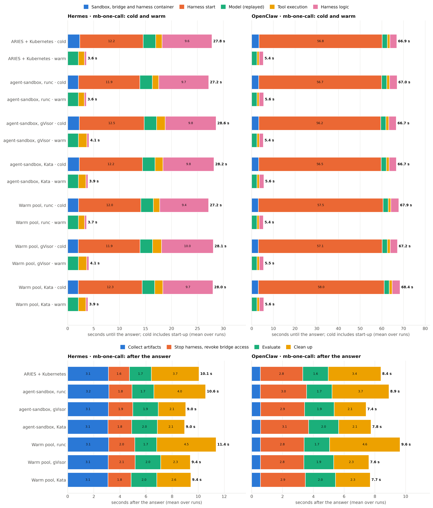
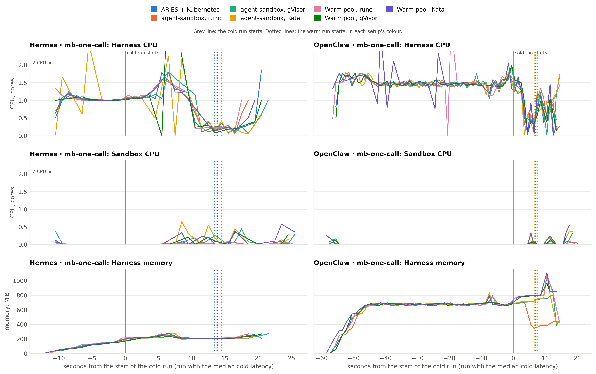

# `mb-one-call`: time breakdown

*Generated by `scripts/experiment/report.py`; back to the [campaign report](../report.md).*

The agent runs `touch /tmp/mb-one`; the verifier checks the file exists. It isolates one tool round trip.

Means ± standard deviation over the valid runs, in seconds unless marked; the last columns are each ARIES setup's mean minus ARIES K8s's.

- **Start-up:** the phases before the first request. The harness starts while the sandbox starts, so the *alongside* phases overlap the harness start, and start-up is less than their sum.
- **Run:** model time is how long a request offering tools was open. Tool execution is timed by the harness, the same way in every setup: Hermes's tool spans, or OpenClaw's session log from the tool-calling reply to the tool's result. Harness logic is the rest of the run: the harness's own work.
- **Harness overhead:** the harness's own time, beside the model and the tools. Cold, it is the harness start plus the cold run's harness logic; warm, the warm run's harness logic.
- **Tool calls:** what one agent tool call costs, from the agent's side. Natively the harness runs the command in its own container; through ARIES the request goes harness → bridge → sandbox and back.
  - *Per call, as the harness timed it:* the whole call, by the harness's own clock. It is timed the same way in every setup, so compare setups on this row.
  - *Commands the bridge ran:* every request the bridge served in the sandbox. One agent call is several: OpenClaw syncs its workspace before each command, and Hermes opens a terminal session (connection checks, environment, a shell snapshot) before its first command.
  - *Per call, the bridge running its commands:* the bridge's time running all of them, divided by the agent's calls.
  - *Per call, transport:* the whole call minus the bridge's share: requests travelling between harness, bridge and sandbox, and any gaps between the bridge's commands. It is a remainder, not a network measurement.
  - Native runs have no bridge, so only the whole call is shown.
  - **–** in a cold run: the bridge ran more commands cold than warm, because the harness also set itself up through the bridge before any agent call (Hermes opens a terminal session when the agent starts). Those commands belong to no call, so the bridge share and transport are left out.

## Figures

PDFs are beside the PNGs in `../figures/tasks/`.

### Time breakdown

### Resources over time

Each setup's run with the median cold latency, timed from the start of its cold run, so start-up is to the left of zero. CPU is the rate of the container's CPU counter over one-second bins.

## OpenClaw

Runs: ARIES K8s 5, agent-sandbox 5, agent-sandbox gVisor 5, agent-sandbox Kata 5, Warm pool 5, Warm pool gVisor 5, Warm pool Kata 5.

| Measure | ARIES K8s | agent-sandbox | agent-sandbox gVisor | agent-sandbox Kata | Warm pool | Warm pool gVisor | Warm pool Kata | agent-sandbox − ARIES K8s | agent-sandbox gVisor − ARIES K8s | agent-sandbox Kata − ARIES K8s | Warm pool − ARIES K8s | Warm pool gVisor − ARIES K8s | Warm pool Kata − ARIES K8s |
|---|---|---|---|---|---|---|---|---|---|---|---|---|---|
| ***Start-up, until the first request*** | | | | | | | | | | | | | |
| Sandbox reservation (`sandbox_reserve`) | 0.29 ± 0.00 | 0.29 ± 0.01 | 0.29 ± 0.00 | 0.29 ± 0.00 | 0.29 ± 0.00 | 0.30 ± 0.00 | 0.30 ± 0.00 | +0.00 | +0.00 | +0.00 | +0.00 | +0.01 | +0.00 |
| Bridge endpoint reservation (`bridge_reserve`) | 0.18 ± 0.01 | 0.18 ± 0.01 | 0.18 ± 0.00 | 0.18 ± 0.00 | 0.17 ± 0.01 | 0.18 ± 0.00 | 0.19 ± 0.00 | +0.00 | +0.01 | +0.00 | -0.00 | +0.01 | +0.01 |
| Harness container or pod creation (`harness_prepare`) | 2.93 ± 0.12 | 2.75 ± 0.15 | 2.80 ± 0.02 | 2.79 ± 0.02 | 2.64 ± 0.02 | 2.62 ± 0.02 | 2.61 ± 0.01 | -0.18 | -0.14 | -0.14 | -0.30 | -0.31 | -0.32 |
| Harness start, until it reports ready (`harness_start`) | 56.76 ± 1.07 | 56.69 ± 0.73 | 56.24 ± 0.66 | 56.46 ± 0.39 | 57.49 ± 0.82 | 57.06 ± 1.38 | 57.98 ± 1.23 | -0.06 | -0.51 | -0.30 | +0.74 | +0.30 | +1.22 |
| *Alongside:* sandbox start (`sandbox_start`) | 2.66 ± 0.13 | 2.49 ± 0.14 | 2.55 ± 0.03 | 6.34 ± 0.45 | 1.81 ± 0.01 | 1.84 ± 0.01 | 1.85 ± 0.01 | -0.17 | -0.10 | +3.68 | -0.85 | -0.82 | -0.81 |
| *Alongside:* sandbox sanitising (`sandbox_prepare`) | 0.41 ± 0.00 | 0.41 ± 0.01 | 0.47 ± 0.01 | 0.47 ± 0.02 | 0.41 ± 0.01 | 0.46 ± 0.00 | 0.47 ± 0.00 | +0.00 | +0.06 | +0.06 | -0.00 | +0.05 | +0.06 |
| *Alongside:* bridge binding the sandbox (`bridge_register`) | 0.35 ± 0.01 | 0.35 ± 0.00 | 0.43 ± 0.01 | 0.44 ± 0.01 | 0.34 ± 0.00 | 0.42 ± 0.00 | 0.44 ± 0.01 | +0.00 | +0.08 | +0.09 | -0.01 | +0.07 | +0.09 |
| **Start-up to the first request** | 60.16 ± 1.09 | 59.92 ± 0.74 | 59.52 ± 0.67 | 59.72 ± 0.39 | 60.60 ± 0.82 | 60.16 ± 1.38 | 61.07 ± 1.23 | -0.24 | -0.64 | -0.44 | +0.44 | +0.00 | +0.91 |
| ***Cold run, from the request to the answer*** | | | | | | | | | | | | | |
| Model (replayed) | 2.35 ± 0.00 | 2.35 ± 0.00 | 2.35 ± 0.00 | 2.35 ± 0.00 | 2.35 ± 0.00 | 2.35 ± 0.00 | 2.35 ± 0.00 | +0.00 | +0.00 | -0.00 | +0.00 | +0.00 | +0.00 |
| Tool execution, as the harness timed it | 1.20 ± 0.01 | 1.31 ± 0.19 | 1.31 ± 0.07 | 1.30 ± 0.01 | 1.19 ± 0.01 | 1.38 ± 0.17 | 1.31 ± 0.01 | +0.11 | +0.11 | +0.10 | -0.01 | +0.18 | +0.12 |
| Harness logic | 3.19 ± 0.42 | 3.46 ± 0.25 | 3.47 ± 0.22 | 3.32 ± 0.27 | 3.72 ± 0.37 | 3.31 ± 0.22 | 3.66 ± 0.26 | +0.27 | +0.28 | +0.13 | +0.52 | +0.12 | +0.47 |
| **Cold run** | 6.75 ± 0.42 | 7.13 ± 0.19 | 7.14 ± 0.25 | 6.97 ± 0.27 | 7.26 ± 0.38 | 7.04 ± 0.25 | 7.33 ± 0.26 | +0.38 | +0.39 | +0.22 | +0.51 | +0.30 | +0.59 |
| **Cold latency: start-up and run** | 66.91 ± 1.37 | 67.05 ± 0.81 | 66.66 ± 0.84 | 66.69 ± 0.51 | 67.85 ± 1.03 | 67.20 ± 1.36 | 68.40 ± 1.30 | +0.14 | -0.25 | -0.21 | +0.95 | +0.30 | +1.50 |
| Harness overhead: harness start and logic | 59.95 ± 1.37 | 60.16 ± 0.81 | 59.71 ± 0.80 | 59.78 ± 0.51 | 61.21 ± 1.04 | 60.37 ± 1.50 | 61.64 ± 1.30 | +0.21 | -0.24 | -0.17 | +1.26 | +0.42 | +1.69 |
| Model calls the agent waited on | 2.0 ± 0.0 | 2.0 ± 0.0 | 2.0 ± 0.0 | 2.0 ± 0.0 | 2.0 ± 0.0 | 2.0 ± 0.0 | 2.0 ± 0.0 | +0.0 | +0.0 | +0.0 | +0.0 | +0.0 | +0.0 |
| ***Warm run, the same task on the running harness and sandbox*** | | | | | | | | | | | | | |
| Model (replayed) | 2.45 ± 0.00 | 2.45 ± 0.00 | 2.45 ± 0.00 | 2.45 ± 0.00 | 2.45 ± 0.00 | 2.45 ± 0.00 | 2.45 ± 0.00 | -0.00 | +0.00 | +0.00 | +0.00 | -0.00 | -0.00 |
| Tool execution, as the harness timed it | 1.01 ± 0.02 | 0.99 ± 0.01 | 1.08 ± 0.02 | 1.09 ± 0.01 | 0.98 ± 0.02 | 1.09 ± 0.02 | 1.10 ± 0.01 | -0.02 | +0.08 | +0.08 | -0.02 | +0.08 | +0.10 |
| Harness logic, its overhead when warm | 1.95 ± 0.26 | 2.14 ± 0.48 | 1.88 ± 0.11 | 2.10 ± 0.44 | 1.99 ± 0.31 | 1.95 ± 0.46 | 2.04 ± 0.36 | +0.19 | -0.07 | +0.15 | +0.04 | +0.00 | +0.09 |
| **Warm latency** | 5.41 ± 0.25 | 5.58 ± 0.49 | 5.42 ± 0.10 | 5.65 ± 0.45 | 5.43 ± 0.33 | 5.49 ± 0.48 | 5.60 ± 0.36 | +0.17 | +0.01 | +0.24 | +0.02 | +0.08 | +0.19 |
| Model calls the agent waited on | 2.0 ± 0.0 | 2.0 ± 0.0 | 2.0 ± 0.0 | 2.0 ± 0.0 | 2.0 ± 0.0 | 2.0 ± 0.0 | 2.0 ± 0.0 | +0.0 | +0.0 | +0.0 | +0.0 | +0.0 | +0.0 |

### Tool calls

| Measure | ARIES K8s | agent-sandbox | agent-sandbox gVisor | agent-sandbox Kata | Warm pool | Warm pool gVisor | Warm pool Kata | agent-sandbox − ARIES K8s | agent-sandbox gVisor − ARIES K8s | agent-sandbox Kata − ARIES K8s | Warm pool − ARIES K8s | Warm pool gVisor − ARIES K8s | Warm pool Kata − ARIES K8s |
|---|---|---|---|---|---|---|---|---|---|---|---|---|---|
| ***Tool calls, cold run*** | | | | | | | | | | | | | |
| Agent tool calls | 1.0 ± 0.0 | 1.0 ± 0.0 | 1.0 ± 0.0 | 1.0 ± 0.0 | 1.0 ± 0.0 | 1.0 ± 0.0 | 1.0 ± 0.0 | +0.0 | +0.0 | +0.0 | +0.0 | +0.0 | +0.0 |
| Commands the bridge ran for them | 5.0 ± 0.0 | 5.0 ± 0.0 | 5.0 ± 0.0 | 5.0 ± 0.0 | 5.0 ± 0.0 | 5.0 ± 0.0 | 5.0 ± 0.0 | +0.0 | +0.0 | +0.0 | +0.0 | +0.0 | +0.0 |
| Per call, as the harness timed it | 1198 ± 9 | 1310 ± 188 | 1312 ± 68 | 1297 ± 15 | 1186 ± 12 | 1377 ± 165 | 1315 ± 8 | +112 | +114 | +99 | -12 | +179 | +117 |
| Per call, the bridge running its commands | 617 ± 10 | 615 ± 4 | 709 ± 9 | 724 ± 6 | 617 ± 9 | 716 ± 15 | 733 ± 7 | -2 | +92 | +107 | +0 | +99 | +116 |
| Per call, transport between harness and sandbox | 581 ± 3 | 695 ± 190 | 603 ± 62 | 573 ± 9 | 569 ± 6 | 661 ± 159 | 582 ± 7 | +114 | +22 | -8 | -12 | +80 | +1 |
| ***Tool calls, warm run*** | | | | | | | | | | | | | |
| Agent tool calls | 1.0 ± 0.0 | 1.0 ± 0.0 | 1.0 ± 0.0 | 1.0 ± 0.0 | 1.0 ± 0.0 | 1.0 ± 0.0 | 1.0 ± 0.0 | +0.0 | +0.0 | +0.0 | +0.0 | +0.0 | +0.0 |
| Commands the bridge ran for them | 5.0 ± 0.0 | 5.0 ± 0.0 | 5.0 ± 0.0 | 5.0 ± 0.0 | 5.0 ± 0.0 | 5.0 ± 0.0 | 5.0 ± 0.0 | +0.0 | +0.0 | +0.0 | +0.0 | +0.0 | +0.0 |
| Per call, as the harness timed it | 1006 ± 23 | 990 ± 13 | 1082 ± 20 | 1090 ± 11 | 984 ± 20 | 1086 ± 20 | 1104 ± 8 | -16 | +75 | +83 | -23 | +79 | +98 |
| Per call, the bridge running its commands | 615 ± 9 | 613 ± 5 | 707 ± 11 | 716 ± 3 | 613 ± 4 | 715 ± 9 | 725 ± 8 | -1 | +93 | +101 | -2 | +100 | +111 |
| Per call, transport between harness and sandbox | 392 ± 19 | 377 ± 12 | 374 ± 22 | 374 ± 14 | 371 ± 20 | 371 ± 12 | 379 ± 3 | -15 | -17 | -18 | -21 | -21 | -13 |

### After the answer and resources

| Measure | ARIES K8s | agent-sandbox | agent-sandbox gVisor | agent-sandbox Kata | Warm pool | Warm pool gVisor | Warm pool Kata | agent-sandbox − ARIES K8s | agent-sandbox gVisor − ARIES K8s | agent-sandbox Kata − ARIES K8s | Warm pool − ARIES K8s | Warm pool gVisor − ARIES K8s | Warm pool Kata − ARIES K8s |
|---|---|---|---|---|---|---|---|---|---|---|---|---|---|
| ***After the answer*** | | | | | | | | | | | | | |
| Collect the harness's artifacts (`harness_collect`) | 0.56 ± 0.00 | 0.57 ± 0.01 | 0.58 ± 0.02 | 0.58 ± 0.02 | 0.58 ± 0.01 | 0.57 ± 0.01 | 0.57 ± 0.00 | +0.00 | +0.01 | +0.02 | +0.01 | +0.01 | +0.01 |
| Stop the harness, revoke bridge access (`isolation`) | 2.76 ± 0.30 | 3.00 ± 0.46 | 2.86 ± 0.27 | 3.12 ± 0.09 | 2.83 ± 0.32 | 2.82 ± 0.14 | 2.92 ± 0.31 | +0.24 | +0.10 | +0.36 | +0.07 | +0.06 | +0.16 |
| Evaluate (`evaluation`) | 1.65 ± 0.01 | 1.65 ± 0.01 | 1.92 ± 0.01 | 1.95 ± 0.01 | 1.65 ± 0.01 | 1.94 ± 0.01 | 1.96 ± 0.02 | +0.00 | +0.27 | +0.30 | +0.00 | +0.29 | +0.31 |
| Clean up (`cleanup`) | 3.42 ± 0.31 | 3.70 ± 0.02 | 2.07 ± 0.13 | 2.10 ± 0.01 | 4.57 ± 0.02 | 2.28 ± 0.01 | 2.25 ± 0.02 | +0.28 | -1.35 | -1.32 | +1.15 | -1.14 | -1.17 |
| **After the answer** | 8.39 ± 0.37 | 8.92 ± 0.45 | 7.43 ± 0.33 | 7.75 ± 0.09 | 9.64 ± 0.31 | 7.61 ± 0.14 | 7.70 ± 0.31 | +0.53 | -0.96 | -0.64 | +1.24 | -0.78 | -0.69 |
| ***Resources, over the whole task*** | | | | | | | | | | | | | |
| Harness CPU, mean (% of one core) | 133 ± 2 | 130 ± 2 | 129 ± 4 | 131 ± 4 | 133 ± 1 | 131 ± 1 | 134 ± 3 | -3 | -3 | -2 | +1 | -2 | +1 |
| Harness CPU, peak (% of one core) | 226 ± 77 | 195 ± 26 | 243 ± 120 | 233 ± 74 | 232 ± 52 | 274 ± 147 | 296 ± 65 | -30 | +17 | +8 | +6 | +48 | +70 |
| Harness memory, peak (MiB) | 931 ± 79 | 869 ± 130 | 1065 ± 158 | 960 ± 174 | 906 ± 113 | 896 ± 83 | 1130 ± 190 | -62 | +134 | +28 | -25 | -35 | +199 |
| Sandbox CPU, mean (% of one core) | 0 ± 0 | 0 ± 0 | 1 ± 0 | 3 ± 0 | 0 ± 0 | 1 ± 0 | 3 ± 0 | -0 | +1 | +3 | -0 | +1 | +3 |
| Sandbox CPU, peak (% of one core) | 9 ± 1 | 9 ± 3 | 30 ± 7 | 48 ± 13 | 11 ± 1 | 33 ± 7 | 53 ± 11 | -1 | +21 | +39 | +2 | +23 | +43 |
| Sandbox memory, peak (MiB) | 1 ± 0 | 2 ± 2 | 18 ± 1 | 318 ± 1 | 1 ± 1 | 18 ± 1 | 320 ± 1 | +1 | +17 | +317 | +0 | +17 | +319 |

### Each repetition (latency, seconds)

| Repetition | ARIES K8s cold | ARIES K8s warm | agent-sandbox cold | agent-sandbox warm | agent-sandbox gVisor cold | agent-sandbox gVisor warm | agent-sandbox Kata cold | agent-sandbox Kata warm | Warm pool cold | Warm pool warm | Warm pool gVisor cold | Warm pool gVisor warm | Warm pool Kata cold | Warm pool Kata warm |
|---|---|---|---|---|---|---|---|---|---|---|---|---|---|---|
| 1 | 67.85 | 5.53 | 67.24 | 5.29 | 67.56 | 5.35 | 66.10 | 5.16 | 67.31 | 5.11 | 67.33 | 5.18 | 66.70 | 5.84 |
| 2 | 64.65 | 5.09 | 66.04 | 5.65 | 65.49 | 5.46 | 67.28 | 5.19 | 67.80 | 5.54 | 65.28 | 6.30 | 68.83 | 5.87 |
| 3 | 66.92 | 5.62 | 67.21 | 6.38 | 66.26 | 5.40 | 66.53 | 5.79 | 69.12 | 5.12 | 67.23 | 5.23 | 69.79 | 5.23 |
| 4 | 66.97 | 5.61 | 66.56 | 5.14 | 66.60 | 5.56 | 66.38 | 5.99 | 68.56 | 5.49 | 69.11 | 5.16 | 67.42 | 5.18 |
| 5 | 68.14 | 5.19 | 68.19 | 5.45 | 67.36 | 5.32 | 67.18 | 6.11 | 66.49 | 5.90 | 67.07 | 5.56 | 69.28 | 5.89 |

## Hermes

Runs: ARIES K8s 5, agent-sandbox 5, agent-sandbox gVisor 5, agent-sandbox Kata 5, Warm pool 5, Warm pool gVisor 5, Warm pool Kata 5.

| Measure | ARIES K8s | agent-sandbox | agent-sandbox gVisor | agent-sandbox Kata | Warm pool | Warm pool gVisor | Warm pool Kata | agent-sandbox − ARIES K8s | agent-sandbox gVisor − ARIES K8s | agent-sandbox Kata − ARIES K8s | Warm pool − ARIES K8s | Warm pool gVisor − ARIES K8s | Warm pool Kata − ARIES K8s |
|---|---|---|---|---|---|---|---|---|---|---|---|---|---|
| ***Start-up, until the first request*** | | | | | | | | | | | | | |
| Sandbox reservation (`sandbox_reserve`) | 0.30 ± 0.00 | 0.30 ± 0.00 | 0.30 ± 0.00 | 0.29 ± 0.00 | 0.30 ± 0.00 | 0.30 ± 0.01 | 0.30 ± 0.00 | +0.00 | -0.00 | -0.00 | +0.00 | +0.00 | +0.00 |
| Bridge endpoint reservation (`bridge_reserve`) | 0.14 ± 0.00 | 0.14 ± 0.00 | 0.13 ± 0.00 | 0.13 ± 0.00 | 0.13 ± 0.00 | 0.14 ± 0.00 | 0.14 ± 0.00 | -0.00 | -0.00 | -0.00 | -0.00 | +0.00 | +0.00 |
| Harness container or pod creation (`harness_prepare`) | 1.90 ± 0.17 | 1.64 ± 0.16 | 1.82 ± 0.01 | 1.81 ± 0.01 | 1.66 ± 0.01 | 1.62 ± 0.01 | 1.62 ± 0.01 | -0.26 | -0.08 | -0.09 | -0.24 | -0.28 | -0.28 |
| Harness start, until it reports ready (`harness_start`) | 12.24 ± 0.49 | 11.85 ± 0.53 | 12.50 ± 0.60 | 12.20 ± 0.59 | 12.02 ± 0.07 | 11.91 ± 0.47 | 12.31 ± 0.50 | -0.38 | +0.26 | -0.04 | -0.21 | -0.32 | +0.07 |
| *Alongside:* sandbox start (`sandbox_start`) | 2.63 ± 0.17 | 2.41 ± 0.16 | 2.62 ± 0.01 | 6.39 ± 0.45 | 1.82 ± 0.01 | 1.85 ± 0.01 | 1.85 ± 0.01 | -0.23 | -0.02 | +3.75 | -0.82 | -0.79 | -0.79 |
| *Alongside:* sandbox sanitising (`sandbox_prepare`) | 0.42 ± 0.01 | 0.42 ± 0.01 | 0.47 ± 0.01 | 0.48 ± 0.01 | 0.42 ± 0.01 | 0.48 ± 0.00 | 0.49 ± 0.01 | +0.00 | +0.05 | +0.06 | -0.00 | +0.06 | +0.07 |
| *Alongside:* bridge binding the sandbox (`bridge_register`) | 0.13 ± 0.00 | 0.13 ± 0.01 | 0.14 ± 0.00 | 0.13 ± 0.01 | 0.14 ± 0.00 | 0.14 ± 0.00 | 0.14 ± 0.01 | +0.00 | +0.00 | -0.00 | +0.00 | +0.00 | +0.00 |
| **Start-up to the first request** | 14.57 ± 0.41 | 13.93 ± 0.50 | 14.75 ± 0.59 | 14.44 ± 0.58 | 14.11 ± 0.07 | 13.97 ± 0.46 | 14.37 ± 0.51 | -0.64 | +0.18 | -0.13 | -0.46 | -0.60 | -0.20 |
| ***Cold run, from the request to the answer*** | | | | | | | | | | | | | |
| Model (replayed) | 2.40 ± 0.00 | 2.40 ± 0.00 | 2.40 ± 0.00 | 2.40 ± 0.00 | 2.40 ± 0.00 | 2.40 ± 0.00 | 2.40 ± 0.00 | +0.00 | +0.00 | +0.00 | +0.00 | +0.00 | -0.00 |
| Tool execution, as the harness timed it | 1.23 ± 0.05 | 1.22 ± 0.01 | 1.64 ± 0.09 | 1.52 ± 0.01 | 1.23 ± 0.05 | 1.71 ± 0.01 | 1.58 ± 0.08 | -0.02 | +0.41 | +0.29 | +0.00 | +0.48 | +0.34 |
| Harness logic | 9.61 ± 0.18 | 9.66 ± 0.35 | 9.82 ± 0.46 | 9.84 ± 0.47 | 9.42 ± 0.41 | 10.00 ± 0.50 | 9.67 ± 0.36 | +0.05 | +0.20 | +0.23 | -0.19 | +0.39 | +0.05 |
| **Cold run** | 13.25 ± 0.21 | 13.28 ± 0.34 | 13.86 ± 0.42 | 13.77 ± 0.48 | 13.06 ± 0.41 | 14.11 ± 0.51 | 13.64 ± 0.30 | +0.03 | +0.62 | +0.52 | -0.19 | +0.86 | +0.40 |
| **Cold latency: start-up and run** | 27.81 ± 0.26 | 27.21 ± 0.68 | 28.61 ± 0.44 | 28.21 ± 0.27 | 27.17 ± 0.43 | 28.08 ± 0.79 | 28.01 ± 0.62 | -0.61 | +0.80 | +0.39 | -0.65 | +0.27 | +0.20 |
| Harness overhead: harness start and logic | 21.85 ± 0.33 | 21.51 ± 0.63 | 22.31 ± 0.40 | 22.04 ± 0.28 | 21.44 ± 0.43 | 21.91 ± 0.79 | 21.98 ± 0.65 | -0.33 | +0.46 | +0.19 | -0.41 | +0.06 | +0.13 |
| Model calls the agent waited on | 3.0 ± 0.0 | 3.0 ± 0.0 | 3.0 ± 0.0 | 3.0 ± 0.0 | 3.0 ± 0.0 | 3.0 ± 0.0 | 3.0 ± 0.0 | +0.0 | +0.0 | +0.0 | +0.0 | +0.0 | +0.0 |
| ***Warm run, the same task on the running harness and sandbox*** | | | | | | | | | | | | | |
| Model (replayed) | 2.07 ± 0.00 | 2.07 ± 0.00 | 2.07 ± 0.00 | 2.07 ± 0.00 | 2.07 ± 0.00 | 2.07 ± 0.00 | 2.07 ± 0.00 | +0.00 | +0.00 | +0.00 | +0.00 | +0.00 | -0.00 |
| Tool execution, as the harness timed it | 1.17 ± 0.06 | 1.15 ± 0.00 | 1.64 ± 0.00 | 1.45 ± 0.01 | 1.20 ± 0.06 | 1.61 ± 0.08 | 1.45 ± 0.00 | -0.02 | +0.47 | +0.28 | +0.03 | +0.44 | +0.29 |
| Harness logic, its overhead when warm | 0.40 ± 0.01 | 0.39 ± 0.01 | 0.42 ± 0.01 | 0.40 ± 0.01 | 0.38 ± 0.01 | 0.42 ± 0.01 | 0.40 ± 0.01 | -0.00 | +0.02 | +0.01 | -0.02 | +0.02 | +0.00 |
| **Warm latency** | 3.63 ± 0.05 | 3.61 ± 0.01 | 4.12 ± 0.01 | 3.92 ± 0.01 | 3.65 ± 0.06 | 4.09 ± 0.09 | 3.92 ± 0.01 | -0.02 | +0.49 | +0.29 | +0.02 | +0.46 | +0.29 |
| Model calls the agent waited on | 3.0 ± 0.0 | 3.0 ± 0.0 | 3.0 ± 0.0 | 3.0 ± 0.0 | 3.0 ± 0.0 | 3.0 ± 0.0 | 3.0 ± 0.0 | +0.0 | +0.0 | +0.0 | +0.0 | +0.0 | +0.0 |

### Tool calls

| Measure | ARIES K8s | agent-sandbox | agent-sandbox gVisor | agent-sandbox Kata | Warm pool | Warm pool gVisor | Warm pool Kata | agent-sandbox − ARIES K8s | agent-sandbox gVisor − ARIES K8s | agent-sandbox Kata − ARIES K8s | Warm pool − ARIES K8s | Warm pool gVisor − ARIES K8s | Warm pool Kata − ARIES K8s |
|---|---|---|---|---|---|---|---|---|---|---|---|---|---|
| ***Tool calls, cold run*** | | | | | | | | | | | | | |
| Agent tool calls | 1.0 ± 0.0 | 1.0 ± 0.0 | 1.0 ± 0.0 | 1.0 ± 0.0 | 1.0 ± 0.0 | 1.0 ± 0.0 | 1.0 ± 0.0 | +0.0 | +0.0 | +0.0 | +0.0 | +0.0 | +0.0 |
| Commands the bridge ran for them | 28.0 ± 0.0 | 28.0 ± 0.0 | 28.0 ± 0.0 | 28.0 ± 0.0 | 28.0 ± 0.0 | 28.0 ± 0.0 | 28.0 ± 0.0 | +0.0 | +0.0 | +0.0 | +0.0 | +0.0 | +0.0 |
| Per call, as the harness timed it | 1232 ± 54 | 1217 ± 11 | 1644 ± 88 | 1523 ± 13 | 1234 ± 53 | 1710 ± 7 | 1575 ± 80 | -15 | +411 | +291 | +2 | +478 | +343 |
| ***Tool calls, warm run*** | | | | | | | | | | | | | |
| Agent tool calls | 1.0 ± 0.0 | 1.0 ± 0.0 | 1.0 ± 0.0 | 1.0 ± 0.0 | 1.0 ± 0.0 | 1.0 ± 0.0 | 1.0 ± 0.0 | +0.0 | +0.0 | +0.0 | +0.0 | +0.0 | +0.0 |
| Commands the bridge ran for them | 14.0 ± 0.0 | 14.0 ± 0.0 | 14.0 ± 0.0 | 14.0 ± 0.0 | 14.0 ± 0.0 | 14.0 ± 0.0 | 14.0 ± 0.0 | +0.0 | +0.0 | +0.0 | +0.0 | +0.0 | +0.0 |
| Per call, as the harness timed it | 1167 ± 55 | 1149 ± 4 | 1637 ± 4 | 1450 ± 9 | 1200 ± 61 | 1608 ± 83 | 1454 ± 5 | -18 | +470 | +283 | +33 | +441 | +287 |
| Per call, the bridge running its commands | 856 ± 4 | 862 ± 5 | 1141 ± 17 | 1104 ± 18 | 872 ± 6 | 1143 ± 12 | 1091 ± 6 | +6 | +285 | +249 | +16 | +288 | +236 |
| Per call, transport between harness and sandbox | 311 ± 54 | 287 ± 3 | 496 ± 18 | 345 ± 15 | 328 ± 56 | 465 ± 81 | 362 ± 6 | -24 | +185 | +34 | +16 | +153 | +51 |

### After the answer and resources

| Measure | ARIES K8s | agent-sandbox | agent-sandbox gVisor | agent-sandbox Kata | Warm pool | Warm pool gVisor | Warm pool Kata | agent-sandbox − ARIES K8s | agent-sandbox gVisor − ARIES K8s | agent-sandbox Kata − ARIES K8s | Warm pool − ARIES K8s | Warm pool gVisor − ARIES K8s | Warm pool Kata − ARIES K8s |
|---|---|---|---|---|---|---|---|---|---|---|---|---|---|
| ***After the answer*** | | | | | | | | | | | | | |
| Collect the harness's artifacts (`harness_collect`) | 3.13 ± 0.06 | 3.16 ± 0.07 | 3.13 ± 0.06 | 3.09 ± 0.06 | 3.14 ± 0.04 | 3.11 ± 0.05 | 3.10 ± 0.05 | +0.03 | -0.00 | -0.04 | +0.01 | -0.02 | -0.03 |
| Stop the harness, revoke bridge access (`isolation`) | 1.61 ± 0.13 | 1.77 ± 0.12 | 1.87 ± 0.19 | 1.82 ± 0.14 | 2.00 ± 0.22 | 2.06 ± 0.25 | 1.77 ± 0.22 | +0.16 | +0.26 | +0.21 | +0.39 | +0.45 | +0.16 |
| Evaluate (`evaluation`) | 1.67 ± 0.01 | 1.68 ± 0.02 | 1.95 ± 0.02 | 1.97 ± 0.02 | 1.68 ± 0.01 | 1.96 ± 0.02 | 1.97 ± 0.02 | +0.01 | +0.27 | +0.29 | +0.01 | +0.29 | +0.29 |
| Clean up (`cleanup`) | 3.65 ± 0.32 | 3.96 ± 0.36 | 2.10 ± 0.02 | 2.09 ± 0.02 | 4.55 ± 0.01 | 2.27 ± 0.02 | 2.60 ± 0.49 | +0.30 | -1.55 | -1.57 | +0.90 | -1.39 | -1.05 |
| **After the answer** | 10.06 ± 0.30 | 10.57 ± 0.31 | 9.05 ± 0.18 | 8.96 ± 0.12 | 11.37 ± 0.25 | 9.40 ± 0.22 | 9.44 ± 0.50 | +0.50 | -1.02 | -1.11 | +1.31 | -0.67 | -0.63 |
| ***Resources, over the whole task*** | | | | | | | | | | | | | |
| Harness CPU, mean (% of one core) | 85 ± 2 | 84 ± 9 | 83 ± 2 | 84 ± 3 | 87 ± 3 | 81 ± 5 | 84 ± 2 | -0 | -1 | -0 | +2 | -4 | -0 |
| Harness CPU, peak (% of one core) | 177 ± 8 | 225 ± 134 | 225 ± 27 | 250 ± 58 | 209 ± 44 | 224 ± 120 | 190 ± 27 | +48 | +48 | +73 | +32 | +47 | +13 |
| Harness memory, peak (MiB) | 268 ± 5 | 270 ± 2 | 272 ± 3 | 268 ± 5 | 269 ± 8 | 266 ± 10 | 273 ± 3 | +2 | +4 | -0 | +1 | -2 | +5 |
| Sandbox CPU, mean (% of one core) | 1 ± 0 | 2 ± 0 | 6 ± 0 | 14 ± 2 | 1 ± 0 | 6 ± 1 | 9 ± 1 | +0 | +4 | +13 | -0 | +4 | +7 |
| Sandbox CPU, peak (% of one core) | 10 ± 2 | 10 ± 2 | 45 ± 5 | 58 ± 5 | 9 ± 2 | 40 ± 8 | 59 ± 7 | +0 | +35 | +48 | -1 | +30 | +49 |
| Sandbox memory, peak (MiB) | 2 ± 2 | 1 ± 1 | 19 ± 1 | 322 ± 3 | 1 ± 0 | 20 ± 1 | 319 ± 2 | -0 | +17 | +321 | -1 | +18 | +318 |

### Each repetition (latency, seconds)

| Repetition | ARIES K8s cold | ARIES K8s warm | agent-sandbox cold | agent-sandbox warm | agent-sandbox gVisor cold | agent-sandbox gVisor warm | agent-sandbox Kata cold | agent-sandbox Kata warm | Warm pool cold | Warm pool warm | Warm pool gVisor cold | Warm pool gVisor warm | Warm pool Kata cold | Warm pool Kata warm |
|---|---|---|---|---|---|---|---|---|---|---|---|---|---|---|
| 1 | 28.18 | 3.62 | 27.02 | 3.61 | 27.88 | 4.13 | 27.92 | 3.94 | 26.97 | 3.70 | 27.99 | 3.93 | 27.65 | 3.94 |
| 2 | 27.85 | 3.61 | 26.99 | 3.61 | 28.98 | 4.13 | 28.02 | 3.92 | 27.41 | 3.60 | 27.30 | 4.13 | 27.91 | 3.92 |
| 3 | 27.80 | 3.72 | 26.67 | 3.63 | 28.56 | 4.11 | 28.53 | 3.92 | 27.02 | 3.61 | 28.50 | 4.14 | 27.35 | 3.92 |
| 4 | 27.45 | 3.61 | 26.96 | 3.60 | 28.91 | 4.12 | 28.45 | 3.93 | 27.76 | 3.61 | 29.20 | 4.14 | 28.98 | 3.92 |
| 5 | 27.79 | 3.61 | 28.40 | 3.60 | 28.72 | 4.13 | 28.10 | 3.91 | 26.66 | 3.72 | 27.41 | 4.13 | 28.18 | 3.93 |
