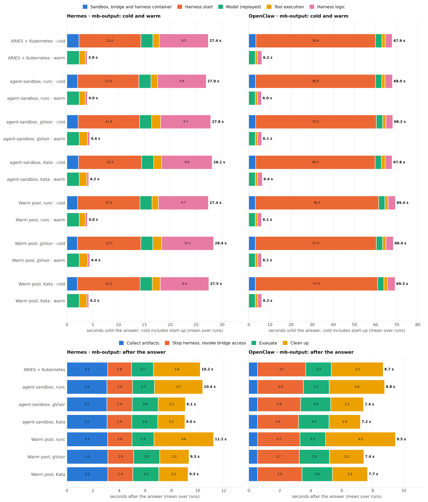
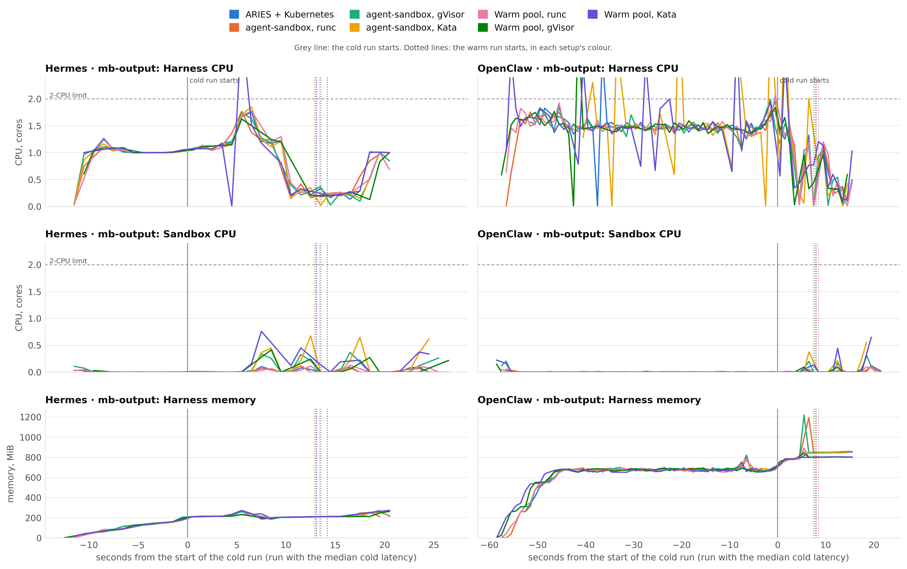

# `mb-output`: time breakdown

*Generated by `scripts/experiment/report.py`; back to the [campaign report](../report.md).*

The agent prints 66,399 bytes of `base64`; the verifier checks the saved copy's size. It isolates output carried back through the bridge.

Means ± standard deviation over the valid runs, in seconds unless marked; the last columns are each ARIES setup's mean minus ARIES K8s's.

- **Start-up:** the phases before the first request. The harness starts while the sandbox starts, so the *alongside* phases overlap the harness start, and start-up is less than their sum.
- **Run:** model time is how long a request offering tools was open. Tool execution is timed by the harness, the same way in every setup: Hermes's tool spans, or OpenClaw's session log from the tool-calling reply to the tool's result. Harness logic is the rest of the run: the harness's own work.
- **Harness overhead:** the harness's own time, beside the model and the tools. Cold, it is the harness start plus the cold run's harness logic; warm, the warm run's harness logic.
- **Tool calls:** what one agent tool call costs, from the agent's side. Natively the harness runs the command in its own container; through ARIES the request goes harness → bridge → sandbox and back.
  - *Per call, as the harness timed it:* the whole call, by the harness's own clock. It is timed the same way in every setup, so compare setups on this row.
  - *Commands the bridge ran:* every request the bridge served in the sandbox. One agent call is several: OpenClaw syncs its workspace before each command, and Hermes opens a terminal session (connection checks, environment, a shell snapshot) before its first command.
  - *Per call, the bridge running its commands:* the bridge's time running all of them, divided by the agent's calls.
  - *Per call, transport:* the whole call minus the bridge's share: requests travelling between harness, bridge and sandbox, and any gaps between the bridge's commands. It is a remainder, not a network measurement.
  - Native runs have no bridge, so only the whole call is shown.
  - **–** in a cold run: the bridge ran more commands cold than warm, because the harness also set itself up through the bridge before any agent call (Hermes opens a terminal session when the agent starts). Those commands belong to no call, so the bridge share and transport are left out.

## Figures

PDFs are beside the PNGs in `../figures/tasks/`.

### Time breakdown

### Resources over time

Each setup's run with the median cold latency, timed from the start of its cold run, so start-up is to the left of zero. CPU is the rate of the container's CPU counter over one-second bins.

## OpenClaw

Runs: ARIES K8s 5, agent-sandbox 5, agent-sandbox gVisor 5, agent-sandbox Kata 5, Warm pool 5, Warm pool gVisor 5, Warm pool Kata 5.

| Measure | ARIES K8s | agent-sandbox | agent-sandbox gVisor | agent-sandbox Kata | Warm pool | Warm pool gVisor | Warm pool Kata | agent-sandbox − ARIES K8s | agent-sandbox gVisor − ARIES K8s | agent-sandbox Kata − ARIES K8s | Warm pool − ARIES K8s | Warm pool gVisor − ARIES K8s | Warm pool Kata − ARIES K8s |
|---|---|---|---|---|---|---|---|---|---|---|---|---|---|
| ***Start-up, until the first request*** | | | | | | | | | | | | | |
| Sandbox reservation (`sandbox_reserve`) | 0.29 ± 0.00 | 0.29 ± 0.00 | 0.29 ± 0.00 | 0.29 ± 0.00 | 0.30 ± 0.00 | 0.30 ± 0.00 | 0.30 ± 0.00 | -0.00 | +0.00 | -0.00 | +0.00 | +0.00 | +0.00 |
| Bridge endpoint reservation (`bridge_reserve`) | 0.19 ± 0.00 | 0.18 ± 0.00 | 0.18 ± 0.00 | 0.19 ± 0.00 | 0.18 ± 0.00 | 0.18 ± 0.01 | 0.18 ± 0.01 | -0.01 | -0.01 | -0.00 | -0.00 | -0.01 | -0.01 |
| Harness container or pod creation (`harness_prepare`) | 2.92 ± 0.14 | 2.69 ± 0.17 | 2.79 ± 0.01 | 2.79 ± 0.01 | 2.63 ± 0.01 | 2.61 ± 0.02 | 2.62 ± 0.01 | -0.23 | -0.12 | -0.12 | -0.29 | -0.30 | -0.30 |
| Harness start, until it reports ready (`harness_start`) | 56.61 ± 0.98 | 56.83 ± 1.29 | 57.10 ± 0.85 | 56.51 ± 1.02 | 58.34 ± 1.73 | 57.29 ± 1.66 | 57.88 ± 1.30 | +0.22 | +0.49 | -0.10 | +1.73 | +0.68 | +1.27 |
| *Alongside:* sandbox start (`sandbox_start`) | 2.65 ± 0.13 | 2.42 ± 0.17 | 2.55 ± 0.01 | 6.56 ± 0.01 | 1.82 ± 0.01 | 1.85 ± 0.03 | 1.85 ± 0.02 | -0.22 | -0.10 | +3.92 | -0.83 | -0.80 | -0.79 |
| *Alongside:* sandbox sanitising (`sandbox_prepare`) | 0.41 ± 0.00 | 0.41 ± 0.00 | 0.46 ± 0.00 | 0.46 ± 0.01 | 0.41 ± 0.00 | 0.46 ± 0.01 | 0.47 ± 0.01 | -0.00 | +0.05 | +0.05 | +0.00 | +0.05 | +0.06 |
| *Alongside:* bridge binding the sandbox (`bridge_register`) | 0.35 ± 0.00 | 0.35 ± 0.00 | 0.43 ± 0.00 | 0.42 ± 0.01 | 0.34 ± 0.00 | 0.42 ± 0.01 | 0.43 ± 0.01 | +0.00 | +0.08 | +0.07 | -0.01 | +0.07 | +0.08 |
| **Start-up to the first request** | 60.01 ± 0.98 | 59.99 ± 1.40 | 60.37 ± 0.85 | 59.78 ± 1.02 | 61.45 ± 1.72 | 60.38 ± 1.67 | 60.98 ± 1.29 | -0.02 | +0.36 | -0.23 | +1.44 | +0.37 | +0.97 |
| ***Cold run, from the request to the answer*** | | | | | | | | | | | | | |
| Model (replayed) | 2.96 ± 0.00 | 2.96 ± 0.00 | 2.96 ± 0.00 | 2.97 ± 0.00 | 2.96 ± 0.00 | 2.96 ± 0.00 | 2.96 ± 0.00 | +0.00 | -0.00 | +0.00 | +0.00 | +0.00 | +0.00 |
| Tool execution, as the harness timed it | 1.55 ± 0.14 | 1.49 ± 0.03 | 1.59 ± 0.02 | 1.79 ± 0.24 | 1.55 ± 0.14 | 1.59 ± 0.03 | 1.64 ± 0.15 | -0.06 | +0.03 | +0.24 | +0.00 | +0.04 | +0.09 |
| Harness logic | 3.37 ± 0.44 | 3.52 ± 0.42 | 3.25 ± 0.21 | 3.30 ± 0.31 | 3.44 ± 0.23 | 3.47 ± 0.32 | 3.69 ± 0.38 | +0.15 | -0.12 | -0.07 | +0.07 | +0.10 | +0.31 |
| **Cold run** | 7.89 ± 0.35 | 7.98 ± 0.40 | 7.80 ± 0.21 | 8.06 ± 0.31 | 7.96 ± 0.29 | 8.03 ± 0.35 | 8.29 ± 0.45 | +0.09 | -0.09 | +0.17 | +0.07 | +0.14 | +0.40 |
| **Cold latency: start-up and run** | 67.90 ± 0.85 | 67.97 ± 1.18 | 68.17 ± 1.00 | 67.85 ± 0.88 | 69.41 ± 1.46 | 68.41 ± 1.68 | 69.28 ± 1.09 | +0.07 | +0.27 | -0.06 | +1.51 | +0.51 | +1.37 |
| Harness overhead: harness start and logic | 59.99 ± 0.75 | 60.35 ± 1.11 | 60.35 ± 1.01 | 59.82 ± 0.99 | 61.78 ± 1.55 | 60.76 ± 1.66 | 61.57 ± 1.06 | +0.36 | +0.36 | -0.17 | +1.79 | +0.78 | +1.58 |
| Model calls the agent waited on | 2.0 ± 0.0 | 2.0 ± 0.0 | 2.0 ± 0.0 | 2.0 ± 0.0 | 2.0 ± 0.0 | 2.0 ± 0.0 | 2.0 ± 0.0 | +0.0 | +0.0 | +0.0 | +0.0 | +0.0 | +0.0 |
| ***Warm run, the same task on the running harness and sandbox*** | | | | | | | | | | | | | |
| Model (replayed) | 3.08 ± 0.00 | 3.08 ± 0.00 | 3.08 ± 0.00 | 3.08 ± 0.00 | 3.08 ± 0.00 | 3.08 ± 0.00 | 3.08 ± 0.00 | -0.00 | +0.00 | -0.00 | -0.00 | +0.00 | -0.00 |
| Tool execution, as the harness timed it | 1.05 ± 0.01 | 1.06 ± 0.01 | 1.17 ± 0.02 | 1.16 ± 0.01 | 1.05 ± 0.01 | 1.16 ± 0.02 | 1.15 ± 0.01 | +0.01 | +0.12 | +0.11 | -0.00 | +0.11 | +0.09 |
| Harness logic, its overhead when warm | 2.07 ± 0.24 | 1.89 ± 0.23 | 1.88 ± 0.21 | 2.20 ± 0.46 | 1.93 ± 0.22 | 1.82 ± 0.14 | 1.96 ± 0.21 | -0.18 | -0.19 | +0.13 | -0.14 | -0.25 | -0.11 |
| **Warm latency** | 6.20 ± 0.24 | 6.03 ± 0.22 | 6.13 ± 0.19 | 6.44 ± 0.46 | 6.06 ± 0.22 | 6.06 ± 0.13 | 6.19 ± 0.21 | -0.17 | -0.07 | +0.24 | -0.14 | -0.14 | -0.02 |
| Model calls the agent waited on | 2.0 ± 0.0 | 2.0 ± 0.0 | 2.0 ± 0.0 | 2.0 ± 0.0 | 2.0 ± 0.0 | 2.0 ± 0.0 | 2.0 ± 0.0 | +0.0 | +0.0 | +0.0 | +0.0 | +0.0 | +0.0 |

### Tool calls

| Measure | ARIES K8s | agent-sandbox | agent-sandbox gVisor | agent-sandbox Kata | Warm pool | Warm pool gVisor | Warm pool Kata | agent-sandbox − ARIES K8s | agent-sandbox gVisor − ARIES K8s | agent-sandbox Kata − ARIES K8s | Warm pool − ARIES K8s | Warm pool gVisor − ARIES K8s | Warm pool Kata − ARIES K8s |
|---|---|---|---|---|---|---|---|---|---|---|---|---|---|
| ***Tool calls, cold run*** | | | | | | | | | | | | | |
| Agent tool calls | 0.0 ± 0.0 | 0.0 ± 0.0 | 0.0 ± 0.0 | 0.0 ± 0.0 | 0.0 ± 0.0 | 0.0 ± 0.0 | 0.0 ± 0.0 | +0.0 | +0.0 | +0.0 | +0.0 | +0.0 | +0.0 |
| Commands the bridge ran for them | 5.0 ± 0.0 | 5.0 ± 0.0 | 5.0 ± 0.0 | 5.0 ± 0.0 | 5.0 ± 0.0 | 5.0 ± 0.0 | 5.0 ± 0.0 | +0.0 | +0.0 | +0.0 | +0.0 | +0.0 | +0.0 |
| ***Tool calls, warm run*** | | | | | | | | | | | | | |
| Agent tool calls | 0.0 ± 0.0 | 0.0 ± 0.0 | 0.0 ± 0.0 | 0.0 ± 0.0 | 0.0 ± 0.0 | 0.0 ± 0.0 | 0.0 ± 0.0 | +0.0 | +0.0 | +0.0 | +0.0 | +0.0 | +0.0 |
| Commands the bridge ran for them | 5.0 ± 0.0 | 5.0 ± 0.0 | 5.0 ± 0.0 | 5.0 ± 0.0 | 5.0 ± 0.0 | 5.0 ± 0.0 | 5.0 ± 0.0 | +0.0 | +0.0 | +0.0 | +0.0 | +0.0 | +0.0 |

### After the answer and resources

| Measure | ARIES K8s | agent-sandbox | agent-sandbox gVisor | agent-sandbox Kata | Warm pool | Warm pool gVisor | Warm pool Kata | agent-sandbox − ARIES K8s | agent-sandbox gVisor − ARIES K8s | agent-sandbox Kata − ARIES K8s | Warm pool − ARIES K8s | Warm pool gVisor − ARIES K8s | Warm pool Kata − ARIES K8s |
|---|---|---|---|---|---|---|---|---|---|---|---|---|---|
| ***After the answer*** | | | | | | | | | | | | | |
| Collect the harness's artifacts (`harness_collect`) | 0.57 ± 0.00 | 0.57 ± 0.01 | 0.57 ± 0.01 | 0.57 ± 0.00 | 0.58 ± 0.01 | 0.57 ± 0.00 | 0.57 ± 0.01 | +0.01 | +0.01 | +0.00 | +0.01 | +0.00 | +0.00 |
| Stop the harness, revoke bridge access (`isolation`) | 3.11 ± 0.13 | 2.95 ± 0.42 | 2.78 ± 0.21 | 2.64 ± 0.27 | 2.73 ± 0.25 | 2.69 ± 0.23 | 2.86 ± 0.38 | -0.15 | -0.33 | -0.46 | -0.38 | -0.41 | -0.24 |
| Evaluate (`evaluation`) | 1.65 ± 0.01 | 1.66 ± 0.01 | 1.94 ± 0.01 | 1.96 ± 0.02 | 1.66 ± 0.01 | 1.94 ± 0.01 | 1.96 ± 0.01 | +0.01 | +0.28 | +0.30 | +0.00 | +0.29 | +0.31 |
| Clean up (`cleanup`) | 3.34 ± 0.16 | 3.58 ± 0.17 | 2.12 ± 0.02 | 2.03 ± 0.13 | 4.50 ± 0.13 | 2.22 ± 0.14 | 2.26 ± 0.02 | +0.24 | -1.22 | -1.31 | +1.16 | -1.12 | -1.08 |
| **After the answer** | 8.67 ± 0.21 | 8.77 ± 0.47 | 7.40 ± 0.21 | 7.21 ± 0.35 | 9.46 ± 0.27 | 7.42 ± 0.29 | 7.66 ± 0.37 | +0.10 | -1.26 | -1.46 | +0.79 | -1.24 | -1.01 |
| ***Resources, over the whole task*** | | | | | | | | | | | | | |
| Harness CPU, mean (% of one core) | 131 ± 2 | 130 ± 4 | 127 ± 3 | 127 ± 6 | 129 ± 3 | 130 ± 3 | 133 ± 2 | -1 | -5 | -4 | -2 | -1 | +2 |
| Harness CPU, peak (% of one core) | 303 ± 209 | 236 ± 66 | 307 ± 203 | 226 ± 90 | 212 ± 51 | 255 ± 91 | 317 ± 73 | -67 | +4 | -77 | -90 | -47 | +14 |
| Harness memory, peak (MiB) | 943 ± 148 | 929 ± 155 | 1077 ± 121 | 943 ± 167 | 900 ± 93 | 957 ± 176 | 1017 ± 191 | -13 | +135 | +1 | -42 | +14 | +74 |
| Sandbox CPU, mean (% of one core) | 0 ± 0 | 0 ± 0 | 2 ± 0 | 3 ± 0 | 0 ± 0 | 2 ± 0 | 3 ± 0 | +0 | +1 | +3 | -0 | +1 | +3 |
| Sandbox CPU, peak (% of one core) | 11 ± 1 | 10 ± 1 | 35 ± 6 | 57 ± 5 | 10 ± 2 | 33 ± 8 | 65 ± 8 | -1 | +24 | +46 | -1 | +22 | +54 |
| Sandbox memory, peak (MiB) | 1 ± 2 | 1 ± 1 | 18 ± 1 | 320 ± 1 | 1 ± 1 | 18 ± 0 | 320 ± 1 | -0 | +16 | +319 | -0 | +16 | +319 |

### Each repetition (latency, seconds)

| Repetition | ARIES K8s cold | ARIES K8s warm | agent-sandbox cold | agent-sandbox warm | agent-sandbox gVisor cold | agent-sandbox gVisor warm | agent-sandbox Kata cold | agent-sandbox Kata warm | Warm pool cold | Warm pool warm | Warm pool gVisor cold | Warm pool gVisor warm | Warm pool Kata cold | Warm pool Kata warm |
|---|---|---|---|---|---|---|---|---|---|---|---|---|---|---|
| 1 | 67.71 | 6.45 | 68.81 | 5.86 | 68.77 | 5.96 | 69.22 | 6.02 | 69.23 | 6.13 | 65.82 | 6.03 | 70.09 | 6.20 |
| 2 | 69.18 | 6.35 | 69.52 | 5.81 | 68.64 | 6.00 | 67.76 | 5.99 | 71.97 | 5.87 | 67.61 | 6.05 | 69.85 | 6.42 |
| 3 | 68.21 | 6.24 | 66.94 | 5.94 | 68.20 | 6.42 | 68.04 | 6.35 | 68.65 | 5.79 | 69.24 | 5.96 | 67.93 | 6.30 |
| 4 | 66.93 | 5.84 | 66.84 | 6.24 | 66.43 | 6.04 | 67.27 | 6.93 | 68.47 | 6.23 | 69.73 | 6.29 | 68.26 | 5.86 |
| 5 | 67.49 | 6.13 | 67.76 | 6.29 | 68.80 | 6.23 | 66.94 | 6.90 | 68.74 | 6.27 | 69.64 | 5.97 | 70.24 | 6.15 |

## Hermes

Runs: ARIES K8s 5, agent-sandbox 5, agent-sandbox gVisor 5, agent-sandbox Kata 5, Warm pool 5, Warm pool gVisor 5, Warm pool Kata 5.

| Measure | ARIES K8s | agent-sandbox | agent-sandbox gVisor | agent-sandbox Kata | Warm pool | Warm pool gVisor | Warm pool Kata | agent-sandbox − ARIES K8s | agent-sandbox gVisor − ARIES K8s | agent-sandbox Kata − ARIES K8s | Warm pool − ARIES K8s | Warm pool gVisor − ARIES K8s | Warm pool Kata − ARIES K8s |
|---|---|---|---|---|---|---|---|---|---|---|---|---|---|
| ***Start-up, until the first request*** | | | | | | | | | | | | | |
| Sandbox reservation (`sandbox_reserve`) | 0.30 ± 0.00 | 0.30 ± 0.00 | 0.30 ± 0.00 | 0.30 ± 0.00 | 0.30 ± 0.01 | 0.30 ± 0.00 | 0.30 ± 0.00 | -0.00 | -0.00 | -0.00 | +0.00 | +0.00 | -0.00 |
| Bridge endpoint reservation (`bridge_reserve`) | 0.14 ± 0.00 | 0.14 ± 0.00 | 0.14 ± 0.00 | 0.14 ± 0.00 | 0.14 ± 0.01 | 0.14 ± 0.00 | 0.14 ± 0.00 | -0.00 | -0.00 | +0.00 | -0.00 | -0.00 | +0.00 |
| Harness container or pod creation (`harness_prepare`) | 1.90 ± 0.17 | 1.65 ± 0.15 | 1.76 ± 0.13 | 1.81 ± 0.01 | 1.65 ± 0.02 | 1.63 ± 0.02 | 1.64 ± 0.01 | -0.25 | -0.14 | -0.08 | -0.25 | -0.27 | -0.26 |
| Harness start, until it reports ready (`harness_start`) | 11.99 ± 0.11 | 11.86 ± 0.52 | 11.89 ± 0.53 | 12.22 ± 0.53 | 12.06 ± 0.19 | 12.25 ± 0.52 | 12.13 ± 0.06 | -0.13 | -0.10 | +0.23 | +0.07 | +0.26 | +0.14 |
| *Alongside:* sandbox start (`sandbox_start`) | 2.64 ± 0.17 | 2.41 ± 0.15 | 2.54 ± 0.13 | 6.60 ± 0.03 | 1.83 ± 0.02 | 1.84 ± 0.02 | 1.86 ± 0.03 | -0.23 | -0.09 | +3.96 | -0.81 | -0.79 | -0.78 |
| *Alongside:* sandbox sanitising (`sandbox_prepare`) | 0.42 ± 0.00 | 0.42 ± 0.01 | 0.48 ± 0.01 | 0.49 ± 0.01 | 0.42 ± 0.01 | 0.47 ± 0.00 | 0.49 ± 0.01 | -0.00 | +0.05 | +0.06 | -0.00 | +0.05 | +0.06 |
| *Alongside:* bridge binding the sandbox (`bridge_register`) | 0.13 ± 0.00 | 0.13 ± 0.00 | 0.13 ± 0.00 | 0.14 ± 0.00 | 0.14 ± 0.00 | 0.14 ± 0.00 | 0.14 ± 0.01 | -0.00 | -0.00 | +0.00 | +0.00 | +0.00 | +0.00 |
| **Start-up to the first request** | 14.32 ± 0.16 | 13.94 ± 0.63 | 14.08 ± 0.66 | 14.47 ± 0.54 | 14.15 ± 0.18 | 14.31 ± 0.52 | 14.20 ± 0.06 | -0.38 | -0.24 | +0.15 | -0.17 | -0.01 | -0.12 |
| ***Cold run, from the request to the answer*** | | | | | | | | | | | | | |
| Model (replayed) | 2.33 ± 0.00 | 2.33 ± 0.00 | 2.33 ± 0.00 | 2.33 ± 0.00 | 2.33 ± 0.00 | 2.33 ± 0.00 | 2.32 ± 0.00 | +0.00 | +0.00 | +0.00 | -0.00 | +0.00 | -0.00 |
| Tool execution, as the harness timed it | 1.24 ± 0.01 | 1.26 ± 0.06 | 1.74 ± 0.02 | 1.55 ± 0.01 | 1.24 ± 0.01 | 1.70 ± 0.09 | 1.55 ± 0.01 | +0.02 | +0.50 | +0.31 | -0.00 | +0.46 | +0.31 |
| Harness logic | 9.49 ± 0.34 | 9.44 ± 0.24 | 9.70 ± 0.62 | 9.77 ± 0.24 | 9.69 ± 0.29 | 10.05 ± 0.28 | 9.39 ± 0.24 | -0.05 | +0.21 | +0.28 | +0.20 | +0.56 | -0.10 |
| **Cold run** | 13.06 ± 0.35 | 13.03 ± 0.22 | 13.77 ± 0.61 | 13.65 ± 0.24 | 13.25 ± 0.29 | 14.08 ± 0.28 | 13.27 ± 0.25 | -0.03 | +0.71 | +0.59 | +0.20 | +1.02 | +0.21 |
| **Cold latency: start-up and run** | 27.38 ± 0.34 | 26.97 ± 0.79 | 27.85 ± 0.52 | 28.12 ± 0.50 | 27.40 ± 0.40 | 28.39 ± 0.34 | 27.47 ± 0.21 | -0.41 | +0.47 | +0.74 | +0.03 | +1.02 | +0.09 |
| Harness overhead: harness start and logic | 21.48 ± 0.30 | 21.30 ± 0.71 | 21.59 ± 0.51 | 21.99 ± 0.50 | 21.75 ± 0.41 | 22.30 ± 0.32 | 21.53 ± 0.20 | -0.18 | +0.11 | +0.51 | +0.27 | +0.82 | +0.05 |
| Model calls the agent waited on | 3.0 ± 0.0 | 3.0 ± 0.0 | 3.0 ± 0.0 | 3.0 ± 0.0 | 3.0 ± 0.0 | 3.0 ± 0.0 | 3.0 ± 0.0 | +0.0 | +0.0 | +0.0 | +0.0 | +0.0 | +0.0 |
| ***Warm run, the same task on the running harness and sandbox*** | | | | | | | | | | | | | |
| Model (replayed) | 2.39 ± 0.00 | 2.39 ± 0.00 | 2.39 ± 0.00 | 2.39 ± 0.00 | 2.39 ± 0.00 | 2.39 ± 0.00 | 2.39 ± 0.00 | +0.00 | +0.00 | +0.00 | -0.00 | +0.00 | +0.00 |
| Tool execution, as the harness timed it | 1.16 ± 0.00 | 1.16 ± 0.00 | 1.62 ± 0.09 | 1.47 ± 0.01 | 1.19 ± 0.06 | 1.66 ± 0.01 | 1.47 ± 0.01 | -0.00 | +0.46 | +0.31 | +0.03 | +0.50 | +0.31 |
| Harness logic, its overhead when warm | 0.37 ± 0.01 | 0.40 ± 0.03 | 0.39 ± 0.00 | 0.37 ± 0.01 | 0.40 ± 0.04 | 0.39 ± 0.02 | 0.37 ± 0.01 | +0.03 | +0.02 | -0.00 | +0.02 | +0.02 | -0.00 |
| **Warm latency** | 3.93 ± 0.01 | 3.95 ± 0.04 | 4.40 ± 0.09 | 4.23 ± 0.01 | 3.98 ± 0.09 | 4.44 ± 0.01 | 4.23 ± 0.01 | +0.02 | +0.48 | +0.31 | +0.05 | +0.51 | +0.31 |
| Model calls the agent waited on | 3.0 ± 0.0 | 3.0 ± 0.0 | 3.0 ± 0.0 | 3.0 ± 0.0 | 3.0 ± 0.0 | 3.0 ± 0.0 | 3.0 ± 0.0 | +0.0 | +0.0 | +0.0 | +0.0 | +0.0 | +0.0 |

### Tool calls

| Measure | ARIES K8s | agent-sandbox | agent-sandbox gVisor | agent-sandbox Kata | Warm pool | Warm pool gVisor | Warm pool Kata | agent-sandbox − ARIES K8s | agent-sandbox gVisor − ARIES K8s | agent-sandbox Kata − ARIES K8s | Warm pool − ARIES K8s | Warm pool gVisor − ARIES K8s | Warm pool Kata − ARIES K8s |
|---|---|---|---|---|---|---|---|---|---|---|---|---|---|
| ***Tool calls, cold run*** | | | | | | | | | | | | | |
| Agent tool calls | 1.0 ± 0.0 | 1.0 ± 0.0 | 1.0 ± 0.0 | 1.0 ± 0.0 | 1.0 ± 0.0 | 1.0 ± 0.0 | 1.0 ± 0.0 | +0.0 | +0.0 | +0.0 | +0.0 | +0.0 | +0.0 |
| Commands the bridge ran for them | 28.0 ± 0.0 | 28.0 ± 0.0 | 28.0 ± 0.0 | 28.0 ± 0.0 | 28.0 ± 0.0 | 28.0 ± 0.0 | 28.0 ± 0.0 | +0.0 | +0.0 | +0.0 | +0.0 | +0.0 | +0.0 |
| Per call, as the harness timed it | 1241 ± 9 | 1260 ± 63 | 1740 ± 25 | 1551 ± 14 | 1241 ± 10 | 1702 ± 91 | 1550 ± 14 | +19 | +499 | +309 | -0 | +461 | +308 |
| ***Tool calls, warm run*** | | | | | | | | | | | | | |
| Agent tool calls | 1.0 ± 0.0 | 1.0 ± 0.0 | 1.0 ± 0.0 | 1.0 ± 0.0 | 1.0 ± 0.0 | 1.0 ± 0.0 | 1.0 ± 0.0 | +0.0 | +0.0 | +0.0 | +0.0 | +0.0 | +0.0 |
| Commands the bridge ran for them | 14.0 ± 0.0 | 14.0 ± 0.0 | 14.0 ± 0.0 | 14.0 ± 0.0 | 14.0 ± 0.0 | 14.0 ± 0.0 | 14.0 ± 0.0 | +0.0 | +0.0 | +0.0 | +0.0 | +0.0 | +0.0 |
| Per call, as the harness timed it | 1162 ± 2 | 1160 ± 5 | 1620 ± 90 | 1469 ± 12 | 1191 ± 61 | 1658 ± 10 | 1469 ± 11 | -2 | +458 | +307 | +29 | +496 | +307 |
| Per call, the bridge running its commands | 863 ± 2 | 863 ± 7 | 1155 ± 16 | 1107 ± 28 | 869 ± 8 | 1155 ± 6 | 1103 ± 13 | +0 | +292 | +244 | +6 | +292 | +240 |
| Per call, transport between harness and sandbox | 299 ± 2 | 297 ± 3 | 465 ± 86 | 362 ± 18 | 322 ± 55 | 503 ± 6 | 366 ± 12 | -2 | +166 | +63 | +23 | +204 | +67 |

### After the answer and resources

| Measure | ARIES K8s | agent-sandbox | agent-sandbox gVisor | agent-sandbox Kata | Warm pool | Warm pool gVisor | Warm pool Kata | agent-sandbox − ARIES K8s | agent-sandbox gVisor − ARIES K8s | agent-sandbox Kata − ARIES K8s | Warm pool − ARIES K8s | Warm pool gVisor − ARIES K8s | Warm pool Kata − ARIES K8s |
|---|---|---|---|---|---|---|---|---|---|---|---|---|---|
| ***After the answer*** | | | | | | | | | | | | | |
| Collect the harness's artifacts (`harness_collect`) | 3.11 ± 0.06 | 3.06 ± 0.04 | 3.06 ± 0.07 | 3.08 ± 0.02 | 3.12 ± 0.07 | 3.13 ± 0.05 | 3.14 ± 0.03 | -0.05 | -0.06 | -0.04 | +0.01 | +0.02 | +0.02 |
| Stop the harness, revoke bridge access (`isolation`) | 1.83 ± 0.22 | 1.96 ± 0.24 | 1.94 ± 0.23 | 1.89 ± 0.21 | 1.86 ± 0.30 | 1.97 ± 0.24 | 1.91 ± 0.18 | +0.13 | +0.12 | +0.07 | +0.03 | +0.14 | +0.08 |
| Evaluate (`evaluation`) | 1.68 ± 0.00 | 1.68 ± 0.01 | 1.98 ± 0.02 | 1.98 ± 0.02 | 1.68 ± 0.00 | 1.99 ± 0.00 | 1.98 ± 0.02 | -0.00 | +0.30 | +0.30 | +0.00 | +0.31 | +0.30 |
| Clean up (`cleanup`) | 3.58 ± 0.18 | 3.69 ± 0.02 | 2.08 ± 0.02 | 2.08 ± 0.02 | 4.55 ± 0.01 | 2.24 ± 0.01 | 2.24 ± 0.02 | +0.11 | -1.50 | -1.50 | +0.98 | -1.34 | -1.34 |
| **After the answer** | 10.20 ± 0.28 | 10.39 ± 0.26 | 9.06 ± 0.24 | 9.03 ± 0.22 | 11.22 ± 0.27 | 9.34 ± 0.23 | 9.27 ± 0.20 | +0.18 | -1.14 | -1.17 | +1.01 | -0.87 | -0.93 |
| ***Resources, over the whole task*** | | | | | | | | | | | | | |
| Harness CPU, mean (% of one core) | 87 ± 1 | 85 ± 3 | 84 ± 7 | 82 ± 1 | 86 ± 3 | 84 ± 1 | 84 ± 3 | -1 | -3 | -5 | -1 | -3 | -3 |
| Harness CPU, peak (% of one core) | 199 ± 49 | 214 ± 36 | 252 ± 147 | 170 ± 11 | 218 ± 94 | 198 ± 79 | 224 ± 80 | +15 | +53 | -29 | +19 | -1 | +25 |
| Harness memory, peak (MiB) | 269 ± 4 | 264 ± 19 | 270 ± 6 | 273 ± 3 | 270 ± 5 | 266 ± 10 | 265 ± 10 | -5 | +1 | +3 | +1 | -3 | -5 |
| Sandbox CPU, mean (% of one core) | 2 ± 0 | 2 ± 0 | 6 ± 1 | 14 ± 1 | 2 ± 0 | 5 ± 1 | 10 ± 1 | -0 | +4 | +13 | -0 | +4 | +8 |
| Sandbox CPU, peak (% of one core) | 11 ± 3 | 12 ± 2 | 48 ± 11 | 59 ± 9 | 11 ± 1 | 44 ± 15 | 61 ± 10 | +1 | +37 | +48 | +1 | +33 | +50 |
| Sandbox memory, peak (MiB) | 1 ± 1 | 1 ± 0 | 19 ± 1 | 321 ± 2 | 1 ± 1 | 19 ± 1 | 321 ± 2 | -0 | +18 | +320 | +0 | +18 | +320 |

### Each repetition (latency, seconds)

| Repetition | ARIES K8s cold | ARIES K8s warm | agent-sandbox cold | agent-sandbox warm | agent-sandbox gVisor cold | agent-sandbox gVisor warm | agent-sandbox Kata cold | agent-sandbox Kata warm | Warm pool cold | Warm pool warm | Warm pool gVisor cold | Warm pool gVisor warm | Warm pool Kata cold | Warm pool Kata warm |
|---|---|---|---|---|---|---|---|---|---|---|---|---|---|---|
| 1 | 27.14 | 3.93 | 27.20 | 3.95 | 28.43 | 4.45 | 28.43 | 4.22 | 27.14 | 4.01 | 28.54 | 4.43 | 27.51 | 4.22 |
| 2 | 27.10 | 3.93 | 27.29 | 3.93 | 27.48 | 4.44 | 28.82 | 4.23 | 27.54 | 3.92 | 28.16 | 4.45 | 27.36 | 4.23 |
| 3 | 27.95 | 3.91 | 25.69 | 4.01 | 28.38 | 4.44 | 27.67 | 4.23 | 27.80 | 3.92 | 28.12 | 4.44 | 27.81 | 4.23 |
| 4 | 27.42 | 3.93 | 27.81 | 3.94 | 27.61 | 4.44 | 27.67 | 4.24 | 26.84 | 4.13 | 28.93 | 4.43 | 27.38 | 4.25 |
| 5 | 27.27 | 3.93 | 26.85 | 3.93 | 27.35 | 4.24 | 27.99 | 4.24 | 27.69 | 3.92 | 28.22 | 4.45 | 27.30 | 4.23 |
