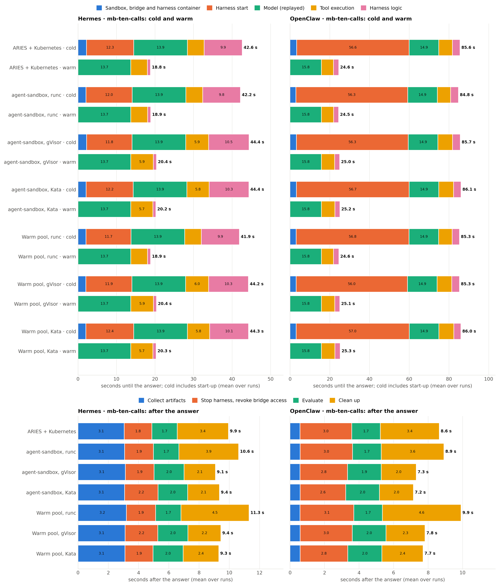

# `mb-ten-calls`: time breakdown

*Generated by `scripts/experiment/report.py`; back to the [campaign report](../report.md).*

The agent runs ten `echo` commands, one tool call each, the first overwriting the file; the verifier checks the file holds lines 1 to 10. It isolates the cost per call.

Means ± standard deviation over the valid runs, in seconds unless marked; the last columns are each ARIES setup's mean minus ARIES K8s's.

- **Start-up:** the phases before the first request. The harness starts while the sandbox starts, so the *alongside* phases overlap the harness start, and start-up is less than their sum.
- **Run:** model time is how long a request offering tools was open. Tool execution is timed by the harness, the same way in every setup: Hermes's tool spans, or OpenClaw's session log from the tool-calling reply to the tool's result. Harness logic is the rest of the run: the harness's own work.
- **Harness overhead:** the harness's own time, beside the model and the tools. Cold, it is the harness start plus the cold run's harness logic; warm, the warm run's harness logic.
- **Tool calls:** what one agent tool call costs, from the agent's side. Natively the harness runs the command in its own container; through ARIES the request goes harness → bridge → sandbox and back.
  - *Per call, as the harness timed it:* the whole call, by the harness's own clock. It is timed the same way in every setup, so compare setups on this row.
  - *Commands the bridge ran:* every request the bridge served in the sandbox. One agent call is several: OpenClaw syncs its workspace before each command, and Hermes opens a terminal session (connection checks, environment, a shell snapshot) before its first command.
  - *Per call, the bridge running its commands:* the bridge's time running all of them, divided by the agent's calls.
  - *Per call, transport:* the whole call minus the bridge's share: requests travelling between harness, bridge and sandbox, and any gaps between the bridge's commands. It is a remainder, not a network measurement.
  - Native runs have no bridge, so only the whole call is shown.
  - **–** in a cold run: the bridge ran more commands cold than warm, because the harness also set itself up through the bridge before any agent call (Hermes opens a terminal session when the agent starts). Those commands belong to no call, so the bridge share and transport are left out.

## Figures

PDFs are beside the PNGs in `../figures/tasks/`.

### Time breakdown

### Resources over time

Each setup's run with the median cold latency, timed from the start of its cold run, so start-up is to the left of zero. CPU is the rate of the container's CPU counter over one-second bins.

## OpenClaw

Runs: ARIES K8s 5, agent-sandbox 5, agent-sandbox gVisor 5, agent-sandbox Kata 5, Warm pool 5, Warm pool gVisor 5, Warm pool Kata 5.

| Measure | ARIES K8s | agent-sandbox | agent-sandbox gVisor | agent-sandbox Kata | Warm pool | Warm pool gVisor | Warm pool Kata | agent-sandbox − ARIES K8s | agent-sandbox gVisor − ARIES K8s | agent-sandbox Kata − ARIES K8s | Warm pool − ARIES K8s | Warm pool gVisor − ARIES K8s | Warm pool Kata − ARIES K8s |
|---|---|---|---|---|---|---|---|---|---|---|---|---|---|
| ***Start-up, until the first request*** | | | | | | | | | | | | | |
| Sandbox reservation (`sandbox_reserve`) | 0.29 ± 0.00 | 0.29 ± 0.00 | 0.29 ± 0.00 | 0.29 ± 0.00 | 0.29 ± 0.00 | 0.29 ± 0.00 | 0.29 ± 0.00 | +0.00 | -0.00 | -0.00 | +0.00 | +0.00 | +0.00 |
| Bridge endpoint reservation (`bridge_reserve`) | 0.18 ± 0.01 | 0.18 ± 0.01 | 0.18 ± 0.01 | 0.18 ± 0.00 | 0.18 ± 0.01 | 0.18 ± 0.00 | 0.18 ± 0.01 | +0.00 | +0.00 | +0.01 | +0.00 | +0.01 | +0.01 |
| Harness container or pod creation (`harness_prepare`) | 2.93 ± 0.13 | 2.51 ± 0.02 | 2.80 ± 0.01 | 2.79 ± 0.01 | 2.64 ± 0.03 | 2.62 ± 0.01 | 2.61 ± 0.02 | -0.42 | -0.13 | -0.14 | -0.29 | -0.31 | -0.32 |
| Harness start, until it reports ready (`harness_start`) | 56.60 ± 0.73 | 56.26 ± 0.87 | 56.28 ± 0.91 | 56.73 ± 0.98 | 56.84 ± 0.54 | 56.02 ± 1.27 | 56.98 ± 0.83 | -0.34 | -0.33 | +0.12 | +0.23 | -0.58 | +0.37 |
| *Alongside:* sandbox start (`sandbox_start`) | 2.66 ± 0.14 | 2.25 ± 0.02 | 2.56 ± 0.01 | 6.54 ± 0.02 | 1.81 ± 0.01 | 1.83 ± 0.01 | 1.84 ± 0.02 | -0.41 | -0.10 | +3.88 | -0.85 | -0.83 | -0.82 |
| *Alongside:* sandbox sanitising (`sandbox_prepare`) | 0.41 ± 0.00 | 0.41 ± 0.01 | 0.47 ± 0.00 | 0.47 ± 0.01 | 0.41 ± 0.01 | 0.46 ± 0.00 | 0.47 ± 0.01 | +0.00 | +0.06 | +0.07 | +0.00 | +0.05 | +0.06 |
| *Alongside:* bridge binding the sandbox (`bridge_register`) | 0.35 ± 0.00 | 0.35 ± 0.00 | 0.43 ± 0.00 | 0.44 ± 0.01 | 0.35 ± 0.01 | 0.43 ± 0.00 | 0.43 ± 0.01 | -0.00 | +0.08 | +0.09 | -0.01 | +0.07 | +0.08 |
| **Start-up to the first request** | 60.01 ± 0.66 | 59.25 ± 0.86 | 59.55 ± 0.92 | 59.99 ± 0.98 | 59.95 ± 0.54 | 59.12 ± 1.27 | 60.06 ± 0.83 | -0.76 | -0.46 | -0.01 | -0.05 | -0.89 | +0.06 |
| ***Cold run, from the request to the answer*** | | | | | | | | | | | | | |
| Model (replayed) | 14.90 ± 0.00 | 14.90 ± 0.00 | 14.90 ± 0.00 | 14.90 ± 0.00 | 14.90 ± 0.00 | 14.90 ± 0.00 | 14.90 ± 0.00 | -0.00 | +0.00 | +0.00 | +0.00 | -0.00 | -0.00 |
| Tool execution, as the harness timed it | 6.83 ± 0.18 | 6.67 ± 0.10 | 7.38 ± 0.18 | 7.45 ± 0.17 | 6.76 ± 0.25 | 7.41 ± 0.16 | 7.50 ± 0.18 | -0.16 | +0.56 | +0.62 | -0.07 | +0.58 | +0.67 |
| Harness logic | 3.86 ± 0.23 | 3.96 ± 0.22 | 3.84 ± 0.19 | 3.75 ± 0.27 | 3.69 ± 0.33 | 3.89 ± 0.31 | 3.57 ± 0.31 | +0.10 | -0.01 | -0.11 | -0.17 | +0.03 | -0.29 |
| **Cold run** | 25.59 ± 0.22 | 25.53 ± 0.25 | 26.13 ± 0.26 | 26.10 ± 0.28 | 25.34 ± 0.32 | 26.20 ± 0.42 | 25.97 ± 0.47 | -0.06 | +0.54 | +0.51 | -0.24 | +0.61 | +0.39 |
| **Cold latency: start-up and run** | 85.59 ± 0.61 | 84.77 ± 1.05 | 85.68 ± 0.88 | 86.09 ± 1.14 | 85.29 ± 0.83 | 85.32 ± 1.00 | 86.04 ± 0.89 | -0.82 | +0.09 | +0.50 | -0.30 | -0.28 | +0.44 |
| Harness overhead: harness start and logic | 60.46 ± 0.78 | 60.22 ± 1.06 | 60.12 ± 0.88 | 60.48 ± 1.06 | 60.53 ± 0.86 | 59.91 ± 1.03 | 60.55 ± 0.90 | -0.24 | -0.34 | +0.01 | +0.06 | -0.55 | +0.09 |
| Model calls the agent waited on | 11.0 ± 0.0 | 11.0 ± 0.0 | 11.0 ± 0.0 | 11.0 ± 0.0 | 11.0 ± 0.0 | 11.0 ± 0.0 | 11.0 ± 0.0 | +0.0 | +0.0 | +0.0 | +0.0 | +0.0 | +0.0 |
| ***Warm run, the same task on the running harness and sandbox*** | | | | | | | | | | | | | |
| Model (replayed) | 15.79 ± 0.00 | 15.79 ± 0.00 | 15.79 ± 0.00 | 15.79 ± 0.00 | 15.79 ± 0.00 | 15.79 ± 0.00 | 15.79 ± 0.00 | +0.00 | -0.00 | -0.00 | -0.00 | -0.00 | +0.00 |
| Tool execution, as the harness timed it | 6.08 ± 0.10 | 6.14 ± 0.08 | 6.68 ± 0.13 | 6.80 ± 0.09 | 6.11 ± 0.09 | 6.74 ± 0.10 | 6.81 ± 0.14 | +0.06 | +0.59 | +0.71 | +0.03 | +0.65 | +0.73 |
| Harness logic, its overhead when warm | 2.71 ± 0.25 | 2.54 ± 0.14 | 2.55 ± 0.06 | 2.58 ± 0.09 | 2.74 ± 0.21 | 2.57 ± 0.18 | 2.69 ± 0.26 | -0.16 | -0.16 | -0.12 | +0.03 | -0.14 | -0.02 |
| **Warm latency** | 24.58 ± 0.30 | 24.47 ± 0.13 | 25.01 ± 0.18 | 25.17 ± 0.18 | 24.63 ± 0.22 | 25.09 ± 0.18 | 25.29 ± 0.33 | -0.11 | +0.43 | +0.59 | +0.06 | +0.51 | +0.71 |
| Model calls the agent waited on | 11.0 ± 0.0 | 11.0 ± 0.0 | 11.0 ± 0.0 | 11.0 ± 0.0 | 11.0 ± 0.0 | 11.0 ± 0.0 | 11.0 ± 0.0 | +0.0 | +0.0 | +0.0 | +0.0 | +0.0 | +0.0 |

### Tool calls

| Measure | ARIES K8s | agent-sandbox | agent-sandbox gVisor | agent-sandbox Kata | Warm pool | Warm pool gVisor | Warm pool Kata | agent-sandbox − ARIES K8s | agent-sandbox gVisor − ARIES K8s | agent-sandbox Kata − ARIES K8s | Warm pool − ARIES K8s | Warm pool gVisor − ARIES K8s | Warm pool Kata − ARIES K8s |
|---|---|---|---|---|---|---|---|---|---|---|---|---|---|
| ***Tool calls, cold run*** | | | | | | | | | | | | | |
| Agent tool calls | 10.0 ± 0.0 | 10.0 ± 0.0 | 10.0 ± 0.0 | 10.0 ± 0.0 | 10.0 ± 0.0 | 10.0 ± 0.0 | 10.0 ± 0.0 | +0.0 | +0.0 | +0.0 | +0.0 | +0.0 | +0.0 |
| Commands the bridge ran for them | 41.0 ± 0.0 | 41.0 ± 0.0 | 41.0 ± 0.0 | 41.0 ± 0.0 | 41.0 ± 0.0 | 41.0 ± 0.0 | 41.0 ± 0.0 | +0.0 | +0.0 | +0.0 | +0.0 | +0.0 | +0.0 |
| Per call, as the harness timed it | 683 ± 18 | 667 ± 10 | 738 ± 18 | 745 ± 17 | 676 ± 25 | 741 ± 16 | 750 ± 18 | -16 | +56 | +62 | -7 | +58 | +67 |
| Per call, the bridge running its commands | 434 ± 7 | 432 ± 2 | 496 ± 3 | 502 ± 2 | 434 ± 7 | 497 ± 3 | 507 ± 8 | -2 | +63 | +68 | +1 | +63 | +73 |
| Per call, transport between harness and sandbox | 249 ± 18 | 235 ± 10 | 242 ± 18 | 243 ± 17 | 241 ± 21 | 244 ± 14 | 243 ± 21 | -14 | -7 | -6 | -8 | -5 | -6 |
| ***Tool calls, warm run*** | | | | | | | | | | | | | |
| Agent tool calls | 10.0 ± 0.0 | 10.0 ± 0.0 | 10.0 ± 0.0 | 10.0 ± 0.0 | 10.0 ± 0.0 | 10.0 ± 0.0 | 10.0 ± 0.0 | +0.0 | +0.0 | +0.0 | +0.0 | +0.0 | +0.0 |
| Commands the bridge ran for them | 41.0 ± 0.0 | 41.0 ± 0.0 | 41.0 ± 0.0 | 41.0 ± 0.0 | 41.0 ± 0.0 | 41.0 ± 0.0 | 41.0 ± 0.0 | +0.0 | +0.0 | +0.0 | +0.0 | +0.0 | +0.0 |
| Per call, as the harness timed it | 608 ± 10 | 614 ± 8 | 668 ± 13 | 680 ± 9 | 611 ± 9 | 674 ± 10 | 681 ± 14 | +6 | +59 | +71 | +3 | +65 | +73 |
| Per call, the bridge running its commands | 430 ± 1 | 431 ± 1 | 493 ± 2 | 499 ± 2 | 431 ± 2 | 494 ± 1 | 503 ± 3 | +0 | +63 | +69 | +1 | +64 | +73 |
| Per call, transport between harness and sandbox | 178 ± 8 | 183 ± 8 | 174 ± 13 | 180 ± 8 | 180 ± 10 | 179 ± 11 | 178 ± 12 | +5 | -4 | +2 | +2 | +1 | -0 |

### After the answer and resources

| Measure | ARIES K8s | agent-sandbox | agent-sandbox gVisor | agent-sandbox Kata | Warm pool | Warm pool gVisor | Warm pool Kata | agent-sandbox − ARIES K8s | agent-sandbox gVisor − ARIES K8s | agent-sandbox Kata − ARIES K8s | Warm pool − ARIES K8s | Warm pool gVisor − ARIES K8s | Warm pool Kata − ARIES K8s |
|---|---|---|---|---|---|---|---|---|---|---|---|---|---|
| ***After the answer*** | | | | | | | | | | | | | |
| Collect the harness's artifacts (`harness_collect`) | 0.58 ± 0.00 | 0.59 ± 0.00 | 0.58 ± 0.00 | 0.59 ± 0.01 | 0.58 ± 0.00 | 0.59 ± 0.00 | 0.59 ± 0.01 | +0.00 | -0.00 | +0.01 | +0.00 | +0.01 | +0.01 |
| Stop the harness, revoke bridge access (`isolation`) | 3.00 ± 0.33 | 3.04 ± 0.29 | 2.75 ± 0.27 | 2.64 ± 0.10 | 3.11 ± 0.26 | 3.02 ± 0.25 | 2.76 ± 0.09 | +0.05 | -0.24 | -0.36 | +0.11 | +0.03 | -0.23 |
| Evaluate (`evaluation`) | 1.66 ± 0.02 | 1.66 ± 0.01 | 1.95 ± 0.01 | 1.96 ± 0.02 | 1.66 ± 0.01 | 1.95 ± 0.01 | 1.97 ± 0.02 | -0.00 | +0.29 | +0.30 | +0.00 | +0.30 | +0.32 |
| Clean up (`cleanup`) | 3.41 ± 0.30 | 3.64 ± 0.13 | 2.03 ± 0.14 | 1.96 ± 0.16 | 4.56 ± 0.02 | 2.26 ± 0.01 | 2.39 ± 0.32 | +0.22 | -1.38 | -1.45 | +1.15 | -1.15 | -1.03 |
| **After the answer** | 8.65 ± 0.41 | 8.92 ± 0.21 | 7.32 ± 0.27 | 7.15 ± 0.21 | 9.91 ± 0.27 | 7.82 ± 0.26 | 7.71 ± 0.30 | +0.27 | -1.33 | -1.50 | +1.26 | -0.82 | -0.94 |
| ***Resources, over the whole task*** | | | | | | | | | | | | | |
| Harness CPU, mean (% of one core) | 94 ± 5 | 96 ± 1 | 86 ± 2 | 86 ± 2 | 96 ± 2 | 95 ± 1 | 94 ± 3 | +2 | -8 | -8 | +2 | +1 | -0 |
| Harness CPU, peak (% of one core) | 200 ± 26 | 189 ± 10 | 212 ± 31 | 217 ± 74 | 243 ± 93 | 231 ± 62 | 286 ± 183 | -11 | +12 | +17 | +43 | +31 | +86 |
| Harness memory, peak (MiB) | 923 ± 175 | 917 ± 91 | 1008 ± 225 | 860 ± 71 | 865 ± 171 | 995 ± 163 | 1137 ± 196 | -6 | +85 | -64 | -58 | +72 | +214 |
| Sandbox CPU, mean (% of one core) | 1 ± 0 | 1 ± 0 | 2 ± 0 | 6 ± 0 | 1 ± 0 | 2 ± 0 | 6 ± 0 | -0 | +1 | +5 | -0 | +1 | +5 |
| Sandbox CPU, peak (% of one core) | 11 ± 2 | 12 ± 1 | 36 ± 6 | 66 ± 20 | 12 ± 1 | 39 ± 10 | 55 ± 6 | +1 | +25 | +55 | +2 | +28 | +44 |
| Sandbox memory, peak (MiB) | 3 ± 1 | 2 ± 2 | 18 ± 0 | 319 ± 1 | 2 ± 2 | 18 ± 1 | 320 ± 1 | -1 | +15 | +317 | -1 | +16 | +317 |

### Each repetition (latency, seconds)

| Repetition | ARIES K8s cold | ARIES K8s warm | agent-sandbox cold | agent-sandbox warm | agent-sandbox gVisor cold | agent-sandbox gVisor warm | agent-sandbox Kata cold | agent-sandbox Kata warm | Warm pool cold | Warm pool warm | Warm pool gVisor cold | Warm pool gVisor warm | Warm pool Kata cold | Warm pool Kata warm |
|---|---|---|---|---|---|---|---|---|---|---|---|---|---|---|
| 1 | 85.00 | 24.35 | 85.44 | 24.40 | 84.22 | 24.84 | 85.87 | 25.27 | 83.85 | 24.54 | 86.14 | 25.24 | 85.69 | 25.83 |
| 2 | 86.33 | 24.81 | 84.88 | 24.44 | 85.85 | 25.19 | 87.76 | 25.22 | 85.91 | 24.54 | 84.43 | 25.17 | 86.64 | 25.12 |
| 3 | 84.99 | 24.27 | 85.81 | 24.70 | 86.55 | 24.89 | 86.68 | 25.24 | 85.56 | 25.03 | 86.41 | 25.15 | 84.65 | 24.98 |
| 4 | 86.09 | 24.50 | 83.07 | 24.45 | 86.11 | 24.92 | 85.02 | 24.85 | 85.76 | 24.52 | 84.18 | 24.78 | 86.38 | 25.32 |
| 5 | 85.56 | 24.97 | 84.67 | 24.36 | 85.67 | 25.23 | 85.14 | 25.26 | 85.40 | 24.53 | 85.42 | 25.12 | 86.83 | 25.19 |

## Hermes

Runs: ARIES K8s 5, agent-sandbox 5, agent-sandbox gVisor 5, agent-sandbox Kata 5, Warm pool 5, Warm pool gVisor 5, Warm pool Kata 5.

| Measure | ARIES K8s | agent-sandbox | agent-sandbox gVisor | agent-sandbox Kata | Warm pool | Warm pool gVisor | Warm pool Kata | agent-sandbox − ARIES K8s | agent-sandbox gVisor − ARIES K8s | agent-sandbox Kata − ARIES K8s | Warm pool − ARIES K8s | Warm pool gVisor − ARIES K8s | Warm pool Kata − ARIES K8s |
|---|---|---|---|---|---|---|---|---|---|---|---|---|---|
| ***Start-up, until the first request*** | | | | | | | | | | | | | |
| Sandbox reservation (`sandbox_reserve`) | 0.30 ± 0.00 | 0.30 ± 0.00 | 0.29 ± 0.00 | 0.30 ± 0.00 | 0.29 ± 0.00 | 0.30 ± 0.00 | 0.30 ± 0.00 | +0.00 | -0.00 | +0.00 | -0.00 | -0.00 | -0.00 |
| Bridge endpoint reservation (`bridge_reserve`) | 0.13 ± 0.00 | 0.14 ± 0.00 | 0.14 ± 0.00 | 0.14 ± 0.00 | 0.14 ± 0.00 | 0.14 ± 0.00 | 0.14 ± 0.00 | +0.00 | +0.00 | +0.00 | +0.00 | +0.00 | +0.00 |
| Harness container or pod creation (`harness_prepare`) | 1.78 ± 0.13 | 1.65 ± 0.17 | 1.83 ± 0.01 | 1.70 ± 0.16 | 1.65 ± 0.02 | 1.63 ± 0.01 | 1.63 ± 0.02 | -0.13 | +0.04 | -0.09 | -0.13 | -0.15 | -0.15 |
| Harness start, until it reports ready (`harness_start`) | 12.26 ± 0.47 | 12.01 ± 0.14 | 11.78 ± 0.39 | 12.23 ± 0.54 | 11.71 ± 0.49 | 11.94 ± 0.08 | 12.42 ± 0.43 | -0.26 | -0.48 | -0.03 | -0.56 | -0.32 | +0.16 |
| *Alongside:* sandbox start (`sandbox_start`) | 2.52 ± 0.14 | 2.41 ± 0.17 | 2.61 ± 0.02 | 6.49 ± 0.15 | 1.82 ± 0.01 | 1.84 ± 0.01 | 1.86 ± 0.04 | -0.11 | +0.09 | +3.97 | -0.70 | -0.68 | -0.66 |
| *Alongside:* sandbox sanitising (`sandbox_prepare`) | 0.42 ± 0.01 | 0.42 ± 0.01 | 0.48 ± 0.01 | 0.49 ± 0.01 | 0.42 ± 0.01 | 0.48 ± 0.01 | 0.49 ± 0.01 | -0.00 | +0.06 | +0.06 | -0.00 | +0.05 | +0.07 |
| *Alongside:* bridge binding the sandbox (`bridge_register`) | 0.13 ± 0.00 | 0.13 ± 0.00 | 0.13 ± 0.00 | 0.14 ± 0.00 | 0.14 ± 0.00 | 0.14 ± 0.00 | 0.13 ± 0.01 | +0.00 | -0.00 | +0.01 | +0.01 | +0.00 | -0.00 |
| **Start-up to the first request** | 14.48 ± 0.46 | 14.09 ± 0.20 | 14.04 ± 0.38 | 14.36 ± 0.45 | 13.78 ± 0.50 | 14.00 ± 0.08 | 14.49 ± 0.44 | -0.39 | -0.44 | -0.12 | -0.69 | -0.47 | +0.01 |
| ***Cold run, from the request to the answer*** | | | | | | | | | | | | | |
| Model (replayed) | 13.93 ± 0.00 | 13.93 ± 0.00 | 13.93 ± 0.00 | 13.93 ± 0.00 | 13.93 ± 0.00 | 13.93 ± 0.00 | 13.93 ± 0.00 | -0.00 | -0.00 | -0.00 | +0.00 | +0.00 | -0.00 |
| Tool execution, as the harness timed it | 4.35 ± 0.07 | 4.36 ± 0.07 | 5.95 ± 0.10 | 5.79 ± 0.01 | 4.32 ± 0.00 | 5.99 ± 0.01 | 5.79 ± 0.01 | +0.01 | +1.59 | +1.43 | -0.04 | +1.64 | +1.43 |
| Harness logic | 9.89 ± 0.33 | 9.81 ± 0.25 | 10.50 ± 0.28 | 10.30 ± 0.46 | 9.89 ± 0.22 | 10.32 ± 0.56 | 10.07 ± 0.21 | -0.08 | +0.61 | +0.41 | +0.01 | +0.43 | +0.19 |
| **Cold run** | 28.17 ± 0.32 | 28.10 ± 0.30 | 30.38 ± 0.34 | 30.02 ± 0.47 | 28.14 ± 0.22 | 30.24 ± 0.57 | 29.79 ± 0.21 | -0.07 | +2.21 | +1.85 | -0.03 | +2.07 | +1.62 |
| **Cold latency: start-up and run** | 42.65 ± 0.50 | 42.19 ± 0.26 | 44.42 ± 0.55 | 44.38 ± 0.60 | 41.93 ± 0.62 | 44.25 ± 0.51 | 44.28 ± 0.51 | -0.46 | +1.77 | +1.73 | -0.72 | +1.60 | +1.64 |
| Harness overhead: harness start and logic | 22.15 ± 0.41 | 21.82 ± 0.30 | 22.28 ± 0.56 | 22.53 ± 0.57 | 21.60 ± 0.61 | 22.26 ± 0.50 | 22.50 ± 0.50 | -0.33 | +0.13 | +0.38 | -0.55 | +0.11 | +0.35 |
| Model calls the agent waited on | 12.0 ± 0.0 | 12.0 ± 0.0 | 12.0 ± 0.0 | 12.0 ± 0.0 | 12.0 ± 0.0 | 12.0 ± 0.0 | 12.0 ± 0.0 | +0.0 | +0.0 | +0.0 | +0.0 | +0.0 | +0.0 |
| ***Warm run, the same task on the running harness and sandbox*** | | | | | | | | | | | | | |
| Model (replayed) | 13.72 ± 0.00 | 13.72 ± 0.00 | 13.72 ± 0.00 | 13.72 ± 0.00 | 13.72 ± 0.00 | 13.72 ± 0.00 | 13.72 ± 0.00 | -0.00 | -0.00 | -0.00 | -0.00 | -0.00 | +0.00 |
| Tool execution, as the harness timed it | 4.32 ± 0.07 | 4.36 ± 0.06 | 5.85 ± 0.10 | 5.75 ± 0.01 | 4.34 ± 0.11 | 5.88 ± 0.08 | 5.75 ± 0.03 | +0.04 | +1.53 | +1.43 | +0.02 | +1.56 | +1.43 |
| Harness logic, its overhead when warm | 0.80 ± 0.02 | 0.80 ± 0.03 | 0.82 ± 0.01 | 0.77 ± 0.03 | 0.80 ± 0.02 | 0.81 ± 0.05 | 0.83 ± 0.01 | -0.00 | +0.02 | -0.03 | -0.00 | +0.01 | +0.03 |
| **Warm latency** | 18.84 ± 0.08 | 18.88 ± 0.04 | 20.40 ± 0.12 | 20.24 ± 0.02 | 18.86 ± 0.11 | 20.41 ± 0.10 | 20.30 ± 0.03 | +0.04 | +1.55 | +1.40 | +0.01 | +1.56 | +1.46 |
| Model calls the agent waited on | 12.0 ± 0.0 | 12.0 ± 0.0 | 12.0 ± 0.0 | 12.0 ± 0.0 | 12.0 ± 0.0 | 12.0 ± 0.0 | 12.0 ± 0.0 | +0.0 | +0.0 | +0.0 | +0.0 | +0.0 | +0.0 |

### Tool calls

| Measure | ARIES K8s | agent-sandbox | agent-sandbox gVisor | agent-sandbox Kata | Warm pool | Warm pool gVisor | Warm pool Kata | agent-sandbox − ARIES K8s | agent-sandbox gVisor − ARIES K8s | agent-sandbox Kata − ARIES K8s | Warm pool − ARIES K8s | Warm pool gVisor − ARIES K8s | Warm pool Kata − ARIES K8s |
|---|---|---|---|---|---|---|---|---|---|---|---|---|---|
| ***Tool calls, cold run*** | | | | | | | | | | | | | |
| Agent tool calls | 10.0 ± 0.0 | 10.0 ± 0.0 | 10.0 ± 0.0 | 10.0 ± 0.0 | 10.0 ± 0.0 | 10.0 ± 0.0 | 10.0 ± 0.0 | +0.0 | +0.0 | +0.0 | +0.0 | +0.0 | +0.0 |
| Commands the bridge ran for them | 64.0 ± 0.0 | 64.0 ± 0.0 | 64.0 ± 0.0 | 64.0 ± 0.0 | 64.0 ± 0.0 | 64.0 ± 0.0 | 64.0 ± 0.0 | +0.0 | +0.0 | +0.0 | +0.0 | +0.0 | +0.0 |
| Per call, as the harness timed it | 435 ± 7 | 436 ± 7 | 595 ± 10 | 579 ± 1 | 432 ± 0 | 599 ± 1 | 579 ± 1 | +1 | +159 | +143 | -4 | +164 | +143 |
| ***Tool calls, warm run*** | | | | | | | | | | | | | |
| Agent tool calls | 10.0 ± 0.0 | 10.0 ± 0.0 | 10.0 ± 0.0 | 10.0 ± 0.0 | 10.0 ± 0.0 | 10.0 ± 0.0 | 10.0 ± 0.0 | +0.0 | +0.0 | +0.0 | +0.0 | +0.0 | +0.0 |
| Commands the bridge ran for them | 50.0 ± 0.0 | 50.0 ± 0.0 | 50.0 ± 0.0 | 50.0 ± 0.0 | 50.0 ± 0.0 | 50.0 ± 0.0 | 50.0 ± 0.0 | +0.0 | +0.0 | +0.0 | +0.0 | +0.0 | +0.0 |
| Per call, as the harness timed it | 432 ± 7 | 436 ± 6 | 585 ± 10 | 575 ± 1 | 434 ± 11 | 588 ± 8 | 575 ± 3 | +4 | +153 | +143 | +2 | +156 | +143 |
| Per call, the bridge running its commands | 283 ± 2 | 283 ± 1 | 378 ± 3 | 366 ± 3 | 284 ± 1 | 378 ± 2 | 365 ± 4 | -0 | +95 | +82 | +1 | +95 | +82 |
| Per call, transport between harness and sandbox | 149 ± 7 | 153 ± 7 | 208 ± 10 | 209 ± 2 | 149 ± 11 | 210 ± 9 | 210 ± 3 | +4 | +59 | +60 | +0 | +61 | +61 |

### After the answer and resources

| Measure | ARIES K8s | agent-sandbox | agent-sandbox gVisor | agent-sandbox Kata | Warm pool | Warm pool gVisor | Warm pool Kata | agent-sandbox − ARIES K8s | agent-sandbox gVisor − ARIES K8s | agent-sandbox Kata − ARIES K8s | Warm pool − ARIES K8s | Warm pool gVisor − ARIES K8s | Warm pool Kata − ARIES K8s |
|---|---|---|---|---|---|---|---|---|---|---|---|---|---|
| ***After the answer*** | | | | | | | | | | | | | |
| Collect the harness's artifacts (`harness_collect`) | 3.06 ± 0.04 | 3.09 ± 0.03 | 3.13 ± 0.04 | 3.08 ± 0.07 | 3.20 ± 0.14 | 3.12 ± 0.16 | 3.11 ± 0.09 | +0.03 | +0.07 | +0.03 | +0.15 | +0.06 | +0.05 |
| Stop the harness, revoke bridge access (`isolation`) | 1.83 ± 0.21 | 1.90 ± 0.20 | 1.90 ± 0.33 | 2.21 ± 0.51 | 1.93 ± 0.15 | 2.16 ± 0.31 | 1.85 ± 0.21 | +0.08 | +0.07 | +0.38 | +0.10 | +0.33 | +0.02 |
| Evaluate (`evaluation`) | 1.67 ± 0.01 | 1.68 ± 0.01 | 1.98 ± 0.01 | 1.96 ± 0.01 | 1.67 ± 0.01 | 1.99 ± 0.01 | 1.98 ± 0.02 | +0.01 | +0.31 | +0.28 | +0.00 | +0.32 | +0.31 |
| Clean up (`cleanup`) | 3.38 ± 0.16 | 3.95 ± 0.37 | 2.07 ± 0.02 | 2.11 ± 0.01 | 4.49 ± 0.14 | 2.18 ± 0.13 | 2.36 ± 0.34 | +0.56 | -1.31 | -1.28 | +1.11 | -1.20 | -1.02 |
| **After the answer** | 9.94 ± 0.25 | 10.62 ± 0.23 | 9.09 ± 0.31 | 9.35 ± 0.55 | 11.30 ± 0.33 | 9.45 ± 0.44 | 9.31 ± 0.36 | +0.67 | -0.86 | -0.59 | +1.36 | -0.50 | -0.63 |
| ***Resources, over the whole task*** | | | | | | | | | | | | | |
| Harness CPU, mean (% of one core) | 52 ± 3 | 53 ± 1 | 41 ± 8 | 44 ± 9 | 56 ± 4 | 52 ± 2 | 51 ± 3 | +1 | -10 | -7 | +5 | +1 | -0 |
| Harness CPU, peak (% of one core) | 190 ± 44 | 174 ± 11 | 206 ± 77 | 174 ± 24 | 298 ± 135 | 216 ± 66 | 258 ± 183 | -16 | +16 | -16 | +108 | +26 | +68 |
| Harness memory, peak (MiB) | 270 ± 10 | 277 ± 5 | 270 ± 10 | 270 ± 10 | 272 ± 11 | 272 ± 8 | 276 ± 6 | +7 | -1 | -0 | +1 | +1 | +6 |
| Sandbox CPU, mean (% of one core) | 2 ± 0 | 2 ± 0 | 7 ± 1 | 13 ± 0 | 2 ± 0 | 6 ± 0 | 10 ± 1 | -0 | +6 | +11 | -0 | +5 | +8 |
| Sandbox CPU, peak (% of one core) | 11 ± 2 | 11 ± 3 | 40 ± 5 | 61 ± 18 | 13 ± 8 | 41 ± 7 | 53 ± 15 | -0 | +29 | +50 | +2 | +30 | +42 |
| Sandbox memory, peak (MiB) | 2 ± 2 | 1 ± 0 | 19 ± 0 | 322 ± 2 | 1 ± 1 | 20 ± 0 | 320 ± 2 | -1 | +17 | +320 | -1 | +18 | +318 |

### Each repetition (latency, seconds)

| Repetition | ARIES K8s cold | ARIES K8s warm | agent-sandbox cold | agent-sandbox warm | agent-sandbox gVisor cold | agent-sandbox gVisor warm | agent-sandbox Kata cold | agent-sandbox Kata warm | Warm pool cold | Warm pool warm | Warm pool gVisor cold | Warm pool gVisor warm | Warm pool Kata cold | Warm pool Kata warm |
|---|---|---|---|---|---|---|---|---|---|---|---|---|---|---|
| 1 | 42.02 | 18.95 | 41.98 | 18.86 | 43.57 | 20.27 | 44.63 | 20.23 | 41.96 | 18.84 | 44.95 | 20.38 | 44.30 | 20.32 |
| 2 | 43.13 | 18.90 | 42.09 | 18.93 | 44.65 | 20.27 | 44.49 | 20.22 | 40.94 | 19.04 | 43.82 | 20.48 | 44.43 | 20.28 |
| 3 | 43.20 | 18.78 | 42.07 | 18.88 | 44.92 | 20.47 | 43.34 | 20.26 | 41.84 | 18.76 | 44.62 | 20.26 | 45.02 | 20.29 |
| 4 | 42.46 | 18.77 | 42.17 | 18.82 | 44.16 | 20.49 | 44.91 | 20.26 | 42.37 | 18.82 | 44.00 | 20.51 | 44.02 | 20.33 |
| 5 | 42.44 | 18.82 | 42.65 | 18.90 | 44.77 | 20.48 | 44.52 | 20.26 | 42.54 | 18.83 | 43.84 | 20.41 | 43.64 | 20.29 |
