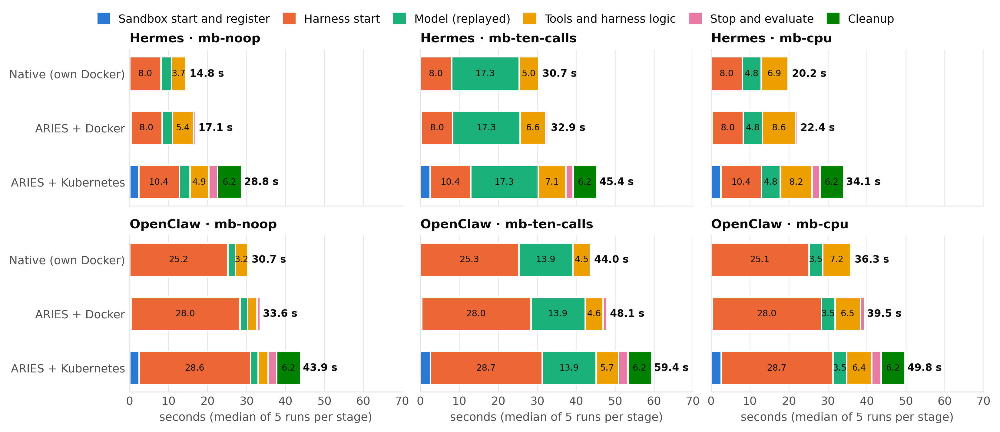
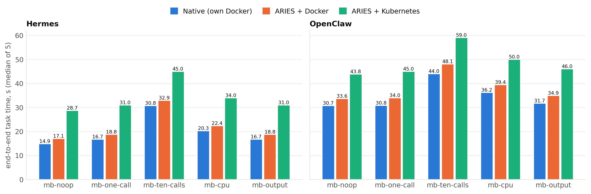
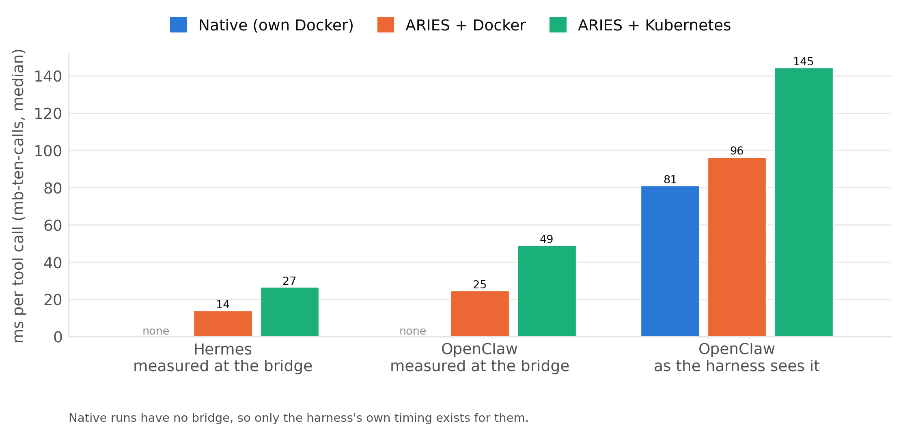
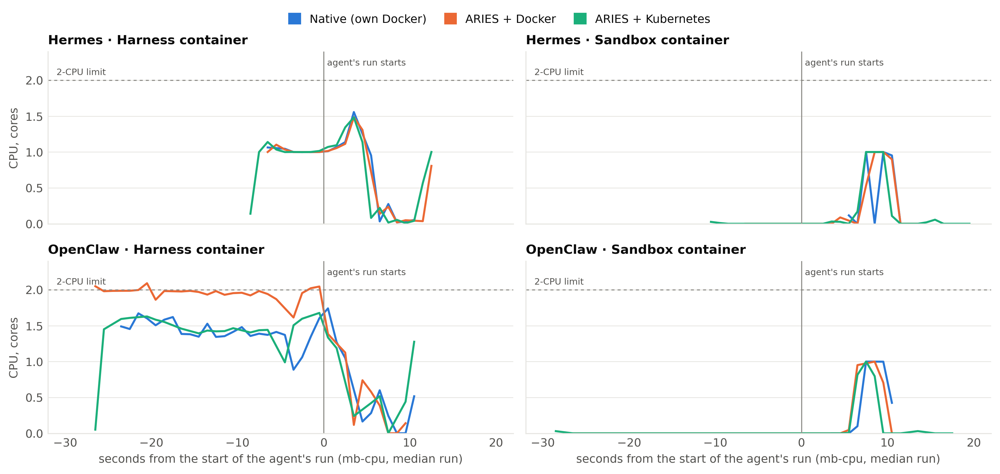
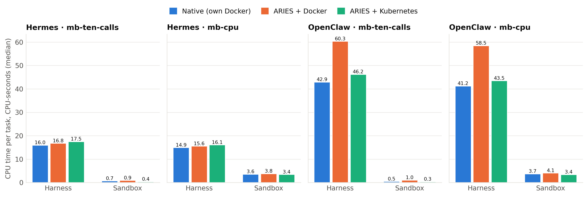
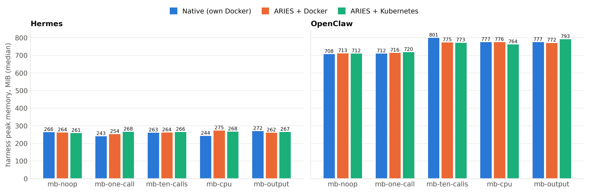

# Tool sandbox comparison: microbenchmark results

*Legacy result: written by hand before experiments were run with `scripts/experiment/`. Its runs, recordings and per-run analysis were not kept in this layout. The cold and warm experiment that followed is `results/coldwarm/20261102-e5-2640v4/`.*

## Setup

Three ways of giving an AI agent harness a sandbox for its tool calls were
compared, each with two harnesses (Hermes and OpenClaw):

| Setup | How tools run |
|---|---|
| **Native** | The harness's own Docker sandbox, with no ARIES involved (the baseline). |
| **ARIES + Docker** | ARIES creates the sandbox as a Docker container; the harness reaches it through ARIES's tool bridge, one long-running server per run. |
| **ARIES + Kubernetes** | The same, with the harness, sandbox and bridge as Kubernetes pods. |

**Controls**
- **Hardware:** one CloudLab worker node with SMT off, turbo boost off and the
  CPU clock pinned at 2.4 GHz.
- **Resources:** every harness and every sandbox limited to 2 CPUs and 4 GiB of
  memory.
- **Model:** the model's replies were recorded once per harness and then
  replayed with their original timing (aries-replay), so model time is
  identical in every setup. Every replayed request was answered from the
  recording.
- **Resource measurement:** CPU and memory were measured the same way in every
  setup, by a standalone cAdvisor sampled every second through Prometheus.

**Tasks**

| Task | What the agent does | What it isolates |
|---|---|---|
| `mb-noop` | Answers without running a command | Fixed start-up and tear-down cost |
| `mb-one-call` | Runs one command | Cost of one tool call |
| `mb-ten-calls` | Runs ten commands | How tool-call cost adds up |
| `mb-cpu` | Runs a CPU-heavy computation (3,000,000 SHA-256 steps) | Compute speed inside the sandbox |
| `mb-output` | Prints about 66 KB | Cost of returning large output |

Each task ran 5 times in each of the 6 combinations. All 150 task runs passed.
Figures show medians.

## Stages of a task

| Stage | Meaning |
|---|---|
| Sandbox start and register | Create the sandbox, copy the task in, register it with the bridge (ARIES only) |
| Harness start | Start the harness container and wait until it accepts work |
| Model (replayed) | Time spent waiting for model replies; identical by construction |
| Tools and harness logic | The rest of the agent's run: executing tools and the harness's own processing |
| Stop and evaluate | Stop the harness, revoke the bridge, run the task's checker |
| Cleanup | Delete the task's containers or pods |

Native creates its sandbox inside the agent's run, on the first tool call, and
has no separate stop step, so those stages are zero for it.

## How model calls are recorded and replayed

The model's replies are held constant by **aries-replay** (`cmd/aries-replay`,
logic in `pkg/model/replay/replay.go`). It is a small proxy that sits between
the harness and the model provider, DeepSeek. The harness is not aware of it:
the harness's model address points at aries-replay instead of at DeepSeek.

### Record mode (once per harness)

```
harness ──request──▶ aries-replay ──same request──▶ DeepSeek
harness ◀──reply──── aries-replay ◀──reply───────── DeepSeek
                          │
                          └─ saves the reply, with the time each piece arrived
```

1. **The request is forwarded unchanged.** The harness sends a normal
   OpenAI-style chat request, and aries-replay forwards it to
   `https://api.deepseek.com` with the harness's own API key.
2. **The reply is relayed as it streams in.** Each piece is passed straight to
   the harness. A copy is saved with its arrival time, in milliseconds after the
   request was received.
3. **The complete reply is saved under a key** that identifies its point in the
   conversation.
4. **Unfinished replies are not saved,** for example after a network error,
   because replaying one would give the agent half a turn. A reply the harness
   hung up on after receiving it whole is complete, so it is kept.

### The key: finding a reply again

| Part | What it is | Why |
|---|---|---|
| **Conversation** | A short hash of the first user message (the task instruction), with every run of digits replaced by `0` | Identifies the task. Folding the digits stops a timestamp the harness inserts from making each run look like a new task. |
| **Turn** | How many replies from the model are already in the conversation | Identifies the step: 0 is the first reply, 1 comes after the first tool result, and so on |
| **Tools** | How many tools the request offers | Separates the agent's main requests from side requests, such as Hermes asking for a session title with no tools offered |

The key deliberately leaves out the rest of the request. Tool output can differ
slightly between sandboxes, for example in a timestamp or a container name.
With a key covering the whole request, those runs would no longer find their
recorded replies. With this key, the same task at the same step always gets the
same reply.

### Replay mode (every comparison run)

1. **The key is computed** from each incoming request in the same way.
2. **The recorded reply is looked up.** DeepSeek is never contacted.
3. **The reply is sent with its original timing.** Each piece is held back
   until its recorded arrival time, so a reply that took 3.0 s to stream from
   DeepSeek takes 3.0 s again, with the same delay before the first piece.
4. **A request with no recording** is answered with HTTP 404 and logged as a
   miss. None of the 150 comparison runs had a miss.

Error replies are recorded too. One of Hermes's side requests is rejected by
DeepSeek (HTTP 400, "response_format type is unavailable"), and every replay
returns the same rejection, so Hermes takes the same path in every setup.

### Where the recordings are stored

On the worker node, under `~/aries/.cache/microbench-replay/`, one folder per
harness:

```
.cache/microbench-replay/
  openclaw/
    recordings.jsonl                        recorded replies (18)
    requests-docker-record-<time>.jsonl     every request made while recording
    requests-docker-replay-<time>.jsonl     every request in each replay run
    requests-k8s-replay-<time>.jsonl
    requests-native-replay-<time>.jsonl
  hermes/
    recordings.jsonl                        recorded replies (28)
    ...
```

- **`recordings.jsonl`:** one line per recorded reply. If a key was recorded
  twice, the first copy is used.
- **`requests-*.jsonl`:** one line per request, in either mode. Each line holds
  the time it arrived, the time to the first byte, the total duration, the key
  and, in replay, whether it was found. The analysis adds up these durations
  within each task's agent run to get that task's model time.

**How the harness is pointed at aries-replay:**
- **ARIES profiles** give the model address as `http://replay.local:8090/v1`.
  `scripts/microbench/run.sh` replaces `replay.local` with the node's IP and
  starts aries-replay in the requested mode.
- **The native baseline scripts** set the same address in each harness's own
  configuration.

### Example: one recorded model call

OpenClaw, task `mb-ten-calls`, the model's first reply, in which it decides to
run the first command. Its key is `d12ee4a99130e825/0/9`: this task, turn 0, 9
tools offered.

**1. The line in `openclaw/recordings.jsonl`.** The reply is stored as 131
pieces. Only the first two are shown here, and each piece's bytes are
base64-encoded:

```json
{
  "key": {"conversation": "d12ee4a99130e825", "turn": 0, "tools": 9},
  "recorded_at": "2026-10-25T05:46:45.68934816Z",
  "status": 200,
  "content_type": "text/event-stream; charset=utf-8",
  "chunks": [
    {"offset_ms": 401.117, "data": "ZGF0YTogeyJpZCI6ImIzZjIxZDYzLTcy…"},
    {"offset_ms": 956.279, "data": "ZGF0YTogeyJpZCI6ImIzZjIxZDYzLTcy…"},
    …
  ]
}
```

**2. Those pieces decoded.** They are DeepSeek's streamed reply, exactly as the
harness received it (long fields shortened):

```
401.117 ms   data: {"id":"b3f21d63-…","model":"deepseek-flash","choices":[{"delta":{"role":"assistant","content":null,"reasoning_content":""}}]}
956.279 ms   data: {"id":"b3f21d63-…","choices":[{"delta":{"reasoning_content":"The"}}]}
1005.763 ms  data: {"id":"b3f21d63-…","choices":[{"delta":{"reasoning_content":" user"}}]}
   …         (the model's reasoning, then the tool call's arguments, a few characters per piece)
3033.779 ms  data: {"id":"b3f21d63-…","choices":[{"delta":{"content":""},"finish_reason":"tool_calls"}],
                    "usage":{"prompt_tokens":10333,"completion_tokens":388,…}}
             data: [DONE]
```

Put together, the reply asks the harness to run one tool:

```
exec {"command": "echo 1 >> /tmp/mb-ten"}
```

**3. The same request in the logs**, while recording and then in a replay run
on ARIES + Docker:

```json
{"mode":"record","path":"/v1/chat/completions","key":{"conversation":"d12ee4a99130e825","turn":0,"tools":9},
 "received_at":"2026-10-25T05:46:45.68934816Z","first_byte_ms":401.117,"duration_ms":3033.836,
 "status":200,"request_bytes":39949,"reply_bytes":110183}

{"mode":"replay","path":"/v1/chat/completions","key":{"conversation":"d12ee4a99130e825","turn":0,"tools":9},
 "received_at":"2026-10-25T09:05:42.705341214Z","first_byte_ms":402.118,"duration_ms":3034.341,
 "status":200,"request_bytes":39949,"reply_bytes":110183,"hit":true}
```

The replay matches the recording to within a millisecond:

| | Time to first byte | Total time | Reply size |
|---|---|---|---|
| Recorded | 401.1 ms | 3033.8 ms | 110,183 bytes |
| Replayed | 402.1 ms | 3034.3 ms | 110,183 bytes |

The request was also identical in size (39,949 bytes), so the harness sent the
same conversation in both cases.

## Figures

Each figure is also saved as a PDF beside its PNG, for print. `figures.csv`
holds every plotted number, for a table beside the figures.

### Figure 1. Where a task's time goes



The fixed costs (harness start, Kubernetes pod creation and deletion) dominate
these short tasks. Model time is the same in every setup, by construction.
Each stage is the median of 5 runs, so the stacked totals can differ slightly
from the median end-to-end times in Figure 2.

### Figure 2. End-to-end task time



ARIES + Docker adds about 2–4 s per task over native. ARIES + Kubernetes adds
about 13–15 s.

### Figure 3. Time per tool call



- **At the bridge:** a command takes 14 ms (Hermes) and 25 ms (OpenClaw) on
  Docker, and roughly twice that on Kubernetes.
- **As OpenClaw sees it:** a call takes 81 ms natively, 96 ms through ARIES +
  Docker and 145 ms through ARIES + Kubernetes.

### Figure 4. CPU over time (`mb-cpu`)



Time is aligned at the start of the agent's run. The sandbox's burst (one core
for about 3.5 s) is the same in every setup, so compute inside the sandbox is
unaffected. The harnesses differ only during OpenClaw's start-up, where the
ARIES + Docker harness runs at its 2-CPU limit.

### Figure 5. CPU time per task



Measured from the containers' cumulative CPU counters. OpenClaw's harness uses
about 17 CPU-seconds more per task under ARIES + Docker than natively. The
other setups and the sandboxes are close to each other.

### Figure 6. Harness peak memory



Memory is the same across setups for both harnesses. Sandboxes peak at under
9 MiB in every setup, too small to share this scale; their values are in
`figures.csv`.

## Results

| | Native | ARIES + Docker | ARIES + Kubernetes |
|---|---|---|---|
| End-to-end time, Hermes | 14.9–30.8 s | +2.1–2.2 s | +13.7–14.3 s |
| End-to-end time, OpenClaw | 30.7–44.0 s | +2.9–4.1 s | +13.1–15.0 s |
| Time per tool call at the bridge (Hermes / OpenClaw) | none | 14 / 25 ms | 27 / 49 ms |
| Time per tool call as OpenClaw sees it | 81 ms | 96 ms | 145 ms |
| Harness CPU time per task, Hermes | 14.5–16.0 CPU-s | 15.1–16.8 | 16.1–17.5 |
| Harness CPU time per task, OpenClaw | 39.4–42.9 CPU-s | 56.6–60.3 | 41.7–46.2 |
| Harness peak memory, Hermes / OpenClaw | 243–272 / 708–801 MiB | 254–275 / 713–776 | 261–268 / 712–793 |
| Sandbox CPU and memory | equal across setups | equal | equal |

The Docker and Kubernetes columns give the difference from native for time,
and absolute values for the other rows.

### Where the overheads come from

**ARIES + Docker against native**
- **OpenClaw starts 2.8 s slower** under ARIES (28.0 s against 25.2 s). During
  start-up its harness container runs at its 2-CPU limit, where native runs at
  about 1.5 cores, and it uses about 17 CPU-seconds more per task. The likely
  cause, still to be confirmed, is ARIES's readiness check: it starts a new
  `node` process in the container every 100 ms, and those processes compete
  with the gateway for its CPUs.
- **Hermes starts in the same time** under ARIES as natively, but its agent run
  takes about 1.6 s longer whether it runs no commands or ten. That is a
  one-off cost per task, most likely setting up the SSH session and shell
  through the bridge.
- **Stopping and revoking the harness** adds 0.4–0.9 s. Native has no such step.
- **Each tool call** costs about 15 ms more for OpenClaw.

**ARIES + Kubernetes against ARIES + Docker**
- **Deleting pods takes 6.2 s per task**, against 0.1 s for Docker containers.
  This is the largest single cost.
- **Creating the sandbox pod** takes 2.6 s, against 0.3 s.
- **Harness start** is 2.4 s slower for Hermes and 0.6 s slower for OpenClaw.
- **Stopping** takes 1.1–2.0 s, against 0.4–0.9 s.
- **Each tool call** takes about twice as long, because a command goes through
  the Kubernetes API (`exec`) rather than the local Docker daemon.

**No difference between setups**
- the model's time, by design
- compute speed inside the sandbox
- the sandbox's CPU and memory
- the harness's memory

## Strengths and weaknesses

### Native (the harness's own Docker sandbox)

**Strengths**
- Lowest latency and fewest moving parts: no bridge, no separate stop step,
  and the sandbox is created only when the first tool runs.
- Lowest CPU cost for OpenClaw.

**Weaknesses**
- Each harness implements isolation its own way, which makes them hard to
  compare or control:
  - OpenClaw's sandbox has no network.
  - Hermes's has outbound network access and runs two sandbox containers
    per task.
  - The harness needs the host's Docker socket, which effectively gives it
    control of the host.
- No common record of tool calls. The per-call time exists only where the
  harness logs it (OpenClaw), so tool cost cannot be measured the same way
  across harnesses.
- Evaluation needs per-harness glue to find the harness's sandbox and run the
  checker in it.
- Single host only, with no scheduling or placement.

### ARIES + Docker

**Strengths**
- One sandbox model and one tool path for every harness: the same resource
  limits, the same network policy, and a per-call log measured at the bridge.
  The comparison between harnesses is fair by construction.
- The harness never holds the Docker socket. Its access to the sandbox is
  limited to the bridge and is revoked before the checker runs.
- Small overhead: about 2–4 s per task and about 15 ms per tool call over
  native. Most of it is start-up work that can be reduced (see the OpenClaw
  readiness check).

**Weaknesses**
- Still a single host.
- Adds a stop-and-revoke step (0.4–0.9 s) and a bridge hop on every tool call.
- The OpenClaw start-up path currently costs about 17 extra CPU-seconds per
  task. That matters when many tasks share a node.

### ARIES + Kubernetes

**Strengths**
- Everything ARIES + Docker provides, plus scheduling across a cluster,
  per-pod resource limits enforced by the kubelet, and standard tools for
  operating it.
- The way to run many tasks in parallel across nodes, which is what the
  throughput experiments will need.
- CPU and memory per task match native and Docker. Kubernetes adds no
  in-container overhead.

**Weaknesses**
- About 11–14 s more per task than ARIES + Docker. Pod deletion (6.2 s) and
  pod creation (2.6 s) dominate, so short tasks pay proportionally the most.
- Each tool call takes about twice as long (27–49 ms at the bridge, 145 ms as
  OpenClaw sees it), because every command goes through the Kubernetes API.
- More infrastructure to run: a cluster, a container registry and a metrics
  stack.

## Limits of these results
- **Short tasks:** these microbenchmarks last 15–60 s, so fixed costs dominate.
  On real benchmark tasks lasting minutes, the per-task overheads shrink
  relative to the total, while per-call costs grow with the number of tool
  calls.
- **One node, one task at a time:** contention between concurrent tasks is not
  measured yet; the throughput experiments will cover it.
- **Five runs per combination:** the spread across runs was small (for example,
  0.6 s for OpenClaw's harness start), but there are not enough runs for
  confidence intervals.
- **CPU measurement:** CPU over time is computed from cumulative counters in
  one-second bins. OpenClaw's ARIES + Docker harness reads 2.04–2.06 cores at
  its peak, which is its 2-CPU limit plus binning noise.
- **Native networking differs from ARIES's:** native OpenClaw has no network,
  native Hermes has outbound access, and ARIES puts the sandbox on its run
  network. No task here uses the network.

---
